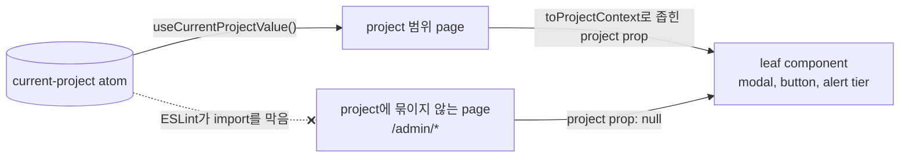

# 0001 — Explicit project prop contract for leaf components

## Summary

- leaf component(생성 modal, session 실행 button, mismatch alert)는 현재
  project를 **필수** `project` prop으로 받는다. leaf component는 ambient 값을
  `useCurrentProjectValue`로 직접 읽지 않는다.
- ambient project를 읽는 곳은 page뿐이다. page는 그 값을 `toProjectContext`로
  좁혀 아래로 넘긴다. project 범위 위에서 동작하는 page는 `null`을 넘기고, 각
  component tier가 `null`일 때 무엇을 그릴지 정한다.
- project에 묶이지 않는 `/admin/*` 화면은 `useIsProjectAgnosticPage()`로
  가린다. 그 화면에는 header selector가 mount되지 않고, ESLint 규칙이 그
  page들에서 ambient hook import를 막는다.

## 설계도



## Context

admin page(`/admin-session`, `/admin-deployments`, `/admin-data`)에서도 super
admin에게 header의 current-project selector가 보이고, 그 값은 표시 없이 이
page들이 보여 주는 내용과 생성 대상을 바꾼다. 모든 folder를 보던 super admin이
folder를 만들거나, session을 실행하거나, model을 deploy하면 그 결과물은
header에서 마침 선택된 project로 들어가고, super admin은 이를 알아채지 못한다.
project mismatch alert는 project 범위 위에서 동작하는 page에서는 개념상
상관없는 selector를 기준으로 뜬다.

근본 원인은 leaf component(생성 modal, session 실행 button, mismatch alert)가
ambient current project를 `useCurrentProjectValue`로 직접 읽는다는 데 있다.
page는 중첩된 component가 어느 project를 대상으로 삼을지 정할 수도 없고 볼
수도 없다.

FR-3407의 multi-agent 설계 review가 두 가지 대안 방식을 검토하고 기각했다.

- **React Context provider**: 전역으로 mount된 opener(예: folder-explorer
  opener)는 모든 route별 element 바깥에 있고, jotai에서 파생한 consumer에는
  Context가 닿지 않는다.
- **Route-derived atom-null layer**: component가 ambient state를 읽지 않게
  되면 필요 없다. 이 방식은 "보이지 않는 전역 값" 실패 양상도 그대로 남긴다.

## Decision

전환한 leaf component는 **필수** prop을 받는다.

```ts
project: { id: string; name: string } | null
```

그리고 **내부에서 ambient current project(`useCurrentProjectValue`)를 절대
읽지 않는다**. project context는 page가 정한다. page는 ambient hook을 읽는
유일한 곳이 되고 `project={currentProject}`를 명시적으로 넘긴다.

- **`id`와 `name` 모두 필수**: legacy REST API는 이름을 key로 쓰고(session 생성의
  `group_name`, preset 검사) GraphQL은 id를 key로 쓴다. 둘을 함께 실으면 leaf
  component 안에서 따로 조회할 필요가 없다.
- **`null`은 "ambient project context 없음"을 뜻한다**: super admin page가
  그 예다. component가 `null`로 하는 일은 tier에 따라 다르다.
  - **Modal tier**(생성 modal): modal 안에 필수 project selector를 직접 그린다.
    mutation은 정확히 선택한 project를 대상으로 삼는다.
  - **Button tier**(session 실행 button): 호출부가 준 이유(`noProjectTooltip`)와
    함께 disabled로 그린다. component 자신은 project가 왜 없는지 알지 못한다.
  - **Alert tier**(project mismatch alert): project 비교 UI를 아예 그리지 않는다.
- prop이 필수이므로 TypeScript가 모든 call site에
  project context(`project={...}` 또는 `project={null}`)를 정하게 한다. 빠뜨리면
  표시 없이 엉뚱한 project를 쓰는 bug가 아니라 compile error가 된다.
- **component에 닿는 화면이 항상 project 범위라면 Modal tier보다 "null 상태
  없음"을 택한다**: modal 안 selector는 감독용 화면이 project 없이 정당하게 열
  수 있는 component를 위해 있다. project 범위 menu에서*만* 생성을 제공하면
  `null`은 도달할 수 없는 상태이고, 이를 모델링하면 표시 없이 엉뚱한 project로
  가는 경로와 쓰이지 않는 selector UI가 생긴다. 이 경우 prop을 non-null
  `ProjectContext`로 만든다. 같은 component가 project가 필요 없는 mode도
  제공하면 props union으로 표현한다. 그리고 project가 없는 page는 그 동작을
  제공하지 않는다. FR-3410이 이 방식을 두 deployment 생성 modal에 적용했다.
  아래를 본다.

공유 contract type은 `react/src/types/projectContext.ts`에 있다
(`ProjectContext`, `ProjectContextOrNull`, 그리고 type이 느슨한 ambient 값을
좁히는 `toProjectContext` helper).

## Consequences

- admin이 아닌 page의 동작은 그대로다. 일반 page는 page 수준에서
  `useCurrentProjectValue`를 읽고 그 값을 명시적으로 아래로 넘긴다.
- admin page는 `project={null}`을 넘긴다. admin page에서는 header 선택을 표시
  없이 물려받지 않고, 사용자가 보이는 곳에서 의도적으로 project를 고른다. 실수는
  표시 없이 엉뚱한 project를 대상으로 삼지 않고 눈에 보이게 드러난다(사용자가
  채워야 하는 selector, disabled button).
- 전환한 leaf component를 _그리기만_ 하고 아직 전환하지 않은 중간 component는
  ambient hook을 계속 읽어도 된다. 다만 그 값을 명시적으로 넘겨야 한다. 전환할
  때마다 ambient read가 page 쪽으로 한 단계 올라가고, 결국 page만 읽게 된다.
- 전역 current-project atom, admin이 아닌 page용으로 그 atom에서 파생한
  resource-group atom, 명령형 client의 `current_group` mirror는 명시적으로
  건드리지 않는다.
- 첫 적용: `FolderCreateModalV2`(FR-3408). Modal tier이고 `null`이면 modal 안
  selector를 그린다.
- 두 번째 적용(FR-3410): 세 component 모두 Modal tier가 **필요 없는** 것으로
  드러났다. deployment는 항상 한 project 안에서 만들어지고 생성은 project 범위
  menu에서만 제공되기 때문이다.
  - `DeploymentSettingModal`: props union이다. 수정 전용 call site는 non-null
    `deploymentFrgmt`를 넘기고 `project`는 아예 넘기지 않는다. project 범위 call
    site는 non-null `project`를 넘겨야 한다. modal 안 selector가 없고, 도달할
    "project 없음" error 경로도 없다.
  - `VFolderDeployModal`: page에서 받은 non-null `project`가 필수다. folder를
    소유한 project는 의도적으로 참고하지 않는다. project-type folder에서 둘이
    어긋나는 것은 대상 선택 문제가 아니라 알림 문제다(나중에 막지 않는 alert를
    둘 수 있다). project context가 없는 page는 deploy 동작을 아예 제공하지 않는다.
  - `AdminModelCardSettingModal`: model card는 resolve한 model-store project에만
    만들어진다. ambient fallback은 지웠다.
- 세 번째 적용(FR-3411):
  - `ResourceAllocationFormItems`: form-fragment tier다. **non-null**
    `project: ProjectContext`가 필수다. selector는 부모가 소유하고, 이 prop이
    `accessible_scaling_groups` query, resource-group select, resource
    limit·preset 조회의 범위를 정한다.
  - `DeploymentAddRevisionModal`: derive-from-resource tier다. deployment 자신의
    `metadata.projectId`와 `projectV2` 이름이 model-folder picker, resource
    form, modal 안 folder 생성을 이끈다. project를 resolve하지 못하면 ambient로
    대체하지 않고 제출을 눈에 보이게 disabled로 둔다.
- 네 번째 적용(FR-3412): `FileBrowserButtonV2`와 `SFTPServerButtonV2`(button
  tier — 필수 `project: ProjectContextOrNull`과 `noProjectTooltip?`. `null`이면
  호출부가 준 이유와 함께 button을 disabled로 그린다. non-null이면 그 값이
  storage-host 권한 조회, project별 volume-host 조회(`useVHostInfo(projectId)`가
  ambient 파생 atom read를 대신한다), 생성되는 session의 대상을 정확히 그
  project로 정한다). `useStartSession`은 명시적 `projectName` 입력을 얻었다. 이
  입력은 `owner` 분기(`owner_access_key`와 묶여 있다)를 재사용하지 않고
  `group_name`을 고정한다. 이 입력을 생략한 호출부는 허용된 임시 상태로 ambient
  fallback을 유지한다. `FolderExplorerHeaderV2`는 prop을 그대로 넘긴다.
- 다섯 번째 적용(FR-3413) — 표시·gating tier:
  - `SessionDetailContent`(alert tier — 필수 `project: ProjectContextOrNull`.
    내부 ambient read와 "Project ID is required" throw를 지웠으므로 session
    detail은 project context 없이도 그려진다. `session.NotInProject` alert는
    non-null project가 넘어오고 session의 project가 그와 다를 때만 그려진다).
    `SessionDetailDrawer`, 여러 page가 쓰는
    `SessionDetailAndContainerLogOpenerLegacy`, `RecentlyCreatedSession`,
    `DeploymentReplicasCard`는 필수 prop을 그대로 넘기는 중간 component다. 일반
    page는 page 수준에서 ambient를 좁히고, super admin page(`/admin/session`,
    scheduler page)는 `null`을 넘긴다.
  - `DeploymentDetailPage`는 세 URL 공간을 담당한다. 이 component는 PAGE로서
    `useIsProjectAgnosticPage()`로 context를 정한다. admin URL 공간에서는
    `null`이고(mismatch alert 없음, `SwitchToProjectButton` 바로가기 없음,
    Add-revision CTA를 더는 숨기지 않음), 그 밖에서는 좁힌 ambient 값이다.
  - `EditableVFolderNameV2`와 `VFolderNodeDescriptionV2`: 소유권·role gating이다.
    두 gate는 같은 조건이 아니다.
    - **Rename**(`EditableVFolderNameV2`): folder 소유자나 `superadmin` role이
      필요하다. project가 관여하지 않으므로 component가 `isSuperAdmin`을
      `useCurrentUserProjectRoles()`에서 직접 읽는다.
    - **Mount-permission editing**(`VFolderNodeDescriptionV2`): FOLDER를 소유한
      PROJECT의 admin도 추가로 허용한다. 이 검사는 page가 준 값이 아니라
      folder 자신의 `ownership.projectId`를 기준으로 한다. domain admin은
      제외한다. domain admin은 project별 소유 권한을 암묵적으로 갖지 않는다.
      어느 gate도 `useEffectiveAdminRole`을 참고하지 않는다. 이 hook의 대상
      project는 ambient 값에서 온다. 그래서 두 gate에서 `project` prop이 완전히
      빠졌고, super admin 권한이 더는 header 상태에 따라 깜박이지 않는다.
  - 전역으로 mount된 `FolderExplorerModalV2`(아래 route-derivation 예외를 본다)는
    이제 folder가 project 소유이면 `useMergedAllowedStorageHostPermission`의
    기준을 folder 자신의 소유 project로 삼는다. user 소유 folder에서는 super
    admin route가 아닐 때만 ambient를 좁히고(임시), hook은 group-scope 조회를
    아예 건너뛰도록 `projectId: null`을 받는다.

  여섯 번째이자 마지막 적용(FR-3414) — route 전환:

  - **Header**: project selector block(label, `ProjectSelect`, selector에 묶인
    admin 나가기 confirm 흐름)을 `WebUIHeader`에서 `WebUIHeaderProjectSelect`로
    분리했고, 이 block은 `useIsProjectAgnosticPage()`가 false일 때만 mount된다.
    project에 묶이지 않는 route에는 이 block이 아예 없다. 그곳의 header에는
    current-project atom을 읽거나 쓰는 것이 없으므로, admin을 떠나면 사용자의
    이전 선택이 그대로 돌아온다. placeholder는 그리지 않는다. header의
    `justify="between"` layout이 왼쪽 slot을 깔끔하게 접는다(mobile menu button은
    남는다).
  - **Scope**: 전환은 처음에 FR-3407의 세 기능 page(`admin-session`,
    `admin-deployments`, `admin-data`)만 다뤘다. 지금은 project에 묶이지 않는
    `/admin/*` 화면 전체를 다룬다. 하위 tree를 감사해 render tree 어디에서도
    ambient current project를 읽지 않는 page 11개를 더 찾았으므로, 그곳에서
    selector를 숨겨도 동작이 바뀌지 않는다: `credential`(`/admin/users`),
    `resource-policy`, `scheduler`, `agent`, `project`, `settings`,
    `maintenance`, `diagnostics`, `rbac`, `branding`, `information`. admin key
    셋은 실제로 ambient state를 읽으므로 제외한다. `environment`(image 설치와
    resource-preset 흐름이 `SessionLauncherPage`에 닿는다)와
    `reservoir`(`ImportArtifactRevisionToFolderModal`이 ambient project를 읽고
    쓴다)는 둘 다 후속 ticket을 기다리고, `admin-dashboard`는 FR-3407 범위
    밖이다.
  - **Naming**: `SUPER_ADMIN_SCOPED_MENU_KEYS` / `useIsSuperAdminScopedPage` /
    `SUPER_ADMIN_SCOPED_PATHNAME_REGEX`의 이름을 `PROJECT_AGNOSTIC_MENU_KEYS` /
    `useIsProjectAgnosticPage` / `PROJECT_AGNOSTIC_PATHNAME_REGEX`로 바꿨다. 옛
    이름은 잘못 붙은 이름이었다. `admin-session`, `credential`,
    `resource-policy`는 `access: 'admin'`이어서 domain admin도 들어온다. 따라서
    이 page들을 정의하는 성질은 여는 데 필요한 role이 아니라 page가 동작하는
    범위다.
  - **`NoResourceGroupAlert`**(`MainLayout`에 전역으로 mount된다 — 허용된
    route-check 예외다)는 project에 묶이지 않는 route에서 `null`을 돌려준다.
    "이 project에 resource group이 없음"은 project 범위 경고이기 때문이다.
  - **Dev-mode straggler warning**: `window.location.pathname`이 project에
    묶이지 않는 화면과 맞을 때 `useCurrentProjectValue`를 읽으면, 이 hook이
    mount당 한 번 경고한다(dev build 전용이고 production에서는 dead code로
    제거된다). matcher(`PROJECT_AGNOSTIC_PATHNAME_REGEX`)는 손으로 쓰지 않고
    `PROJECT_AGNOSTIC_ROUTE_PATHS`에서 **파생한다**. 그래서 새로 gate한 key가
    생기면 matcher가 자동으로 넓어진다. matcher는 정식 `/admin/*` 모양과 legacy
    flat shim을 모두 다룬다. matcher는 명령형으로 남는다(router hook을 쓰지
    않는다). 그래서 이 hook은 router context 밖에서도 쓸 수 있다.
  - **One source of truth**: menu-key 목록, key→pathname map, 파생 regex는 leaf
    module `react/src/helper/projectAgnosticRoutes.ts`에 있다(leaf인 이유는
    그렇지 않으면 `useCurrentProject -> useRouteScope -> useCurrentProject`가
    import cycle이 되기 때문이다). menu key가 항상 path segment와 같지는 않으므로
    map을 명시적으로 쓴다. `credential`은 `/admin/users`로 resolve된다.
    `projectAgnosticRoutes.test.tsx`는 모든 정식 path와 legacy path를 실제 route
    tree(`mainLayoutChildRoutes`에 대한 `matchRoutes`)와 맞춰 본다. 그래서 route
    이름을 바꿔도 page의 gate가 표시 없이 풀리지 않는다.
  - **ESLint guardrail**: `react/eslint.config.js`는 project에 묶이지 않는
    source(`AdminSessionPage`, `AdminComputeSessionListPage`,
    `AdminVFolderNodeListPage`, `AdminDeploymentListPage`,
    `AdminDeploymentPresetListPage`, `AdminDeploymentPresetSettingPage`,
    `AdminModelCardListPage`, `PendingSessionNodeList`, `AdminUsersPage`,
    `ResourcePolicyPage`, `SchedulerPage`, `ResourcesPage`, `ProjectPage`,
    `ConfigurationsPage`, `MaintenancePage`, `DiagnosticsPage`,
    `RBACManagementPage`, `BrandingPage`, `pages/InformationPage/InformationPage`)에서
    `useCurrentProjectValue` import를 막고, 위반한 코드에 이 ADR을 가리킨다.
    `EnvironmentPage`, `ReservoirPage`, `AdminDashboardPage`(모두 전환에서
    제외)와 `DeploymentDetailPage`(허용된 page 수준 reader)는 제외한다.
  - **E2E**(`e2e/admin/header/`, `e2e/admin/data/`): 세 admin route에는 selector가 없고 user Data
    page에는 있다. admin을 떠나면 이전 선택이 돌아온다. admin Data page에서 만든
    folder는 modal 안에서 고른 project에 들어간다.

  일곱 번째 적용(FR-3415) — project에 의존하던 마지막 admin page 두 개로,
  `/admin/*` 화면을 마무리한다:

  - **Environments**(`EnvironmentPage`, `/admin/environment`): 이 page는 눈에
    보이고 URL에 저장되는 page 수준 project 선택을 얻었고,
    `ProjectSelectForAdminPage`를 쓴다(domain의 모든 project를 보여 준다. header의
    selector는 admin이 MEMBER인 project만 보여 주는데, admin 화면에는 맞지 않는
    집합이다). 선택은 `project` search param(project **id**)에 저장되고, page
    수준에서 `useAccessibleProjects`로 `{ id, name }`에 resolve된다. 이 hook은
    selector가 읽는 source와 같으므로 URL과 보이는 option이 어긋날 수 없고, 더는
    resolve되지 않는 id는 임의의 값이 아니라 filter 없는 view로 돌아간다.

    **기본값은 의도적으로 없고**, 필요하지도 않다. project는 전제 조건이 아니라
    **domain 전체 기본값 위의 선택적 filter**다. ambient project나 "첫
    project"로 기본값을 채우면 이 ADR이 없애려는 보이지 않는 범위 bug가 그대로
    돌아온다. 빈 상태("image를 보려면 project를 고르세요")를 두면 admin 화면이
    임의의 project를 고를 때까지 domain의 image를 보여 주지 않는다. 그래서 목록은
    항상 load된다. selector는 "All projects" placeholder가 있는 `allowClear`이고,
    선택을 지우면 URL에서 `?project=`가 빠지고 query가 domain 범위로 다시 돈다.

    **admin image 목록의 기본 범위는 DOMAIN scope다 — app에서 처음으로 project가
    아닌 `scope_id`다.** 다른 call site는 모두 `project:${...}`를 넘긴다.
    `image_nodes(scope_id: ScopeField!)`는 non-null이라 인자를 생략할 수 없지만,
    `ScopeField`는 TYPE이 `system | domain | project | user`인 `<TYPE>:<ID>`를
    parse한다(`src/ai/backend/manager/api/gql_legacy/fields.py:15`). 나머지
    조건을 모두 고정하고 live manager 26.7.0에서 확인했다: `system:` → image 149개,
    `domain:default` → 149, `project:<uuid>` → 149, legacy 무범위 `images` query →
    149, 즉 전체 집합이다. 범위의 넓이는 global이 아닌(project에 연결된) container
    registry에서만 달라지고, 그때 `domain:<name>` ⊇ `system:` ⊇ `project:<one>`이다.
    global registry의 image는 모든 범위에 나타난다. 잘못된 형태는 오류를 분명히
    낸다(`domain:nope` → "Domain not found").

    **`system:`보다 `domain:<current domain>`을 고른 이유**는 두 가지다:

    1. `system:`은 **호출자 자신의 project 소속**에서 계산되고, 실제 crash
       경로가 있다. 소속 project가 0개인 admin에게는 `IndexError`가 나서 HTTP
       500이 된다(`src/ai/backend/manager/models/image/row.py:1441-1443`).
    2. `/admin/environment`는 `access: 'admin'`이므로 **domain admin**도 들어온다.
       domain 범위는 이들의 권한과 정확히 맞는다. 반면 `system:`은 이 page가
       주장할 근거가 없는 넓이를 주장한다.

    `admin_images_v2`가 있지만 scope 인자를 받지 않으므로 대체재가 아니다. 이
    field가 scope 인자를 얻으면 다시 검토한다.

    **selector는 page의 card header가 아니라 Images tab 자체의 filter 행에
    있다.** project는 그 목록이 보여 주는 것을 좁히므로 content 범위
    control이다(`.claude/rules/use-bai-card.md`는 card의 `extra` slot을 card 범위
    동작에 쓰고 filter·sort·paging control은 body에 둔다). 또 selector가 필요한
    tab은 이것뿐이다. Registries는 domain 전체이고, resource preset에는 project
    차원이 아예 없다(아래를 본다). URL state는 여전히 page가 소유하고 id도
    page가 resolve한다. `ImageList`는 `project`와 `onChangeProject` callback을
    받을 뿐 project를 직접 정하지 않으므로 ADR 0001의 contract가 유지된다.

    그 아래의 consumer는 다음과 같이 전환했다:
    - `ImageList`: 필수 `project: ProjectContextOrNull`과
      `onChangeProject: (project: ProjectContextOrNull) => void`를 받는다.
      filter가 켜져 있으면 query scope가 `project:${project.id}`이고, 그렇지
      않으면 `domain:${baiClient._config.domainName}`이다. `null`은 error가
      아니라 평범한 상태다. 목록은 어느 쪽이든 load된다.
    - `ImageInstallModal`: **modal tier**이고 `project: ProjectContextOrNull`을
      받는다. image를 설치하면 batch session이 queue에 들어가고, batch session은
      항상 project가 필요하다. 하지만 목록이 domain 전체이므로 물려받을 project가
      항상 있지는 않다. `null`이면 modal이 자체 필수
      `ProjectSelectForAdminPage`를 그리고(`FolderCreateModalV2`,
      `DeploymentSettingModal`과 같은 pattern), project를 고를 때까지 OK는
      disabled로 남는다. 선택은 modal session state이고 열 때마다 초기화된다.
      project가 넘어오면 selector를 보여 주지 않고 그 project에 설치한다. 선택이
      비어 있을 때 설치 대상을 filter에서 빌려 오지 않는 것은 의도다. *동작*을
      켜려고 사용자가 *filter*를 바꾸게 하는 것은 이 epic이 없애려는 암묵적
      결합과 같다. 어느 경우든 `group_name`은 `baiClient.current_group`이 아니라
      resolve한 project에서 온다.

    **resource preset은 어느 tier에서도 `project` prop을 받지 않는다 — project
    차원이 없기 때문이다.** manager의 `resource_presets` table에는 project/group
    column이 없다. 이 table의 유일한 관계는 `ScalingGroupRow` 하나이고, row
    model이 의미를 직접 적는다: _`scaling_group_name`이 None이면 preset은
    global이다_(`src/ai/backend/manager/models/
resource_preset/row.py`). `data/schema.graphql`도 같다.
    `CreateResourcePresetInput`은 `resource_slots`, `shared_memory`,
    `scaling_group_name`만 싣고, `resource_presets` query는 project 인자를 받지
    않는다.

    따라서 project로 resource-group 선택지를 좁히던 동작은 전환할 ambient
    project 잔재가 아니라 **원래 있던 bug**였다. global preset을 수정하는 admin은
    자기 current project에 붙은 resource group만 고를 수 있었고 다른 resource
    group은 대상으로 삼을 수 없었다. 그래서 `ResourcePresetSettingModal`과
    `ResourcePresetList`는 **project prop을 아예 싣지 않고**, modal은
    `BAIAdminResourceGroupSelect`(project와 무관한
    `resourceGroups(first, after, filter)` connection)로 admin 범위에서 resource
    group을 나열한다. 빈 resource group이 바로 manager의 global preset이므로 이
    field는 `allowClear`로 남는다.

  - **Reservoir**(`ReservoirArtifactDetailPage`, `/admin/reservoir`):
    `ImportArtifactRevisionToFolderModal`은 derive-from-resource tier다. artifact
    import는 항상 MODEL STORE project에 들어가므로, 이제 대상은 page가 resolve한
    model-store project에서 온다. fragment는 `@relay(plural: true)`가 됐고,
    page는 `groups[0]`을 임의로 고르지 않고 모두 넘기며, 둘 이상이면 modal 안
    selector를 그린다. **`useSetCurrentProject`를 호출해 admin 화면에서 전역
    project 선택을 MUTATE하던 "Change Project" `Popconfirm`을 지웠고**, 이를
    보여 줄지 정하던 ambient read도 함께 지웠다. model-store project가 없으면
    modal 안 folder 생성 button은 project 변경을 제안하지 않고 이유와 함께
    disabled가 된다.
  - **Gating**: `environment`와 `reservoir`가 `PROJECT_AGNOSTIC_MENU_KEYS`에
    들어갔다(정식 path와 legacy path 포함. reservoir 항목은 prefix이므로
    `/:artifactId` 자식도 포함된다).
  - **Fourth copy removed**:
    `e2e/admin/header/admin-header-project-selector.spec.ts`는 처음 세 route만
    다루는 자체 local `SUPER_ADMIN_ROUTES` 상수를 갖고 있었다. 이제 이 spec은
    목록을 `react/src/helper/projectAgnosticRoutes.ts`(의도적인 leaf module이라
    Playwright에 import해도 비용이 없다)에서 파생하고, 모든 test cluster에서
    navigate할 수는 없는 feature-flag gate page 셋(`scheduler`, `rbac`,
    `reservoir`)을 뺀다.
  - **ESLint guardrail**: `EnvironmentPage`, `ReservoirPage`,
    `ReservoirArtifactDetailPage`를 제외 집합에서 제한 file 목록으로 옮겼다.

  **backend에 project 차원이 없는** component(위의 resource-preset editor)는 이
  ADR의 어느 tier에도 속하지 않는다. 맞는 답은 tier를 고르는 것이 아니라 project
  배관을 통째로 지우는 것이다. ambient read가 project 범위 resource를 뜻한다고
  가정하기 전에 manager의 data model을 확인한다.

- Dashboards (#10583): `admin-dashboard`가 `/admin/dashboard` route로
  `PROJECT_AGNOSTIC_MENU_KEYS`에 들어갔으므로, 이제 제외된 `/admin/*` key는 없다.
  `AdminDashboardPage`는 프로젝트 관리자 route에서 URL 프로젝트
  (`useUrlProjectValidity`)를, superadmin route에서 `null`을 넘기고,
  `DashboardPage`는 page 수준 프로젝트를 넘기며, `DashboardPanelBoard`는 그 값을
  filter context로 모든 카드에 전한다. `AdminDashboardPage`와
  `components/DashboardPanels/**`는 ESLint 제한 file 목록에 있다.

## route에서 정하는 project context (`useIsProjectAgnosticPage`)

`react/src/hooks/useIsProjectAgnosticPage.ts`는
`PROJECT_AGNOSTIC_MENU_KEYS`(`react/src/helper/projectAgnosticRoutes.ts`에서
정의)를 re-export하고, 현재 route가 project에 묶이지 않는 page인지 알려 주는
hook을 노출한다. 이 hook은 가장 깊은 route의 `handle.menuKey`를 기준으로 삼고,
prefix 없는 legacy path에는 pathname fallback을 쓴다.

```
admin-session  admin-deployments  admin-data  admin-dashboard  credential
environment    resource-policy    reservoir   scheduler        agent
project        settings           maintenance diagnostics      rbac
branding       information
```

`admin-dashboard`는 프로젝트 관리자 대시보드(`/project/:projectName/admin/dashboard`)도
가리킨다. 이 route는 프로젝트 범위이고 프로젝트를 URL에서 받는다. 이 key의
`/admin/dashboard` route만 project에 묶이지 않으므로, hook은 key와 함께 `admin`
route scope도 요구한다(#10583).

호출할 수 있는 곳:

- **Pages**(예: 한 component로 세 URL 공간을 담당하는 `DeploymentDetailPage`):
  page는 허용된 ambient reader이고, page 수준의 route-scope 검사는 또 하나의
  page 수준 입력일 뿐이다.
- **Globally-mounted components with no page parent**(예: router root에 한 번
  mount되는 `FolderExplorerModalV2`): 이 component는 어떤 page에서도 `project`
  prop을 받을 수 없으므로, route를 참고하는 것이 유일하게 맞는 신호다. 이것이
  허용된 유일한 예외다.

전환한 **leaf component는 이 hook을 호출하면 안 된다**. leaf component는 필수
`project` prop으로 결정을 받는다. route를 참고하는 leaf는 이 ADR이 없애려는
보이지 않는 전역 값 실패 양상을 다시 들여온다.

## 지키는 방법 (새 component와 전환한 component의 checklist)

1. 먼저 `null`에 도달할 수 있는지 정한다. component를 열 수 있는 화면을 모두
   나열한다. 모두 project 범위라면 **non-null `project: ProjectContext`**를
   받고(component가 project 없는 mode도 제공하면 props union) 2단계로 넘어간다.
   그렇지 않으면 `project: ProjectContextOrNull`을 **필수** prop으로 추가한다. 둘
   다 `react/src/types/projectContext.ts`에서 import한다.
2. component 안의 모든 `useCurrentProjectValue` import와 read를 지운다.
3. `ProjectContextOrNull`을 남겼다면 자기 tier의 `null` 동작(selector /
   disabled / 숨김)을 구현한다. non-null project를 받았다면 project가 없는 화면이
   그 동작을 제공하지 않게 한다. type이 이미 배제한 runtime "project 없음" error
   경로는 절대 추가하지 않는다.
4. project 이름 기반 gating은 ambient project가 아니라 넘겨받은(또는 modal 안에서
   고른) project를 기준으로 삼는다.
5. 일반 call site에서는 page 수준에서 ambient project를 읽고
   `project={toProjectContext(currentProject)}`를 넘긴다.
6. contract test를 추가한다: (a) `project`가 주어지면 내장 selector가 없고
   mutation variable이 정확히 그 project를 싣는다. (b) component가 `null`을
   받으면 그 tier의 동작이 그려진다. 외부 동작(들어가는 props, 나오는 render
   결과와 mutation variable)만 test하고, 어떤 hook이 호출되는지는 절대 test하지
   않는다.

## 출처

- FR-3407(epic). FR-3408, FR-3410, FR-3411, FR-3412, FR-3413, FR-3414,
  FR-3415(적용 순서대로이며, 마지막으로 `/admin/*` 화면이 완성된다). #10583(대시보드).
- 결정일: 2026-07-29.
