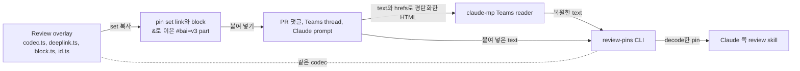

# 0002 — Pin set link grammar and a single codec

## Summary

- pin set은 하나의 link 안에서 `&`로 반복되는 `#bai=v3` part다:
  `#bai=v3.<id1>.<anchor1>&bai=v3.<id2>.<anchor2>…`. pin 하나는 N=1인 경우이고
  기존 link와 byte 단위로 같으므로 version을 올리지 않는다.
- 이 형식을 읽는 곳은 하나다. review overlay의 자체 codec이 읽고, 이 codec은
  `pnpm run review-pins` CLI로 노출된다. Claude 쪽 review skill은 재구현을
  유지하지 않고 이 CLI를 실행한다.
- claude-mp의 Teams transport는 붙여 넣은 text를 복원해 CLI에 넘기기만 한다.
  transport는 pin을 직접 parse하지 않는다.

## 설계도

## Context

dev review overlay는 pin 하나를 `<path>?<query>#bai=v3.<id>.<anchor>`와
markdown block으로 복사한다. reviewer는 한 번에 여러 pin을 만들고, 모든 pin을
한꺼번에 보여 주는 link 하나와 함께 댓글 하나로 넘기기를 원한다. 이 fragment는
wire format이다. reviewer가 이 fragment를 PR 댓글, Teams thread, Claude
prompt에 붙여 넣고, 이 overlay와 Claude 쪽 review skill이 다시 읽는다. 그래서
link가 밖에 퍼진 뒤에는 grammar를 바꾸기 어렵다.

## Decision

pin set은 **기존 part를 `&`로 구분해 반복한 형태**로 싣는다:
`#bai=v3.<id1>.<anchor1>&bai=v3.<id2>.<anchor2>…`. part는 set 순서를 따르고,
link의 path와 query는 첫 pin에서 가져온다. pin 하나는 N=1인 경우이고 오늘의
link·block과 byte 단위로 같다. version은 올리지 않는다.

이 형식을 **읽는 곳은 하나**다. overlay의 자체 codec
(`react/vite-plugins/review-overlay/client/codec.ts`, `deeplink.ts`,
`block.ts`, `id.ts`)이 읽고, 이 codec은 Node CLI(`pnpm run review-pins`)로
노출된다. Claude 쪽 skill은 자체 재구현을 유지하지 않고 Web UI checkout에서 이
CLI를 실행한다.

claude-mp에 남는 것은 형식 앞단의 **transport**다. Teams는 붙여 넣은 block을
HTML로 그리고, Teams reader는 그 HTML을 다시 text로 평탄화한다. 이때 인용
표시는 사라지고 link는 별도의 `hrefs[]`로 옮겨진다. 따라서 이 복원 작업은
pin의 구조가 아니라 Teams의 구조를 따르고, transport는 CLI를 복제하지 않고
CLI에 입력을 넘긴다.

## 대안과 기각 사유

- **`v4` set envelope**: 모든 anchor를 압축한 blob 하나에 담는 방식이다. URL이
  짧아지고(deflate가 반복되는 route와 landmark를 공유한다) set 단위 metadata를
  둘 자리가 자연스럽게 생긴다. 하지만 grammar가 둘이 되고, `v3` link를 위한
  legacy 경로가 영구히 남고, 잘린 link는 전부 decode되거나 전혀 decode되지
  않고, 모든 reader를 고쳐야 한다. set 단위 metadata가 실제로 필요해질 때까지
  기각한다. 그날이 와도 `&` 반복은 v4와 나란히 유효하다.
- **Python 재구현 유지**: claude-mp의 `pin_parser.py`를 TypeScript codec과 손으로
  맞춰 두는 방식이다. 기각한다. multi-pin 변경을 두 번 넣어야 하고, 두 구현은
  이미 주석에서 어긋나 있었다.

## Consequences

- `deeplink.ts`는 목록을 parse한다. app 자체의 fragment part도 함께 실리고
  보존된다.
- pin의 `at`(따라서 id)은 set이 복사될 때가 아니라 pin이 set에 들어갈 때
  정해진다. 그래서 커지는 set을 다시 복사해도 id는 그대로 나온다.
- fragment 길이는 pin 수에 비례해 늘어난다(pin 하나당 약 300–500자). 30 pin의
  soft cap이 link를 어디에나 붙여 넣을 수 있는 길이로 유지한다.
- 각 block은 자기 pin의 link를 싣고, set link는 마지막 block 뒤에 한 번만
  나온다. 모든 block에 set link를 반복하면 댓글 크기가 O(N²)가 되기 때문이다.
  30 pin에서 371 KB가 되고, 13 pin부터 GitHub 댓글 한도인 65,536자를 넘는다.

## 출처

- FR-3313(epic)과 그 아래의 pin set ticket. FR-3855가 CLI를 넣었다.
- 결정일: 2026-09-04.
