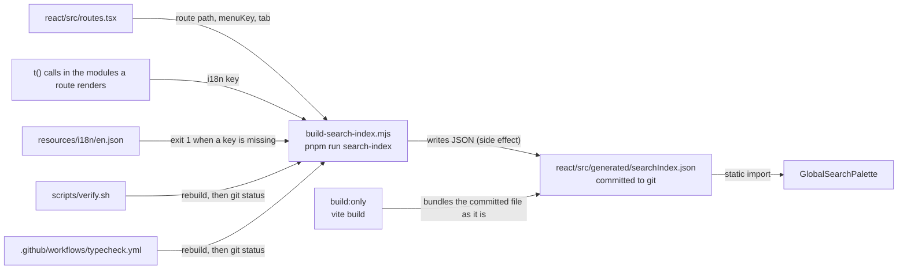

# 0003 — Committed search index artifact

## Summary

> Unfamiliar terms are collected in the [Glossary](#glossary) at the end.

- The global search palette reads the index `react/src/generated/searchIndex.json`. `react/scripts/build-search-index.mjs` builds that index from `react/src/routes.tsx` and from the i18n keys of the modules each route renders, and the index is committed to git.
- The committed file is the only source. The production build (`build:only` in `react/package.json`) bundles this file as it is and does not build it again.
- Two gates catch the state where the committed file no longer matches the source ([drift](#glossary)). The "Search index" step of `scripts/verify.sh` and the "Check for drift in the search index" step of `.github/workflows/typecheck.yml` both build the index again, and each fails when `git status` shows the file as dirty.
- Nobody resolves a merge conflict in this file by hand. A structural merge driver (`scripts/merge-search-index.mjs`) merges the file entry by entry first. Its result is provisional, so a check compares it with a regenerated index and reports any difference. When the driver cannot resolve a conflict, the developer takes either side and builds the index again, as `.claude/rules/search-index-conflicts.md` describes.
- The extractor never enters `packages/backend.ai-ui/`, because that path matches `EXTERNAL_PREFIXES`. The extractor therefore does not index the BUI locale keys.

## Context

- **Why an index exists**: Every route is a `React.lazy` chunk, so the text of other pages is not in the DOM when the palette opens. For this reason `build-search-index.mjs` builds the index from the source. The index holds i18n keys instead of strings, so all 22 locales work without a second indexing run.
- **What the artifact is**: `searchIndex.json` is a function of `routes.tsx`, of the `t()` calls in the modules each route imports transitively, and of the CONFIG block of the extractor. Two builds from the same source are identical byte for byte (`searchIndex.test.ts` asserts this). When the extractor reports an esbuild or import-scan failure as a warning, some import edges can be missing from that run, and the result can differ. A diff from a run with that warning is therefore treated as a problem of the run environment, not as drift.
- **What was wrong**: Before this decision, `build:only` also built the index again on every build. The build therefore succeeded even when the committed file had drifted. The drift gate in `verify.sh` is a local check that CI does not run, so nothing stopped a drifted committed file. The index that reviewers read could differ from the index that shipped.
- **Cost of committing**: Almost every PR that changes user-facing text also changes this large JSON file, so every stack rebase produces a conflict. One FR-3558 stack needed three regeneration commits.

## Diagram

## Decision

### 1. The artifact is committed to git

- **Location**: The file is `react/src/generated/searchIndex.json`. It is not in `react/src/__generated__/`, because relay-compiler deletes every file in that directory that it does not own. `.claude/rules/review-ignored-paths.md` records this constraint.
- **Version field**: The `version` in the JSON is the extractor's `INDEX_VERSION`, and `generatedFrom` is the extractor's `GENERATED_FROM`, which is the input file `react/src/routes.tsx`. When the shape changes, the same PR raises `INDEX_VERSION` and updates the type in `searchIndex.types.ts`.
- **Generated marks**: Three files mark this artifact as generated.

| File                                    | What it does                                                                             |
| --------------------------------------- | ---------------------------------------------------------------------------------------- |
| `.gitattributes`                        | It marks the file `linguist-generated=true`, so GitHub collapses it in diffs.            |
| `.prettierignore`                       | It excludes the file from formatting.                                                    |
| `.claude/rules/review-ignored-paths.md` | It excludes the file from review and points reviewers at `routes.tsx` and the extractor. |

### 2. The build uses the committed file as it is

- **Build script**: `build:only` in `react/package.json` runs only `pnpm run relay` and `vite build`. It does not contain `search-index`.
- **Guard**: `searchIndex.test.ts` asserts that `build:only` in `react/package.json` does not contain `search-index`.
- **Single source**: The file that `GlobalSearchPalette` imports statically through `searchIndex.types.ts`, the file a reviewer saw in the diff, and the file that goes into the bundle are all the same committed file.

### 3. Two gates check for drift, one local and one in CI

- **Local gate**: `check_search_index_drift` in `scripts/verify.sh` runs `pnpm run search-index` and fails when the file appears in `git status --porcelain`.
- **CI gate**: `.github/workflows/typecheck.yml` runs `pnpm run search-index` after relay-compiler. Its "Check for drift in the search index" step has the same shape as the Relay drift step and runs the same check.
- **Shared script**: Both gates use one script, `scripts/check-generated-drift.sh`, for the diff. `verify.sh` and `typecheck.yml` pass it only a label, the command that fixes the drift, and the path to check.
- **Trigger paths**: The path filter of `typecheck.yml` includes `resources/i18n/en.json`, because the extractor checks the keys in the index against `en.json`.

### 4. Every key the index references must exist in en.json

- **Fatal check**: When a key in the index does not exist in `resources/i18n/en.json`, the extractor exits with code 1 before it writes the file. This check stops a mistyped key from appearing as a raw key in the palette.
- **Allowlist**: A key that is left out on purpose goes into the extractor's `KNOWN_MISSING_KEYS`, together with the reason. The list is empty today.

### 5. A structural merge driver resolves conflicts first, and regeneration gives the final result

- **Merge driver**: `.gitattributes` assigns `merge=search-index` to this file. `scripts/merge-search-index.mjs` matches the entries of the base, ours, and theirs indexes by `path` and merges them three-way. It merges `keys` and `descriptionKeys` as sets, and it merges `tabs` (`param=key`) and `settings` (group and key) member by member. It sorts and serializes with `react/scripts/search-index-format.mjs`, the same module the extractor uses. This module has no dependencies, so the driver runs even when `node_modules` is missing or when the extractor itself is in conflict.
- **Fallback**: The driver leaves git's ordinary conflict markers and exits with code 1 in these cases: the `version` values differ, both sides changed the same scalar, tab, or setting differently, one side changed an entry that the other side deleted, or a side is not JSON. In that case the developer takes either side, runs `pnpm run search-index`, and stages the result, as `.claude/rules/search-index-conflicts.md` describes.
- **Provisional result**: The index is a function of the merged source, not of the three indexes. `keyPlacement` places a key by the number of pages that own it, so a key that the driver kept can disappear after regeneration. For this reason the driver leaves a marker at `search-index-merge/pending` under the git dir when it succeeds. `scripts/search-index-merge-check.mjs` runs only when that marker exists. It regenerates the index into a temporary file, compares it with the index in `HEAD`, and prints the branch name and `pnpm run search-index` when they differ. This check does not touch the working tree and never fails. The two drift gates of decision 3 catch anything this check misses.
- **Registration**: Git keeps a merge driver in the git config, not in the tree. The `prepare` script in the root `package.json` therefore registers `merge.search-index.driver` through `scripts/register-merge-drivers.mjs`. In a checkout without the registration, and in GitHub's server-side merge, git uses the ordinary line merge as before. The report-only lane "Merge drivers" in `verify.sh` lists every driver that `.gitattributes` declares but the git config does not contain.

## Rejected alternatives

- **Ignore the artifact and generate before every consumer**: The file goes into `.gitignore`, and a generation step runs before `tsc`, vitest, build, and dev. The advantage is that the conflicts disappear. This alternative is rejected for two reasons. `searchIndex.types.ts` imports the file statically, so `tsc` and vitest fail in a fresh checkout until the file is generated. The Relay artifacts in this repository already follow the "commit plus drift gate" convention, and this alternative would make the two artifacts follow different rules.
- **Regenerate inside the build**: `build:only` builds the index again every time. This was the state before this decision. The advantage is that the bundle is always up to date. This alternative is rejected because nothing fails when a drifted committed file is merged.
- **Fail the build on drift**: The extractor gets a `--check` option, and `build:only` fails when the committed file differs from a new build. The advantage is that a different index can never ship without notice. This alternative is rejected because the CI drift step already catches the same case at the PR stage, and a check in the build stage would duplicate it.
- **Rebuild once at dev boot**: `scripts/dev.mjs` runs the extractor once at startup. This was the original decision of 2026-09-09. The advantage is that the palette shows a new route even when a developer forgets to regenerate the index and restarts the dev server. FR-3925 removed it for three reasons. That run happened only once per boot, so it did not follow edits made during a session. It added about 3 seconds to the boot path. When the extractor emitted an esbuild or import-scan warning, that run could produce an index that lacked entries the committed file had.

## Consequences

- **Skipped verify is caught**: When a PR did not run `verify.sh`, `typecheck.yml` still catches drift and keys that are missing from `en.json`.
- **Advisory in CI**: `typecheck.yml` cannot become a required check, because its path filter works at the event level. A PR that does not match the filter gets no check run at all. However, the filter entries `react/**` and `resources/i18n/en.json` cover every input of the index, so every PR that can change the index starts this workflow. The only remaining gap is that a developer can merge with the check still failing, and the Relay drift check has the same gap.
- **Dev server does not rebuild**: `pnpm run dev` serves the committed file as it is. A developer who changes `routes.tsx` or a `t()` key and wants to see the change in the palette runs `pnpm run search-index` by hand. When the developer forgets, the two drift gates above catch it.
- **BUI is not indexed**: The extractor's `EXTERNAL_PREFIXES` filters out `packages/backend.ai-ui/`, so the extractor does not enter it, because BUI uses its own i18next instance and its own locale files in `packages/backend.ai-ui/src/locale/`. As a result, for a route whose UI BUI components draw, the extractor indexes only the host-side keys, and the search results for that route are thin.

## Sources

- Jira: FR-3558 (global search palette). GitHub: the review of #8811 (2026-09-09), `react/package.json:99`, and question (1) in the review body.
- Decided 2026-09-09.
- Revised 2026-09-15 in FR-3925 (#9645): the regeneration at dev-server startup was removed.
- Revised 2026-10-30 in #10716: decision 5 gained the structural merge driver and the check of the provisional result. Regeneration still gives the final result.
- Related: `.claude/rules/search-index-conflicts.md`, `.claude/rules/review-ignored-paths.md`. No neighbouring ADR exists.

## Glossary

| Term  | Meaning                                                                                                                                                                                                |
| ----- | ------------------------------------------------------------------------------------------------------------------------------------------------------------------------------------------------------ |
| drift | Drift is the state where the committed artifact differs from an artifact built fresh from the current source. `verify.sh` and `typecheck.yml` rebuild the artifact and detect drift with `git status`. |
