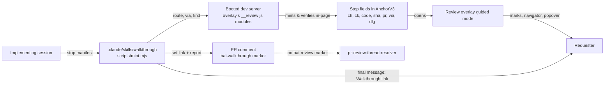

# 0004 — Walkthrough stops in the v3 anchor

## Summary

> Unfamiliar terms are collected in the [Glossary](#glossary) at the end.

- A **Stop** is one pin that the implementing session leaves to record what
  changed and what to check. A Stop is a bundle of optional fields added to
  the existing v3 anchor (ADR 0002). There is no v4 envelope: a v4 envelope
  would be three times smaller, but it adds one more grammar, so it is
  deferred.
- The overlay resolves a Stop **strictly**: the landmark must match, and the
  `dlg` flag limits the candidates to elements inside an open dialog. A
  measured false positive, in which a stop for a closed modal took its
  position from a look-alike element outside the modal, is the reason the
  overlay does not use the looser reviewer-pin resolution for stops.
- The codec owns one **volatile-query denylist** and removes parameters such
  as `formValues` from the query of every anchor, reviewer pins included.
- A walkthrough is **capped at 20 stops**. GitHub's 65,536-character comment
  limit sets that cap, not the link itself.
- The PR comment carries one marker,
  `<!-- bai-walkthrough v1 pr= sha= stops= server= -->`. The marker only
  makes the comment idempotent on a re-mint. The actual guarantee that
  `pr-review-thread-resolver` does not read stops as findings is a codec-side
  rule: `review-pins parse` in `cli.ts` excludes stops (that is, anchors that
  carry `ck`) from the findings by default.
- Guided mode borrows the grammar of the docs PR preview
  (`packages/backend.ai-docs-toolkit/templates/assets/pr-preview.{js,css}`)
  as a design. Sharing an implementation with the Web UI overlay is out of
  scope.
- A link opens guided mode only when **every** part is a stop. A walkthrough
  opened that way is a separate read-only set that the overlay never merges
  into the reviewer's draft set. A Shadow-root tracking box draws each Mark
  and does not paint the visible element directly. The cross-page `›`
  prefers the host app's own router over a full reload.
- The trigger is a webui-owned skill (`.claude/skills/walkthrough/`), and the
  implementing session runs it itself. The trigger is not a change to the
  shared `dw`/`fw` plugins, and it is not a notification. This decision is a
  narrow re-examination of the "no ✅ What to check comment" decision of spec
  R3.1 (2026-09-01), in the shape that spec R3.9 left open: it is a new
  ticket, not a revival of the stopped Teams reply.

## Context

The pin set of the review overlay (ADR 0002) carries the remarks of one
reviewer. This decision extends the same anchor to also carry a
[**Stop**](#glossary): a pin that the _implementing_ session, not a reviewer,
creates to record what it changed and what the requester should check. An
ordered set of Stops is a [**Walkthrough**](#glossary). These terms, together
with [**Mark**](#glossary) (the tinted element that guided mode draws instead
of a pin glyph) and [**Navigator**](#glossary) (the bottom-right pill that
steps through the stops), are also defined in
`react/vite-plugins/review-overlay/CONTEXT.md`.

A Stop must fit within the existing budget of the anchor. The overlay must
resolve it reliably against DOM that renders behind tabs and dialogs. The
Stop must reach the PR as a comment that GitHub accepts and that the
review-thread resolver ignores. Spec Revision 3 (R3.1, R3.9) already ruled
out an automatic "what to check" comment and an end-of-run notification for
the shared implementation workflow. This decision re-examines only the first
ruling, and only for a mechanism with a different trigger; R3.9 stays as it
is.

## Diagram

## Decision

### 1. Additive stop fields and no v4 envelope

A Stop adds optional keys to `AnchorV3`
(`react/vite-plugins/review-overlay/client/types.ts`), and the cap of each key
is in `client/stop-guard.ts`:

| field         | meaning                                                                                                                                                                                                                                                                             | cap                 |
| ------------- | ----------------------------------------------------------------------------------------------------------------------------------------------------------------------------------------------------------------------------------------------------------------------------------- | ------------------- |
| `ch`          | What changed                                                                                                                                                                                                                                                                        | ≤280 characters     |
| `ck`          | What to check, written as the expected result                                                                                                                                                                                                                                       | ≤280 characters     |
| `old` / `new` | The diff line in the popover                                                                                                                                                                                                                                                        | ≤40 characters each |
| `type`        | `'added'` or `'modified'`                                                                                                                                                                                                                                                           | fixed enum          |
| `kind`        | A short element kind                                                                                                                                                                                                                                                                | ≤64 characters      |
| `code`        | 1–3 `{path, line, to?}` code references                                                                                                                                                                                                                                             | 1–3 items           |
| `sha`         | The full head at the time the stop was created                                                                                                                                                                                                                                      | 40 hex digits       |
| `pr`          | The PR for which the stop was minted                                                                                                                                                                                                                                                | positive integer    |
| `via`         | A replayable step list; each step is one of `{click: {text?, tid?}}`, `{fill: {tid?, label?, value, enter?}}`, or `{select: {tid?, label?, option}}` (FR-4103). The overlay only guides with sentences and on-screen hints; it never clicks, types, or selects on the user's behalf | ≤8 items            |
| `dlg`         | The element was picked inside an open dialog                                                                                                                                                                                                                                        | literal `1`         |

`pr` is always present, so a static build without a boot record can still
build code links. `decodeAnchor` drops an optional field whose type does not
match instead of rejecting the anchor; `isStop(anchor)` decides by whether
`ck` is a string. Today's `decodeAnchor` and the `review-pins` CLI already
accept and preserve these keys as they are, so this is the "no version bump"
case of ADR 0002.

| variant                                            | worst case, in characters                        |
| -------------------------------------------------- | ------------------------------------------------ |
| Today's reviewer note, 280 Korean characters       | 760                                              |
| `ch`+`ck` at 280 Korean, 3 code refs, `sha`, `pr`  | 1,263                                            |
| `ch`+`ck` at 280 English, 3 code refs, `sha`, `pr` | 792                                              |
| v4 envelope, same content                          | not applicable: 3× smaller per set, not per stop |

A v4 envelope is three times smaller at 30 stops (12.3K vs. 36.1K
characters), but it adds one more grammar and leaves a permanent legacy path
for v3 links. The v4 envelope is deferred until a cap higher than 20 stops is
actually needed.

### 2. Strict resolution and the volatile-query denylist

For a Stop, `resolve.ts` accepts a text-scan candidate only when the
candidate's landmark `data-testid` matches the stop's. `tid` is an optional
base-anchor field (from ADR 0002), not a Stop-only field. For that reason, a
stop with no `tid` at all has no landmark to match, and `resolve.ts` falls
back to an unrestricted text scan of the whole document instead of failing.
For a stop with `dlg: 1`, `resolve.ts` accepts a candidate only when it is
inside `DIALOG_SELECTOR` (`dialog, [role="dialog"], [role="alertdialog"]`,
which covers both Astryx's own native `<dialog>` and the `alertdialog` of
ui-common `Modal`). This rule follows a measured false positive: while a
modal was closed, a stop for that modal "took its position" from the Active
button on the Data page. The text fallback matched a look-alike without a
landmark check, and opening the modal did not move the mark to the real
element. An unconfirmed stop stays in the "waiting" state instead of pinning
the wrong element.

`client/stop-guard.ts` holds a shared, codec-owned denylist of volatile query
parameters (`VOLATILE_QUERY_PARAMS`, with `formValues` first) and the
`stripVolatileQuery` helper that removes them from a query string.
`client/anchor.ts` removes them at capture time. `pathNeedsChange` in
`deeplink.ts` and the link ranking in `cli.ts` both remove them from the
anchor's query _and_ from the actual URL before comparing, so every
comparison point agrees, reviewer pins included. The `formValues` JSON of the
session launcher alone produced a 1,047-character anchor, and the launcher
rewrites it on every keystroke. When the overlay compared only the raw query,
a pin that had just been created flipped to "away" at once.

While a walkthrough stop is selected and unconfirmed, `pin.ts` re-arms
resolution not only on the landing ladder and on route changes, as it does
today, but also on DOM mutations outside the overlay host. Without this, a
dialog that opens without changing the URL could not trigger resolution
again.

### 3. The 20-stop cap and the comment length budget

GitHub's 65,536-character comment body is the real limit, not the anchor or
the URL. With 20 Korean stops, a comment that carries one set link in the
header, with no per-stop link in each block, reaches about 38K characters.
The same shape with a per-stop link on every block reaches about 62K, which
is close enough to the limit to fail with heavier stops. For that reason, a
walkthrough is capped at 20 stops, separately from the 30-pin cap of the
reviewer pin set (ADR 0002).

### 4. Code link format and the sha-drift warning

A stop's code link needs no commit SHA to resolve: the overlay renders it as
`<repo>/pull/<pr>/files#diff-<sha256(path)>R<line>[-R<to>]`, and the PR's
Files tab answers it regardless of the current head. `<repo>` is
`ReviewServerState.repo` (`/__review/state`), and `repoUrl()` turns it into a
GitHub URL. Only when the state has no `repo` at all does the link fall back
to `https://github.com/lablup/backend.ai-webui`; it is not a hardcoded
constant. Line drift after a rebase is accepted. The stop's own `sha` field
is the value that lets the overlay warn when the server serves a different
commit from the one at which the stop was created.

### 5. The codec's stop-exclusion rule, not the marker, separates stops from `bai-review`

Each PR has one comment, and that comment carries exactly one marker,
`<!-- bai-walkthrough v1 pr=<pr> sha=<sha> stops=<n> server=<app> -->`. The
skill finds the comment by the marker and edits it in place on a re-mint.
The marker's only role is to make the comment idempotent; it does not keep
`pr-review-thread-resolver` away from stops. That guarantee comes from
`review-pins parse` in `cli.ts`: unless `--include-stops` is given, it
excludes anchors that carry `ck` (stops, Decision 1) from the findings by
default. As a result, stops are invisible to the resolver whether or not the
marker is present, and the shared `claude-mp` resolver needs no change. A
reviewer comment left inside a walkthrough's guided-mode popover is still
exported as an ordinary `bai-review` block (Decision 12 removes the stop
fields first, so the exported anchor has no `ck` and the same exclusion rule
does not apply), with a `re: stop k · <id>` line. The resolver therefore
keeps reading those blocks as it always does.

### 6. Guided mode borrows the docs PR preview grammar as a design

The overlay's guided mode follows the visual and interaction grammar of the
docs PR preview
(`packages/backend.ai-docs-toolkit/templates/assets/pr-preview.{js,css}`).
Guided mode consists of tinted Marks with a dashed outline and an ordinal
badge, the bottom-right Navigator pill, a per-stop popover, the
`n`/`p`/`v`/`m`/`c` keys, and a page banner that also carries the
stale-server warning. This borrowing is a design reference, not shared code:
the docs preview is a global-CSS IIFE tied to the docs DOM, and the Web UI
overlay is a Shadow-DOM module tied to `#bai=v3`. Merging the two
implementations into one module is later work and is outside the scope of
this decision.

### 7. A link opens guided mode only when every part is a stop

`applyFragment` (`main.ts`) decodes each part of a `#bai=v3` link and checks
`isStop` on all of them; guided mode opens only when the number of parts
equals the number of stops. If even one part is not a stop, the whole link
takes the existing path that merges into the draft set. A walkthrough is not
a mode that a caller picks with a flag: a link becomes a walkthrough when
every anchor in it carries `ck`. When a stop has lost `ck` (through a hand
edit, or a decode that dropped a mistyped field), the overlay reopens that
link as an ordinary pin set instead of a broken walkthrough.

### 8. The walkthrough set is separate from the draft set

A walkthrough lives under its own `sessionStorage` key, separate from the
reviewer's draft set. The overlay neither merges it into the draft set nor
includes it in the dock's "Copy all". Its progress (which stops the reviewer
has seen and which comments the reviewer has typed) lives separately in
`localStorage`, keyed by the walkthrough's `sha` (or by a fixed fallback key
when no stop has a sha). As a result, when the skill re-creates the
walkthrough for a new push, the seen state starts over. A page reload keeps
the walkthrough open: the overlay reads the stored set before it applies the
incoming hash, and when the incoming hash itself carries a walkthrough, that
walkthrough replaces the stored one. Every storage read and write is wrapped,
so a reviewer can walk a walkthrough in a tab where storage is disabled,
though nothing persists across reloads. The only way out is the `Exit`
action in the ☰ panel (`Escape` closes only the popover and the panel).
Exiting clears the session-scoped set and every mark. The progress in
`localStorage` remains, so reopening the same link brings back what the
reviewer has already seen.

### 9. A Mark is a tracking overlay, not element styling

Guided mode draws each mark as its own box inside the overlay's Shadow root
and positions the box to follow the target element's rect. The box sits
below the reviewer's own pin layer, so the reviewer's pins stay visible
while a walkthrough is open. The box does not receive pointer events; the
only clickable part of a mark is its ordinal badge, not the element beneath
it. The element itself gets only `data-bai-change` and `data-bai-type`, plus
`role` and `aria-label` when the element does not already have them. Guided
mode records which of these it added, so on exit it removes exactly what it
added and leaves what the app originally gave the element.

### 10. Cross-page moves prefer the host's router

The host publishes a `navigate` function on the same `window.__BAI_REVIEW__`
object on which it publishes the route label (`DevReviewRouteLabel.tsx`,
through `useWebUINavigate`). Guided mode's `›` calls that function first.
Only when the function is missing or throws does guided mode fall back to
`location.assign`, which does a full reload with the stop's own set link.
That link carries the whole walkthrough, so the page returns to guided mode
on arrival.

### 11. `/__review/state` reports the head being served

The page banner can warn that a walkthrough was made for a different commit
only when it knows what the server is serving now. `/__review/state` gains an
optional `head` field: the checkout's `git rev-parse HEAD`, or `null` outside
a checkout. The banner turns into a warning only when `head` is present, the
walkthrough has a real `sha`, and no stop's `sha` matches `head`.

### 12. Comment export removes the stop fields and rewrites stops as ordinary pins

`✎ Copy N comments` (`Copy ref` for a single one) rewrites each stop that has
a comment as an ordinary reviewer pin. It removes all 11 stop-only fields
from the anchor (`ch`, `ck`, `old`, `new`, `type`, `kind`, `code`, `sha`,
`pr`, `via`, `dlg`), so the exported anchor has no `ck` and reads as an
ordinary pin, not a stop. The reviewer's own comment becomes that pin's note.
Each exported block uses the existing reviewer-pin format with a
`re: stop k · <id>` line, and no set link follows: the export is N separate
remarks, not one set. The exported anchor no longer carries `ck`, so the stop
exclusion rule of `cli.ts` (Decision 5) does not apply here. As a result,
`pr-review-thread-resolver`, the CLI, and the Claude-side skills read each
exported comment as an ordinary finding, with no new parsing on their side.

### 13. Trigger: a webui-owned skill, not the dw/fw plugins

A skill that this repository owns, `.claude/skills/walkthrough/`, mints
walkthroughs. The implementing session calls it as the last step of its
workflow, after the PR's dev server has booted and been advertised, and a
person can also call it on request for any PR that has a live server. The
`dev-server` skill itself does not change: minting is not a new side effect
of booting; the walkthrough skill is a caller of the boot record. The shared
`dw`/`fw` plugins do not change, and there is no notification: the final
chat message gains one line of the form `[Walkthrough](<set link>) · N stops`,
and nothing is posted to Teams.

This is a narrow re-examination of the "no ✅ What to check comment" decision
of spec R3.1 (2026-09-01, driver Jongeun Lee, FR-3814 Not Planned). The
comment that spec R3.1 ruled out was one that the shared `dw:impl`
orchestrator posted automatically on every implementation run. A
walkthrough, by contrast, is triggered by a repository-owned skill and is
limited to changes that are visible on screen and reviewable; it is not a
status update. The "not planned" ruling of spec R3.9 on end-of-run
notifications stays as it is: minting a Walkthrough posts no Teams message.
Instead of landing silently, this reversal is reported to the previous
driver through [FR-3947](https://lablup.atlassian.net/browse/FR-3947).

## Rejected alternatives

- **A v4 envelope for every stop.** The comment becomes shorter (three times
  at 30 stops), but the envelope adds one more grammar and leaves a permanent
  legacy path for v3 links. It is rejected until the 20-stop cap itself must
  rise.
- **Loose (reviewer-style) resolution for stops.** This matches today's
  reviewer pins, but the measured false positive, in which a stop for a
  closed modal took its position from a look-alike element, showed that a
  wrong pin is worse than a stop that stays "waiting". It is rejected in
  favor of the strict landmark-and-dialog check.
- **An encoder CLI fallback for minting.** This would let a developer create
  stops without a live dev server. It is rejected: the skill mints and
  verifies every stop headlessly against a running server, or does not mint
  it at all, because nothing verifies that the element of a CLI-made anchor
  exists.
- **A per-stop dev link inside the PR comment.** This matches the per-block
  link convention of ADR 0002 reviewer pins, but a link on every block of a
  20-stop Korean walkthrough reaches about 62K characters, which is close to
  the GitHub limit. It is rejected: the comment carries one set link, and the
  Navigator walks the rest.
- **One guided-mode implementation shared by the docs PR preview and the Web
  UI review overlay.** This would remove the duplication that the borrowed
  guided mode creates, but the two run on different DOM and styling bases.
  It is rejected for this decision; a shared implementation is later work.
- **Reviving the end-of-run Teams notification of spec R3.9 for the
  walkthrough trigger.** The shape that the notification would have taken,
  one message at the end of an implementation run, became possible again now
  that the trigger is owned by the repository, not by the shared
  orchestrator. It is rejected: R3.9 stays stopped, and the only delivery
  channels of a Walkthrough are the PR comment and the final chat message.
- **Merging stops into the draft set and drawing them as ordinary pin
  cards.** This needs no new set, storage key, or mode switch. It is
  rejected: opening someone else's walkthrough would silently grow the
  reviewer's own draft set, and "Copy all" would send content the reviewer
  never wrote as a PR comment. A walkthrough must be read-only by structure,
  not by convention.
- **Drawing marks by injecting global CSS into the reviewed document.** This
  is the shortest path, and the earliest prototype used it. It is rejected:
  the overlay's styling leaks into the page under review, and nothing can
  prove that every trace is removed on exit. A Shadow-root tracking box
  paints nothing on the app's own elements or stylesheets. Only the semantic
  attributes that Decision 9 names touch the app's DOM, and guided mode
  removes them on exit.
- **A comment-only export format** (the prototype's plain
  `[walkthrough] …` text block). This format is easier to read on its own.
  It is rejected: neither `pr-review-thread-resolver`, nor the `review-pins`
  CLI, nor the Claude-side skills can read it, while all three already read
  the existing block format.
- **Always using `location.assign` for cross-page moves.** This needs no
  cooperation from the host app. It is rejected: a full reload on every `›`
  loses the resolution ladder that stops hidden behind a modal depend on, and
  the whole app loads again at every step. Preferring the host's own router
  avoids both.

## Consequences

- `react/vite-plugins/review-overlay/client/types.ts`, `resolve.ts`,
  `stop-guard.ts`, and `pin.ts` gain the Stop-only fields, the resolution
  rules, and the denylist. The reviewer-pin path is unaffected apart from the
  shared denylist.
- `.claude/skills/walkthrough/` becomes a new caller of the overlay's
  in-page anchor-minting module and of the `dev-server` boot record. This
  decision changes neither of them.
- The minting skill must shorten or group a walkthrough longer than 20
  stops. Until someone builds the v4 envelope, no escape hatch exists for a
  larger set.
- The enforcement point is `review-pins parse` in `cli.ts`, which excludes
  stops from the findings by default, so `pr-review-thread-resolver` needs
  no change to stay safe from walkthrough comments.
- A developer must now keep the visual language of guided mode in line with
  the docs PR preview by hand, because the two share no code.
- A reviewer can still drop and copy pins from the dock as usual while a
  walkthrough is open; the two sets do not interfere with each other.
- The minting skill needs no separate mode flag: giving every stop `ck` is
  what opens the link as a walkthrough, and when one stop loses `ck`, the
  overlay reopens the whole link as a pin set.
- Guided mode runs a mutation observer alongside the resolution ladder,
  because for a stop behind a modal or a launcher step, the route does not
  change as expected through the ladder alone.
- An element that already has `role`/`aria-label` keeps only its own
  semantics for screen readers; screen readers do not read the mark's
  ordinal position on such an element.

## Sources

- [FR-3941](https://lablup.atlassian.net/browse/FR-3941) (wayfinder map) and
  its resolved decisions,
  [FR-3942](https://lablup.atlassian.net/browse/FR-3942) (payload and budget),
  [FR-3943](https://lablup.atlassian.net/browse/FR-3943) (headless
  minting and strict resolution),
  [FR-3944](https://lablup.atlassian.net/browse/FR-3944) (guided mode),
  [FR-3945](https://lablup.atlassian.net/browse/FR-3945) (walkthrough
  skill), and [FR-3946](https://lablup.atlassian.net/browse/FR-3946) (PR
  comment). Decided 2026-09-15.
- FR-3947 — reports the R3.1 re-examination to the previous driver.
- FR-3950 — the guided-mode implementation (mark, navigator, popover,
  storage separation, host-router navigation, comment export,
  `/__review/state`), decisions 7–12 above.
- FR-3949 — the volatile-query denylist applied at every comparison point
  and the widened `DIALOG_SELECTOR`, decision 2 above (commit `3c4507c74`).
- Prototype: branch `proto/FR-3944-guided-mode`,
  `walkthrough-guided-mode.html` variant D. The visual tokens are borrowed
  from `packages/backend.ai-docs-toolkit/templates/assets/pr-preview.css`.
- Related: ADR 0002 (the v3 anchor and pin-set grammar that this decision
  extends); spec `pr-devserver-review.md` Revision 3 (R3.1, R3.8, R3.9) and
  Revision 4, `lablup/frontend-board`.

## Glossary

- **Stop** — A Stop is one pin inside a Walkthrough that carries what
  changed, what to check, and the code references for the change. Full
  definition: `react/vite-plugins/review-overlay/CONTEXT.md`.
- **Walkthrough** — A Walkthrough is the ordered set of Stops that the
  implementing session leaves on the dev server. Full definition:
  `react/vite-plugins/review-overlay/CONTEXT.md`.
- **Mark** — A Mark is the tinted, changed element that guided mode draws
  instead of a pin glyph. Full definition:
  `react/vite-plugins/review-overlay/CONTEXT.md`.
- **Navigator** — The Navigator is the bottom-right pill that steps through
  the stops. Full definition: `react/vite-plugins/review-overlay/CONTEXT.md`.
