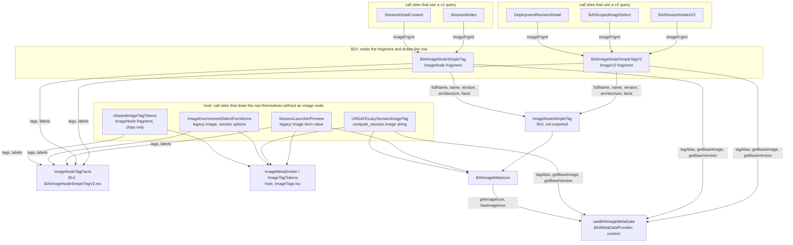

# 0005 — Container image meta row

## Summary

> Unfamiliar terms are collected in the [Glossary](#glossary) at the end.

- A screen that shows the identity of one container image uses the BUI component that matches the schema of the image node. `BAIImageNodeSimpleTagV2` in `packages/backend.ai-ui/src/components/fragments/BAIImageNodeSimpleTagV2.tsx` draws a v2 `ImageV2` node, and `BAIImageNodeSimpleTag` in the same folder draws a v1 `ImageNode`. Both draw the image's icon, name, version, architecture, tag chips, and a control that copies the full reference, on one line.
- The two components take only three props: `imageFrgmt`, `withoutTag`, and `copyable`. Each component derives the name, version, architecture, chips, and the string to copy from the node that the fragment read. No prop passes a string.
- A place that uses a v2 query uses the v2 component, and a place that uses a v1 query uses the v1 component. When a place needs the fragment, it spreads the fragment into its query.
- On a screen without an image node, the host draws a row of the same shape itself. Three screens are in this group: the form value in the review step of the session launcher, the `compute_session.image` string in the session detail, and the legacy `Image` object in the environment select dropdown. For the divider and the chips they use `ImageMetaDivider` and `ImageTagTokens`, which `react/src/components/ImageTags.tsx` exports.
- One BUI function, `imageNodeTagFacts`, decides whether a tag chip is drawn as a [double tag](#glossary) or as a single token. The v1 component, the v2 component, and the host all draw chips from the same facts, and no prop lets a caller choose the chip colour.
- BUI does not export the divider or the chips separately. They are local components of the `ImageNodeSimpleTag` module, which both components share, and BUI does not export that module either. When code uses Astryx `Divider` with `orientation="vertical"` directly, its height collapses to 0 inside `BAIFlex`, so that module fixes the divider's metrics.
- The Full image path column shows a reference string, not a row. It is drawn with `BAIText monospace copyable ellipsis`.
- The lowest manager this repository supports is 26.4.x, and [extended image info](#glossary) is turned on from 24.12.0. All image displays for managers older than that were therefore deleted.
- Out of scope: three screens do not draw an image row. They are the environment list in the environment select dropdown, the image string that the session launcher takes as manual input, and the short label in the session template table.

## Context

- **What the components are**: `BAIImageNodeSimpleTagV2` reads a v2 `ImageV2` fragment and draws the row of one image. `BAIImageNodeSimpleTag` reads a v1 `ImageNode` fragment and draws the same row. Neither one calls the other. `ImageNodeSimpleTag` in the same folder draws the markup of the row from strings and chip facts that it receives as props, and both components call it. The barrel does not export `ImageNodeSimpleTag`.
- **Why a decision is needed**: The same image reference `cr.backend.ai/stable/python-tensorflow:2.15-py39-cuda12.4-ubuntu20.04@x86_64` looked different on each screen. The six places below each drew that image in their own way.

| Location                                                                      | How it drew the image                                                                                                                                                                                                                                                                               |
| ----------------------------------------------------------------------------- | --------------------------------------------------------------------------------------------------------------------------------------------------------------------------------------------------------------------------------------------------------------------------------------------------- |
| `react/src/components/ImageNodeSimpleTag.tsx`                                 | An icon, three parts drawn with `BAIText`, a `Divider` used directly, tag chips, and `BAIText copyable`                                                                                                                                                                                             |
| `packages/backend.ai-ui/src/components/fragments/BAIImageNodeSimpleTagV2.tsx` | An icon, three parts drawn with Astryx `Text`, a `Divider` used directly, tag chips, and `BAIText copyable`                                                                                                                                                                                         |
| `react/src/components/SessionLauncherPreview.tsx`                             | One copy of the same row for each `supportExtendedImageInfo` branch. The file used `ImageMetaDivider` and `ImageTagTokens` from FR-3544, but the two branches assembled the icon, the three parts, and the copy control separately, and the copy control was `CopyValueIconButton` inside this file |
| `UNSAFELazySessionImageTag` in `react/src/components/ImageTags.tsx`           | A different shape, not a row. The name and the version as a blue/green double tag, and the base image and the architecture each as a badge                                                                                                                                                          |
| The Full image path column in `react/src/components/ImageList.tsx`            | A reference string. `BAIText copyable ellipsis`, not monospace                                                                                                                                                                                                                                      |
| The Full image path column in `react/src/components/CustomizedImageList.tsx`  | A reference string. `BAIText monospace copyable`, no ellipsis                                                                                                                                                                                                                                       |

- **Collapsed dividers**: `ImageNodeSimpleTag` and `BAIImageNodeSimpleTagV2` used `Divider orientation="vertical"` directly with `marginInline: 0`. The vertical Astryx `Divider` has `height: 100%`, and the default of `BAIFlex` is `align="center"`, so that height collapsed to 0. As a result, the divider was not visible at all in the session list and the session detail. `ImageMetaDivider`, which FR-3544 created in `ImageTags.tsx`, already fixed these metrics, but only the session launcher path used it.
- **Four copies of the chip rule**: The rule that decides a double tag was copied in four places: `imageTagFacts` / `imageNodeTagFacts` in `ImageTags.tsx`, `AliasedImageTagTokens`, `ImageNodeSimpleTag`, and `BAIImageNodeSimpleTagV2`. The chip colour also differed. `ImageTagTokens` from FR-3544 hard-coded blue. The other three passed `undefined` or the caller's `color` for a tag that was not customized, and `badgeVariantForTagColor` returned neutral for it. Only `ImageList` passed `color="blue"`, so the same Tags column was blue in `ImageList` and neutral in `CustomizedImageList`.
- **Divergent type scale**: `ImageNodeSimpleTag` drew each part with `BAIText`, and the other two places drew the parts with Astryx `Text`. `BAIText` uses the metrics of the antd era, and Astryx `Text` uses the Astryx type scale and colours.
- **A host twin of the icon**: `react/src/components/ImageMetaIcon.tsx` remained as a component that did the same work as BUI's `BAIImageMetaIcon`. It was a same-purpose twin, which `.claude/rules/bui-component-home.md` forbids.
- **Two schemas, two kinds of query**: `image_nodes`, `customized_images`, and `KernelNode.image` return the v1 `ImageNode`, and `adminImagesV2`, `SessionV2.images`, and `Revision.imageV2` return the v2 `ImageV2`. The session launcher's `images` is a legacy `Image` object that is neither of the two, and `ComputeSession.image` is a string. One fragment cannot cover these four inputs.

## Diagram

## Decision

### 1. Each schema has one component, and each component takes only three props

| component                 | fragment                                     | name                                | version                     | architecture            | string to copy                                         |
| ------------------------- | -------------------------------------------- | ----------------------------------- | --------------------------- | ----------------------- | ------------------------------------------------------ |
| `BAIImageNodeSimpleTagV2` | `BAIImageNodeSimpleTagV2Fragment on ImageV2` | `tagAlias(getBaseImage(reference))` | `getBaseVersion(reference)` | `identity.architecture` | `identity.canonicalName` with `@architecture` appended |
| `BAIImageNodeSimpleTag`   | `BAIImageNodeSimpleTagFragment on ImageNode` | `tagAlias(base_image_name)`         | `version`                   | `architecture`          | `registry/namespace:tag` with `@architecture` appended |

- **Same three props**: The two components take only `imageFrgmt`, `withoutTag`, and `copyable`. `withoutTag` removes the chips and the divider before them, and `copyable={false}` removes the copy control. Call sites have used these names since the antd era, and `.claude/rules/component-props-extension.md` says that this vocabulary must not change.
- **Everything else is derived**: No prop passes the name, version, architecture, chips, or the string to copy. The v2 `identity.canonicalName` does not contain the architecture, so the component extracts the name and the version from the reference with `@architecture` appended. `architecture` is nullable in both schemas, so the component does not append `@` when it is missing.
- **No string input**: No entry point draws a row from strings. When a node exists, the call site spreads the fragment. When no node exists, the host draws the row (decision 3). When the props need to grow, a separate issue handles it.
- **Provider requirement**: The icon, the alias, and the split into base name and version come from `useBAIImageMetaData`, so the two components must sit inside `BAIMetaDataProvider`. The host app wraps the whole app in that provider in `react/src/components/DefaultProviders.tsx` and passes `imagePath="resources/icons"`.

### 2. The v2 component is used only with v2 queries, and the v1 component only with v1 queries

| call site                                      | type the query returns           | component                                                    |
| ---------------------------------------------- | -------------------------------- | ------------------------------------------------------------ |
| The Environments column of `BAISessionNodesV2` | `SessionV2.images` → `ImageV2`   | `BAIImageNodeSimpleTagV2 withoutTag copyable={false}`        |
| The popup options of `BAIScopedImageSelect`    | `scopedImagesV2` → `ImageV2`     | `BAIImageNodeSimpleTagV2 copyable={false}` as `labelContent` |
| The Image of `DeploymentRevisionDetail`        | `Revision.imageV2` → `ImageV2`   | `BAIImageNodeSimpleTagV2`                                    |
| The Environments column of `SessionNodes`      | `KernelNode.image` → `ImageNode` | `BAIImageNodeSimpleTag withoutTag copyable={false}`          |
| The Environments of `SessionDetailContent`     | `KernelNode.image` → `ImageNode` | `BAIImageNodeSimpleTag`                                      |

- **Spread the fragment**: A call site spreads `...BAIImageNodeSimpleTagV2Fragment` or `...BAIImageNodeSimpleTagFragment` into the image node of its own query and passes that node as `imageFrgmt`. The call site does not rebuild the node as a plain object.
- **Never cross**: A call site does not pass a v1 `ImageNode` to the v2 component or a v2 `ImageV2` to the v1 component. The fragment type prevents it.

### 3. On a screen without an image node, the host draws the row itself

| call site                                                | what it has                                           | what it draws                                                                                                                |
| -------------------------------------------------------- | ----------------------------------------------------- | ---------------------------------------------------------------------------------------------------------------------------- |
| The Image of `SessionLauncherPreview`                    | The legacy `Image` form value from the `images` query | An icon, `tagAlias(base_image_name)`, `version`, `architecture`, chips, and `BAIText copyable`                               |
| `UNSAFELazySessionImageTag`                              | The `compute_session.image` string and `architecture` | An icon, `tagAlias(getBaseImage(...))`, `getBaseVersion(...)`, and `architecture`. It has no tags, so it has no chips        |
| The version options of `ImageEnvironmentSelectFormItems` | A legacy `Image` object                               | `version`, `architecture`, and chips. Options of the same environment share one name, so it leaves out the icon and the name |
| `AliasedImageTagTokens`                                  | An `ImageNode` fragment                               | Chips only. The Tags column of the image list uses it                                                                        |

- **Shared parts live in `ImageTags.tsx`**: FR-3544 created the divider `ImageMetaDivider` and the chip row `ImageTagTokens` in this file, and the four places above use them. `ImageTagTokens` takes an array of BUI's `BAIImageTagFact` and supports highlighting the search term.
- **Same shape**: The row places the parts as Astryx `Text` inside `BAIFlex direction="row" wrap="wrap" gap="xxs"`, with an `ImageMetaDivider` between each pair. This is the same shape that the two BUI components draw.
- **Why not a fragment**: The session launcher's `images` query returns the legacy `Image` type, and that value arrives as a form value without going through Relay. `ComputeSession.image` is a string, not a node. Neither place has a fragment to spread.

### 4. One fact builder holds the tag chip rule

- **`BAIImageTagFact`**: This type holds the display facts of one chip. It has six fields: `key`, `value`, `isCustomized`, `aliasedTag`, `isDouble`, and `keyAlias`. BUI exports it.
- **`imageNodeTagFacts`**: This is the only builder, and it takes the `tags` and `labels` of an image node. It treats a tag whose key contains `customized_` as customized. The value of such a tag is a hash, so the builder takes the readable name from the `ai.backend.customized-image.name` label. The tag `value` in the v1 schema is nullable, so the builder treats a missing value as an empty string.
- **Who calls it**: A call site that has the `tags` of an image node calls it directly. `BAIImageNodeSimpleTag`, `BAIImageNodeSimpleTagV2`, `AliasedImageTagTokens`, `SessionLauncherPreview`, and `ImageEnvironmentSelectFormItems` do so. A new call site also calls this builder and does not decide by itself.
- **Colour**: A customized tag is cyan, and every other tag is blue. No prop lets a caller pass a colour.
- **Tags without a key**: A tag with an empty key has nothing to alias, so the components draw no chip for it.
- **Empty means no divider**: When there are no facts, the components draw neither the chip row nor the divider before it.

### 5. BUI does not export the divider or the chips

- **Module-local in BUI**: The divider and the chip row are local components of `packages/backend.ai-ui/src/components/fragments/ImageNodeSimpleTag.tsx`. `BAIImageNodeSimpleTag` and `BAIImageNodeSimpleTagV2` derive `fullName`, `name`, `version`, `architecture`, and `facts` from the fragment and pass them to `ImageNodeSimpleTag` in that module, which draws the row. The only image items the barrel exports are those two components, `imageNodeTagFacts`, and `BAIImageTagFact`. The barrel does not export `ImageNodeSimpleTag`.
- **Host parts in host**: A host screen that draws the row without a node uses `ImageMetaDivider` and `ImageTagTokens` from `ImageTags.tsx`.
- **Fixed metrics**: The divider is a `Divider` fixed at `alignSelf: center`, `height: 0.9em`, and `marginInline: token.marginXXS`. When code uses Astryx `Divider` with `orientation="vertical"` directly, its height collapses to 0 inside a flex row.

### 6. The Full image path column is a reference string

- **Not a row**: The Full image path column of `ImageList` and `CustomizedImageList` holds a reference that machines read, not an identity that people read, so the column does not draw an image row. Both columns use `BAIText monospace copyable ellipsis={{ tooltip: true }}`.
- **Why one line**: An Astryx table cell has `white-space: nowrap; overflow: hidden`, so a path that is not truncated does not wrap and is cut off. One-line truncation with a tooltip lets the user reach the full value. The width of both columns is bound to `token.screenXS`.
- **Search highlight**: `CustomizedImageList` takes a search term, so it wraps the value in `TextHighlighter`.

### 7. The shared components live in BUI

- **Home**: The two image components are in `packages/backend.ai-ui/src/components/fragments/`. `.claude/rules/bui-component-home.md` defines this location.
- **The icon twin is retired**: The host file `react/src/components/ImageMetaIcon.tsx` was deleted, and its call sites moved to `BAIImageMetaIcon`. The two components read the same metadata and drew the same icon and the same fallback glyph. The only difference was that the BUI component renders null when `imagePath` is missing. The host app always passes `imagePath`.
- **Host side**: The only image-related code that stays in the host is code that needs a host query or a host form value. That code is `ImageMetaDivider`, `ImageTagTokens`, and `UNSAFELazySessionImageTag` in `ImageTags.tsx`, and `AliasedImageTagTokens`.

### 8. No image display exists for managers older than 24.12

- **Support floor**: The lowest manager this repository supports is 26.4.x. The `extended-image-info` flag was turned on from manager 24.12.0, so it was always true within the supported range. ADR 0010 deleted it from `packages/backend.ai-client/src/client.ts` together with the other flags of the 26.4 line and below.
- **What went**: All image displays that the false branch of that flag drew were deleted. They were the host `ImageTags` component, the four legacy columns Namespace/Version/Base/Tags of `CustomizedImageList`, the legacy row of the version options in `ImageEnvironmentSelectFormItems`, and the second copy in `SessionLauncherPreview`.
- **Parsers that went with them**: `getTags` and `getBaseImages`, which parsed the tags and the base image out of the image string again, were deleted from the host `imageParser`, and `imageTagFacts`, which took their output, was deleted too. The server provides `tags` directly, so there is no reason to parse them again.
- **Search coverage**: The search in `CustomizedImageList` now looks only at the `tags`, `version`, `namespace`, `digest`, and the full reference that the server provides. The re-parsed base version and base image scanned the same values twice, so they were deleted as well.
- **New code**: New code does not add a branch that depends on whether an image has `namespace`, `base_image_name`, `version`, or `tags`.

## Rejected alternatives

- **One row component that also takes strings**: `BAIImageNodeSimpleTagV2` takes `fullName`, `name`, `version`, `architecture`, `tags`, and `variant` instead of `imageFrgmt`, and draws the v1 adapter, the launcher form value, and the `compute_session.image` string with one markup. The advantage is that only one copy of the row markup exists. This alternative is rejected because the props of the v2 component would differ from the v1 component, so two components that do the same work would have different contracts. It would also create adapters that assemble and pass strings even where spreading the fragment is enough. The row that takes strings exists only as `ImageNodeSimpleTag`, which is not exported. That keeps one copy of the markup while the call sites pass only fragments. When the v2 component needs a new prop, a separate issue handles it.
- **One fragment-reading component for both schemas**: One shared component reads both v1 and v2. This alternative is rejected because a Relay fragment is declared on only one type. The v1 `ImageNode` and the v2 `ImageV2` have different schemas.
- **Keep the shared component in the host app**: The advantage is a short move, because all v1 screens are in the host. This alternative is rejected because BUI's `BAISessionNodesV2` and `BAIScopedImageSelect` use the same row and BUI cannot import the host. Also, `.claude/rules/bui-component-home.md` makes BUI the home of reusable components.
- **The chips and the divider as exported BUI components**: Each of the two is its own component, the barrel exports them, and the host uses them too. The advantage is that the host's `ImageMetaDivider` and `ImageTagTokens` disappear. This alternative is rejected because exporting three parts separately adds a step to assemble the row, and it ties the two image components to those parts. The two host parts stay where FR-3544 created them.
- **An icon on the Full image path column too**: The advantage is that the Full image path column of the table would also show the framework at a glance. This alternative is rejected because the width of that column is bound to `token.screenXS`, so the icon would cut off as much of the reference as it takes, and users copy the value in that column.
- **Convert every surface that shows an image icon**: Every place that shows an icon together with a name, such as the Environments column of the session template table, becomes a row. The advantage is that no exceptions need tracking. This alternative is rejected because such places hold a short label in a narrow cell, not the identity of one image. A row would bring the architecture and the copy control with it and exceed the width.

## Consequences

- **Dividers become visible**: The dividers in the image rows of the session list and the session detail become visible for the first time.
- **One type scale**: The three parts that `ImageNodeSimpleTag` drew change from `BAIText` to Astryx `Text`, so they get the same font size and colour as the review step of the session launcher.
- **Full image path becomes monospace everywhere**: The Full image path column of `ImageList` becomes monospace, and the same column of `CustomizedImageList` gets a truncation tooltip.
- **Neutral chips become blue**: Every chip that was neutral until now becomes blue. This affects the image rows of the session list and the session detail and the Tags column of `CustomizedImageList`. The Tags column of `ImageList` and the session launcher path were already blue. The chips in the Tags column of `CustomizedImageList` also get search-term highlighting.
- **Session detail fallback changes shape**: The detail screen of a session without an image node changes from the blue/green double tag display to a row of icon, name, version, and architecture. This path has no tag information, so it has no chips.
- **The launcher copy control loses its custom label**: The copy control in the review step of the session launcher uses BUI's generic Copy label, the same as the other rows, instead of the "Copy Image" tooltip.
- **Empty chips and empty parts disappear**: The empty chip that a tag with an empty key drew disappears, and an image without chips no longer draws the divider before the chips.
- **The chip loop exists three times**: The v1 component, the v2 component, and the host's `ImageTagTokens` draw the same facts with the same rule. The decision lives in one place, `imageNodeTagFacts`, so the rule does not diverge, but a change to the chip markup must be made in all three places together.
- **Three surfaces stay outside the row**: The environment list in the environment select dropdown, the manually entered image string, and the Environments column of `react/src/components/SessionTemplateModal.tsx` do not draw an image row. The first two are not the identity of one image. The last is a short label in a cell whose width is bound to 250px, so it has no room for the architecture and the copy control. All three use `BAIImageMetaIcon`.

## Sources

- Jira: FR-3182. GitHub: lablup/backend.ai-webui#7995.
- Earlier fixes: FR-3544 created `ImageMetaDivider`, `ImageTagTokens`, and the tag fact concept in the host's `ImageTags.tsx` and applied them to the session launcher path. FR-3587 changed the fallback glyph for an image without an icon to a theme colour.
- Decided 2026-09-11. On 2026-09-15 the props of the two components were reduced to the three props `imageFrgmt`, `withoutTag`, and `copyable`, and the string input was removed. On 2026-09-18, following [ADR 0007](0007-badge-for-live-values-and-token-for-settled-values.md), the tag chips came to be drawn with Astryx `Token`, and the components were renamed to `ImageTagTokens`, `AliasedImageTagTokens`, and `BAIDoubleToken`.
- Related: `.claude/rules/bui-component-home.md` defines the home of shared components, and `.claude/rules/component-props-extension.md` defines the props base of wrappers and the frozen prop vocabulary. [ADR 0007](0007-badge-for-live-values-and-token-for-settled-values.md) gives the reason the tag chips are drawn with `Token`.

## Glossary

| Term                | Meaning                                                                                                                                                                                                                                                |
| ------------------- | ------------------------------------------------------------------------------------------------------------------------------------------------------------------------------------------------------------------------------------------------------ |
| image meta row      | An image meta row is a display that places the icon, name, version, architecture, and tag chips of one image on one line.                                                                                                                              |
| double tag          | A double tag is a chip of two joined Astryx `Token`s that show the `key` and the `value` side by side. `BAIDoubleToken` draws it, and the components use it when the metadata has no alias for that tag or when the tag belongs to a customized image. |
| extended image info | Extended image info is the feature in which the server provides the `namespace`, `base_image_name`, `version`, and `tags` of an image as separate fields. Managers provide it from 24.12.0.                                                            |
