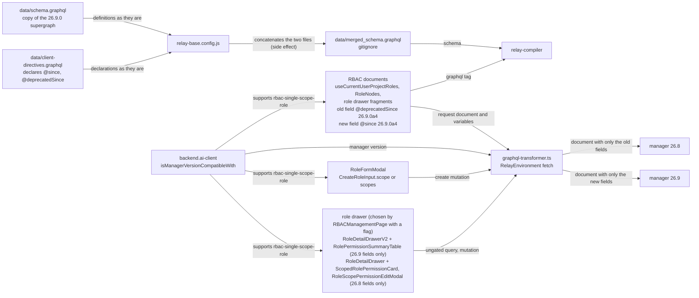

# 0006 — Version-gated field pairs across manager versions

> [ADR 0010](0010-component-level-manager-version-gates.md) replaces the feature flag rule of section 4 (choosing a branch outside a document with a `backend.ai-client` flag and `baiClient.supports(flag)`). Of the flags this document names, each flag at 26.5.0 or later is now a `baiClient.isManagerVersionCompatibleWith('<version>')` check, and each flag of the 26.4 line or earlier (`my-roles`, `rbac-filter-wrapper`) behaves as if it were on, with no check. The field pairs and the remaining decisions stay in force.

## Summary

> Unfamiliar terms are collected in the [Glossary](#glossary) at the end.

- `data/schema.graphql` is a copy of the manager [supergraph](#glossary), and nobody edits it by hand. The 26.9.0 supergraph keeps the RBAC fields that 26.9.0 retired as `@deprecated` fields, so relay-compiler compiles a document that selects an old field.
- One document selects both the fields a 26.8 manager answers and the fields a 26.9 manager answers. The old field carries `@deprecatedSince(version: "26.9.0a4")`, the new field carries `@since(version: "26.9.0a4")`, and `react/src/helper/graphql-transformer.ts` removes the side that does not match the connected manager before the request goes out.
- The RBAC documents that follow this approach are the query of `useCurrentUserProjectRoles`, the role list's `RoleNodesFragment`, the role drawer's `RoleAssignmentTabFragment` and `RolePermissionDetailTab_roleScopeFragment`, the 26.9 drawer's `RoleDetailDrawerContentV2Fragment` and `RolePermissionSummaryTableFragment` (only `@since` on the new fields), and the assignment modal's `AssignRoleModalBulkAssignMutation`. The documents of `LegacyRoleScopeTab`, `LegacyRolePermissionTab`, and `LegacyCreatePermissionModal` reach only managers below 26.8.0. The old drawer's `ScopedRolePermissionCard` and `RoleScopePermissionEditModal` reach only managers below 26.9.0a4, and the query and mutations of the new drawer's `RolePermissionSummaryTable` reach only managers at 26.9.0a4 or later. Those documents therefore carry no gate.
- A component that compares RBAC type strings converts the value to upper case before it compares, and it sends the manager the spelling the manager answered, unchanged. The role form uses the `rbac-single-scope-role` flag to send either `CreateRoleInput.scope` or `scopes`. `RBACManagementPage` uses the same flag to choose the role drawer: when the flag is on, the page mounts `RoleDetailDrawerV2` (one scope, a permission summary table); when the flag is off, the page mounts the previous `RoleDetailDrawer` (one card per scope type, and an edit modal).

## Context

- **Schema copy**: `data/schema.graphql` is an unchanged copy of `docs/manager/graphql-reference/supergraph.graphql` in the backend.ai repository. `bai-agent query` validates a document against this file before it goes to the network, so a definition in this file that the manager does not have would let that validation pass a field the manager does not have.
- **Compiler constraint**: `relay-base.config.js` concatenates `data/schema.graphql` and `data/client-directives.graphql` and writes `data/merged_schema.graphql`, and relay-compiler reads only that one file as the schema. relay-compiler does not compile a document that selects a field missing from this schema.
- **Changed 26.9.0 fields**: Manager 26.9.0 changed a role so that it belongs to exactly one scope (backend.ai BA-7796, #14478). The table below lists what changed among the things this repository's documents selected.

| 26.8.3                                                                                                | 26.9.0                                                                                                                                                                                     |
| ----------------------------------------------------------------------------------------------------- | ------------------------------------------------------------------------------------------------------------------------------------------------------------------------------------------ |
| `Role.scopes` connection                                                                              | `Role.scopeType`, `scopeId`, `scope`. `scopes` remains as a `@deprecated` field, holds only the role's one scope, and ignores `filter` and `order_by`.                                     |
| `CreateRoleInput.scopes`                                                                              | `CreateRoleInput.scope`. `scopes` remains as a `@deprecated` field and accepts only one item.                                                                                              |
| `RBACElementType` enum, upper-case values                                                             | `String`, lower-case snake_case values. The enum definition remains in the schema, and its description string says "Deprecated since 26.9.0".                                              |
| `Permission.scopeType`, `scopeId`, `operation: OperationType`, all non-null                           | `Permission.permission: PermissionBit!`. The old fields remain as nullable `@deprecated` fields and always answer `null`.                                                                  |
| `CreatePermissionInput.scopeType`, `scopeId`, `operation`                                             | `CreatePermissionInput.permission: PermissionBit!` is required. The old fields remain as `@deprecated` fields, and the manager ignores their values.                                       |
| `PermissionNestedFilter.entityType: RBACElementTypeFilter`, project admin entity `PROJECT_ADMIN_PAGE` | `StringFilter`, project admin entity [`scope_admin`](#glossary). The `scopeType`, `scopeId`, and `operation` filters remain as `@deprecated` fields, and the manager ignores their values. |
| `RoleMappedScopeNestedFilter.scopeId: StringFilter`                                                   | `UUIDFilter`                                                                                                                                                                               |
| `rbacPermissionMatrix`'s `OperationInfo.requiredPermission: OperationType!` (including `GRANT_*`)     | `PermissionBit!`                                                                                                                                                                           |

- **Unknown field rejection**: The manager rejects the whole request when the request document contains even one field the manager does not know. The 26.8.3 supergraph has no `myRolesV2`, `Role.scopeType`, or `Permission.permission`.
- **First failure site**: `useCurrentUserProjectRoles` is the hook that `useRouteAccess`, `useWebUIMenuItems`, `WebUIHeaderProjectSelect`, and the folder components call to ask whether the user is a project admin. If this hook selects only `myRoles` filtered by `PROJECT_ADMIN_PAGE`, a 26.9 manager finds no matching permission, and the project admin menu and routes disappear. The 26.9 answer is `myRolesV2`, which answers the user's roles that are mapped to a project scope and hold a `scope_admin` permission. The hook does not use `myAtomicBulkScopePermissions`, which answers effective permissions: that field also counts permissions inherited from the domain and global scopes, so it would judge a superadmin and a domain admin to be the admin of every project (FR-4128).
- **Existing mechanism**: `data/client-directives.graphql` declares `@since` and `@deprecatedSince` as `on FIELD`. The fetch in `react/src/RelayEnvironment.ts` passes the request document and `isNotCompatibleWithVersion` to `manipulateGraphQLQueryWithClientDirectives`, and it sends the document that function returns together with the original variables object.

## Diagram

## Decision

### 1. One supergraph copy is the only schema

- **Source file**: `data/schema.graphql` is a copy of the backend.ai supergraph, and nobody adds definitions for older managers to it. A document selects a field that an older manager answers through the definition that the supergraph kept as `@deprecated`.

### 2. A directive pair separates fields that differ by manager

- **Directive pair**: The old field carries `@deprecatedSince(version: V)`, and the new field carries `@since(version: V)`. V is the version in which the manager retired or added that field. `useCurrentUserProjectRoles` places `legacyRoles: myRoles … @deprecatedSince(version: "26.9.0a4")` and `projectAdminRoles: myRolesV2 … @since(version: "26.9.0a4")` side by side in one query.
- **Pre-release boundary**: The V of the RBAC field pairs and of `rbac-single-scope-role` is `26.9.0a4`. `comparePEP440Versions` treats `26.9.0a4` as lower than `26.9.0`, so if a document wrote V as `26.9.0`, a 26.9 pre-release manager would receive the old-shape request, and the `RBACElementType` enum would reject the lower-case scope types of 26.9. A non-RBAC document such as `DeleteVFolderModalV2` keeps its `26.9.0`, because each such document follows the time of its own backend change.
- **Version boundary**: When the connected manager is at V or later, `graphql-transformer.ts` keeps the `@since` field and removes the `@deprecatedSince` field. When the manager is below V, it does the opposite.
- **Variable pruning**: Only `legacyRoles` takes the variable `$legacyPermissionFilter`. After `graphql-transformer.ts` removes fields, it removes every variable definition that the document no longer references, so the document a 26.9 manager receives has no `$legacyPermissionFilter: PermissionNestedFilter` definition. `RelayEnvironment.ts` sends the variables object as it is, without trimming it.
- **Why both gates**: `@since` keeps a 26.8 manager from rejecting the whole request because of a new field it does not know. `@deprecatedSince` keeps the hook from sending a 26.9 manager the `myRoles` filter that matches no permission. A 26.9 manager does not reject a retired field, so without this gate no error occurs, and the result is empty.
- **Error isolation**: Both root fields carry `@catch(to: RESULT)`. When a field returns an error, the hook receives `{ ok: false }` and skips that result, and the page keeps rendering.
- **Object field pair**: `RoleNodesFragment` puts `@deprecatedSince(version: "26.9.0a4")` on the role's `scopes` and `@since(version: "26.9.0a4")` on `scopeType`, `scopeId`, and `scope`. `RoleAssignmentTabFragment` puts the same pair on `firstScope: scopes(first: 1)` and on `scopeType` and `scopeId`.
- **Read order**: `RoleNodes` and `RoleAssignmentTab` read the scope from `scopeType` when it has a value, and otherwise read the first item of `scopes`. `RoleNodes`'s `readRoleScope` answers `scopeType`, `scopeId`, `scope`, and `extraCount` on both paths. `extraCount` is always 0 on 26.9; on 26.8 and earlier it is the number of remaining scopes the cell could not name. The scope type and scope id columns add a `+N` badge only when this value is greater than 0, so the columns do not look at the manager version.
- **Empty-scope check**: `RolePermissionDetailTab_roleScopeFragment` selects the `count` of `totalScopes: scopes(first: 1) @deprecatedSince(version: "26.9.0a4")` and `scopeType` and `scopeId @since(version: "26.9.0a4")`. `RolePermissionDetailTab` renders the empty state only when `scopeId` has no value and `count` is 0, and it renders one `ScopedRolePermissionCard` for each scope type of `rbacPermissionMatrix`. This tab belongs to the old drawer, so it mounts only on a manager where the flag is off, and `scopeId @since` is always empty on that manager.
- **V2 drawer fields**: `RoleDetailDrawerContentV2Fragment` puts `@since(version: "26.9.0a4")` on `scopeType`, `scopeId`, and `scope`, and it does not select the old fields (the old drawer exists separately). This fragment is spread into the list query, which every manager receives, so it needs `@since`. The information list renders the scope type and name with `BAIDoubleToken`. `resolveRBACScopeName` in `react/src/helper/rbacScopeName.ts` resolves the name from the `scope` entity, and when there is no name the list renders a copyable id.
- **Per-version permission documents**: The documents of the permission tab carry no pair. `RolePermissionSummaryTableQuery` and its grant and revoke mutations select only 26.9 fields (`Permission.permission`, `CreatePermissionInput.permission`). `ScopedRolePermissionCardQuery` and the fragments and mutation of `RoleScopePermissionEditModal` select only 26.8 fields (the filter of `Role.scopes`, `Permission.scopeId` and `operation`, `PermissionFilter.scopeType`). `RBACManagementPage` mounts only one drawer, chosen by the flag, so each manager receives only the documents of its own shape.
- **Per-version drawer**: `RoleDetailDrawerV2` (≥ 26.9.0a4) has a fixed title, and it renders the role name and description above the body and a scope token in the information list. On its Permissions tab, `RolePermissionSummaryTable` renders one row per permission type of the scope and shows the five `PermissionBit` values as checkboxes in two column groups: Read (Read) and Write (Create, Update, Soft Delete, Hard Delete). A changed checkbox stays pending until the user saves, and Save on the save bar at the bottom of the drawer sends all changes at once through the bulk add and remove mutations. The previous `RoleDetailDrawer` (< 26.9.0a4) is the code on `main`, unchanged: the role name is the title, `ScopedRolePermissionCard` renders scope rows for each scope type, and `RoleScopePermissionEditModal` edits several scopes at once.
- **Result merge**: The hook collects each role's `scopeId` from the `projectAdminRoles` answer, collects each `scopeId` whose `scopeType` is PROJECT from each role's `scopes` in the `legacyRoles` answer, and merges them into one set. The transformer keeps only one side, so in a single request only one side has values.

### 3. RBAC type strings are compared case-insensitively and sent in the manager's spelling

- **Spellings**: 26.8 answers a scope or entity type as an upper-case enum value (`PROJECT`), and 26.9 answers it as a lower-case snake_case string (`project`).
- **Case folding**: A component that compares type values applies `toUpperCase()` to the value and then compares it with the upper-case value. The places that compare today are the scope type option filter of `RoleFormModal`, the picker branch of `ScopeIdSelect`, and the `PROJECT` check of `RoleAssignmentTab`.
- **Labels**: `rbacTypeI18nKey(type)` in `react/src/helper/rbacElementTypes.ts` builds the key `rbac.types.<upper-case type>`. `RoleNodes`, `RoleFormModal`, and `RBACManagementPage` look up labels with this function, and the i18n keys keep the upper-case spelling.
- **Filter options**: The scope type options of the role list filter are all the `scopeType` values that `rbacScopeEntityCombinations` answered. `ScopeTypeSelect` in `RBACManagementPage` owns this query, and the filter property's `renderInput` wraps that select in `Suspense`. The page does not send this query until the user opens the filter.
- **Form options**: The scope type options of the role form are the `scopeType` values that `rbacPermissionMatrix` answered whose upper-case value is in `RBAC_ELEMENT_TYPES` (the upper-case list of types that have a scope-id picker) and that have at least one entity with one or more actions. The form removes duplicates by the upper-case value.
- **Sent value**: Both option sets use the spelling the manager answered as the option value, and they send that value to the filter and the mutation unchanged.
- **Scope id filter**: The `mappedScope.scopeId` filter of the role list uses `type: 'uuid'` and `fixedOperator: 'equals'`. `equals` is an operator that the filter types of both 26.8 and 26.9 accept.

### 4. A feature flag chooses a branch outside a document

- **Flag location**: An `isManagerVersionCompatibleWith('<version>')` block in `packages/backend.ai-client/src/client.ts` turns a [feature flag](#glossary) on, and components and hooks read it with `baiClient.supports(flag)`.
- **Hook flags**: The table lists the flags that `useCurrentUserProjectRoles` reads and their effects.

| flag                     | version that turns it on | when on                                                                                                                                          | when off                                                                                                           |
| ------------------------ | ------------------------ | ------------------------------------------------------------------------------------------------------------------------------------------------ | ------------------------------------------------------------------------------------------------------------------ |
| `rbac-single-scope-role` | 26.9.0a4                 | The hook sends `$supportsMyRolesV2` as `true`, which applies `@include` to `projectAdminRoles: myRolesV2` and `@skip` to `legacyRoles: myRoles`. | The hook sends `$supportsMyRolesV2` as `false`, which keeps only `legacyRoles` and leaves out `projectAdminRoles`. |
| `my-roles`               | 26.4.0                   | The hook reads the main query with `store-or-network`.                                                                                           | The hook reads the main query with `store-only`.                                                                   |
| `rbac-filter-wrapper`    | 26.4.4rc9                | The hook sends `$legacyPermissionFilter.entityType` as `{ equals: 'PROJECT_ADMIN_PAGE' }`.                                                       | The hook sends the same value as a plain string.                                                                   |

- **Role form flag**: `RoleFormModal` takes one scope type and one scope id. When `rbac-single-scope-role` is on, the form sends them as `CreateRoleInput.scope`; when it is off, the form sends them as a one-item `CreateRoleInput.scopes`.
- **Drawer switch**: `RBACManagementPage` mounts `RoleDetailDrawerV2` when `rbac-single-scope-role` is on and `RoleDetailDrawer` when it is off. The fragments of both drawers are spread into the list query, so directives separate the fields and the flag separates the components. On a 26.9 pre-release below 26.9.0a4, the flag is off and the page uses the old drawer, and that drawer's card sends `PermissionFilter.scopeType` (`RBACElementTypeFilter`), which rejects the lower-case scope type the manager answered.
- **Assignment source**: `RoleAssignmentTabFragment` puts `@deprecatedSince(version: "26.9.0a4")` on `Role.users` and `@since(version: "26.9.0a4")` on `Role.usersV2`. The two fields have different filter and orderBy types, so each takes its own refetch variables. `usersV2` answers users rather than assignment rows and has no `grantedAt`, so `RoleAssignmentTab` does not render the Granted At column on a manager at 26.9.0a4 or later. `AssignRoleModalBulkAssignMutation` puts `@deprecatedSince(version: "26.9.0a4")` on `failed`. A manager at 26.9.0a4 or later assigns all users in one transaction and rolls back the whole mutation if it rejects even one user, so `AssignRoleModal` records that error in the table as a failure for every selected user.

### 5. The PR that ends 26.8 support removes these pieces together

- **Removal set**: The PR that ends support for 26.8 managers removes the items below together. Only RBAC documents write V as `26.9.0a4`, so the targets are the results of a grep for `@deprecatedSince(version: "26.9.0a4")`.
  - The `@deprecatedSince(version: "26.9.0a4")` selections in RBAC documents and the code that reads their results.
  - The `rbac-single-scope-role` branches: `useCurrentUserProjectRoles`, `RoleFormModal`, and the drawer choice in `RBACManagementPage`.
  - The whole old drawer: `RoleDetailDrawer`, `RoleDetailDrawerContent`, `RolePermissionDetailTab`, `ScopedRolePermissionCard`, `RoleScopePermissionEditModal`. `RoleDetailDrawerV2` takes over the name.

## Rejected alternatives

- **New schema only**: Documents select only the new fields. The advantage is that there are no directives and no fallback. This alternative is rejected because, in a deployment with a 26.8 manager, the manager would reject the request of `useCurrentUserProjectRoles`, and the menu and route access checks would stop working, while this repository connects one build to several manager versions.
- **Compat schema fold**: The retired definitions live in a separate compat file, and `relay-base.config.js` folds them into the merged schema. The advantage is that old documents still compile even after the supergraph removes the definitions completely. This alternative is rejected because the 26.9.0 supergraph already contains those definitions as `@deprecated`, so the compat file would only be a second schema that declares the same fields again.
- **Hand-edited supergraph copy**: The old definitions go directly into `data/schema.graphql`. The advantage is that there is no merge step. This alternative is rejected because the next sync overwrites that edit, and because `bai-agent` validates documents against this file, so a field the manager does not have would pass the validation.
- **Documents per manager version**: Each manager version has its own fragments and queries, and the component chooses one. The advantage is that each document needs to match only one manager version. This alternative is rejected because every place that spreads a fragment would need a branch, and because relay-compiler accepts only one schema, so the two documents would still have to match the same schema. The role drawer is the one exception: the 26.9 `RoleDetailDrawerV2` and the 26.8 `RoleDetailDrawer` are different components, so the query and mutations of each drawer select only its own manager's fields, and `RBACManagementPage` mounts only one of them, chosen by the flag (Ungated RBAC documents in Consequences). The fragments of both drawers are spread into the same list query, so the fields inside those fragments still carry directives.

## Consequences

- **One build, two managers**: With the same build, `useCurrentUserProjectRoles` answers whether the user is a project admin on both a 26.8 manager and a 26.9 manager.
- **Nullability gap**: A field that the transformer removed is `undefined`, whatever the generated type says. A `@since` field is `undefined` on an old manager, and a `@deprecatedSince` field is `undefined` on a new manager. TypeScript does not catch a component that uses that value without checking it. `useCurrentUserProjectRoles` checks with the `ok` of the `@catch` result and optional chaining. `RoleNodes` and `RoleAssignmentTab` first check whether `scopeType` has a value. `RoleDetailDrawerContentV2` and `RolePermissionSummaryTable` mount only on a manager where the flag is on, so they render `-` when a `@since` field is empty.
- **Role page cap**: `useCurrentUserProjectRoles` asks for both root fields with `first: 100`. For a user with more than 100 project admin roles, the hook does not judge the user to be the admin of the projects after the first 100.
- **Ungated RBAC documents**: The documents below select or send retired definitions without a gate. `RoleDetailDrawerContent` renders `LegacyRoleScopeTab`, `LegacyRolePermissionTab`, and `LegacyCreatePermissionModal` only on a manager where `role-mapped-scope-filter` (26.8.0) is off, so a 26.9 manager does not receive these documents. `RBACManagementPage` renders `RoleDetailDrawerV2` (`RolePermissionSummaryTable`) only on a manager where the flag is on and `RoleDetailDrawer` (`ScopedRolePermissionCard`, `RoleScopePermissionEditModal`) only on a manager where the flag is off, so each manager also receives only the drawer queries and mutations of its own shape.

| document                                                                                                                                                                          | retired definitions                                                                                                                                                                                        |
| --------------------------------------------------------------------------------------------------------------------------------------------------------------------------------- | ---------------------------------------------------------------------------------------------------------------------------------------------------------------------------------------------------------- |
| `LegacyRoleScopeTabQuery`                                                                                                                                                         | `filter`, `orderBy` of `Role.scopes`                                                                                                                                                                       |
| `LegacyRolePermissionTabQuery`                                                                                                                                                    | `Permission.scopeType`, `scopeId`, `operation`, `scope`, `PermissionFilter.scopeType`                                                                                                                      |
| The create and update mutations of `LegacyCreatePermissionModal`                                                                                                                  | `scopeType`, `scopeId`, `operation` of the input, and the same fields of the payload. The component compiles with an `as CreatePermissionInput` cast.                                                      |
| `ScopedRolePermissionCardQuery`, `RoleScopePermissionEditModal_scopesFragment`, `RoleScopePermissionEditModal_permissionsFragment`, `RoleScopePermissionEditModalBulkAddMutation` | `filter` of `Role.scopes`, `PermissionFilter.scopeType`, `Permission.scopeId` and `operation`, and `scopeType`, `scopeId`, `operation` of the input. A manager at 26.9.0a4 or later does not receive them. |
| `RolePermissionSummaryTableQuery`, `RolePermissionSummaryTableGrantMutation`, `RolePermissionSummaryTableRevokeMutation`                                                          | None — these select only 26.9 fields (`Permission.permission`, `CreatePermissionInput.permission`), and a manager below 26.9.0a4 does not receive them.                                                    |

- **Chip label after reload**: A filter property that uses `renderInput` keeps the label of a committed value only in the in-memory map that `onAddCondition` passed. After a reload, the scope type chip shows the value the manager gave (`project`) instead of the translated label. The assigned-user property of the same filter behaves the same way. Both are resolved when a per-property `resolveLabels` exists.

## Sources

- Jira: FR-3905 (Epic FR-3906). FR-3962 set the compatibility policy. FR-3955 covers the gates of the role list and drawer fragments, FR-3956 the single-scope input of the role form, FR-3957 the gates of the permission tab, and FR-3958 the gates of the assignment tab. The follow-up is FR-3959, the Legacy tabs.
- backend.ai: BA-7796 (#14478) removes the scope-entity association table, BA-7885 (#14628) reads roles, permissions, and assignments through the scope, BA-7919 (#14669) restores `Role.scopes` as deprecated, and BA-7924 (#14678) adds `myScopePermissions`, `myAtomicBulkScopePermissions`, and `RoleFilter.permission`.
- schema: `data/schema.graphql` is a copy of the backend.ai 26.9.0 supergraph. The comparison baseline, 26.8.3, is the supergraph at the backend.ai tag `26.8.3`.
- Decision date: 2026-09-17.
- Related: `data/client-directives.graphql`, `react/src/helper/graphql-transformer.ts`, and the version-gated field pair tests in `react/src/helper/graphql-transformer.test.ts`.

## Glossary

| term                 | meaning                                                                                                                                                                                                                                                                                                     |
| -------------------- | ----------------------------------------------------------------------------------------------------------------------------------------------------------------------------------------------------------------------------------------------------------------------------------------------------------- |
| supergraph           | The supergraph is the SDL that combines the schemas of the backend.ai manager's several GraphQL services into one. It is at `docs/manager/graphql-reference/supergraph.graphql` in the backend.ai repository.                                                                                               |
| client directive     | A client directive is a directive such as `@since` or `@deprecatedSince` that `graphql-transformer.ts`, not the manager, reads and removes from the request document. `data/client-directives.graphql` declares these directives `on FIELD`, so relay-compiler accepts them.                                |
| feature flag         | A feature flag is a named boolean that the `Client` of `backend.ai-client` turns on according to the connected manager version. Code reads it with `baiClient.supports(name)`.                                                                                                                              |
| `@catch(to: RESULT)` | `@catch(to: RESULT)` is a Relay directive that does not throw a field error and instead returns `{ ok: false, errors }` or `{ ok: true, value }`.                                                                                                                                                           |
| `PermissionBit`      | `PermissionBit` is the 26.9.0 enum of the kinds of access one permission grants. Its values are `READ`, `UPDATE`, `CREATE`, `SOFT_DELETE`, and `HARD_DELETE`.                                                                                                                                               |
| `scope_admin`        | `scope_admin` is the entity type string that represents the scope management permission on a 26.9.0 manager. The hook treats a user who directly holds an active project-scoped role with at least one permission on this entity as the admin of that project. The hook does not check the permission bits. |
