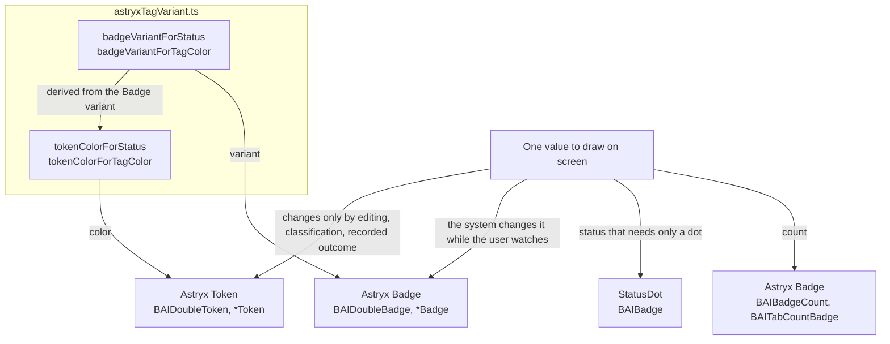

# 0007 — Badge for live values and Token for settled values

## Summary

> Unfamiliar terms are collected in the [Glossary](#glossary) at the end.

- When this repository draws a single value as a chip, the way the value changes decides whether the chip is an Astryx `Badge` or an Astryx `Token`. A [live value](#glossary), which the system changes on its own, is drawn with `Badge`. A [settled value](#glossary), which changes only when a user or an administrator edits it or which names a classification, is drawn with `Token`.
- A count stays a `Badge`, and a place that shows a status with a single dot stays a `StatusDot` (BUI `BAIBadge`).
- A BUI or host component that draws a chip has a name that ends in `*Badge` or `*Token`, according to the primitive the component draws. "Tag" remains only as a domain noun, such as image tag or deployment tag.
- A chip's colour is chosen only through the helpers in `packages/backend.ai-ui/src/helper/astryxTagVariant.ts`. A `Badge` uses `badgeVariantFor*`, and a `Token` uses `tokenColorFor*`.
- `.claude/rules/badge-vs-token.md` carries this decision as a review rule, and the `STATUS SEMANTICS` line in the PROJECT LINES under the UI-COMMON block of `AGENTS.md` carries it as an agent instruction. That line overrides, in this repository, the sentence "Status = StatusDot/Token; Badge = counts only" that `ui-common agents` generates.
- Out of scope: separate issues cover replacing the isActive display drawn with `StatusDot` by `BAIBooleanToken`, the wording "status tag" and "tag chip" in the user manual, and the `.ant-tag` locators in e2e.

## Context

- **What the two primitives are**: Astryx core has no `Tag` or `Chip` primitive. The only chip shapes are `Badge` (`label: ReactNode`, `variant`, not clickable) and `Token` (`label: string`, `color`, `icon`, `onClick`, `onRemove`, `endContent`). `StatusDot` draws a single dot and is not a chip.
- **Styling after PR #9777**: The theme change of FR-4002 gives `Token` a transparent background with a 1px outline in its own colour, and gives `Badge` a lightly filled background, an outline, and dark text. The two chips now look clearly different on the same screen, so the choice of chip for a value now carries meaning to the user.
- **One wrapper, two meanings**: BUI's `BAITag` took the `color` string of antd `Tag` and drew a `Token` when `closable` was set and a `Badge` otherwise. The call sites did not pass `closable`, so almost every chip was a `Badge`, and settled values such as user names, permissions, and versions looked the same as live values such as session status. `BAIDoubleTag`, `BAITagList`, `BAIBadgeList`, and `BooleanTag` also all drew `Badge`, whatever their names said.
- **Upstream guidance disagrees with itself**: The agent instructions that `ui-common agents` generates say "Status = StatusDot/Token; Badge = counts only", but the Astryx `Badge` documentation says to use the semantic variants for system state. This repository has many screens that draw a status as a chip, so it cannot follow either sentence as written.
- **A hidden colour bug**: `BAIRouteNodes` passed the hex string from `useSemanticColorMap` as the `color` of `BAITag`, so both route status and health status were drawn as neutral. Nothing routed colour input through a single helper, and that hid this bug.

## Diagram

## Decision

### 1. The way a value changes decides the primitive

| primitive      | values it draws                                                                               | examples                                                                                                                                                                                                |
| -------------- | --------------------------------------------------------------------------------------------- | ------------------------------------------------------------------------------------------------------------------------------------------------------------------------------------------------------- |
| Astryx `Badge` | A value the system changes on its own                                                         | lifecycle and health status, in-progress markers (Installing, Deploying, Applying), system pointers that move without the user's action (Current, Latest), tickers and metrics that change every second |
| Astryx `Token` | A value that changes only when a user or an administrator edits it, or a classification label | names, types, permissions, versions, tags and labels, on/off settings, outcomes that are recorded once and do not move (login results, the status of an audit row, error records)                       |

- **Deciding question**: The question is "Can this value change while the user watches the screen and does nothing?" If the answer is yes, the value is a `Badge`; if the answer is no, it is a `Token`. `.claude/rules/badge-vs-token.md` carries this question and the examples as a review rule.
- **Shared slot**: A single slot never alternates between a `Badge` and a `Token`. The Current and Latest markers are a `Badge` partly because `Deploying`, which appears in the same slot, is a `Badge`.
- **Recorded outcomes**: A recorded outcome is a `Token`. A filled `Badge` on every row of a history table reads as a warning on each row, while a `Token` with only an outline reads as a record.

### 2. Counts stay Badge and a single dot stays StatusDot

- **Counts**: `BAIBadgeCount`, `BAITabCountBadge`, and the `+N` overflow marker are `Badge`, as the Astryx guidance says.
- **Dot-only status**: `BAIBadge` and the components that wrap it, `BAIAuditLogStatusBadge`, `BAISchedulingResultBadge`, and `StorageUsageBadge`, draw `StatusDot`, and this decision does not change them.

### 3. A chip component's name follows the primitive it draws

- **Suffix**: A component that draws a chip ends in `*Badge` or `*Token`. Examples: `BAIDeploymentStatusBadge`, `BAISessionTypeToken`, `BAIBooleanToken`, `BAITokenList`, `BAITokenRow`, `SessionStatusBadge`, `VFolderPermissionToken`.
- **Tag as a domain noun**: The word "Tag" is used only for image tags and deployment tags. `BAIImageNodeSimpleTag(V2)` keeps its name because the name covers the whole image row, and `BAIDeploymentTagTokens` means that the component draws deployment tags as `Token`.
- **No generic wrapper**: `BAITag` was deleted. Each call site imports Astryx `Badge` or `Token` directly and chooses the colour with the helpers in item 4.

### 4. Colour is chosen only through the helpers in `astryxTagVariant.ts`

| primitive | helper                                 | input                                                |
| --------- | -------------------------------------- | ---------------------------------------------------- |
| `Badge`   | `badgeVariantForStatus(domain, value)` | a domain of `STATUS_BADGE_VARIANT` and an enum value |
| `Badge`   | `badgeVariantForTagColor(color)`       | a colour name from the antd era                      |
| `Token`   | `tokenColorForStatus(domain, value)`   | the same domain and enum value                       |
| `Token`   | `tokenColorForTagColor(color)`         | the same colour name                                 |

- **Derived token colour**: `BADGE_VARIANT_TO_TOKEN_COLOR` in `astryxTagVariant.ts` derives the `Token` colour from the `Badge` variant. A palette colour maps to the colour of the same name, and `gray` is not used.

| `Badge` variant | `Token` color |
| --------------- | ------------- |
| `success`       | `green`       |
| `warning`       | `orange`      |
| `error`         | `red`         |
| `info`          | `blue`        |
| `neutral`       | `default`     |

- **No local maps**: A file does not create its own map from status to colour. A new domain is added to `STATUS_BADGE_VARIANT`.
- **Primary marker**: The main access key marker is drawn with `PRIMARY_TOKEN_COLOR` (`'green'`).
- **Agent CLI vocabulary**: The `variant` values in `packages/backend.ai-agent-cli/mappings/*.yaml` stay `Badge` variant names. `tokenColorForStatus` derives the `Token` colour of a settled value from that value.

### 5. A Token label is a string

The `label` of `Token` accepts only a `string`. A place that needs a node does not go back to `Badge`; it uses one of the paths below.

| need                                                       | path                                                                                                                 |
| ---------------------------------------------------------- | -------------------------------------------------------------------------------------------------------------------- |
| a leading glyph                                            | the `icon` prop                                                                                                      |
| a composed string such as `mode × size` or `label · count` | join it into one string                                                                                              |
| search keyword highlight                                   | the original string in `label`, `isLabelHidden`, and the same string wrapped in `BAITextHighlighter` in `endContent` |

- **Accessible name**: On the highlight path too, the accessible name is the original string in `label`.

### 6. Joined chip pairs exist as two separate components

- **Two components**: A chip pair that draws a key and a value joined together is split into `BAIDoubleToken` for settled values and `BAIDoubleBadge` for live values. No switching prop such as `kind` exists.
- **Value types**: The `values` of `BAIDoubleToken` is `string[]` or `{ label: string; color?: AstryxTokenColor }[]`, and a plain string is drawn `blue`. Only `BAIDoubleToken` has `highlightKeyword`. The `values` of `BAIDoubleBadge` is `string[]` or `{ label: string; variant?: AstryxBadgeVariant }[]`, and a plain string is drawn `neutral`.
- **Same weld**: Both components overlap the outlines of neighbouring chips and square off the inner corners. `BAIDoubleToken` draws this with the `.bai-double` class in `BAIDoubleToken.css`, and `BAIDoubleBadge` draws it with the stylesheet of ui-common `DoubleBadge`, where its implementation moved.

## Rejected alternatives

- **Keep a generic `BAITag` with a `kind` switch**: In this form, `BAITag` takes `kind="live" | "settled"` and picks `Badge` or `Token`. Its advantage is that call sites do not need to change their imports. It is rejected because the wrapper's name does not tell the reader which primitive it draws, and a call site that leaves out `kind` is silently bound to one side by the default. The wrapper itself is the ambiguity this decision removes.
- **Follow Astryx's "Badge = counts only"**: In this form, a status is drawn only as `StatusDot` or `Token`, exactly as the generated agent instructions say. Its advantage is that it does not diverge from upstream. It is rejected because the Astryx `Badge` documentation itself says to use the semantic variants for system state, and because `StatusDot` shows no label on a screen where one table cell must show an in-progress status together with a spinner.

## Consequences

- **Visible difference**: On one screen, a filled chip now means the current state, and an outline chip means a value or a classification. Every chip that drew a permission, a name, a type, or a version changes to an outline.
- **Route colours return**: `BAIRouteNodes` draws route status and health status with `badgeVariantForStatus('route', …)`, so they have colour for the first time.
- **Highlight cost**: A `Token` that needs search keyword highlight must use `isLabelHidden` and `endContent` together, so the call site grows by one line.
- **Override to maintain**: The `STATUS SEMANTICS` line sits in the PROJECT LINES outside the markers of the UI-COMMON block, so it survives when `ui-common agents --write` regenerates the block after a `@lablup/ui-common` bump ([ADR 0009](0009-ui-common-as-the-single-entry-point-to-astryx.md)). When a sentence in the generated block changes, the maintainer also updates the sentence that this line overrides.
- **Pointers stay Badge**: Current and Latest are system pointers that move even when the user does nothing, so they are `Badge`. When a new marker of the same shape for a user setting appears, the question in item 1 decides it again.

## Sources

- Jira: FR-4002. GitHub: lablup/backend.ai-webui#9777 changed the styling of the two primitives.
- The `Badge`, `Token`, and `StatusDot` documentation of Astryx core 0.5.4 (`pnpm run ui-common component <Name>`).
- Decided 2026-09-18.
- Related: [ADR 0005](0005-container-image-meta-row.md) decides where image tag chips are drawn, and under this decision it draws those chips as `Token`. `.claude/rules/badge-vs-token.md` is the review rule, and `.claude/rules/component-props-extension.md` decides the base of a wrapper's props.

## Glossary

| Term          | Meaning                                                                                                                                                                                                                                                             |
| ------------- | ------------------------------------------------------------------------------------------------------------------------------------------------------------------------------------------------------------------------------------------------------------------- |
| live value    | A live value is a value that the system changes even when the user does nothing. Examples are the status of a session, a deployment, or an agent, an in-progress marker, elapsed time, and the Current and Latest pointers.                                         |
| settled value | A settled value is a value that changes only when a user or an administrator edits it, a classification label, or an outcome that is recorded once and does not change. Examples are names, types, permissions, versions, tags, on/off settings, and login results. |
