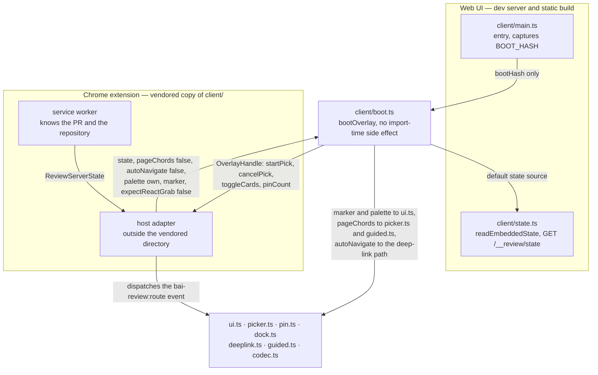

# 0008 — Host-agnostic review overlay client

## Summary

> Unfamiliar terms are collected in the [Glossary](#glossary) at the end.

- **Host seam**: Everything that the review overlay client (`react/vite-plugins/review-overlay/client/`) could get only from the dev server is now an option that a [Host](#glossary) answers. The only starting point is `bootOverlay(options)` in `client/boot.ts`, and this module does nothing when it is imported. The host passes an [`OverlayHostOptions`](#glossary), in which every item is optional.
- **Entry**: `client/main.ts` remains the entry that the dev server serves as `/__review/overlay.js` and that the static build bundles. All this file does is capture `location.hash` when the module is evaluated and call `bootOverlay` with the default host.
- **Default host**: The defaults are today's behaviour exactly. The defaults are a state source that reads `/__review/state`, keyboard shortcuts that the overlay takes from the page, automatic navigation to the page a link asks for, inheritance of the page's `--color-*` tokens, and a `data-bai-review-overlay` marker with an empty value.
- **One codec**: ADR 0002's "one codec on the reading side" stays in force. The Lablup Jira Helper chrome extension does not reimplement this client; it vendors `client/*.ts` byte for byte, and a sync script, a `--check` gate in CI, and the copied vitest suite together guarantee that the copies are identical.
- **Extension host**: The extension boots with `pageChords: false`, `autoNavigate: false`, `palette: 'own'`, `marker: 'extension'`, and `expectReactGrab: false`. The reason is that three behaviours are unacceptable on an arbitrary site: intercepting Ctrl+C or bare letter keys, letting a single fragment move the reader to a different path, and trusting the site's `--color-*` as they are.
- **Storage**: Every storage key the overlay uses stays in the page's `sessionStorage` and `localStorage`. The content script sees the same storage as the page, so the visited site can read and delete those keys; this is the accepted cost.

## Context

The review overlay is a dev tool that picks an element on screen, attaches a note to it, and copies the whole set of pins as one `#bai=v3` link. ADR 0002 decides the link's grammar and codec, and ADR 0004 decides the walkthrough stops that an implementing session leaves. Today this client runs in only two places: the Web UI dev server and the nightly static build.

The Lablup Jira Helper chrome extension needs to create the same pins on an arbitrary site and to open the same links on an arbitrary site. The client made four assumptions about the dev server. The first is that the `/__review/state` endpoint is on the same origin. The second is that react-grab is loaded on the page. The third is that the page defines the Astryx `--color-*` tokens. The fourth is that the overlay owns this page, so the overlay may take ⌘C and may navigate by following a fragment. Inside a content script, none of the four holds.

[**OverlayHostOptions**](#glossary) is a plain option object with seven items, including those four, and every item is optional. It is not a plugin system and not a layer that abstracts rendering. An item the host does not answer takes the default value, which is today's Web UI behaviour.

## Diagram

## Decision

### 1. `bootOverlay` is the only starting point

`client/boot.ts` does nothing when it is imported, and it exports `bootOverlay(options)`. This function checks `window.__baiReviewOverlay` and returns `null` if an overlay is already running, and an `OverlayHandle` otherwise. The handle has the four functions that the host calls from its own entry points: `startPick()`, `cancelPick()`, `toggleCards()`, and `pinCount()`.

A host that can be injected twice **must keep the handle it received from the first boot on its own side**. The second `bootOverlay` returns `null`, and the handle is the only way to reach the running instance. For a host such as the extension, which injects the overlay file again on every popup press, the message listener that the first injection registered is that entry point.

`client/main.ts` is the first host of this seam. The SPA's login redirect drops the fragment, so the whole file captures `location.hash` when the module is evaluated and calls `bootOverlay({ bootHash })`.

### 2. Options that the host answers

In the `OverlayHostOptions` that the host passes, every item is optional. `bootOverlay` fills in the defaults, builds one `OverlayHost` in which every item is set, and passes it to the other modules.

| option         | default                                                         | what the default means                                                                                                                           |
| -------------- | --------------------------------------------------------------- | ------------------------------------------------------------------------------------------------------------------------------------------------ |
| `state`        | `readEmbeddedState` and `fetchServerState` in `client/state.ts` | The client reads the JSON block of the built document first and calls `/__review/state` when the block is absent                                 |
| `bootHash`     | `location.hash`                                                 | The fragment the pins are read from                                                                                                              |
| `pageChords`   | `true`                                                          | The overlay takes keys from the page: ⌘C/Ctrl+C in pick mode, ⌘⇧H to collapse the cards, and the bare `n`·`p`·`v`·`m`·`c`·`[`·`]` in guided mode |
| `autoNavigate` | `true`                                                          | When every pin of a link is on another page, the client goes to that page with `location.assign`                                                 |
| `palette`      | `'inherit'`                                                     | The overlay reads its colours from the page's `--color-*` tokens                                                                                 |
| `marker`       | `''`                                                            | The value of `data-bai-review-overlay` on the shadow host                                                                                        |

`expectReactGrab` is the seventh item and the only one with three states. When no value is given, the client derives it from `host === 'static'` in the state, as before; when `false` is given, the client does not wait for react-grab. Before this value existed, a host without react-grab had no option other than claiming to be a static build.

For `marker`, only the value changes and the attribute itself stays. The reason is that code and tests that find the overlay with the `[data-bai-review-overlay]` selector must keep working. `ui.ts`, which uses the value, exports the attribute name as `OVERLAY_MARKER_ATTR`, and every place in the client that reads or writes that name uses this constant. A host that must step aside when it sees the native overlay also imports this constant instead of writing the literal again. If the name changes and one side does not follow, two overlays appear on one page, and no test fails when that happens.

**A host that turns page chords off does not advertise those keys either.** With `pageChords: false`, the client drops the `⌘⇧H` hint in the dock header, the chord suffix on the cards button label, the `Previous stop (p)` and `Next stop (n)` titles in the navigator, and `Copy ref (c)`, `Comment (m)`, and the key legend in the popover. A UI that describes keys that are not bound states something false. Escape always works regardless of `pageChords`, so it stays in the legend, and the composer's `⌘⏎` stays because it is the textarea's own shortcut.

### 3. The extension vendors the client instead of reimplementing it

The "one codec on the reading side" that ADR 0002 decided stays. The extension copies `client/*.ts` and its tests **byte for byte** into its own repository, and the following three mechanisms keep the copies identical.

- **Sync script**: The script records the upstream commit it copied from and the sha256 of each file in a record file. A reader can find in one place which file came from which point of webui.
- **`--check` gate**: The `--check` mode of the same script compares the recorded sha256 with the actual files and fails when they differ, and the extension CI runs it on every PR. If someone edits the vendored directory by hand, CI blocks the change.
- **Vendored tests**: The vitest suite copied together with the client runs as a conformance suite in the extension repository. The tests prove that the wire format, the block grammar, and the id derivation are the same in both repositories.

All code specific to the extension lives in the host adapter outside the vendored directory.

### 4. What the extension host turns off

| option            | extension value | reason                                                                                                                                                                                                                                                                                                                                                                                                                                                                                                                                                   |
| ----------------- | --------------- | -------------------------------------------------------------------------------------------------------------------------------------------------------------------------------------------------------------------------------------------------------------------------------------------------------------------------------------------------------------------------------------------------------------------------------------------------------------------------------------------------------------------------------------------------------- |
| `pageChords`      | `false`         | The chord in `picker.ts` is ⌘C/Ctrl+C with neither shift nor alt, and guided mode calls `preventDefault` on the bare `n`·`p`·`v`·`m`·`c`·`[`·`]`. If the overlay takes these keys on an arbitrary site, the user cannot copy text, and `c` means "create" on GitHub and Jira. The extension calls `handle.startPick()` from a popup button and from a `chrome.commands` command.                                                                                                                                                                         |
| `autoNavigate`    | `false`         | Opening a link that someone else made is the extension's default use, so the extension does not let a crafted fragment move the reader to another path on the same origin. The pins are still merged into the set, and the dock's "go" and guided mode's `›` keep working because the user must press the overlay's chrome for them. The `location.assign` that guided mode uses to move between stops is blocked by `pageChords`, not by this option: with `pageChords: false`, the bare `n` is not bound, so that navigation starts only from a click. |
| `palette`         | `'own'`         | Names such as `--color-text-primary` are common, and each site gives them a different meaning. `'own'` defines a literal light palette and a `prefers-color-scheme` dark palette inside the shadow root and reads none of the page's custom properties.                                                                                                                                                                                                                                                                                                  |
| `marker`          | `'extension'`   | The value tells which of the two overlays, native or extension, is running on a page.                                                                                                                                                                                                                                                                                                                                                                                                                                                                    |
| `expectReactGrab` | `false`         | In the isolated world of a content script, `window.__REACT_GRAB__` is never visible. Without this value, the client spends 20 seconds before the chords are bound and 4 seconds retrying the ⚛️ stack for every pin a link opened.                                                                                                                                                                                                                                                                                                                       |

### 5. Storage uses the page's own storage

The draft set, the navigation guard, the focus handover, the dock position, and the walkthrough progress all stay in the page's `sessionStorage` and `localStorage` under the keys used today. The content script sees the same storage as the page, so the storage keeps its per-tab and per-origin separation, and the handover survives the reload that `location.assign` causes.

The cost is that the visited site can read and delete those keys. The keys contain the pins' anchors and the notes the reviewer wrote. Moving to `chrome.storage` would remove this exposure, but the position reads and writes in `dock.ts` would become async, and the vendored directory would depend on the extension API.

### 6. The route event name is exported

The `ROUTE_EVENT` constant in `deeplink.ts` is exported. The way `patchHistory()` wraps the page's `history` does not work in an isolated world, but DOM events cross worlds, so when the extension adapter dispatches an event of the same name itself from the `navigation` API, `watchRoute` receives it unchanged. This export is the only client-side change for route watching.

## Rejected alternatives

- **Publish as an npm package**: In this approach, `client/` is published as a package and the extension takes it as a dependency. A version number would keep the copies in step instead of CI. The approach would need a new registry and release procedure for a package with only one consumer, and while a change goes through that procedure, the pin behaviour of the two repositories would differ for a period. It is rejected.
- **Pin store on a backend**: In this approach, the pins live on a server and the extension reads them by id. It would directly solve the problem that the anchor does not carry the origin. It would reverse the FR-3813 decision that removed the pin list on purpose, and it would break ADR 0002's premise that one link carries all of the pins. It is rejected.
- **Reimplement in the extension**: ADR 0002 already rejected this option for the Python reimplementation (`pin_parser.py`). A multi-pin change had to land twice, and the comments of the two implementations had already diverged. It is rejected for the same reason.
- **Inject into the MAIN world**: Injecting into the same realm as the page with `world: 'MAIN'` of `chrome.scripting` would make react-grab visible and would make the `history` patch work. The overlay would share a realm with the page's scripts, so the page could reach the overlay's functions and storage, and the injection would fail on sites whose CSP blocks scripts. It is rejected for v1.

## Consequences

- **Default host unchanged by the seam**: The seam itself changes none of the behaviour of the dev server and the static build. The wire format, the block grammar, the labels, the caps, and the id derivation were not touched, and a host with `pageChords` set to `true` has the same chords and the same chord hints as before. The only edit to the existing vitest suite is one line that builds the dock, for the new `pageChords` in `SetDockOptions`; the rest is added tests that cover the seam.
- **Default host fixes, all intended**: This PR also fixed three places that drew pins on an element without a box, and the fixes apply to the default host too. The first resolved to a `display: none` look-alike, the second did not search again for a held element that the page had hidden, and the third drew the marker, the box, and the card at (0,0) while the rect was empty. As a result, the client now gives up on an element without a box instead of drawing it at (0,0), and the ladder searches for it again; an element that draws only its children, such as a `display: contents` wrapper, falls in this group. In addition, the dock's away row moves "where" onto its own line so that the note is not squeezed; this is the only purely visual change in this PR.
- **New module served for free**: The dev server maps `/__review/<name>.js` one to one to `client/<name>.ts`, and the static build bundles every module reachable from `main.ts` into one chunk, so the dev server serves `boot.ts` and the static build bundles it without any change to the plugin.
- **Extension tsconfig compatibility**: The whole client compiles under the extension's `exactOptionalPropertyTypes: true`, `moduleResolution: node`, and a `lib` without `DOM.Iterable`. Four places were edited and the behaviour did not change: the `tid` assignment in `anchor.ts`, the `component` stored in the pick state in `boot.ts`, the `copyWithToast` payload in `ui.ts` (the place where `pin.ts:654` passed `html: undefined`), and the `Array.from` in `dock.ts` that spread a `DOMTokenList`.
- **A gate, pinned to TypeScript 5.x**: The sentence above does not stay true by itself, so `react/vite-plugins/review-overlay/tsconfig.host.json` compiles the client with the extension's flags and `scripts/verify.sh` runs it as a lane. Only this lane uses **the root's TypeScript 5.5.4**: TypeScript 6 merges the iterable DOM declarations into the main `DOM` lib, so it cannot detect a `DOM.Iterable` violation at all, and running the lane with the 6.0.3 of `react/` would disable half of the gate. `host-conformance.ts` writes down the extension host only as a type, so the gate breaks if `OverlayHost` can no longer be held in an `OverlayHostOptions`.
- **Pick entry point without a chord**: A host with `pageChords: false` binds no chords at all, so `handle.startPick()` is the only way into pick mode. A host that does not provide that entry point cannot create pins and can only read them.
- **Two palettes to keep**: The `TONES` table in `ui.ts` holds the dark values of `palette: 'own'`, and they do not follow the app's theme. When the `--color-*` tokens change, `inherit` follows them, but someone must update `own` by hand. No screen in this repository draws these dark values, so nobody has measured their contrast. Checking them on a real dark page is part of phase B.
- **Known limits for v1**: The extension host has no ⚛️ component stack, and on a site without `data-testid` the anchor relies only on the selector and the text. The overlay cannot pin an element inside an iframe.

## Sources

- Jira: FR-4004. This decision is phase A of the work that opens the review overlay client to a second host, and phase B is the work on the Lablup Jira Helper extension side.
- FR-3811, FR-3813, FR-3858, and FR-3859 built the overlay, and FR-3950 built guided mode.
- Decided 2026-09-18.
- Related: [ADR 0002](0002-pin-set-link-grammar-and-single-codec.md) decides the link grammar and the single codec, and [ADR 0004](0004-walkthrough-stops-in-the-v3-anchor.md) decides the walkthrough stops.

## Glossary

| Term               | Meaning                                                                                                                                                                                                                            |
| ------------------ | ---------------------------------------------------------------------------------------------------------------------------------------------------------------------------------------------------------------------------------- |
| Host               | A host is the side that starts the overlay client and answers in place of the dev server for the values that only the dev server can provide. The Web UI dev server, the static build, and the chrome extension are each one host. |
| OverlayHostOptions | OverlayHostOptions is the type of the option object that a host passes to `bootOverlay`, and `client/boot.ts` exports it. Every item is optional, and an item left out takes the Web UI default.                                   |
| OverlayHost        | OverlayHost is the result of filling the defaults into the options above, and `bootOverlay` builds it and passes it inward. Every item is set, and `defaultOverlayHost()` returns the Web UI one.                                  |
| OverlayHandle      | OverlayHandle is the object that `bootOverlay` returns, and it has `startPick`, `cancelPick`, `toggleCards`, and `pinCount`, which the host calls from its own entry points.                                                       |
| Vendoring          | Vendoring means copying another repository's source files as they are instead of taking them as a dependency, and checking with a script and CI that the copies match the originals.                                               |
