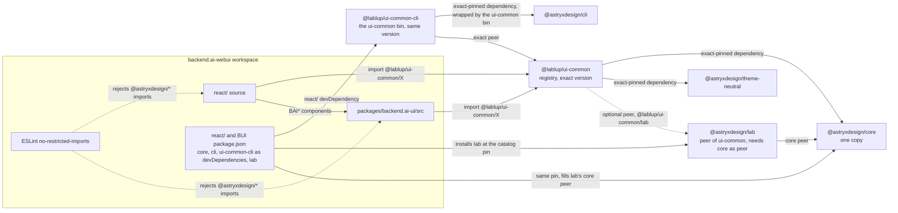
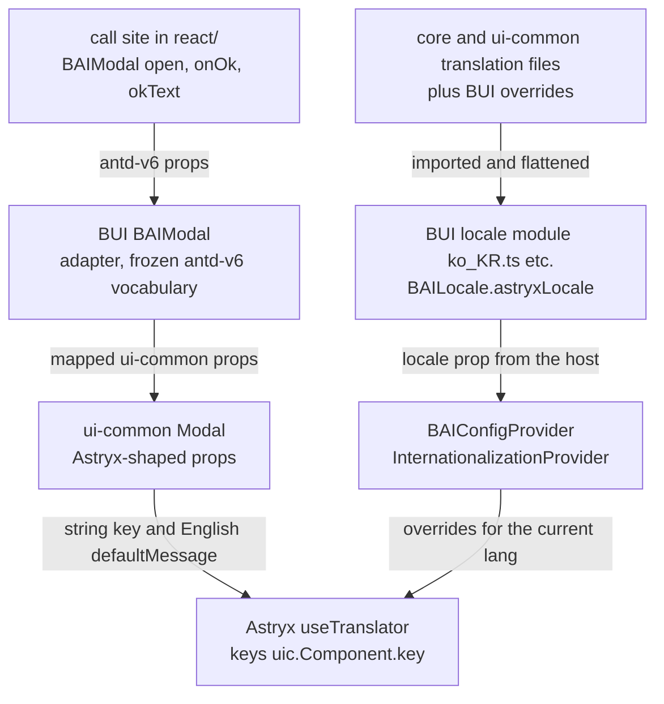

# 0009 — @lablup/ui-common as the single entry point to Astryx

> ADR 0014 supersedes the form-control part of the "New code" item in Decision 1.

## Summary

> Unfamiliar terms are collected in the [Glossary](#glossary) at the end.

- **Single entry point**: The source in `react/` and `packages/backend.ai-ui/` (BUI) imports Astryx only through `@lablup/ui-common`. ui-common [mirrors](#glossary) the export map of `@astryxdesign/core` 1:1, exports `@astryxdesign/lab` as `@lablup/ui-common/lab`, and exports the theme, the tokens, and the CSS under ui-common subpaths of the same names.
- **Guardrail**: In both source trees, ESLint `no-restricted-imports` blocks `@astryxdesign/*` imports. Only a few files that the Astryx CLI generates or reads are exempt.
- **Dependency form**: `react/` and BUI install `@lablup/ui-common` from the registry at an exact version, and they do not link a ui-common checkout. The `ui-common` CLI is a separate package, `@lablup/ui-common-cli`, which is released together at the same version and is a devDependency of `react/`. `@astryxdesign/core` and `@astryxdesign/cli` stay as exact-pinned devDependencies so that pnpm installs only one copy of core.
- **BAI adapters**: A component that moved from BUI to ui-common has Astryx-shaped props in ui-common. BUI keeps a `BAI*` component of the same name as a thin [adapter](#glossary) that maps the frozen antd-v6 prop vocabulary onto the ui-common props, and the call sites do not change.
- **Strings**: Astryx `useTranslator()` looks up the strings of ui-common components. BUI's locale modules merge the ui-common translations into `BAILocale.astryxLocale`, and `BAIConfigProvider` passes that value once to Astryx `InternationalizationProvider`.
- **Layers and agent docs**: The cascade layer order gains `ui-common` after `astryx-theme`. In the agent instructions, the `ASTRYX` block is replaced by the `UI-COMMON` block that `ui-common agents` generates.
- **Out of scope**: The [`theme-shim`](#glossary) replacement track, the per-component move order (FR-4087), and ui-common's internal design (theme, CLI, admission rule) are out of scope. The ui-common side's decisions are in ui-common's `CONTRIBUTING.md` and `docs/astryx.md`.

## Context

- **What ui-common is**: `@lablup/ui-common` is a UI package that several Lablup products share, such as backend.ai-go, continuum-hub, and mlxcel. From 0.2.0, ui-common drops its own components and its `--token-*` token contract and becomes a thin layer over Astryx. ui-common does not reimplement or bundle Astryx. ui-common ships precompiled JS and CSS, keeps Astryx external, and pins it at an exact version.
- **What webui does today**: `react/` and BUI hold `@astryxdesign/core`, `@astryxdesign/lab`, and `@astryxdesign/theme-neutral` as direct dependencies through [catalog pins](#glossary) in `pnpm-workspace.yaml`, and the source imports `@astryxdesign/core/<X>` in more than 1,200 places. `react/src/index.css` `@import`s CSS such as `@astryxdesign/core/reset.css` directly.
- **Why a decision is needed**: When a component with no BAI dependency, such as BUI's `BAIModal`, moves to ui-common, webui ends up importing the same Astryx through two paths. ui-common removes core's `Dialog` from the mirror and replaces it with its own `Modal`, but if webui imports core directly, that exclusion has no effect. The project has to decide once which path is correct, how to declare dependencies so that only one copy of core is installed, and where to align strings and cascade layers.

## Diagram

### Package graph



### A moved component at runtime



## Decision

### 1. The source imports Astryx only through `@lablup/ui-common`

The Astryx imports in `react/src/**`, `packages/backend.ai-ui/src/**`, and `packages/backend.ai-ui/.storybook/**` move to ui-common subpaths as the table below shows. A one-time [codemod](#glossary) script kept in webui, `scripts/ui-common-codemod.mjs`, applies the table (a developer runs it again on new imports that a rebase brings in), and after that the ESLint rule in item 2 keeps the same state. `ui-common upgrade`, not this script, handles migration between ui-common versions.

| Current import                              | New import                                  |
| ------------------------------------------- | ------------------------------------------- |
| `@astryxdesign/core` (root)                 | `@lablup/ui-common`                         |
| `@astryxdesign/core/<X>`                    | `@lablup/ui-common/<X>`                     |
| `@astryxdesign/core/theme/tokens.stylex`    | `@lablup/ui-common/theme/tokens.stylex`     |
| `@astryxdesign/core/locales/<file>.json`    | `@lablup/ui-common/locales/<file>.json`     |
| `@astryxdesign/lab`                         | `@lablup/ui-common/lab`                     |
| `@astryxdesign/theme-neutral`               | `@lablup/ui-common/theme/neutral`           |
| CSS `@astryxdesign/core/reset.css`          | `@lablup/ui-common/reset.css`               |
| CSS `@astryxdesign/core/astryx.css`         | `@lablup/ui-common/astryx.css`              |
| CSS `@astryxdesign/lab/lab.css`             | `@lablup/ui-common/lab/lab.css`             |
| CSS `@astryxdesign/theme-neutral/theme.css` | `@lablup/ui-common/theme/neutral/theme.css` |

- **Excluded names**: ui-common removes core's `Dialog` and `AlertDialog` subpaths from the mirror through its [exclusion list](#glossary). Code uses `Modal`, `ModalHeader`, and `ModalProps` from `@lablup/ui-common/Modal` instead of `Dialog`, `DialogHeader`, and `DialogProps`, and uses `AlertModal` from `@lablup/ui-common/AlertModal` instead of `AlertDialog`. `AlertDialog` renders in the top layer and bypasses `Modal`'s level stack (FR-4087).
- **Dialog cluster**: ui-common `Modal` takes over `BAIDialog`'s behavior and its level stack. That behavior is rendering through a portal instead of promoting to the top layer, so that notices stay above the dialog (FR-3578). `BAIDialog` is deleted. `BAIModal` stays in BUI as an adapter over `Modal` and handles the antd-shaped props, window minimizing, and `confirmBeforeClose`. `BAIUnmountAfterClose` also stays in BUI. In ui-common, `Modal`'s `unmountOnClose` does the same job (FR-4087).
- **BAIFlex stays**: `BAIFlex` uses the Astryx spacing tokens (`--spacing-1` to `--spacing-12`) directly instead of the theme-shim, and every gap equals the pixel value the shim returned. `BAIFlex` does not move to ui-common, because it is the frozen antd `Flex` vocabulary that about 290 files use, and Astryx `Stack`, `HStack`, and `VStack` fill the same role. A component that moved to ui-common uses these Astryx layout components and `@layer ui-common` CSS instead of `BAIFlex` (FR-4087).
- **Table cluster**: The table lives in ui-common `DataGrid`. `DataGrid` uses Astryx-shaped props (`data`, `idKey`, the column's `renderCell`, `sort`, `page` and `totalItems`, `columnSettings`, `csvExport`, `expansion`). `BAITable` is an adapter over it that translates the frozen antd-v6 vocabulary (`dataSource`, `rowKey`, `dataIndex` and `render`, the `order` string, `current` and `total`, `rowSelection`, `tableSettings`, `exportSettings`, `expandable`), so the call sites do not change. The column translation is in `Table/dataGridColumns.tsx`, and `BAIBulkErrorModal`, the adapter of ui-common `BulkErrorModal`, also uses it. `BAITableSettingModal` is the adapter of `DataGridSettingsModal`. The CSV export modal and the pagination text moved into `DataGrid` and were deleted from BUI. dnd-kit, which column reordering uses, is a dependency of ui-common. `BAINameActionCell` stays in BUI because of its link adapter and its BUI-only tokens (`--color-info` and others) (FR-4096).
- **Single components**: `BAIProgressWithLabel`, `BAITextHighlighter`, `BAICountdownBorder`, `BAIDoubleToken`, and `BAIListAlert` are the adapters of ui-common `ProgressWithLabel`, `TextHighlighter`, `CountdownBorder`, `DoubleToken`, and `ListBanner`. ui-common's custom properties follow Astryx naming with no prefix. ui-common reads theme values directly as theme tokens (names that the WebUI theme declares, such as `--color-warning-border-hover`) with an Astryx fallback, so BUI has no setter. A product value that is not a theme token goes through a component knob (`--<component>-<property>`, for example `--progress-with-label-radius` for the 3px progress corner). The host's copy of `TextHighlighter` was merged into `BAITextHighlighter`. `BAIFetchKeyButton` stays in BUI because it inherits `BAIButton`'s props and writes the time with the app-wide dayjs locale (FR-4096).
- **Astryx forks**: `ComplexSelector` and lab's `Drawer` and `Tour` are forks that ui-common ships under the same names and import paths as Astryx. `BAIDrawer` sits on the lab `Drawer` fork. `BAIDrawer` and `BAIDrawerPortal` stay in BUI for three reasons: in ui-common the name `Drawer` belongs to the lab fork, the fork's styles load only when the optional peer lab is installed, and a drawer with a scrim uses BUI's z-index ladder band. From 0.2.0-alpha.14, the fork `Drawer` handles Escape through core's layer-dismissal stack, as core `Dialog` does. A popover, selector, or modal opened inside the drawer closes first, and a drawer without a scrim also closes on Escape wherever the focus is, when it is the top layer (FR-4098). lab 0.6.5 promotes a drawer without a scrim into the top layer as a manual popover, but the fork keeps `show()` and a z-index (base 1000, below the modal band) from 0.2.0-alpha.17. ui-common `Modal` and the notification stack stack by z-index, so a top-layer drawer would render above them (#10203).
- **Paged selector**: The body of `BAIComplexSelect` moved to ui-common `PagedSelector` (0.2.0-alpha.14). `PagedSelector` sits on the `ComplexSelector` fork, takes the option values (`string` or `string[]`) as its value, and uses Astryx-shaped props (`isMultiple`, `onEndReached`, `hasClear`, `totalCount`). `BAIComplexSelect` stays in BUI as an adapter over it and translates the frozen antd vocabulary (`multiple`, `endReached`, `allowClear`, `total`) and the `{ label, value }` values, so about 20 Relay `*Select` wrappers and their call sites do not change. The adapter passes the labels of the current value as `labels`, so a selection on a page that has not loaded yet keeps its name. The ui-common catalog (`uic.PagedSelector.*`) owns the panel strings, so the BUI locale keys that only `BAIComplexSelect` used were deleted (FR-4098).
- **Form engine**: The project's own form engine (`Form`, `Form.Item`, `Form.List`, `Form.useForm`, the validation rules, `FormConfigProvider`, the item shell) lives in `@lablup/ui-common/Form`. The engine keeps its antd-shaped API as is, because it is a form state API, not a component prop. BUI's `form-engine` only re-exports it, so the call sites do not change. The item's DOM hooks are the `.uic-form-item*` classes and `data-uic-field-id`. `BAIBulkEditFormItem` becomes the adapter of ui-common `BulkEditFormItem`. `BAICheckbox` stays in BUI because it only adds the antd vocabulary and the status read on top of `CheckboxInput` (FR-4097).
- **ui-common's own CSS**: Each ui-common custom component imports its own styles, and every rule is inside `@layer ui-common`. `@lablup/ui-common/ui-common.css`, which holds only global scrollbar rules, changes webui's look, so neither `react/src/index.css` nor Storybook imports it.
- **Product theme stays**: The Backend.AI theme family in `react/src/astryx-theme/` stays as webui's product theme. The hand-written files import `defineTheme` and `Theme` from `@lablup/ui-common/theme`, and `neutralTheme` from `@lablup/ui-common/theme/neutral`.
- **New code**: New webui code uses the `BAI*` adapter when BUI has one, and otherwise uses the ui-common component directly. Code uses form controls under the `BAI<X>` names that ADR 0014 defines.

### 2. ESLint blocks `@astryxdesign/*` imports

- **Rule**: `no-restricted-imports` in `react/eslint.config.js` and `packages/backend.ai-ui/eslint.config.js` blocks the `@astryxdesign/*` group as an error, and its message points to `@lablup/ui-common/<X>`.
- **React blocks**: `react/eslint.config.js` must repeat the pattern in every block that redeclares the rule. The pattern goes into the shared array `restrictedImportPatterns`. The project-agnostic page block, which today does not use that array and repeats the `backend.ai-ui/*` group by hand, changes to use `...restrictedImportPatterns`.
- **BUI blocks**: BUI's existing `no-restricted-imports` block excludes tests and stories through `ignores` and blocks the `react-i18next` path. In flat config, when two blocks match the same file, the later block's rule setting replaces the earlier one. So the ban pattern is added to the existing block, and one more block applies the same pattern only to the files the existing block excludes (tests, stories, `useBAIi18n.ts`, `BAITrans.tsx`).
- **Exempt files**: The files below import `@astryxdesign/*` as is, and the ban block's `ignores` excludes them. The config does not exempt them with a negated group pattern.

| File                                                         | Reason                                                                                                                                                                                                            |
| ------------------------------------------------------------ | ----------------------------------------------------------------------------------------------------------------------------------------------------------------------------------------------------------------- |
| `packages/backend.ai-ui/src/**/*.doc.ts`                     | These files are the CLI's integration doc input. They use only types from `@astryxdesign/cli/authoring` and do not enter the app bundle.                                                                          |
| `packages/backend.ai-ui/src/astryx-docs/**`                  | This directory holds the CLI integration doc (`backend-ai-ui.doc.ts`) and the test that validates it with `@astryxdesign/cli/authoring`.                                                                          |
| `packages/backend.ai-ui/src/astryx-theme-augmentations.d.ts` | A module augmentation must target core's real module id (`@astryxdesign/core/Text` and others).                                                                                                                   |
| `react/src/astryx-theme/built/**`                            | This directory is the output of `astryx theme build`. `scripts/verify.sh` compares it byte for byte with the CLI output, and it is already in ESLint `ignores`. The codemod does not touch this directory either. |

`packages/backend.ai-ui/astryx.integration.ts` is outside `src`, so ESLint does not lint it.

### 3. Dependency declarations

| package                       | `react/package.json`                           | BUI `package.json`                                         |
| ----------------------------- | ---------------------------------------------- | ---------------------------------------------------------- |
| `@lablup/ui-common`           | Added to `dependencies`                        | Added to `peerDependencies` and `devDependencies`          |
| `@astryxdesign/core`          | Moved from `dependencies` to `devDependencies` | Removed from `peerDependencies`, kept in `devDependencies` |
| `@astryxdesign/cli`           | Kept in `devDependencies`                      | Kept in `devDependencies`                                  |
| `@lablup/ui-common-cli`       | Added to `devDependencies`                     | None                                                       |
| `@astryxdesign/lab`           | Kept in `dependencies`                         | Kept in `peerDependencies` and `devDependencies`           |
| `@astryxdesign/theme-neutral` | Removed                                        | Removed                                                    |

- **Version spec**: The spec of `@lablup/ui-common` and `@lablup/ui-common-cli` is the exact registry version in the `pnpm-workspace.yaml` catalog, and a developer bumps the two packages together to the same version. The workspace does not use a `workspace:` or `link:` spec. When pnpm installs the registry package, a second copy of core, which a link would hide, shows up directly at install time.
- **CLI package**: From ui-common 0.2.0-alpha.15, `@lablup/ui-common` has no `bin` and does not depend on `@astryxdesign/cli`. `@lablup/ui-common-cli` ships the `ui-common` bin. That package holds `@astryxdesign/cli` as an exact-pinned dependency and `@lablup/ui-common` as a peer of the same version. `scripts/verify.sh` and the `ui-common` script in the root `package.json` run this bin from `react/`, so only `react/` holds it as a devDependency. The bin requires Node 22.13 or later.
- **Release quarantine**: `minimumReleaseAge` holds back a new version for 7 days after it is published. So when a developer bumps the two packages, they add both to `minimumReleaseAgeExclude` with the date and remove them after 7 days.
- **Build externals**: BUI's library build keeps only peers external, so `vite.config.ts` additionally marks all of `@astryxdesign/*` as external. Even after core leaves the peers, the remaining core imports are not bundled into `dist` as a second copy.
- **Test runner**: ui-common's custom components import their own `.css`. `react/vitest.config.ts` puts ui-common in `server.deps.inline` so that Vite processes those CSS imports.
- **Pinned core devDependency**: The canary version of lab requires core as a non-optional peer. If webui's importer has no core, pnpm [`autoInstallPeers`](#glossary) installs one more copy of core, and `--frozen-lockfile` and the peer check still pass. When `react/` and BUI hold core at the same pin as a devDependency, pnpm fills lab's peer with that core. The CLI also reads the installed core, so it needs core as well.
- **Lab stays installed**: `@lablup/ui-common/lab` resolves only when the optional peer `@astryxdesign/lab` is installed. `scripts/migration-gates/z-index-ladder-gate.mjs` also reads `react/node_modules/@astryxdesign/lab/dist/lab.css` to check that no z-index literal sits inside a ladder band. The ui-common fork sets the base (1000) of a drawer without a scrim, so the gate reads that value from `react/node_modules/@lablup/ui-common/dist/forks/Drawer/Drawer.js.map`. The source imports lab only as `@lablup/ui-common/lab` and `@lablup/ui-common/lab/lab.css` (`BAIDrawer`, `BAITour`, `Stat`, and others).
- **Single core gate**: webui does not patch Astryx. ui-common ships the fixes that `ComplexSelector` and lab's `Drawer` and `Tour` need as forks with the same names and import paths (FR-4098). The versionless `patchedDependencies` key that FR-4059 used as a tripwire went away with the patches, and `scripts/migration-gates/single-astryx-core-gate.mjs` takes over its role. This gate checks that `pnpm-lock.yaml` has only one version of `@astryxdesign/core` and `@astryxdesign/lab` under `packages:` and only one resolution under `snapshots:`, and that the version equals the catalog pin. The gate also counts `snapshots:`, because pnpm installs a separate copy even when the same version resolves twice with different peers. `scripts/verify.sh` and `.github/workflows/typecheck.yml` run this gate.
- **Pins move together**: One ui-common version is tied to one set of Astryx pins. The catalog's `@astryxdesign/*` pins must equal the versions ui-common pinned, and a developer bumps them together with ui-common. If the two differ, pnpm installs two copies of core.

### 4. BUI's `BAI*` components become adapters of ui-common components

- **Props in ui-common**: A component that moved from BUI to ui-common has Astryx-shaped props such as `isOpen`, `onOpenChange`, `onClose`, `label`, and `variant`. ui-common does not export aliases under `BAI*` names.
- **Adapter props**: BUI keeps the `BAI*` component and the `BAI*Props` type of the same name. The adapter's props interface extends the ui-common component's props type (`.claude/rules/component-props-extension.md`). A prop with the same name and meaning (`BAIModal`'s `isOpen`, `onOpenChange`, and others) passes through as is. A prop with a different name or shape (`open`, `onOk`, `okText`, `variant`, which is currently `'standard' | 'fullscreen'`, and others) is removed with `Omit<>` and redeclared in the BUI shape.
- **Call sites unchanged**: The about 140 files that use `<BAIModal>` and the call sites of the other moved components are not modified. A call site's props interface that extends `BAIModalProps` also compiles unchanged.

### 5. BUI locale modules merge the translations and `BAIConfigProvider` passes them once

- **Key format**: ui-common components look up their default strings with Astryx `useTranslator()`. The key is `uic.<Component>.<key>`, and the English `defaultMessage` is in the ui-common code.
- **Explicit prop wins**: When a call site passes a string prop, that value takes precedence over the catalog.
- **Locale modules**: `packages/backend.ai-ui/src/locale/<lang>_<REGION>.ts` currently holds the translations of the Astryx keys as flat strings in `BAILocale.astryxLocale`. Each module merges into it the same language's `uic.*` translations that ui-common ships, plus BUI's overrides. `withUiCommonMessages(<Astryx locale name>, overrides)` in `packages/backend.ai-ui/src/locale/uiCommonMessages.ts` performs the merge. This function flattens `uiCommonMessages[<name>]` into strings and puts the BUI overrides on top. The name that each module passes decides the mapping between `BAILocale.lang` (`ko`, `pt-BR`, and others) and the Astryx locale name (`ko-KR`, `pt-PT`, and others). A language with no ui-common translation (`id`, `mn`, `ms`, `th`, and others) renders with the English `defaultMessage`.
- **One mount**: `packages/backend.ai-ui/src/components/provider/BAIConfigProvider/BAIConfigProvider.tsx` passes `overrides={{ [lang]: locale.astryxLocale }}` to `InternationalizationProvider`, as it does today. No wrapper wraps translations per component, and ui-common has no context of its own.
- **Moved keys**: When a component moves, the BUI locale keys it used become ui-common keys together with their translations.

### 6. The cascade layer order gains `ui-common`

All four layer order declarations become the statement below.

```css
@layer reset, theme, base, astryx-base, astryx-theme, ui-common, components, utilities;
```

| File                                                  | Role                                               |
| ----------------------------------------------------- | -------------------------------------------------- |
| `index.html`                                          | The declaration that actually sets the app's order |
| `react/src/index.css`                                 | The mirror in the app CSS                          |
| `packages/backend.ai-ui/src/styles/backend.ai-ui.css` | For consumers that use BUI on its own              |
| `packages/backend.ai-ui/.storybook/astryx.css`        | For Storybook                                      |

- **Precedence**: The composite styles of ui-common components win over the primitive styles of the Astryx base and theme, and the `@layer components` rules of webui and BUI win over ui-common.
- **Gate**: `REQUIRED_ORDER` in `scripts/migration-gates/layer-order-gate.mjs` gains `ui-common` after `astryx-theme`.

### 7. ui-common generates the agent instructions and the token gate input

- **Agent block**: The `ASTRYX:START`/`ASTRYX:END` block in `AGENTS.md` (`CLAUDE.md` is a symlink to this file) and `react/AGENTS.md` becomes the `UI-COMMON:START`/`UI-COMMON:END` block that `ui-common agents --write <file>` generates. This block is the output of `astryx init --features agents` with the import paths rewritten to ui-common. The markers differ, so `astryx init` and `astryx upgrade` do not overwrite it.
- **Project lines**: The MIGRATION RELAXATION, STATUS SEMANTICS (ADR 0007), and BUI INTEGRATION lines that were attached to the `ASTRYX` block go in the PROJECT LINES right after the UI-COMMON block's END marker, outside the markers. So they survive when `ui-common agents --write` regenerates the block. The regeneration note below the block changes to tell the reader to run `ui-common agents` again.
- **Staleness gate**: `scripts/verify.sh` runs `ui-common agents --check` on both files, so it fails when a developer bumps ui-common and does not regenerate the block.
- **Token gate**: In `DEFAULT_DECLARED_CSS` of `scripts/migration-gates/astryx-token-gate.mjs`, the core and theme-neutral entries change to the same CSS files that ui-common ships. The `react/src/astryx-theme/built/backendai-default-built.css` entry stays as is.

## Rejected alternatives

- **Import Astryx directly next to ui-common**: In this form, webui keeps its `@astryxdesign/*` imports and takes only the custom components from ui-common. Its advantage is that no codemod is needed. It is rejected because webui could keep using the `Dialog` that ui-common removed from the mirror, so the exclusion would lose its effect, and the same primitive would get two import paths with nothing checking which one is correct. ui-common#41 also forbids ui-common consumers from importing `@astryxdesign/*` directly.
- **Link the local ui-common checkout**: In this form, a `workspace:` or `link:` spec connects a ui-common working copy. Its advantage is that a ui-common change shows up immediately. The reason for rejecting it is in the Version spec bullet of item 3.
- **Reach core only transitively**: In this form, webui's `package.json` drops `@astryxdesign/core` entirely. Its advantage is that the dependency list matches the target state exactly. The reason for rejecting it is in the Pinned core devDependency bullet of item 3. FR-4059 also rejected preventing a second core with `publicHoistPattern`, `overrides`, or `peerDependencyRules`.
- **Rename call sites to Astryx-shaped props**: In this form, the `<BAIModal>` call sites are rewritten to the props of ui-common `Modal` with no BUI adapter. Its advantage is that the frozen vocabulary disappears from the code. It is rejected because about 140 files would have to change at once, and `.claude/rules/component-props-extension.md` froze the names of that vocabulary so that nobody renames them.
- **Antd-shaped props in ui-common**: In this form, ui-common components accept BUI's antd-v6 props as is. Its advantage is that no adapter is needed. It is rejected because ui-common is a library for several products, and the antd-v6 vocabulary is webui's history, not a library contract (FR-4054).
- **Per-component translation wrappers**: In this form, BUI keeps a wrapper per moved component that supplies the strings with `useBAIi18n()`. Its advantage is that the existing BUI locale keys stay in use. It is rejected because the wrappers would grow with the number of components, and the one Astryx provider that `BAIConfigProvider` already mounts is enough (FR-4055).
- **Keep the ASTRYX markers**: In this form, a developer edits the ui-common instructions by hand into the existing `ASTRYX` block. Its advantage is that no new generator is needed. It is rejected because `astryx init` and `astryx upgrade` regenerate that block and revert the import paths to `@astryxdesign/*`.

## Consequences

- **One import path**: When agents and people look for an Astryx component, there is one path, `@lablup/ui-common/<X>`. CLI commands such as `ui-common component` and `ui-common search` rewrite the `astryx` output to the same path, and they attach the replacement name to each excluded name.
- **Upgrade through ui-common**: ui-common's `sync-astryx` command bumps the Astryx version first. After that, webui bumps the ui-common version and the catalog pins together and runs the codemods with `ui-common upgrade`. webui cannot bump Astryx on its own.
- **Global scrollbar**: webui does not load `ui-common.css`, so the unlayered rules in `MainLayout.css` keep deciding the scrollbar's look.
- **Release before use**: webui receives ui-common changes only as released versions. A ui-common change becomes visible only after a developer changes ui-common, releases it, and bumps the two catalog pins in webui.
- **Component home narrows**: The rule "a new reusable component goes to BUI" in `.claude/rules/bui-component-home.md` now applies only to components with a BAI dependency. A product-neutral component goes to ui-common, and BUI keeps an adapter.
- **Exempt files track core**: The exempt files in item 2 keep using `@astryxdesign/*` paths, so when Astryx is bumped, a developer updates them by rerunning `astryx theme build` and by hand edits, not through the codemod.

## Sources

- Jira: [FR-4086](https://lablup.atlassian.net/browse/FR-4086) (webui rollout), [FR-4046](https://lablup.atlassian.net/browse/FR-4046) (map).
- [FR-4047](https://lablup.atlassian.net/browse/FR-4047): the 1:1 mirror of the core export map, the exclusion list, `@lablup/ui-common/lab`, `theme/tokens.stylex`, `ui-common.css`.
- [FR-4049](https://lablup.atlassian.net/browse/FR-4049): precompiled JS and CSS, exact-pinned external Astryx, and webui keeping the StyleX compiler dependency.
- [FR-4059](https://lablup.atlassian.net/browse/FR-4059): the core devDependency and the bare-name patch key. [FR-4098](https://lablup.atlassian.net/browse/FR-4098): moving the Astryx patches to ui-common forks, replacing them with the lockfile gate, and moving the body of `BAIComplexSelect` to ui-common `PagedSelector`.
- [FR-4054](https://lablup.atlassian.net/browse/FR-4054): Astryx-shaped props and the BUI adapters. [FR-4055](https://lablup.atlassian.net/browse/FR-4055): `useTranslator` and the merge at the provider. [FR-4087](https://lablup.atlassian.net/browse/FR-4087): the move order and the `theme-shim` track. [FR-4097](https://lablup.atlassian.net/browse/FR-4097): moving the form engine to ui-common.
- ui-common: [#40](https://github.com/lablup/ui-common/issues/40) (dependency form, theme, layer), [#41](https://github.com/lablup/ui-common/issues/41) (admission rule, ban on direct imports), [#42](https://github.com/lablup/ui-common/issues/42) (`ui-common` CLI), [#52](https://github.com/lablup/ui-common/issues/52) (upgrade tool).
- [FR-4099](https://lablup.atlassian.net/browse/FR-4099): moving from the vendor tarball to `@lablup/ui-common` 0.2.0-alpha.15 from the registry, and adding the CLI package `@lablup/ui-common-cli`.
- [#10203](https://github.com/lablup/backend.ai-webui/issues/10203): bumping to ui-common 0.2.0-alpha.17 and Astryx 0.6.5, and keeping a drawer without a scrim outside the top layer (ui-common [#59](https://github.com/lablup/ui-common/pull/59)).
- Decision date: 2026-09-25.
- Related: the `Badge` and `Token` of [ADR 0007](0007-badge-for-live-values-and-token-for-settled-values.md) are now imported from `@lablup/ui-common/Badge` and `@lablup/ui-common/Token`, and that ADR's STATUS SEMANTICS line moves to the PROJECT LINES right after the UI-COMMON block. `.claude/rules/component-props-extension.md` defines the base of the adapter props.

## Glossary

| Term             | Meaning                                                                                                                                                                                                                                                                |
| ---------------- | ---------------------------------------------------------------------------------------------------------------------------------------------------------------------------------------------------------------------------------------------------------------------- |
| mirror           | ui-common uses a generator to create the same subpaths as the export map of `@astryxdesign/core` and re-exports core unchanged. `@lablup/ui-common/Button` is the same module as core's `Button`.                                                                      |
| exclusion list   | The exclusion list is ui-common's `exports.exclude.json`. A core export listed there does not appear in the mirror, and a ui-common component replaces it: `Modal` replaces `Dialog`, and `AlertModal` replaces `AlertDialog`.                                         |
| adapter          | An adapter is the `BAI*` component of the same name that stays in BUI. It only takes the frozen antd-v6 props, maps them to the ui-common component's props, and passes them on.                                                                                       |
| catalog pin      | A catalog pin is a version written under `catalog:` in `pnpm-workspace.yaml`. Each `package.json` points to that version with `"catalog:"`.                                                                                                                            |
| autoInstallPeers | `autoInstallPeers` is the pnpm setting under which pnpm installs a required peer dependency automatically when it is missing. The installed copy does not follow the importer's pin.                                                                                   |
| codemod          | A codemod is a script that rewrites the import statements in the source at the AST level. This ADR has a one-time script, and `ui-common upgrade` ships per-version jscodeshift transforms.                                                                            |
| theme-shim       | The theme-shim was `packages/backend.ai-ui/src/theme-shim/`. It was an internal BUI layer that returned the same JS values as `theme.useToken()` from the antd era, and FR-3605 deleted it. Components now read tokens with `var(--…)` or Astryx `useTheme().token()`. |
