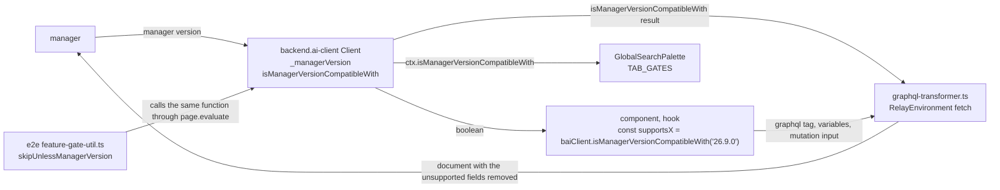
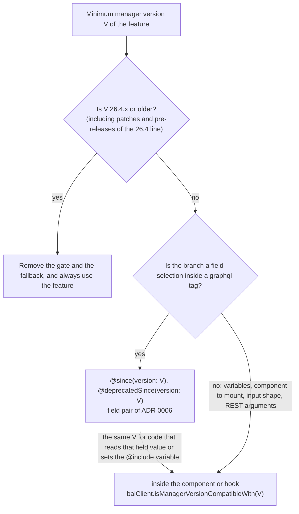

# 0010 — Component-level manager version gates

> [ADR 0011](0011-manager-compatibility-policy-in-the-team-dev-catalog.md) replaces the **Floor location** item of Decision section 1, which says that the body of this ADR sets the floor line. The policy in the team dev catalog declares the floor line for each branch, the supported range runs from that line to the branch's own line, and `pnpm run dev-env compat` reads it. The `26.4` this document states is the value at the time of the decision. The rule for removing gates and the other decisions stay in force.
>
> A screen that [ADR 0012](0012-scoped-search-fields-in-place-of-admin-fields.md) moved to the `scoped*` fields requires a manager of 26.9.0a4 or later, regardless of that floor.

## Summary

> Unfamiliar terms are collected in the [Glossary](#glossary) at the end.

- The manager floor this repository supports is the whole 26.4 LTS line. In application code, a [version gate](#glossary) for a feature that arrived in 26.4.x (patches and pre-releases included) or an older version is removed together with its fallback branch, and the code uses that feature as always present. A version check at a call site remains only for a feature that arrived in 26.5.0 or later.
- For a branch that depends on a manager version of 26.5.0 or later, the component or hook that uses the field decides it directly with `baiClient.isManagerVersionCompatibleWith('<version>')`. The version string is the manager version that first shipped the field, so a reader sees the minimum version right at the call site.
- The `Client` of `backend.ai-client` no longer turns on named [feature flags](#glossary). `_updateSupportList()` is an empty function, and `supports(name)` remains as an API but answers `false` for every name.
- The field pairs of [ADR 0006](0006-version-gated-field-pairs-across-manager-versions.md) (`@since` and `@deprecatedSince` together with `graphql-transformer.ts`) are still used for fields that arrived in 26.5.0 or later. This ADR replaces only the rule in section 4 of ADR 0006 that says "a branch outside the document is chosen with a feature flag".
- In e2e, `skipUnlessManagerVersion` makes the same decision, and in the global search palette, `TAB_GATES` makes it with `ctx.isManagerVersionCompatibleWith`. The supported floor applies to application code. An e2e test that depends on the manager version records the minimum version it passes on as a `@requires-manager-vX.Y` tag, and it carries the tag even when that version is 26.4 or older. `skipUnlessManagerVersion` is used only for features newer than the 26.4 floor.

## Context

- **Named flags**: Before this decision, `_updateSupportList()` in `packages/backend.ai-client/src/client.ts` turned on an item such as `this._features['client-ip-of-login-history'] = true` inside each `isManagerVersionCompatibleWith('<version>')` block, and a component read it with `baiClient.supports('client-ip-of-login-history')`. Every new query or field added one item to `Client`.
- **Hidden version**: The `supports('client-ip-of-login-history')` in `BAILoginHistoryTable` did not show the minimum manager version. A reader had to look up the name again in `client.ts` to learn the version.
- **Dead compat code**: After the supported LTS became 26.4, the code still held the disabled branches of flags for the 26.4 line or older, `@since(version: "X")` where X was on the 26.4 line or older, the handling in `graphql-transformer.ts` that renamed a fragment's `Query` to `Queries` for managers older than 25.14.0, and the image `name` field marked `@deprecatedSince(version: "24.12.0")`. A manager in the supported range never enters these branches.
- **Version source**: `Client.get_manager_version()` stores the version the manager answered in `_managerVersion`, and `isManagerVersionCompatibleWith(version)` compares that value with the argument through `comparePEP440Versions` and answers `true` when the result is `>= 0`. The comparison follows PEP 440, so `26.9.0a4` is less than `26.9.0`.

## Diagram

### Where the version is read

### How one gate is handled

## Decision

### 1. The supported floor is the manager 26.4 LTS line

- **Removed gates**: In application code (`react/`, `packages/`), a gate whose minimum version is 26.4.x or older is treated as always true, including patches and pre-releases such as `26.4.2` and `26.4.4rc9`. The flag item, the `isManagerVersionCompatibleWith` check, the fallback branch for a failed check, and the components, queries, and i18n keys that only that branch used are removed together. The code uses the feature as always present.
- **Stripped directives**: A `@since(version: "X")` in a graphql tag is removed when X is 26.4.x or older. For a `@deprecatedSince(version: "X")` where X is 26.4.x or older, the old field selection is removed together with the code that reads that field as a fallback (an expression such as `newField ?? oldField`). An `@include` or `@skip` variable that carried only that gate is removed too.
- **Latest patch assumed**: Treating a 26.4.x gate as always true assumes that every supported 26.4 deployment runs the latest 26.4 patch. A manager on an earlier 26.4 patch receives fields it cannot answer.
- **Backport arrays stay**: An array gate that holds both a 26.4.x item and an item from a newer line, such as `isManagerVersionCompatibleWith(['26.4.5', '26.8.2'])` or `@sinceMultiple(versions: [...])`, stays. The reason is that managers from 26.5.0 through 26.8.1 do not have the feature. An array whose items are all 26.4.x or older is removed like a single gate.
- **Floor location**: This ADR, not a constant in the code, sets the 26.4 floor line. A PR that raises the floor writes an ADR that replaces this section.
- **Transformer shims**: `graphql-transformer.ts` no longer converts between `Query` and `Queries` for managers older than 25.14.0. Its only remaining job is to read client directives and remove fields.

### 2. The place that uses a field decides the version branch

- **Call site check**: For a branch that depends on the manager version, the component or hook that holds the branch calls `baiClient.isManagerVersionCompatibleWith('<version>')` directly. `react/` gets the client with `useSuspendedBackendaiClient()`, and BUI gets it with `useConnectedBAIClient()`.
- **Non-component code**: Code that cannot call a hook calls the same method another way. The pure functions of the global search palette take `SearchContext.isManagerVersionCompatibleWith` as an argument, and `RelayEnvironment.ts` calls the method on `globalThis.backendaiclient`.
- **Version loaded first**: When `_managerVersion` is empty, `isManagerVersionCompatibleWith` answers `false` for every version. The login path calls `get_manager_version()` and then sends `backend-ai-connected`, and `useSuspendedBackendaiClient()` returns the client only after that, so a check inside a component sees a client whose version is filled in.
- **Named constant**: When the code uses the result more than once, it stores the result in a constant near the top of the component body, and the constant's name states the feature. A condition used only once stays inline in the JSX or the expression. `const isClientIpSupported = baiClient.isManagerVersionCompatibleWith('26.9.0')` in `BAILoginHistoryTable` and `const supportsSubFilter = baiClient.isManagerVersionCompatibleWith('26.7.0')` in `ResourceGroupList` have that shape.
- **Version string**: The argument states exactly the manager version that first shipped the field or the behaviour. When the shape changed in a pre-release, the argument states that pre-release, such as `26.9.0a4` or `26.9.0rc3`. When several places decide the same feature, they all use the same string.
- **Backported features**: When one feature arrived separately in several minor lines, the code uses an array, `isManagerVersionCompatibleWith(['26.4.4', '26.9.0'])`. `isCompatibleMultipleConditions` in `pep440.ts` compares against the item with the same minor as the connected manager, and against the highest item when no item has the same minor. `@sinceMultiple(versions: [...])` inside a graphql tag does not follow this rule. `isNotCompatibleWithVersion` in `RelayEnvironment.ts` keeps the field only when the manager is at or above every version in the array.
- **Field selection**: Inside a graphql tag, ADR 0006's `@since(version: V)` and `@deprecatedSince(version: V)` decide the field selection. The component calls `isManagerVersionCompatibleWith(V)` with the same V to align the code that reads that field and the `@include` or `@skip` variable. `useCurrentUserProjectRoles` sends `$supportsMyRolesV2` as the result of `isManagerVersionCompatibleWith('26.9.0a4')`.
- **Same rule outside GraphQL**: A branch that is not GraphQL uses the same check. `RBACManagementPage` chooses which role drawer to mount with `isManagerVersionCompatibleWith('26.9.0a4')`.

### 3. The Client does not turn on named flags

- **Empty support list**: `Client._updateSupportList()` is an empty function, and nobody adds new flags there. When a new field or query needs a gate, the check goes at the call site as section 2 says.
- **supports() surface**: Code in `react/`, BUI, and e2e does not call `supports`. `Client.supports(name)` remains as an API, but `_features` is always empty, so it answers `false` for every name.
- **ADR 0006 flags**: The checks below replace the flags that ADR 0006 names.

| flag in ADR 0006           | minimum version | replacing check                                                                                                                                                                                                 |
| -------------------------- | --------------- | --------------------------------------------------------------------------------------------------------------------------------------------------------------------------------------------------------------- |
| `rbac-single-scope-role`   | 26.9.0a4        | `useCurrentUserProjectRoles`, `RoleFormModal`, the drawer choice in `RBACManagementPage`, `RoleAssignmentTab`, `ProjectAdminSettingModal`, and `ProjectPage` call `isManagerVersionCompatibleWith('26.9.0a4')`. |
| `rbac-filter-wrapper`      | 26.4.4rc9       | No check exists. `useCurrentUserProjectRoles`, `LegacyRolePermissionTab`, and `LegacyRoleScopeTab` always send the `entityType` of the permission filter in the `{ equals: ... }` shape.                        |
| `role-mapped-scope-filter` | 26.8.0          | `RoleDetailDrawerContent`, `RoleAssignmentTab`, `RBACManagementPage`, and `ProjectPage` call `isManagerVersionCompatibleWith('26.8.0')`.                                                                        |
| `my-roles`                 | 26.4.0          | No check exists. `useCurrentUserProjectRoles` always reads the main query with `store-or-network`.                                                                                                              |

### 4. Tests and the palette also decide by version

- **E2E gate**: `skipUnlessManagerVersion(page, version, reason)` in `e2e/utils/feature-gate-util.ts` calls `backendaiclient.isManagerVersionCompatibleWith(version)` on the page and skips the test when the answer is `false`. The same test carries a version tag such as `@requires-manager-v26.9` so that `--grep-invert` can exclude it.
- **E2E records every minimum version as a tag**: The supported floor of section 1 applies to application code. An e2e test that depends on the manager version records the minimum version it passes on as a `@requires-manager-vX.Y` tag, and it carries the tag even when that version is 26.4 or older. A run against an older manager excludes that test with `--grep-invert`. A test for a version of 26.4 or older has no `skipUnlessManagerVersion`. The Agent Statistics test in `dashboard.spec.ts` carries only the `@requires-manager-v25.15` tag, and the preset test in `deployment-lifecycle.spec.ts` carries only the `@requires-manager-v26.4` tag.
- **E2E overrides**: A spec that forces the path of a version different from the connected manager wraps `isManagerVersionCompatibleWith` so that it answers `true` or `false` for specific version strings. `e2e/admin/deployments/admin-preset-service-config.spec.ts` is an example.
- **Palette context**: `SearchContext` in `react/src/components/GlobalSearchPalette/types.ts` has `isManagerVersionCompatibleWith` instead of `supports`.
- **Palette gates**: A manager version gate in `TAB_GATES` of `visibility.ts` calls `ctx.isManagerVersionCompatibleWith` with the same version string as the page that draws the tab. Today `TAB_GATES` has no version gate items.

## Rejected alternatives

- **Keep named flags in the client**: In this option, flags keep being added to `_updateSupportList()`, and components read them with `supports(name)`. Its advantage is that version decisions gather in one file, `client.ts`. It is rejected because the two problems the Context lists would remain: the items in `Client` grow with every field, and the name at the call site hides the minimum version.
- **Central version table**: In this option, a constant map that pairs feature names with versions lives in one file instead of flags, and components read that map. Its advantage is that names and versions can be seen in one place. It is rejected because the indirection of finding the version through a name is the same as with named flags, so the version is not visible at the call site.
- **Keep pre-LTS fallbacks**: In this option, gates for the 26.4 line or older are not removed and are only converted to version checks. Its advantage is that the existing behaviour stays even when the app connects to a manager older than 26.4. It is rejected because the team would have to maintain and test branches that no manager in the supported range enters, and the e2e specs for those branches cannot run against a supported backend either.
- **Floor at 26.4.0 only**: In this option, the floor is the single version `26.4.0`, and gates for patches and pre-releases after 26.4.0 stay. Its advantage is that a manager on a 26.4 patch that is not the latest still works through the fallback. It is rejected because the supported range is the whole 26.4 LTS line, and keeping patch gates would pile up, with every patch, fallback branches inside one LTS line and the components that only those branches use.

## Consequences

- **No client edit per gate**: A PR that adds a new gate does not edit `client.ts`.
- **Repeated version strings**: When several components, or a page and `TAB_GATES`, decide the same feature, the same version string is written in several files, and nothing checks that the strings match. A PR that removes a gate or raises the floor greps `isManagerVersionCompatibleWith('…')` and `@since(version: "…")` for that version and removes the gates and fallbacks in application code together; in `e2e/`, it removes `skipUnlessManagerVersion` but keeps the `@requires-manager-vX.Y` tags.
- **No lint guard**: No lint rule blocks a new `_features` item or a `supports(` call. Review blocks them with this ADR.
- **Silent false for plugins**: An external plugin that calls `supports(name)` receives `false` without an error and loses the gated behaviour.
- **No login floor**: The login step does not check a minimum manager version. A manager older than 26.4 and a manager on a 26.4 patch that is not the latest receive queries they cannot answer, instead of the removed fallbacks.
- **Out of scope**: A follow-up cleanup covers the REST API v3/v4 field shims in `backend.ai-client` resources, the unused `force2FA` setting path, four i18n keys that the code no longer references (`statistics.IOReadDesc` and others), and `scripts/release-risk-report.mjs`, which counts `_features`.

## Sources

- Jira: FR-3980. GitHub: #9738, PR #9739.
- Decided 2026-09-17.
- Related: The field pairs of [ADR 0006](0006-version-gated-field-pairs-across-manager-versions.md) stay in force, and this ADR replaces the feature flag rule in its section 4. [ADR 0003](0003-committed-search-index-artifact.md) decides the index of the global search palette that uses `TAB_GATES`. Code: `packages/backend.ai-client/src/client.ts`, `packages/backend.ai-client/src/pep440.ts`, `react/src/helper/graphql-transformer.ts`, `e2e/utils/feature-gate-util.ts`.

## Glossary

| Term                             | Meaning                                                                                                                                                                                                                                               |
| -------------------------------- | ----------------------------------------------------------------------------------------------------------------------------------------------------------------------------------------------------------------------------------------------------- |
| version gate                     | A version gate is a branch that chooses one of a field selection, variables, a component to mount, or a request shape according to the connected manager version.                                                                                     |
| feature flag                     | A feature flag is a named boolean that, before this decision, the `Client` of `backend.ai-client` turned on in `_updateSupportList()` according to the manager version. Code read it with `baiClient.supports(name)`, and today nothing turns one on. |
| `isManagerVersionCompatibleWith` | `isManagerVersionCompatibleWith` is a method of `Client` that answers `true` when the connected manager version is at or above the argument version. `comparePEP440Versions` in `pep440.ts` does the comparison.                                      |
