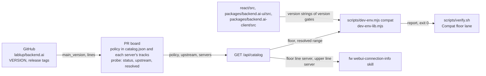
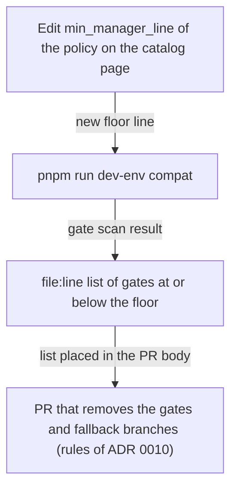

# 0011 — Manager compatibility policy in the team dev catalog

## Summary

> Unfamiliar terms are collected in the [Glossary](#glossary) at the end.

- `policy.webui.branches[<branch>].min_manager_line` in the team dev catalog declares the manager [floor](#glossary) that a branch of this repository supports. The ADRs, code, and documents of this repository do not write that value; they only say to read the catalog.
- One webui branch must work on every manager minor [line](#glossary) from the floor up to its own [upper line](#glossary), with the latest patch of each line. The upper line is manager `main` for webui `main`, and manager line `X.Y` for webui `X.Y`. The floor is the nearest manager [LTS line](#glossary) at or below the branch's version. When the next manager release (backend.ai `main`) is an LTS, the floor of webui `main` is `main`.
- Developers and agents run `pnpm run dev-env compat` to read the floor of the checked-out branch, the catalog server that runs each line in the range, and the `file:line` list of the [version gates](0010-component-level-manager-version-gates.md#glossary) in the application code that are at or below the floor.
- The person who raises the floor edits the catalog's policy and opens a PR that removes the gates `dev-env compat` listed, following the rules of [ADR 0010](0010-component-level-manager-version-gates.md). That person does not write a new ADR.
- A branch that is not in the policy is a branch nobody maintains.
- This ADR replaces only one item of ADR 0010 Decision section 1: **Floor location**.

## Context

- **Floor in the ADR**: ADR 0010 Decision section 1 wrote the support baseline at the time of the decision as the `26.4` line. Its **Floor location** item decided that the ADR body, not a constant in the code, sets that value, and that the PR that raises the baseline also writes an ADR that replaces that section.
- **Release branches**: Besides `main`, a release branch such as `26.9` also has its own floor.
- **Range, not a point**: A branch connects not to one floor but to every manager line from the floor up to its own line. Before this decision, no document wrote that range down, and nothing showed which server covers which line.
- **Team dev catalog**: The team PR board (`lablup/frontend-board`) serves the catalog of dev API servers and test accounts at `http://board.<domain>/api/catalog`, and people edit it on the board's catalog page (`?view=catalog`) ("Dev servers and test accounts" in `DEV_ENVIRONMENT.md`). `scripts/dev-env.mjs` already reads it, and the board probes the manager version of each server. The board lives in a repository separate from webui, and it is reachable only inside the dev VPN.
- **Version strings alone**: The manager reports only a version string (`26.9.0rc1`) and does not report a commit. Only release PRs bump the `VERSION` file on backend.ai `main`, so a server built from `main` cannot be told apart from a pre-release of the same name, and by number it looks lower than the latest patch of the release line. For this reason a server declares what it [tracks](#glossary), and the board uses that declaration to recognize a `main` server.
- **Shared contract**: The board, webui, and the `webui-connection-info` skill of the `fw` plugin agreed on the field names and meanings of the catalog as a shared contract.

## Diagram

### Where the policy is read

### Order of raising the floor

## Decision

### 1. The catalog policy declares the floor per branch, and the floor sets the range

- **Policy location**: `policy.webui.branches` in the catalog document holds the fields below, keyed by webui branch name.

| field              | value                                                     | meaning                                                                                                                                                                         |
| ------------------ | --------------------------------------------------------- | ------------------------------------------------------------------------------------------------------------------------------------------------------------------------------- |
| key                | `main`, or a release branch name of the form `^\d+\.\d+$` | The webui branch that reads the entry. `parseCatalog` skips any other key with a warning.                                                                                       |
| `min_manager_line` | `main` or a line of the form `^\d+\.\d+$`                 | The floor. A line means the whole line and assumes its latest patch (**Latest patch assumed** in ADR 0010). `main` means the branch supports only the backend.ai `main` branch. |
| `notes`            | string                                                    | A free-form note.                                                                                                                                                               |

- **Range rule**: A branch supports every manager minor line from the floor up to the upper line, with the latest patch of each line. The policy does not write the upper line. The upper line of webui `main` is manager `main`, and the upper line of webui `X.Y` is manager line `X.Y`. A line with no release (for example, a skipped minor) is not in the range.
- **Floor rule**: The floor is the nearest manager LTS line at or below the branch's version. When the next manager release (the one on backend.ai `main`) is an LTS, the floor of webui `main` is `main`, and the range is then `main` alone.
- **No number in this repository**: The ADRs, code, and documents of this repository do not write the value of the floor. A document that needs the value points at the catalog and `pnpm run dev-env compat`. `.github/instructions/e2e.instructions.md`, `e2e/E2E-TEST-NAMING-GUIDELINES.md`, and `.github/PULL_REQUEST_TEMPLATE.md` are written that way.
- **Edit path**: People edit the policy on the board's catalog page (`?view=catalog`), and the board saves and validates it through `PUT /api/catalog/policy`. The person who cuts a release branch adds that branch's entry. webui has no way to write the policy.
- **Retired target**: The `target` field that the first contract had no longer exists. `parseCatalog` drops any `target` left in the catalog without a warning.
- **Unmaintained branch**: A branch that is not in `branches` is a branch nobody maintains, and `dev-env compat` answers "not maintained" and the list of maintained branches for that branch.

### 2. `dev-env compat` reads the policy and reports the range

- **Branch resolution**: `scripts/dev-env.mjs compat` reads the checked-out branch with `git rev-parse --abbrev-ref HEAD`, and when `--branch <name>` is given, it uses that name instead. Both pass through `resolveCompatBranch` in `dev-env-lib.mjs`. When the name matches `^\d+\.\d+$`, the command reads that entry; for every other name (a feature branch, a detached HEAD, a place that is not a git checkout), it reads the `main` entry.
- **Resolved range**: The board computes `resolved` for each branch and sends it. When the board does not send `resolved` or its shape is wrong (one warning), `compatReport` in `dev-env-lib.mjs` computes the same block from the catalog's servers, `upstream`, and `tracks`. A live server is a server whose probe has `status.live` set to `true`.

| `resolved` field      | meaning                                                                                                                                                                                                                                                                                                                                      |
| --------------------- | -------------------------------------------------------------------------------------------------------------------------------------------------------------------------------------------------------------------------------------------------------------------------------------------------------------------------------------------- |
| `upper`               | The upper line: `main` or `X.Y`.                                                                                                                                                                                                                                                                                                             |
| `floor_version`       | The latest patch of the floor line (`upstream.lines[floor]`), or `upstream.main_version` when the floor is `main`. `null` when unknown.                                                                                                                                                                                                      |
| `upper_version`       | The same value for the upper line.                                                                                                                                                                                                                                                                                                           |
| `lines[]`             | The lines from the floor to the upper line in ascending order, each with `line`, `latest` (the latest patch), and `servers` (the live servers that run that line). A numbered line holds the servers that do not track `main`, and the `main` entry holds the live servers whose `tracks` is `main`. `main` comes after every numbered line. |
| `below_floor_servers` | The live servers of lines lower than the floor line. When the floor is `main`, these are the servers lower than the line of `main_version` that do not track `main`.                                                                                                                                                                         |

- **Report**: The command prints the floor and its latest patch, the range (`floor … upper`), each line's latest patch and servers (`— no server` when there is none), the servers below the floor, and a coverage gap warning for each line without a server.
- **Gate scan**: The command reads the `.ts`, `.tsx`, `.js`, `.jsx`, and `.mjs` files under `react/src`, `packages/backend.ai-ui/src`, and `packages/backend.ai-client/src`, and it skips the `__generated__` and `node_modules` directories and the `*.test.*`, `*.spec.*`, `*.stories.*`, and `*.doc.*` files (a `*.doc.*` file is a component's Astryx catalog entry and contains example code). `findVersionGates` in `dev-env-lib.mjs` finds the forms below with regular expressions.

| form                                        | example                                                    | condition for counting it as at or below the floor                                           |
| ------------------------------------------- | ---------------------------------------------------------- | -------------------------------------------------------------------------------------------- |
| `isManagerVersionCompatibleWith('V')`       | `isManagerVersionCompatibleWith('26.9.0')`                 | The line of V is at or below the gate floor.                                                 |
| `isManagerVersionCompatibleWith([...])`     | `isManagerVersionCompatibleWith(['26.4.5', '26.8.2'])`     | The line of every item is at or below the gate floor (**Backport arrays stay** in ADR 0010). |
| `@since(version: "V")`                      | `@since(version: "26.7.0")`                                | The line of V is at or below the gate floor.                                                 |
| `@deprecatedSince(version: "V")`            | `@deprecatedSince(version: "26.4.0")`                      | The line of V is at or below the gate floor.                                                 |
| `@sinceMultiple(versions: [...])`           | `@sinceMultiple(versions: ["26.4.5", "26.9.0"])`           | The line of every item is at or below the gate floor.                                        |
| `@deprecatedSinceMultiple(versions: [...])` | `@deprecatedSinceMultiple(versions: ["26.4.3", "26.8.1"])` | The line of every item is at or below the gate floor.                                        |

- **Gate floor**: The line the command compares gates against is the floor line. When the floor is `main`, it is the line of `upstream.main_version`, and when `upstream` is unknown, the command writes that it does not know instead of the gate list.
- **Version strings**: `versionLine` ignores a version that does not start with `<digits>.<digits>` (`x.y.z`), and `compareLines` compares lines by their two numeric components and places `main` after every numbered line. The command does not use `packages/backend.ai-client/src/pep440.ts`.
- **Report only**: When the command cannot read the catalog (when `WEBUI_DEV_ENV_CATALOG`, `WEBUI_DEV_ENV_CATALOG_URL`, and `DEV_GW_CONFIG` are all absent and `~/.config/fw/dev-gw.json` does not exist either, when the board is unreachable, or when the board does not serve `policy`), the command prints one line, `compat: no policy to read — <reason>`, and exits with 0. In that case `--json` outputs `{ available: false, branch, gitBranch, reason }`.
- **JSON output**: `--json` outputs the keys below.

| key                                                                   | value                                                                                                                                         |
| --------------------------------------------------------------------- | --------------------------------------------------------------------------------------------------------------------------------------------- |
| `available`                                                           | `true`                                                                                                                                        |
| `gitBranch`                                                           | The name `git rev-parse` answered, or `null` when there is none.                                                                              |
| `branch`, `maintained`                                                | The policy branch the command read, and whether an entry exists. When there is none, `maintainedBranches` is the list of maintained branches. |
| `floor`, `notes`                                                      | The values of the entry.                                                                                                                      |
| `upper`, `floorVersion`, `upperVersion`, `lines`, `belowFloorServers` | The `resolved` fields of the table above, in camelCase.                                                                                       |
| `gateFloorLine`                                                       | The line the command compared gates against, or `null` when unknown.                                                                          |
| `gates`                                                               | An array of `{ file, line, kind, versions }`, ordered by file name and line.                                                                  |
| `policyUpdatedAt`, `upstream`, `warnings`                             | The policy's `updated_at`, the board's GitHub probe result, and the warnings of `parseCatalog`.                                               |

- **List and status**: `dev-env list` prints each live server's `tracks` and [freshness](#glossary) next to its version (`tracks main (current)`, `tracks 26.9 (behind: expected 26.9.4)`), and `dev-env status` prints the policy's floor for each branch on one line.

### 3. A PR that raises the floor does not write an ADR

- **Catalog first**: The person who raises the floor edits that branch's `min_manager_line` on the catalog page.
- **Deletion PR**: That person then opens a PR that removes the gates `pnpm run dev-env compat` listed, following the rules of ADR 0010 Decision section 1 (remove the gate, the fallback branch, the components, queries, and i18n keys that only that branch used, and the `@include` and `@skip` variables together), and puts the command's output in the PR body.

### 4. Verification is report-only

- **verify.sh lane**: The `Compat floor` lane of `scripts/verify.sh` runs `node scripts/dev-env.mjs compat` with `WEBUI_DEV_ENV_FETCH_TIMEOUT_MS=4000`, prints the output unchanged, and does not affect `=== ALL PASS ===`. It is the same `report` kind as the Astryx token gate lane.
- **Skip rule**: The lane skips with one line when `WEBUI_DEV_ENV_CATALOG` and `WEBUI_DEV_ENV_CATALOG_URL` are both absent and the `${DEV_GW_CONFIG:-~/.config/fw/dev-gw.json}` file does not exist either. A CI runner is in that case. The board is reachable only inside the dev VPN, so CI does not enforce the floor, and a reviewer finds the gates at or below the floor in the lane's output.

## Rejected alternatives

- **Keep the floor in the ADR**: The value stays in the ADR body, as ADR 0010's **Floor location** says, and each raise writes a replacing ADR. The advantage is that people can read the value inside the repository. This alternative is rejected because each change of the LTS line adds one more ADR, and because one body cannot hold a floor that differs per branch.
- **Explicit target line**: The policy declares a development target line, `target`, next to the floor. The advantage is that people can see at a glance which line they develop against. This alternative is rejected because the upper line follows directly from the branch name (`main` is manager `main`, `X.Y` is line `X.Y`), and because the branch must support every line in between, so writing down one more point hides the range. The first contract had this field, and the second contract removed it.
- **Constant in code**: A constant such as `SUPPORTED_MANAGER_FLOOR` lives in `packages/backend.ai-client`, and a lint rule or test compares the gates against it. The advantage is that CI could block gates at or below the floor. This alternative is rejected because the value differs per branch, and because choosing a server for each line in the range requires reading the value together with each server's `tracks` and `freshness`, which only the board has. Nothing would check whether the constant disagrees with the catalog.
- **Policy file in the repository**: A file such as `compat-policy.json` lives in the repository, and the board reads it. The advantage is that the value goes through PR review. This alternative is rejected because each release branch would get its own copy of the file and the copies would diverge between branches, and because the board would have to walk webui's branches to read the file. People already edit the catalog in one place, and the board keeps its previous versions.
- **CI enforcement**: The `Compat floor` lane becomes a gate that fails verify when a gate at or below the floor exists. The advantage is that no gate that should be removed can remain. This alternative is rejected because the board is only inside the VPN, so CI cannot read the policy, and a gate that fails only on boxes that can read it gives results that depend on the environment.

## Consequences

- **Floor raise cost**: The person who raises the floor edits the catalog and opens one PR that removes gates. No webui document needs an edit.
- **Floor source**: A person who reads only the repository cannot know the floor. People outside the dev VPN and CI see only the one-line notice of `dev-env compat`.
- **Coverage gaps visible**: `compat` and the board show a warning for each line in the range without a server. Nobody actually checks compatibility on that line.
- **No enforcement**: CI passes even when gates at or below the floor remain. A reviewer catches them in the output of the `Compat floor` lane.
- **Contract drift**: The catalog's field names must change together with the board and the `fw` plugin. `parseCatalog` ignores unknown keys and records invalid values as warnings, so the command keeps working even when the board changes first.
- **Scan method**: The gate scan uses regular expressions, so it does not count a call that passes a variable, such as `isManagerVersionCompatibleWith(version)` (the directive helper in `react/src/RelayEnvironment.ts`), and it does not read `.graphql` files. Gates in components, hooks, and graphql tags write the version as a string literal (**Version string** in ADR 0010).

## Sources

- GitHub: #10345.
- Decision date: 2026-10-14; the second contract, which removed `target` and set the range rule, is dated 2026-10-15. The board (`lablup/frontend-board`), webui, and the `fw` plugin (`webui-connection-info` skill) agreed on the contract together.
- Related: This ADR replaces **Floor location** in Decision section 1 of [ADR 0010](0010-component-level-manager-version-gates.md), and the remaining decisions of ADR 0010 stay in force. The `@since` and `@deprecatedSince` pair of [ADR 0006](0006-version-gated-field-pairs-across-manager-versions.md) is two of the gate forms that `dev-env compat` counts. Code: `scripts/dev-env.mjs`, `scripts/dev-env-lib.mjs`, `scripts/verify.sh`. Documents: "Manager compatibility policy" in `DEV_ENVIRONMENT.md`.

## Glossary

| term       | meaning                                                                                                                                                                                                                                                     |
| ---------- | ----------------------------------------------------------------------------------------------------------------------------------------------------------------------------------------------------------------------------------------------------------- |
| line       | A line is the first two numeric components of a manager version. The line of `26.9.0rc1` is `26.9`, and the line of `26.4.13` is `26.4`. `main` is a special line name that refers to the backend.ai `main` branch, and it comes after every numbered line. |
| LTS line   | An LTS line is a release line that backend.ai supports for a long term.                                                                                                                                                                                     |
| floor      | The floor is the oldest manager line that a webui branch supports. It is the catalog's `min_manager_line`, and when it is a line, the latest patch of that line is assumed.                                                                                 |
| upper line | The upper line is the newest manager line that a webui branch supports. For webui `main` it is manager `main`, for webui `X.Y` it is manager line `X.Y`, and the catalog does not write it.                                                                 |
| tracks     | `tracks` is the backend.ai branch (`main`) or release line that a catalog server declares it was built from. The board compares the probed manager version with the current version of that branch or line. A server that does not declare it has `null`.   |
| freshness  | Freshness is the result of the board comparing a server's probed version with the current version of its `tracks`. It is one of `current`, `behind`, and `unknown`.                                                                                         |
