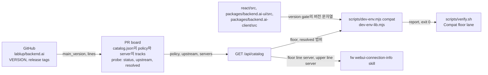
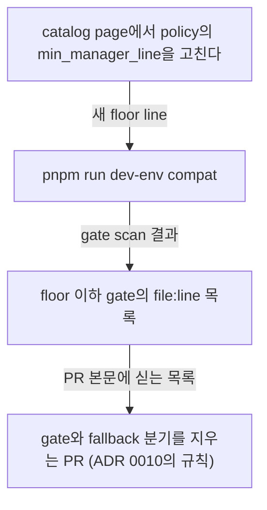

# 0011 — Manager compatibility policy in the team dev catalog

## Summary

> 낯선 용어는 문서 맨 아래 [용어](#용어)에 모아 두었다.

- 이 저장소의 branch가 지원하는 매니저 [floor](#용어)는 팀 dev catalog의 `policy.webui.branches[<branch>].min_manager_line`이 선언한다. 이 저장소의 ADR, 코드, 문서는 그 값을 적지 않고 catalog를 읽으라고만 적는다.
- 한 webui branch는 floor부터 자기 [upper line](#용어)까지의 모든 매니저 minor [line](#용어)에서, 각 line의 최신 patch로 동작해야 한다. upper line은 webui `main`이면 매니저 `main`, webui `X.Y`면 매니저 line `X.Y`다. floor는 branch의 버전 이하에서 가장 가까운 매니저 [LTS line](#용어)이고, 다음 매니저 release(backend.ai `main`)가 LTS면 webui `main`의 floor는 `main`이다.
- 개발자와 agent는 `pnpm run dev-env compat`으로 checkout한 branch의 floor, 범위의 line마다 그 line을 돌리는 catalog server, 그리고 애플리케이션 코드에서 floor 이하인 [version gate](0010-component-level-manager-version-gates.md#용어)의 `file:line` 목록을 읽는다.
- floor를 올리는 사람은 catalog의 policy를 고치고, `dev-env compat`이 나열한 gate를 [ADR 0010](0010-component-level-manager-version-gates.md)의 규칙대로 지우는 PR을 낸다. ADR은 새로 쓰지 않는다.
- policy에 없는 branch는 유지하지 않는 branch다.
- 이 ADR은 ADR 0010 Decision 1절의 **Floor location** 하나만 대신한다.

## Context

- **Floor in the ADR**: ADR 0010 Decision 1절은 결정 당시의 지원 기준을 `26.4` line으로 적었고, **Floor location**에서 그 값은 코드의 상수가 아니라 ADR 본문이 정하며 기준을 올리는 PR은 그 절을 대신하는 ADR을 함께 쓴다고 정했다.
- **Release branches**: `main` 외에 `26.9` 같은 release branch도 자기 floor를 갖는다.
- **Range, not a point**: branch는 floor 하나가 아니라 floor부터 자기 line까지의 모든 매니저 line에 붙는다. 이 결정 전에는 어떤 문서도 그 범위를 적지 않았고, 어느 server가 어느 line을 덮는지 아무도 보여 주지 않았다.
- **Team dev catalog**: 팀 PR board(`lablup/frontend-board`)가 `http://board.<domain>/api/catalog`로 dev API server와 test account의 catalog를 내고, board의 catalog page(`?view=catalog`)에서 편집한다(`DEV_ENVIRONMENT.md`의 "Dev servers and test accounts"). `scripts/dev-env.mjs`가 이미 그것을 읽고, board는 server마다 매니저 버전을 probe한다. board는 webui와 다른 저장소에 있고, dev VPN 안에서만 열린다.
- **Version strings alone**: 매니저는 버전 문자열(`26.9.0rc1`)만 알려 주고 commit은 알려 주지 않는다. backend.ai `main`의 `VERSION` 파일은 release PR만 올리므로, `main`으로 build한 server는 같은 이름의 pre-release와 구별되지 않고 숫자로는 release line의 최신 patch보다 낮아 보인다. 그래서 server는 자기가 [tracks](#용어)하는 것을 선언하고, board는 그것으로 `main` server를 알아본다.
- **Shared contract**: catalog의 field 이름과 의미는 board, webui, `fw` plugin의 `webui-connection-info` skill이 함께 쓰는 contract로 정했다.

## 설계도

### policy를 읽는 곳

### floor를 올리는 순서

## Decision

### 1. floor는 catalog policy가 branch마다 선언하고, 범위는 floor가 정한다

- **Policy location**: catalog 문서의 `policy.webui.branches`가 webui branch 이름을 key로 아래 field를 담는다.

| field | 값 | 뜻 |
|---|---|---|
| key | `main`, 또는 `^\d+\.\d+$` 꼴의 release branch 이름 | 그 entry를 읽는 webui branch. `parseCatalog`는 다른 key를 warning과 함께 건너뛴다. |
| `min_manager_line` | `main` 또는 `^\d+\.\d+$` 꼴의 line | floor. line이면 그 line 전체를 뜻하고 최신 patch를 가정한다(ADR 0010의 **Latest patch assumed**). `main`이면 backend.ai `main` branch만 지원한다. |
| `notes` | 문자열 | 자유 메모 |

- **Range rule**: branch는 floor부터 upper line까지의 모든 매니저 minor line을, 각 line의 최신 patch로 지원한다. upper line은 policy에 적지 않는다. webui `main`의 upper line은 매니저 `main`이고, webui `X.Y`의 upper line은 매니저 line `X.Y`다. release가 없는 line(예: 건너뛴 minor)은 범위에 없다.
- **Floor rule**: floor는 branch의 버전 이하에서 가장 가까운 매니저 LTS line이다. 다음 매니저 release(backend.ai `main`에 있는 것)가 LTS면 webui `main`의 floor는 `main`이고, 그때 범위는 `main` 하나다.
- **No number in this repository**: 이 저장소의 ADR, 코드, 문서는 floor의 값을 적지 않는다. 값이 필요한 문서는 catalog와 `pnpm run dev-env compat`을 가리킨다. `.github/instructions/e2e.instructions.md`, `e2e/E2E-TEST-NAMING-GUIDELINES.md`, `.github/PULL_REQUEST_TEMPLATE.md`가 그렇게 적는다.
- **Edit path**: policy는 board의 catalog page(`?view=catalog`)에서 고치고, board가 `PUT /api/catalog/policy`로 저장하며 검증한다. release branch를 자르는 사람이 그 branch의 entry를 더한다. webui 쪽에서 쓰는 길은 없다.
- **Retired target**: 첫 contract가 두었던 `target` field는 없다. catalog에 남은 `target`은 `parseCatalog`가 warning 없이 버린다.
- **Unmaintained branch**: `branches`에 없는 branch는 유지하지 않는 branch이고, `dev-env compat`은 그 branch에 "not maintained"와 유지하는 branch 목록을 답한다.

### 2. `dev-env compat`이 policy를 읽고 범위를 보고한다

- **Branch resolution**: `scripts/dev-env.mjs compat`은 `git rev-parse --abbrev-ref HEAD`로 checkout한 branch를 읽고, `--branch <name>`이 있으면 그 이름을 대신 쓴다. 둘 다 `dev-env-lib.mjs`의 `resolveCompatBranch`를 거친다. 이름이 `^\d+\.\d+$`이면 그 entry를, 그 밖의 모든 이름(feature branch, detached HEAD, git checkout이 아닌 곳)은 `main`의 entry를 읽는다.
- **Resolved range**: board는 branch마다 `resolved`를 계산해 보낸다. board가 `resolved`를 보내지 않거나 모양이 맞지 않으면(warning 하나) `dev-env-lib.mjs`의 `compatReport`가 catalog의 server, `upstream`, `tracks`로 같은 block을 계산한다. live server는 probe의 `status.live`가 `true`인 server다.

| `resolved` field | 뜻 |
|---|---|
| `upper` | upper line: `main` 또는 `X.Y` |
| `floor_version` | floor line의 최신 patch(`upstream.lines[floor]`), floor가 `main`이면 `upstream.main_version`. 모르면 `null`. |
| `upper_version` | upper line의 같은 값 |
| `lines[]` | floor부터 upper까지의 line을 오름차순으로, 각각 `line`, `latest`(최신 patch), `servers`(그 line을 돌리는 live server). 번호 line에는 `main`을 tracks하지 않는 server가, `main` entry에는 `tracks`가 `main`인 live server가 들어간다. `main`은 모든 번호 line 뒤에 온다. |
| `below_floor_servers` | floor line보다 낮은 line의 live server. floor가 `main`이면 `main_version`의 line보다 낮고 `main`을 tracks하지 않는 server다. |

- **Report**: 명령은 floor와 그 최신 patch, 범위(`floor … upper`), line마다 그 line의 최신 patch와 server(없으면 `— no server`), floor 아래의 server, server가 없는 line의 coverage gap warning을 찍는다.
- **Gate scan**: 명령은 `react/src`, `packages/backend.ai-ui/src`, `packages/backend.ai-client/src` 아래 `.ts`, `.tsx`, `.js`, `.jsx`, `.mjs` 파일을 읽고, `__generated__`·`node_modules` 디렉터리와 `*.test.*`, `*.spec.*`, `*.stories.*`, `*.doc.*`(component의 Astryx catalog 항목; 예제 코드를 담는다) 파일은 건너뛴다. `dev-env-lib.mjs`의 `findVersionGates`가 아래 형태를 정규식으로 찾는다.

| 형태 | 예 | floor 이하로 세는 조건 |
|---|---|---|
| `isManagerVersionCompatibleWith('V')` | `isManagerVersionCompatibleWith('26.9.0')` | V의 line이 gate floor 이하 |
| `isManagerVersionCompatibleWith([...])` | `isManagerVersionCompatibleWith(['26.4.5', '26.8.2'])` | 모든 항목의 line이 gate floor 이하(ADR 0010의 **Backport arrays stay**) |
| `@since(version: "V")` | `@since(version: "26.7.0")` | V의 line이 gate floor 이하 |
| `@deprecatedSince(version: "V")` | `@deprecatedSince(version: "26.4.0")` | V의 line이 gate floor 이하 |
| `@sinceMultiple(versions: [...])` | `@sinceMultiple(versions: ["26.4.5", "26.9.0"])` | 모든 항목의 line이 gate floor 이하 |
| `@deprecatedSinceMultiple(versions: [...])` | `@deprecatedSinceMultiple(versions: ["26.4.3", "26.8.1"])` | 모든 항목의 line이 gate floor 이하 |

- **Gate floor**: gate를 비교하는 line은 floor line이다. floor가 `main`이면 `upstream.main_version`의 line이고, `upstream`을 모르면 명령은 gate 목록 대신 모른다고 적는다.
- **Version strings**: `versionLine`은 `<digits>.<digits>`로 시작하지 않는 버전(`x.y.z`)을 무시하고, `compareLines`는 line을 두 숫자 성분으로 비교하며 `main`을 모든 번호 line 뒤에 둔다. `packages/backend.ai-client/src/pep440.ts`는 쓰지 않는다.
- **Report only**: catalog를 읽지 못하면(`WEBUI_DEV_ENV_CATALOG`·`WEBUI_DEV_ENV_CATALOG_URL`·`DEV_GW_CONFIG`가 모두 없고 `~/.config/fw/dev-gw.json`도 없을 때, board에 닿지 않을 때, board가 `policy`를 내지 않을 때) 명령은 `compat: no policy to read — <이유>` 한 줄을 찍고 exit 0으로 끝난다. `--json`은 그 경우 `{ available: false, branch, gitBranch, reason }`을 낸다.
- **JSON output**: `--json`은 아래 key를 낸다.

| key | 값 |
|---|---|
| `available` | `true` |
| `gitBranch` | `git rev-parse`가 답한 이름, 없으면 `null` |
| `branch`, `maintained` | 읽은 policy branch와 entry가 있는지. 없으면 `maintainedBranches`가 유지하는 branch 목록이다. |
| `floor`, `notes` | entry의 값 |
| `upper`, `floorVersion`, `upperVersion`, `lines`, `belowFloorServers` | 위 표의 `resolved`를 camelCase로 |
| `gateFloorLine` | gate를 비교한 line, 모르면 `null` |
| `gates` | `{ file, line, kind, versions }`의 배열, 파일 이름과 줄 순 |
| `policyUpdatedAt`, `upstream`, `warnings` | policy의 `updated_at`, board의 GitHub probe 결과, `parseCatalog`의 warning |

- **List and status**: `dev-env list`는 live server의 `tracks`와 [freshness](#용어)를 버전 옆에 찍고(`tracks main (current)`, `tracks 26.9 (behind: expected 26.9.4)`), `dev-env status`는 policy의 branch별 floor를 한 줄로 찍는다.

### 3. floor를 올리는 PR은 ADR을 쓰지 않는다

- **Catalog first**: floor를 올리는 사람은 catalog page에서 그 branch의 `min_manager_line`을 고친다.
- **Deletion PR**: 그다음 `pnpm run dev-env compat`이 나열한 gate를 ADR 0010 Decision 1절의 규칙(gate, fallback 분기, 그 분기만 쓰던 component·query·i18n key, `@include`·`@skip` variable을 함께 지운다)대로 지우는 PR을 내고, PR 본문에 그 명령의 출력을 싣는다.

### 4. 검증은 report-only다

- **verify.sh lane**: `scripts/verify.sh`의 `Compat floor` lane은 `WEBUI_DEV_ENV_FETCH_TIMEOUT_MS=4000`으로 `node scripts/dev-env.mjs compat`을 돌려 출력을 그대로 찍고, `=== ALL PASS ===`에 영향을 주지 않는다. Astryx token gate lane과 같은 `report` 종류다.
- **Skip rule**: lane은 `WEBUI_DEV_ENV_CATALOG`와 `WEBUI_DEV_ENV_CATALOG_URL`이 모두 없고 `${DEV_GW_CONFIG:-~/.config/fw/dev-gw.json}` 파일도 없으면 한 줄로 건너뛴다. CI runner가 그 경우다. board는 dev VPN 안에서만 열리므로 CI는 floor를 강제하지 않고, 리뷰어가 lane의 출력으로 floor 이하 gate를 본다.

## 대안과 기각 사유

- **Keep the floor in the ADR**: ADR 0010의 **Floor location**대로 값을 ADR 본문에 두고, 올릴 때마다 대신하는 ADR을 쓴다. 저장소 안에서 값을 읽을 수 있다는 것이 장점이다. 기각한 이유는 LTS line이 바뀔 때마다 ADR이 하나씩 늘고, branch마다 다른 floor를 본문 하나가 담지 못하기 때문이다.
- **Explicit target line**: floor 옆에 개발 대상 line `target`을 함께 선언한다. 어느 line을 상대로 개발하는지 한눈에 보인다는 것이 장점이다. 기각한 이유는 upper line이 branch 이름에서 바로 나오고(`main`은 매니저 `main`, `X.Y`는 line `X.Y`), 그 사이의 모든 line을 지원해야 하므로 점 하나를 더 적는 것이 범위를 가리기 때문이다. 첫 contract에 있던 이 field는 두 번째 contract가 지웠다.
- **Constant in code**: `packages/backend.ai-client`에 `SUPPORTED_MANAGER_FLOOR` 같은 상수를 두고 lint나 test가 그 값과 gate를 비교한다. CI가 floor 이하 gate를 막을 수 있다는 것이 장점이다. 기각한 이유는 값이 branch마다 다르고, server의 `tracks`·`freshness`와 함께 읽어야 범위의 line마다 server를 고를 수 있는데 그 정보는 board만 갖기 때문이다. 상수가 catalog와 어긋나도 아무도 검사하지 않는다.
- **Policy file in the repository**: `compat-policy.json` 같은 파일을 저장소에 두고 board가 그것을 읽는다. 값이 PR 리뷰를 거친다는 것이 장점이다. 기각한 이유는 release branch마다 파일 사본이 생겨 branch 사이에서 어긋나고, board가 webui의 branch를 돌며 파일을 읽어야 하기 때문이다. catalog는 이미 한곳에서 편집되고 board가 이전 버전을 보관한다.
- **CI enforcement**: `Compat floor` lane을 gate로 두어 floor 이하 gate가 있으면 verify를 실패시킨다. 지워야 할 gate가 남지 못한다는 것이 장점이다. 기각한 이유는 board가 VPN 안에만 있어 CI가 policy를 읽을 수 없고, 읽을 수 있는 box에서만 실패하는 gate는 환경에 따라 결과가 갈리기 때문이다.

## Consequences

- **Floor raise cost**: floor를 올리는 사람은 catalog를 고치고 gate를 지우는 PR 하나를 낸다. webui 쪽 문서는 고칠 것이 없다.
- **Floor source**: 저장소만 읽는 사람은 floor를 알 수 없다. dev VPN 밖의 사람과 CI는 `dev-env compat`의 안내 한 줄만 본다.
- **Coverage gaps visible**: 범위의 line 중 server가 없는 line은 `compat`과 board가 warning으로 보여 준다. 그 line의 호환성은 아무도 실제로 확인하지 못한다.
- **No enforcement**: floor 이하 gate가 남아도 CI는 통과한다. 리뷰어가 `Compat floor` lane의 출력으로 잡는다.
- **Contract drift**: catalog의 field 이름은 board와 `fw` plugin과 함께 바뀌어야 한다. `parseCatalog`는 모르는 key를 무시하고 잘못된 값은 warning으로 남기므로, board가 먼저 바뀌어도 명령은 멈추지 않는다.
- **Scan method**: gate scan은 정규식이라 `isManagerVersionCompatibleWith(version)`처럼 변수를 넘기는 호출(`react/src/RelayEnvironment.ts`의 directive helper)은 세지 않고, `.graphql` 파일은 읽지 않는다. component, hook, graphql tag의 gate는 버전을 문자열 literal로 적는다(ADR 0010의 **Version string**).

## 출처

- GitHub: #10345.
- 결정일: 2026-10-14; `target`을 지우고 범위 규칙을 정한 두 번째 contract는 2026-10-15. contract는 board(`lablup/frontend-board`), webui, `fw` plugin(`webui-connection-info` skill)이 함께 정했다.
- 관련: [ADR 0010](0010-component-level-manager-version-gates.md)의 Decision 1절 **Floor location**을 이 ADR이 대신하고, 나머지 결정은 그대로 발효 중이다. [ADR 0006](0006-version-gated-field-pairs-across-manager-versions.md)의 `@since`·`@deprecatedSince` pair는 `dev-env compat`이 세는 gate 형태 중 둘이다. 코드: `scripts/dev-env.mjs`, `scripts/dev-env-lib.mjs`, `scripts/verify.sh`. 문서: `DEV_ENVIRONMENT.md`의 "Manager compatibility policy".

## 용어

| 용어 | 뜻 |
|---|---|
| line | 매니저 버전의 앞 두 숫자 성분이다. `26.9.0rc1`의 line은 `26.9`, `26.4.13`의 line은 `26.4`다. `main`은 backend.ai `main` branch를 가리키는 특별한 line 이름이고 모든 번호 line 뒤에 온다. |
| LTS line | backend.ai가 장기 지원하는 release line이다. |
| floor | 한 webui branch가 지원하는 가장 오래된 매니저 line이다. catalog의 `min_manager_line`이고, line이면 그 line의 최신 patch를 가정한다. |
| upper line | 한 webui branch가 지원하는 가장 새 매니저 line이다. webui `main`은 매니저 `main`, webui `X.Y`는 매니저 line `X.Y`이고, catalog에는 적지 않는다. |
| tracks | catalog server가 선언하는, 그 server를 build한 backend.ai branch(`main`) 또는 release line이다. board는 probe한 매니저 버전을 그것의 현재 버전과 비교한다. 선언하지 않은 server는 `null`이다. |
| freshness | board가 server의 probe 버전을 `tracks`의 현재 버전과 비교한 결과다. `current`, `behind`, `unknown` 중 하나다. |
