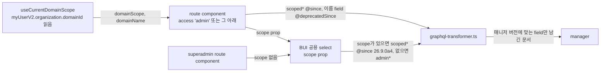

# 0011 — Scoped search fields on non-superadmin routes

## Summary

> 낯선 용어는 문서 맨 아래 [용어](#용어)에 모아 두었다.

- superadmin이 아닌 사용자가 들어올 수 있는 route(`access`가 `'admin'`, `'projectAdmin'`이거나 없는 route)의 component는 `admin*` root field를 select하지 않는다. 그 목록은 엔티티마다 하나인 [`scoped*` field](#용어)에 `scope` input 하나를 넘겨 읽는다.
- 공용 component(BUI의 select, 목록)는 범위를 `domainId`·`projectId` 같은 종류별 prop이 아니라, 그 `scoped*` field의 scope input type을 그대로 받는 optional `scope` prop 하나로 받는다. `scope`가 없으면 superadmin route용 `admin*` field를 읽는다.
- 현재 도메인의 scope는 `react/src/hooks/useCurrentDomainScope.ts`의 `useCurrentDomainScope()`가 `myUserV2.organization.domainId`로 만든다.
- `scoped*` field와 `UserV2.organization.domainId`가 함께 답하는 매니저 버전은 26.9.0a4이다. 그보다 오래된 매니저는 [ADR 0006](0006-version-gated-field-pairs-across-manager-versions.md)의 field pair로 지금 쓰는 field를 계속 받는다.

## Context

- **admin field**: 매니저 Strawberry API의 `admin*` root field(`adminUsersV2`, `adminProjectsV2`, `adminResourceGroups`, `adminImagesV2`, `admin*Mutation` …)는 resolver 첫 줄에서 `check_admin_only()`를 부르고, superadmin이 아니면 `Insufficient privilege. (Admin exclusive access)`로 요청을 거부한다. backend.ai `src/ai/backend/manager/api/gql/AGENTS.md`는 이 field를 "superadmin only, no scope"로 정의한다.
- **Route access**: `react/src/routes.tsx`의 `/admin` 하위 route는 `access: 'admin'`이라 도메인 관리자도 들어온다. 그중 일부만 `access: 'superadmin'`으로 좁혀져 있다. #10300 조사 시점에 `/admin/users`, `/admin/resource-policy`, `/admin/session`, `/admin/environment`, `/admin/scheduler`와 배포 상세의 Revision History가 `admin*` field를 select해서, 도메인 관리자나 일반 사용자에게 오류 화면을 보였다.
- **Two scope shapes**: schema에는 범위를 받는 field가 두 모양으로 있다.

| 모양                                                           | 예                                                                                                                        | 추가된 매니저 |
| -------------------------------------------------------------- | ------------------------------------------------------------------------------------------------------------------------- | ------------- |
| 범위 종류마다 field 하나, 이름으로 지정                        | `domainUsersV2(scope: { domainName })`, `domainProjectsV2(scope: { domainName })`, `projectUsersV2(scope: { projectId })` | 26.2.0        |
| 엔티티마다 `scoped*` field 하나, 여러 종류의 범위를 한 input에 | `scopedUsersV2(scope: { domain: [{ value }], project: [{ value }], role: [{ value }] })`                                  | 26.9.0a1      |

- **Backend direction**: backend.ai의 `api/gql/AGENTS.md`와 `KNOWLEDGE.md`는 `scoped*` 모양을 규약으로 두고, 범위 종류별 field는 "outgoing pattern"이라 새로 만들지 않는다고 적는다(BA-7742). 두 모양은 같은 action과 같은 권한 검사를 거친다.
- **Authorization**: `scoped*` field는 scope에 적힌 모든 범위에서 읽기 권한을 검사하고 하나라도 없으면 요청 전체를 거부한다. 결과는 각 범위로 닿는 행의 합집합이고, `filter`는 그 위에 AND로 붙는다. 모든 목록이 빈 scope는 거부되므로 superadmin도 빈 scope로 전체 목록을 받지 못한다.
- **Domain id**: `scoped*` scope는 도메인을 UUID로 받는데, `useCurrentDomainValue()`는 도메인 이름을 답한다. UUID를 답하는 `UserV2.organization.domainId`는 26.9.0a4에 추가되었다.

## 설계도

## Decision

### 1. superadmin이 아닌 route는 `scoped*` field로 읽는다

- **Rule**: `access`가 `'superadmin'`이 아닌 route가 렌더하는 component, 그리고 그런 route에서 열리는 modal과 select는 `admin*` root field를 select하지 않는다.
- **Read**: 목록은 그 엔티티의 `scoped*` field(`scopedUsersV2`, `scopedProjectsV2`, `scopedResourceGroups`, `scopedImagesV2` …)로 읽고, scope는 화면이 다루는 도메인이나 프로젝트를 담는다.
- **Write**: `scoped*`에 대응하는 mutation이 없는 쓰기(사용자 생성·수정, keypair, 리소스 정책)는 `useSuspendedBackendaiClient().is_superadmin`이 참일 때만 그 동작을 렌더한다.
- **No scoped field**: 읽을 `scoped*` field가 없으면, 도메인 관리자에게 답하는 legacy field가 있을 때 그 field를 쓰고, 없으면 route를 `access: 'superadmin'`으로 좁힌다. 두 경우 모두 `TODO(needs-backend)`로 backend 요청 issue를 가리킨다.

### 2. 공용 component는 `scope` prop 하나를 받는다

- **Prop**: BUI의 공용 select와 목록은 `scope?: <ScopeInputType>` prop 하나로 범위를 받는다. type은 relay-compiler가 만든 그 field의 scope input type(`ProjectScope`, `ResourceGroupScope`, `ImageSearchScope`)이다. `domainId`·`projectId`·`userId` 같은 종류별 prop을 더하지 않는다.
- **Query**: component의 document는 `scoped*` field에 `@since(version: "26.9.0a4")`와 `@include(if: $useScope)`를, `admin*` field에 `@skip(if: $useScope)`를 단다. `$useScope`는 `scope`가 있고 `isManagerVersionCompatibleWith('26.9.0a4')`가 참일 때 참이다.
- **Callers**: superadmin route의 호출부는 `scope`를 넘기지 않고, 그 밖의 호출부는 넘긴다.

### 3. 현재 도메인 scope는 `useCurrentDomainScope`가 만든다

- **Hook**: `react/src/hooks/useCurrentDomainScope.ts`의 `useCurrentDomainScope()`는 `{ domainName, domainId, domainScope, supportsScopedSearch }`를 답한다. `domainScope`는 `{ domain: [{ value: domainId }] }`이고, 26.9.0a4 미만 매니저에서는 `null`이다.
- **Fetch**: 26.9.0a4 이상에서는 `myUserV2.organization.domainId`를 `store-or-network`로 읽고, 미만에서는 `store-only`로 두어 요청을 보내지 않는다.
- **Version constant**: 버전 문자열 `'26.9.0a4'`는 같은 파일의 `SCOPED_SEARCH_MIN_VERSION`이 가진다. graphql tag 안의 `@since`는 상수를 쓸 수 없어 같은 문자열을 적는다.

### 4. 26.9.0a4 미만 매니저는 지금 field를 유지한다

- **Pair**: 페이지가 직접 쓰는 query는 ADR 0006대로 `scoped*` field에 `@since(version: "26.9.0a4")`, 이름으로 범위를 받는 field(`domainUsersV2` …)에 `@deprecatedSince(version: "26.9.0a4")`를 단다. 이름 field가 없으면 `admin*` field를 그대로 둔다.
- **Removal**: 26.9 미만 매니저 지원을 끝내는 PR이 `@deprecatedSince(version: "26.9.0a4")` 선택과 `$useScope`의 버전 조건을 지운다.

## 대안과 기각 사유

- **범위 종류별 field(`domainUsersV2`, `projectUsersV2`)**: 26.2.0부터 있어 버전 분기가 없고 도메인 이름으로 바로 부른다. 기각한다. 도메인, 프로젝트, 사용자 범위마다 field와 query가 따로 필요해 공용 component가 범위 종류마다 분기하고, backend가 새로 만들지 않는 모양이라 새 엔티티에는 없다.
- **종류별 prop(`domainId`, `projectId`)을 공용 component에 더하기**: 호출부가 읽기 쉽다. 기각한다. 범위 종류가 늘 때마다 prop과 분기가 늘고, 두 종류를 함께 넘기는 경우(도메인과 사용자 OR)를 표현하려면 prop 조합 규칙을 따로 정해야 한다. scope input type은 schema가 이미 정의한 계약이다.
- **도메인 관리자에게 화면을 숨기기만 하기**: 수정이 가장 적다. 기각한다. 도메인 관리자가 읽을 수 있는 `scoped*` field가 있는데도 화면을 잃는다.

## Consequences

- superadmin과 도메인 관리자가 같은 route에서 같은 document를 받고, 매니저가 scope로 결과를 좁힌다.
- 공용 select의 범위 계약이 schema의 scope input과 같아, 새 범위 종류는 prop 변경 없이 호출부의 값으로 들어온다.
- 26.9.0a4 미만 매니저에서 `admin*` field만 있는 공용 select는 도메인 관리자에게 계속 거부된다.
- 리소스 정책, 사용자와 keypair 쓰기처럼 backend에 scoped field가 없는 동작은 superadmin 전용으로 남는다.

## 출처

- #10300 (epic), #10301, #10288, 2026-10-13.
- backend.ai `src/ai/backend/manager/api/gql/AGENTS.md`, `api/gql/KNOWLEDGE.md`, `api/gql/utils.py`의 `check_admin_only`, BA-7742(#14451).

관련: [ADR 0006](0006-version-gated-field-pairs-across-manager-versions.md), [ADR 0010](0010-component-level-manager-version-gates.md).

## 용어

| 용어            | 뜻                                                                                                                                                                                                     |
| --------------- | ------------------------------------------------------------------------------------------------------------------------------------------------------------------------------------------------------ |
| `scoped*` field | 엔티티마다 하나인 검색 root field로, `scope` input에 도메인·프로젝트·사용자 같은 범위를 `UUIDScope` 목록으로 받는다(`scopedUsersV2`, `scopedProjectsV2` …). backend.ai `api/gql/AGENTS.md`가 정의한다. |
| `UUIDScope`     | `scoped*` scope input의 항목 하나로, `{ value: UUID }` 모양이다. 한 목록 안의 항목과 여러 목록은 OR로 합쳐진다.                                                                                        |
