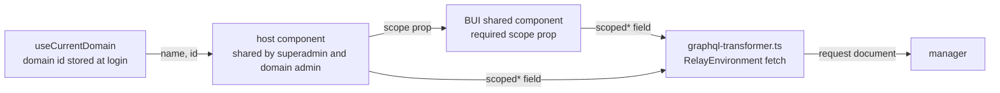

# 0012 — Scoped search fields in place of admin fields

## Summary

> Unfamiliar terms are collected in the [Glossary](#glossary) at the end.

- A component that reads a list reads it through the one [`scoped*` field](#glossary) of each entity, passing a single `scope` input, instead of through an `admin*` root field. The code drops every `admin*` read that has a matching `scoped*` field.
- The `scope` is the current domain, whatever role the user logged in with. Both a superadmin and a domain admin pass `{ domain: [{ value: <domain UUID> }] }`, built from the `id` of `useCurrentDomain()`.
- A shared component receives its range as one required `scope` prop that takes that field's scope input type, not as one id prop per kind of range.
- The code uses these fields only on managers 26.9.0a4 or later. The code keeps no fallback field for managers older than 26.9, and for these fields only, it requires 26.9.0a4, which is higher than the support floor that [ADR 0011](0011-manager-compatibility-policy-in-the-team-dev-catalog.md) set in the team dev catalog.

## Context

- **admin field**: An `admin*` root field of the manager's Strawberry API calls `check_admin_only()` on the first line of its resolver, and the manager rejects the request with `Insufficient privilege. (Admin exclusive access)` when the user is not a superadmin.
- **Route access**: `useRouteAccessDecision` (`react/src/hooks/useRouteAccess.ts`) decides a route's access from the deepest `handle.access` in the match chain. The `/admin` route in `react/src/routes.tsx` is `access: 'admin'`, so domain admins can also enter leaf routes that have no `access` of their own, such as `/admin/users` and `/admin/session`.
- **Two scope shapes**: The schema has fields that take a range in two shapes.

| Shape                                                                    | Example                                                                                  | Manager that added it |
| ------------------------------------------------------------------------ | ---------------------------------------------------------------------------------------- | --------------------- |
| One field per kind of range, selected by name                            | `domainUsersV2(scope: { domainName })`, `projectUsersV2(scope: { projectId })`           | 26.2.0                |
| One `scoped*` field per entity, with several kinds of range in one input | `scopedUsersV2(scope: { domain: [{ value }], project: [{ value }], role: [{ value }] })` | 26.9.0                |

- **Backend direction**: backend.ai's `api/gql/AGENTS.md` and `KNOWLEDGE.md` set the `scoped*` shape as the convention, and they state that the backend no longer creates new per-kind fields (BA-7742).
- **Authorization**: A `scoped*` field checks read permission on every range listed in the scope, and the manager rejects the whole request if any one check fails. A superadmin passes every check. The result is the union of the rows reachable through each range, and the `filter` applies on top of it with AND. The manager rejects a scope whose range lists are all empty.
- **Domain id**: A `scoped*` scope takes the domain as a UUID. `useCurrentDomain()` in `react/src/hooks/index.tsx` returns `{ name, id }`, the domain name and UUID that the app stored from `myUserV2` at login (#10382).
- **No scoped write**: For creating and updating users, keypairs, resource policies, and resource presets, and for fair share weights, both the V2 `admin*` mutations and the legacy mutations accept only a superadmin, and no `scoped*` mutation exists. For `session_pending_queue`, the resource policy lists, and the `rg*FairShare*` queries, no field exists that a domain admin can read either.

## Diagram

## Decision

### 1. `admin*` reads change to `scoped*` fields

- **Rule**: An `admin*` read that has a matching `scoped*` field (`adminUsersV2`, `adminProjectsV2`, `adminResourceGroups`, `adminImagesV2` …) changes to the `scoped*` field (`scopedUsersV2`, `scopedProjectsV2`, `scopedResourceGroups`, `scopedImagesV2` …), and the code drops the `admin*` selection.
- **System-wide management**: A screen where a superadmin creates and manages entities that are not bound to a domain keeps its `admin*` fields. This group includes `ResourceGroupList` in resource group management, `BAIAdminResourceGroupSelect` in the Agent settings and the RBAC role modal, the fair share settings (`FairShareItems/*`), and the RBAC management screens and `BAIAdminUserV2Select`. If these screens read with a domain scope, the entities they manage would be missing from them.
- **No scoped field**: When no `scoped*` field exists for a read or a write, the host component renders that action only when `useSuspendedBackendaiClient().is_superadmin` is true, and it uses a legacy read field if one exists that answers domain admins. A `TODO(needs-backend)` marker points to the backend request issue.

### 2. The scope is the current domain

- **Hook**: The caller builds `{ domain: [{ value: id }] }` from the `id` of `useCurrentDomain()` (`react/src/hooks/index.tsx`) and passes it. The code adds no separate hook or type that builds the scope.
- **Every role**: A superadmin passes the same `domainScope` too. The list that a superadmin sees narrows to the current domain.
- **Narrower scope**: When the range a screen handles is narrower than the domain (the project of one deployment), the caller builds that range directly (`{ project: [{ value: projectId }], public: true }`).

### 3. A shared component takes one required `scope` prop

- **Prop**: BUI's shared selects and lists receive their range through one `scope: <ScopeInputType>` prop. `<ScopeInputType>` is the scope input that the component's query uses (`UserScope`, `ProjectScope`, `ResourceGroupScope`, `ImageSearchScope`), and the component imports the type that relay-compiler exported in that query's `__generated__/<Query>.graphql.ts`. The code adds no per-kind props such as `domainId`, `projectId`, or `userId`.
- **Host value**: The shape `{ domain: [{ value: id }] }` is assignable to all four input types above.

### 4. The code uses these fields only on managers 26.9.0a4 or later

- **No fallback**: The `scoped*` fields carry no `@since`, and the code keeps no `admin*` or by-name field branch for managers older than 26.9. A screen that uses these fields shows an error on a manager older than 26.9.0a4.
- **Floor**: The screens this decision changed require a manager 26.9.0a4 or later, regardless of the support floor that the catalog declares ([ADR 0011](0011-manager-compatibility-policy-in-the-team-dev-catalog.md)). The rest of the code follows ADR 0010 and ADR 0011.

## Rejected alternatives

- **Per-kind scope fields**: In this alternative, the code uses a different field for each kind of range (`domainUsersV2`, `projectUsersV2`). These fields exist from 26.2.0, so a 26.4 manager also answers them. This alternative is rejected. Domain, project, and user ranges each need their own field and query, so shared components would branch per kind of range, and new entities do not have these fields because the backend no longer creates this shape.
- **Admin fields for superadmins**: In this alternative, superadmins keep reading the `admin*` fields. Superadmin screens keep showing all domains as they do today. This alternative is rejected. Every shared component would keep a role branch and an `admin*` branch, and a superadmin and a domain admin would receive different documents on the same screen.
- **Pre-26.9 fallback fields**: In this alternative, the code keeps fallback fields for managers older than 26.9. Screens keep working on a 26.4 LTS manager. This alternative is rejected. Every document would carry a pair of fields and a branch variable, and the pre-26.9 path that uses by-name fields would leave shared selects that fall back to `admin*` for domain admins again.
- **Per-kind id props**: In this alternative, shared components gain per-kind props (`domainId`, `projectId`). Call sites are easier to read. This alternative is rejected. Each new kind of range adds a prop and a branch, and expressing a case that passes two kinds together would need a separate rule for combining props.

## Consequences

- **Domain admin lists**: Domain admins see the lists that only `admin*` fields served before, limited to their own domain.
- **Superadmin lists**: The lists in which a superadmin saw all domains (the Project filter in Admin › Sessions and others) show only the current domain.
- **Manager floor**: On managers older than 26.9.0a4, the screens this decision changed do not work.
- **Scoped writes**: Until `scoped*` mutations exist, only a superadmin writes users, keypairs, resource policies, resource presets, and fair share settings.

## Sources

- #10300 (epic), #10301, #10288, 2026-10-13.
- backend.ai `src/ai/backend/manager/api/gql/AGENTS.md`, `api/gql/KNOWLEDGE.md`, `check_admin_only` in `api/gql/utils.py`, BA-7742 (#14451).

Related: [ADR 0006](0006-version-gated-field-pairs-across-manager-versions.md), [ADR 0010](0010-component-level-manager-version-gates.md), [ADR 0011](0011-manager-compatibility-policy-in-the-team-dev-catalog.md).

## Glossary

| Term            | Meaning                                                                                                                                                                                                                                                                                                                |
| --------------- | ---------------------------------------------------------------------------------------------------------------------------------------------------------------------------------------------------------------------------------------------------------------------------------------------------------------------- |
| `scoped*` field | A `scoped*` field is the one search root field of an entity, and its `scope` input takes ranges such as domains, projects, and users as lists of `UUIDScope` (`scopedUsersV2`, `scopedProjectsV2` …). `ImageSearchScope` also takes `public: Boolean!` besides the lists. backend.ai's `api/gql/AGENTS.md` defines it. |
| `UUIDScope`     | A `UUIDScope` is one item of a `scoped*` scope input, with the shape `{ value: UUID }`. The manager combines the items within one list, and the lists themselves, with OR.                                                                                                                                             |
