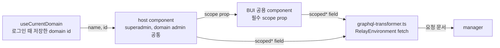

# 0012 — Scoped search fields in place of admin fields

## Summary

> 낯선 용어는 문서 맨 아래 [용어](#용어)에 모아 두었다.

- 목록을 읽는 component는 `admin*` root field 대신 엔티티마다 하나인 [`scoped*` field](#용어)에 `scope` input 하나를 넘겨 읽는다. 대응하는 `scoped*` field가 있는 `admin*` 읽기는 코드에서 지운다.
- `scope`는 로그인한 역할과 상관없이 현재 도메인이다. superadmin과 도메인 관리자 모두 `useCurrentDomain()`의 `id`로 만든 `{ domain: [{ value: <domain UUID> }] }`를 넘긴다.
- 공용 component는 범위를 종류별 id prop이 아니라, 그 field의 scope input type을 받는 필수 `scope` prop 하나로 받는다.
- 이 field들은 26.9.0a4 이상 매니저에서만 쓴다. 26.9 미만 매니저를 위한 대체 field는 두지 않으며, 이 field들에 한해 [ADR 0011](0011-manager-compatibility-policy-in-the-team-dev-catalog.md)이 팀 dev catalog에 둔 지원 floor보다 높은 26.9.0a4를 요구한다.

## Context

- **admin field**: 매니저 Strawberry API의 `admin*` root field는 resolver 첫 줄에서 `check_admin_only()`를 부르고, superadmin이 아니면 `Insufficient privilege. (Admin exclusive access)`로 요청을 거부한다.
- **Route access**: `useRouteAccessDecision`(`react/src/hooks/useRouteAccess.ts`)은 match chain에서 가장 깊은 `handle.access`로 route의 접근을 정한다. `react/src/routes.tsx`의 `/admin` route가 `access: 'admin'`이라, 자기 `access`가 없는 `/admin/users`, `/admin/session` 같은 leaf는 도메인 관리자도 들어온다.
- **Two scope shapes**: schema에는 범위를 받는 field가 두 모양으로 있다.

| 모양                                                           | 예                                                                                       | 추가된 매니저 |
| -------------------------------------------------------------- | ---------------------------------------------------------------------------------------- | ------------- |
| 범위 종류마다 field 하나, 이름으로 지정                        | `domainUsersV2(scope: { domainName })`, `projectUsersV2(scope: { projectId })`           | 26.2.0        |
| 엔티티마다 `scoped*` field 하나, 여러 종류의 범위를 한 input에 | `scopedUsersV2(scope: { domain: [{ value }], project: [{ value }], role: [{ value }] })` | 26.9.0        |

- **Backend direction**: backend.ai의 `api/gql/AGENTS.md`와 `KNOWLEDGE.md`는 `scoped*` 모양을 규약으로 두고, 범위 종류별 field는 새로 만들지 않는 모양이라고 적는다(BA-7742).
- **Authorization**: `scoped*` field는 scope에 적힌 모든 범위에서 읽기 권한을 검사하고 하나라도 없으면 요청 전체를 거부한다. superadmin은 모든 검사를 통과한다. 결과는 각 범위로 닿는 행의 합집합이고, `filter`는 그 위에 AND로 붙는다. 범위 목록이 모두 비어 있는 scope는 거부된다.
- **Domain id**: `scoped*` scope는 도메인을 UUID로 받는다. `react/src/hooks/index.tsx`의 `useCurrentDomain()`이 로그인 때 `myUserV2`에서 저장한 도메인 이름과 UUID를 `{ name, id }`로 답한다(#10382).
- **No scoped write**: 사용자·keypair·리소스 정책·resource preset의 생성과 수정, fair share 가중치는 V2 `admin*` mutation과 legacy mutation이 모두 superadmin만 받고, `scoped*` mutation이 없다. `session_pending_queue`, 리소스 정책 목록, `rg*FairShare*` 조회도 도메인 관리자가 읽을 field가 없다.

## 설계도

## Decision

### 1. `admin*` 읽기는 `scoped*` field로 바꾼다

- **Rule**: 대응하는 `scoped*` field가 있는 `admin*` 읽기(`adminUsersV2`, `adminProjectsV2`, `adminResourceGroups`, `adminImagesV2` …)는 `scoped*` field(`scopedUsersV2`, `scopedProjectsV2`, `scopedResourceGroups`, `scopedImagesV2` …)로 바꾸고 `admin*` 선택은 지운다.
- **System-wide management**: 도메인에 묶이지 않은 엔티티를 superadmin이 만들고 관리하는 화면은 `admin*` field를 유지한다. 리소스 그룹 관리의 `ResourceGroupList`, Agent 설정과 RBAC role 모달의 `BAIAdminResourceGroupSelect`, fair share 설정(`FairShareItems/*`), RBAC 관리 화면과 `BAIAdminUserV2Select`가 여기에 든다. 도메인 scope로 읽으면 그 화면에서 관리할 엔티티가 빠진다.
- **No scoped field**: 읽기나 쓰기에 `scoped*` field가 없으면, 그 동작은 host component가 `useSuspendedBackendaiClient().is_superadmin`이 참일 때만 렌더하고, 도메인 관리자에게 답하는 legacy 읽기가 있으면 그 field를 쓴다. `TODO(needs-backend)`로 backend 요청 issue를 가리킨다.

### 2. scope는 현재 도메인이다

- **Hook**: 호출부는 `useCurrentDomain()`(`react/src/hooks/index.tsx`)의 `id`로 `{ domain: [{ value: id }] }`를 만들어 넘긴다. scope를 만드는 별도 hook이나 type은 두지 않는다.
- **Every role**: superadmin도 같은 `domainScope`를 넘긴다. superadmin이 보는 목록은 현재 도메인으로 좁혀진다.
- **Narrower scope**: 화면이 다루는 범위가 도메인보다 좁으면(배포 하나의 프로젝트) 호출부가 그 범위를 직접 만든다(`{ project: [{ value: projectId }], public: true }`).

### 3. 공용 component는 필수 `scope` prop 하나를 받는다

- **Prop**: BUI의 공용 select와 목록은 `scope: <ScopeInputType>` prop 하나로 범위를 받는다. `<ScopeInputType>`은 그 component의 query가 쓰는 scope input(`UserScope`, `ProjectScope`, `ResourceGroupScope`, `ImageSearchScope`)이고, relay-compiler가 그 query의 `__generated__/<Query>.graphql.ts`에 내보낸 type을 import한다. `domainId`·`projectId`·`userId` 같은 종류별 prop을 더하지 않는다.
- **Host value**: `{ domain: [{ value: id }] }` 모양은 위 네 input type에 모두 대입된다.

### 4. 이 field들은 26.9.0a4 이상 매니저에서만 쓴다

- **No fallback**: `scoped*` field에 `@since`를 달지 않고, 26.9 미만 매니저를 위한 `admin*`·이름 field 분기를 두지 않는다. 26.9.0a4 미만 매니저에서 이 field를 쓰는 화면은 오류를 낸다.
- **Floor**: 이 결정이 바꾼 화면은 catalog가 선언한 지원 floor([ADR 0011](0011-manager-compatibility-policy-in-the-team-dev-catalog.md))와 상관없이 26.9.0a4 이상 매니저를 요구한다. 나머지 코드는 ADR 0010과 ADR 0011을 따른다.

## 대안과 기각 사유

- **Per-kind scope fields**: 범위 종류마다 다른 field(`domainUsersV2`, `projectUsersV2`)를 쓴다. 26.2.0부터 있어 26.4 매니저도 답한다. 기각한다. 도메인, 프로젝트, 사용자 범위마다 field와 query가 따로 필요해 공용 component가 범위 종류마다 분기하고, backend가 새로 만들지 않는 모양이라 새 엔티티에는 없다.
- **Admin fields for superadmins**: superadmin은 `admin*` field를 계속 읽는다. superadmin 화면이 지금처럼 모든 도메인을 보여 준다. 기각한다. 공용 component마다 역할 분기와 `admin*` 분기가 남고, superadmin과 도메인 관리자가 같은 화면에서 다른 document를 받는다.
- **Pre-26.9 fallback fields**: 26.9 미만 매니저를 위한 대체 field를 유지한다. 26.4 LTS 매니저에서도 화면이 동작한다. 기각한다. 모든 document에 field 쌍과 분기 variable이 붙고, 이름 field를 쓰는 26.9 미만 경로가 도메인 관리자에게 다시 `admin*`로 떨어지는 공용 select를 남긴다.
- **Per-kind id props**: 공용 component에 종류별 prop(`domainId`, `projectId`)을 더한다. 호출부가 읽기 쉽다. 기각한다. 범위 종류가 늘 때마다 prop과 분기가 늘고, 두 종류를 함께 넘기는 경우를 표현하려면 prop 조합 규칙을 따로 정해야 한다.

## Consequences

- **Domain admin lists**: 도메인 관리자는 `admin*`만 쓰던 목록을 자기 도메인 범위로 본다.
- **Superadmin lists**: superadmin이 모든 도메인을 보던 목록(Admin › Sessions의 Project filter 등)은 현재 도메인만 보여 준다.
- **Manager floor**: 26.9.0a4 미만 매니저에서는 이 결정이 바꾼 화면이 동작하지 않는다.
- **Scoped writes**: `scoped*` mutation이 생기기 전까지 사용자, keypair, 리소스 정책, resource preset, fair share 쓰기는 superadmin만 한다.

## 출처

- #10300 (epic), #10301, #10288, 2026-10-13.
- backend.ai `src/ai/backend/manager/api/gql/AGENTS.md`, `api/gql/KNOWLEDGE.md`, `api/gql/utils.py`의 `check_admin_only`, BA-7742(#14451).

관련: [ADR 0006](0006-version-gated-field-pairs-across-manager-versions.md), [ADR 0010](0010-component-level-manager-version-gates.md), [ADR 0011](0011-manager-compatibility-policy-in-the-team-dev-catalog.md).

## 용어

| 용어            | 뜻                                                                                                                                                                                                                                                                 |
| --------------- | ------------------------------------------------------------------------------------------------------------------------------------------------------------------------------------------------------------------------------------------------------------------ |
| `scoped*` field | 엔티티마다 하나인 검색 root field로, `scope` input에 도메인·프로젝트·사용자 같은 범위를 `UUIDScope` 목록으로 받는다(`scopedUsersV2`, `scopedProjectsV2` …). `ImageSearchScope`는 목록 외에 `public: Boolean!`도 받는다. backend.ai `api/gql/AGENTS.md`가 정의한다. |
| `UUIDScope`     | `scoped*` scope input의 항목 하나로, `{ value: UUID }` 모양이다. 한 목록 안의 항목과 여러 목록은 OR로 합쳐진다.                                                                                                                                                    |
