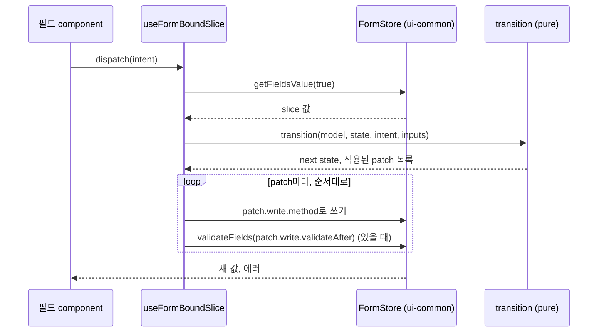
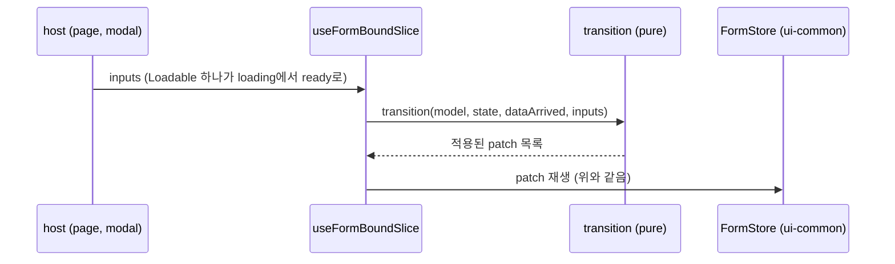
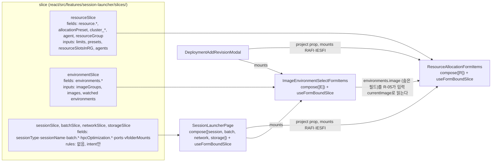

# 0013 — Ordered rules for the session launcher

## Summary

> 낯선 용어는 문서 맨 아래 [용어](#용어)에 모아 두었다.

- 세션 런처의 자동 변경(한 필드를 바꾸면 다른 필드를 설정하거나 초기화하는 것)은 `react/src/features/session-launcher/slices/`의 [rule](#용어) 목록에 이름 붙은 항목으로 들어가고, `react/src/features/session-launcher/model/`의 순수 함수 `transition(model, state, event, inputs)` 하나가 그 목록을 적힌 순서대로 더 적용되는 [patch](#용어)가 없을 때까지 돌린다.
- 상태는 [intent](#용어)(사용자 행동 하나), `dataArrived`(비동기 입력 하나가 준비됨), `restored`(URL·템플릿·reset으로 전체 값 교체) 세 종류의 event로만 바뀐다. 필드 component는 intent를 dispatch만 한다.
- 값마다 [provenance](#용어)(`user`, `restored`, `rule:<id>`)를 기록하고, patch는 `policy`(`force`, `unless-user-set`, `raise-only`)와 `reason`과 `write`(지금 코드가 그 값을 쓰는 method와 후속 검증)를 가진다.
- 폼 섹션은 각각 소유한 필드와 필요한 입력을 선언한 [slice](#용어)이고, 섹션 사이 규칙은 slice를 조합하는 host(`SessionLauncherPage`, `DeploymentAddRevisionModal`)가 `compose`의 `crossRules`에 등록한다.
- 전환 기간에는 `@lablup/ui-common/Form`의 `FormStore`가 화면이 읽는 store로 남고, 어댑터 `useFormBoundSlice`가 slice 값을 그 store에서 읽어 `transition`을 돌린 뒤 적용된 patch를 순서대로 다시 쓴다. patch의 `write`가 지금 코드와 같으므로 사용자에게 보이는 동작은 알려진 버그까지 같고, 그 버그를 고치는 일은 #10462가 항목별로 정한다.
- 필드 검증은 `Form.Item`의 `rules`에 남고, `view/selectors.ts`의 순수 함수가 그 rules가 읽는 제한값과 잔여량을 준다.

## Context

- **Today's launcher**: `SessionLauncherPage.tsx`, `ResourceAllocationFormItems.tsx`, `ImageEnvironmentSelectFormItems.tsx`, `useResourceLimitAndRemaining.tsx`, `useStartSession.tsx` 등 22개 파일(약 10.6k줄)이 의존 규칙 114개를 들고 있다. 규칙은 `useEffect` 23개, `setFieldValue`·`setFieldsValue` 호출 47회, 필드 간 validator, 렌더 시점 계산에 나뉘어 있고, 어떤 규칙이 어떤 순서로 도는지는 React commit 순서와 각 effect의 dependency 배열이 정한다.
- **Dependency map**: 규칙 114개와 위험 요소 36개의 목록은 epic #10454의 comment "Dependency map v2"에 있다. 이 문서와 특성화 테스트(PR #10467)가 쓰는 `R-xx`, `E-xx`, `P-xx`, `PAY-xx`(규칙)와 `H1`–`H36`(위험 요소) 번호는 그 목록의 번호다.
- **Value change as intent**: `InputNumberWithSlider`는 blur마다, step이 바뀔 때마다 `onChange`를 부르고, `ResourceAllocationFormItems`의 handler는 그것을 사용자 편집으로 보고 preset을 `custom`으로 바꾼다(H14). `AgentSelect`는 옵션 목록이 바뀔 때마다 선택한 agent를 `auto`로 되돌린다(H19). 늦게 도착한 데이터도 같은 handler를 거쳐 값을 덮어쓴다(H27).
- **Form engine writes**: `@lablup/ui-common/Form` 0.2.0-alpha.19의 `FormStore`에서 `setFields`(`FormStore.js:268-276`), `setFieldsValue`(`:357-362`), `setFieldValue`(`:364-372`)는 `onFieldsChange`를 부르지 않는다. `Form.js:20-21`은 `onFieldsChange`에서만 `triggerFormChange`를 부르고, `SessionLauncherPage.tsx:623-627`의 `onFormChange`가 URL 동기화를 건다. 그래서 규칙이 쓴 값은 다음 사용자 편집이나 `validateFields`까지 URL에 반영되지 않는다. `setFieldValue`는 `errors: []`를 함께 쓰고(`FormStore.js:364-372`) `Field.js:68`은 외부 `valueUpdate`에 `errors`를 비우므로, 두 method 모두 바꾼 필드의 보이는 에러를 지운다(H23).
- **Shared fragments**: `ResourceAllocationFormItems`는 `DeploymentAddRevisionModal`, `LaunchMultipleSessionsModal`, `SessionDetailContent`, `DeploymentPresetDetailModal`도 mount한다. `ResourceAllocationFormItems.tsx:305`는 `Form.useWatch(['environments', 'image'])`로 부모 폼에 이미지 필드가 있다고 가정하고, 이미지 필드가 없는 host에서는 그 규칙이 돌지 않는다. 어느 host에서 어느 규칙이 도는지는 코드 어디에도 적혀 있지 않다.
- **Groundwork**: PR #10467이 지금의 동작을 시나리오 104개(`react/src/__characterization__/session-launcher/`)로 고정했고, PR #10474가 순수 계산을 `react/src/features/session-launcher/domain/`으로 옮겼다.

## 설계도

### intent 하나가 처리되는 순서

### 입력이 준비되었을 때

### slice와 host의 관계

## Decision

### 1. 규칙은 순서 있는 목록 하나다

- **Rule shape**: 규칙은 `{ id, reads, writes, needs?, run }`다. `id`는 Dependency map의 번호(`R-03`, `E-02`)다. `reads`와 `writes`는 `NamePath`(`react/src/form-engine`가 re-export하는 ui-common의 경로 타입) 배열이고, `needs`는 규칙이 읽는 입력의 key 목록이다. `run({ values, provenance, event, inputs, pass })`는 `Patch[]`를 답하는 순수 함수이고, `inputs`는 준비된 입력의 값만 담는다(`Loadable`을 벗긴 값). `pass`는 0부터 세는 settle 회차이고, 지금 코드에서 한 번만 돌던 effect를 옮긴 규칙은 `pass === 0`에서만 patch를 낸다.
- **Patch shape**: patch는 `{ path: NamePath, value, policy, reason, write }`다. `policy`는 `force`, `unless-user-set`, `raise-only` 중 하나이고, `reason`은 i18n key이며, `write`는 `{ method: 'setFieldsValue' | 'setFieldValue' | 'none', validateAfter?: NamePath[], validateOptions?: { recursive?: boolean } }`다.
- **Validation-only patch**: `method: 'none'`인 patch는 값을 쓰지 않고 `validateAfter`만 재생한다. 지금 코드가 값이 바뀌지 않아도 `validateFields`를 부르는 자리를 옮길 때 쓴다. 이 patch는 no-op으로 버리지 않고 settle 판정에도 세지 않는다.
- **Order**: 한 slice의 규칙은 `rules` 배열에 적힌 순서로 돈다. `compose`는 slice 순서대로 각 slice의 규칙을 이어 붙이고 `crossRules`를 맨 뒤에 둔다.
- **Every rule, every event**: `transition`은 event의 종류와 관계없이 목록의 모든 규칙을 돈다. 규칙은 `event`를 읽어 스스로 빠질 수 있다.
- **Input gating**: 규칙이 `needs`에 적은 입력 중 하나라도 `loading`이거나 host가 넘기지 않았으면 `transition`은 그 규칙을 건너뛴다. slice가 `required`로 선언한 입력을 host가 넘기지 않으면 어댑터가 mount 시점에 `LauncherModelError`를 던진다.
- **Settle**: `transition`은 목록을 한 번 돌리고, 적용된 patch가 하나라도 있으면 다시 돌린다. 적용된 patch가 없는 pass에서 끝나고, 4번째 pass 뒤에도 적용된 patch가 있으면 `LauncherInvariantError`를 던진다. 테스트와 개발 빌드는 그 오류로 실패하고, production 빌드의 어댑터는 `useBAILogger`로 기록하고 마지막 상태를 쓴다.
- **Applied patch**: `transition`은 값이 현재 값과 같은 patch(`lodash` `isEqual`로 비교, 메모리 문자열도 문자열 그대로 비교한다. `'4g'`와 `'4096m'`은 다른 값이고, `BAIDynamicUnitInputNumber`가 문자열의 단위를 화면에 그리기 때문이다)와 `policy`가 거부한 patch를 버린다. 남은 patch가 적용된 patch이고, settle 판정과 어댑터 재생은 적용된 patch만 센다. 한 path에 patch가 여러 번 적용되면 어댑터는 순서대로 모두 재생한다.
- **Order test**: `slices/*.test.ts`는 각 slice의 규칙 `id` 순서를 배열로 단언한다. 순서를 바꾸는 것은 동작 변경이다.

### 2. 상태는 세 가지 event로만 바뀐다

| event | 누가 보내는가 | 처리 |
|---|---|---|
| intent `{ type, payload }` | 필드 component | slice의 `intents[type](values, payload, inputs)`이 답한 `Patch[]`를 적용한 뒤 규칙을 돈다. `type`이 어느 slice에도 없으면 `transition`이 `LauncherModelError`를 던진다 |
| `{ type: 'dataArrived', keys: string[] }` | 어댑터 | 값은 바꾸지 않고 규칙을 돈다. `keys`는 `loading`에서 `ready`로 바뀌었거나 `ready` 값의 참조가 바뀐 입력의 key다 |
| `{ type: 'restored', from: 'url' \| 'template' \| 'reset', values }` | host | slice가 소유한 모든 필드를 `values`로 교체하고(없는 필드는 `undefined`) provenance를 `restored`로 둔 뒤 규칙을 돈다. 지금 코드의 복원이 어떤 필드를 건드리지 않으면 host는 그 필드의 현재 값을 `values`에 넣는다 |

- **Intent naming**: intent 이름은 사용자의 행동을 적는다(`presetSelected`, `cpuEdited`, `clusterModeSelected`). 값이 바뀌었다는 사실은 intent가 아니다. 필드 component는 `onChange`로 받은 값이 현재 값과 다를 때만 dispatch한다.
- **Intent reducers**: 지금 코드의 `onChange` handler가 하던 연쇄 쓰기(CPU 편집이 preset을 `custom`으로 바꾸는 R-13 등)는 그 intent의 reducer가 patch로 답한다. 지금 코드의 `useEffect`가 하던 쓰기는 규칙이다. 규칙은 `event`를 읽을 수 있으므로 어느 intent 뒤에만 도는 규칙도 쓸 수 있다.
- **Host-side form operations**: `form.resetFields()`는 폼 엔진 연산이므로 host에 남고, host는 그 직후 `restored { from: 'reset' }`을 보내 provenance만 되돌린다. 템플릿 적용(P-22)은 지금의 `setFieldsValue` 하나를 모델의 `fields` 경계에서 둘로 나눈다. host가 모델 밖의 필드를 `setFieldsValue`로 쓰고, 모델 안의 필드는 `restored { from: 'template' }`로 보낸다. `FormStore`의 deep merge 때문에 결과 store는 같다.
- **Effect with a side effect**: toast처럼 시점이 중요한 side effect를 가진 effect(P-28 legacy mount 폐기)는 규칙이 되지 않고, 그 effect가 `useEffectEvent`로 intent를 dispatch한다.
- **No writes from components**: `react/src/features/session-launcher/**`의 파일은 `form.setFieldValue`, `form.setFieldsValue`, `form.setFields`를 부르지 않는다. `react/eslint.config.js`의 `no-restricted-syntax`가 그 member call을 막고, `view/useFormBoundSlice.ts`만 예외다.
- **ESLint block shape**: 이 경로용 flat-config block은 기존 `no-restricted-syntax` 항목(`<style>` 금지, `astryxDynamicImportBan`, `bailinkEllipsisRestriction`)을 함께 적는다. flat config에서 뒤의 block이 같은 rule을 다시 선언하면 앞의 배열을 대체한다.

### 3. 값마다 provenance를 기록한다

- **Provenance values**: `state.provenance[key]`는 `'user'`, `'restored'`, `` `rule:${id}` `` 중 하나이고, `key`는 `NamePath`를 `.`으로 이은 문자열(`resource.cpu`)이다. intent reducer가 쓴 값은 `'user'`, `restored`가 쓴 값은 `'restored'`, 규칙이 쓴 값은 `rule:<id>`다.
- **Policy**: `force`는 항상 쓴다. `unless-user-set`은 그 path의 provenance가 `'user'`면 쓰지 않는다. `raise-only`는 현재 값이 없거나 patch 값이 현재 값보다 클 때만 쓴다(숫자는 `>`, 메모리 문자열은 `compareNumberWithUnits`). 비교할 수 없는 값이면 쓰지 않는다.
- **User no-op**: intent reducer의 patch는 값이 현재 값과 같아 버려져도 그 path의 provenance를 `'user'`로 바꾼다. 버려진 patch는 재생되지 않으므로, 지금 코드가 같은 값을 `setFieldValue`로 다시 써서 그 필드의 에러를 지우던 자리는 에러가 남는다. 특성화 시나리오 중 이 차이를 보는 것은 없다. `Form.Item`이 값을 먼저 쓰고 component가 dispatch하므로, 사용자 편집의 patch는 대개 no-op이기 때문이다. 지금 코드를 옮기는 단계에서는 각 규칙의 policy를 지금 동작과 같게 적고, 대부분 `force`다.

### 4. slice는 입력을 선언하고 host가 조합한다

- **Slice shape**: `defineSlice({ name, fields, intents, rules, inputs })`다. `fields`는 slice가 소유한 `NamePath` 목록이고, `intents`는 intent 이름을 key로 reducer `(values, payload, inputs) => Patch[]`를 값으로 가진 객체이며, `inputs`는 `{ [key]: 'required' | 'optional' }`이다.
- **Inputs**: 어댑터가 받는 `inputs`의 각 값은 [Loadable](#용어)이다. host에 없는 `optional` 입력은 key 자체가 없다.
- **Compose**: `compose(slices, { crossRules })`는 module scope에서 한 번 부른다(`const launcherModel = compose(...)`).
- **Slice checks**: `defineSlice`는 slice 안에서 `fields`가 겹치거나, slice의 규칙이 다른 slice의 필드를 `reads`·`writes`에 적으면 `LauncherModelError`를 던진다. 다른 slice의 필드를 읽는 규칙은 `crossRules`에 둔다.
- **Compose checks**: `compose`는 다음 중 하나라도 어긋나면 `LauncherModelError`를 던진다. slice의 `fields`가 서로 겹침, intent 이름이 slice 사이에 겹침, 규칙 `id`가 겹침, intent 이름이 `dataArrived`·`restored`임, `crossRules`의 `reads`·`writes`가 조합된 `fields` 밖임, 규칙의 `needs`가 어느 slice의 `inputs`에도 없음. `transition`은 규칙이 `writes` 밖의 경로에 patch를 내면 `LauncherModelError`를 던진다.
- **Fragment-owned slices**: 여러 host가 mount하는 공유 fragment(`ResourceAllocationFormItems`, `ImageEnvironmentSelectFormItems`)는 자기 slice를 `compose([slice])`로 스스로 조합하고 자기 `useFormBoundSlice`를 mount한다. 같은 폼 위의 어댑터 여러 개는 각자 자기 `fields`만 읽고 쓴다. host(`SessionLauncherPage`)는 페이지 수준 slice만 조합한다.
- **Cross rules**: 다른 slice의 필드를 읽거나 쓰는 규칙은 `crossRules`에 둔다. 해석된 이미지의 최솟값을 리소스에 적용하는 R-05는 fragment 경계를 넘으므로 지금은 리소스 slice의 규칙이고, `environments.image`(폼의 숨은 필드)를 입력 `currentImage`로 받는다. 이미지 필드가 없는 host에서는 그 입력이 `undefined`이고 규칙은 지금 코드처럼 아무것도 쓰지 않는다.
- **Project**: `project`는 ADR 0001대로 host가 prop으로 정해 `inputs.project`로 넘긴다. slice는 ambient hook을 부르지 않는다.

### 5. 어댑터는 Form store 위에서 동작한다

- **Adapter**: `useFormBoundSlice(form, model, inputs)`는 dispatch마다 `form.getFieldsValue(true)`에서 모델의 `fields`를 읽고, `transition`을 돌리고, 적용된 patch를 `write.method`로 `form`에 쓴 뒤 `write.validateAfter`가 있으면 `form.validateFields(validateAfter)`를 부른다. `inputs`의 `Loadable`이 `loading`에서 `ready`로 바뀌거나 `ready` 값의 참조가 바뀌면 그 key로 `dataArrived`를 보내고, 그 event는 그 렌더의 `inputs`로 `transition`을 돌린다. 적용된 patch가 없으면 어댑터는 state를 바꾸지 않는다. `{ dispatch, state }`를 답한다.
- **Write replay**: 각 규칙과 intent reducer는 지금 코드가 그 값을 쓰는 method와 뒤이어 부르는 `validateFields`의 경로를 patch의 `write`에 그대로 적는다. 그래서 H23(규칙의 쓰기가 URL에 늦게 반영되고 보이는 에러가 지워지는 것)은 유지된다.
- **Selectors**: `view/selectors.ts`의 `selectLimits(values, inputs)`, `selectRemaining(values, inputs)`, `selectDisabled(values, inputs)`는 순수 함수다. `Form.Item`의 `rules`와 `min`·`max` prop은 이 값을 읽는다.
- **Drift check**: 개발 빌드(`import.meta.env.DEV`)에서 어댑터는 재생이 끝난 뒤 모델의 값과 `form.getFieldsValue(true)`를 비교해 다르면 `useBAILogger`로 기록한다.
- **Un-migrated fields**: 어댑터는 모델의 `fields` 밖의 값을 읽지도 쓰지도 않으므로, 같은 폼의 아직 옮기지 않은 필드는 지금처럼 동작한다.
- **Input churn**: host가 렌더마다 새 객체로 만드는 입력은 렌더마다 `dataArrived`를 일으킨다. 지금 코드의 effect도 그런 값을 dependency로 가져 렌더마다 다시 돌았으므로 같은 동작이다. 그 입력을 memoise하는 것은 규칙이 도는 횟수를 바꾸는 동작 변경이고, #10462의 항목으로 다룬다.

### 6. 파일 위치

| 무엇 | 어디 |
|---|---|
| 엔진: `defineSlice`, `compose`, `transition`, provenance, `Loadable`, `Patch`, `Rule` 타입 | `react/src/features/session-launcher/model/` |
| 순수 계산 | `react/src/features/session-launcher/domain/` (PR #10474) |
| URL 형식(`?formValues=`의 omit 목록, 민감값 blank, legacy mount 변환) | `react/src/features/session-launcher/domain/urlCodec.ts`. nuqs 호출과 500 ms debounce는 페이지에 남는다 |
| slice 정의와 순서 테스트 | `react/src/features/session-launcher/slices/<name>.ts`, `<name>.test.ts` |
| 어댑터, selector, 필드용 hook | `react/src/features/session-launcher/view/` |
| 모델로 옮긴 필드 component | `react/src/features/session-launcher/view/fields/` |
| 특성화 테스트 | `react/src/__characterization__/session-launcher/` (PR #10467) |

## 대안과 기각 사유

- **Rule list on the form store**: 규칙을 한 곳에 모으되 지금처럼 값 변경을 trigger로 쓴다. 가장 싸고 규칙 하나씩 옮길 수 있다. 이 ADR은 이 안을 기각한다. 값 변경을 사용자 결정으로 읽는 구조(H14, H19, H27의 원인)가 그대로 남는다.
- **Derived state in jotai**: 사용자가 고른 값만 저장하고 나머지는 jotai atom으로 파생한다. 저장하는 값이 사용자 의도뿐이라 사용자 값을 덮어쓰는 일이 정의상 없다. 이 ADR은 이 안을 기각한다. 데이터를 다시 받을 때마다 값이 다시 계산되어 지금의 "한 번 자동 선택된 값이 유지되는" 동작이 바뀌고, form store와 양방향 변환 없이는 섹션 하나씩 옮길 수 없다.
- **XState**: 규칙을 statechart로 구현한다. statechart가 흐름을 그려 준다. 이 ADR은 이 안을 기각한다. 114개 규칙은 상태 전이가 아니라 값 사이의 계산이고, `context`를 고치는 `assign` 사이의 순서를 XState가 정해 주지 않으며, 새 런타임 의존성이 든다.
- **Field reactions in the form engine**: ui-common의 `FormStore`에 Formily 모양의 `derive`·`constrain` reaction을 넣는다. 이 ADR은 이 안을 기각한다. 등록된 필드와 원시 store의 차이, `autoSelectOption`, reset·템플릿·URL 흐름이 페이지 수준에 남고, 두 평가 방식이 전환이 끝날 때까지 공존한다.

## Consequences

- **One place to read**: 어떤 규칙이 어떤 순서로 도는지는 `slices/*.ts`의 `rules` 배열과 host의 `compose` 호출에서 읽는다.
- **Pure tests**: `transition`과 규칙은 React 없이 "이 상태에서 이 event면 결과는 이것"으로 테스트한다. 특성화 suite(PR #10467)는 전환 내내 oracle로 남는다.
- **Bugs written down**: patch의 `write`와 `policy`에 지금의 버그(H14, H15, H23)가 값으로 적힌다. 그 값을 바꾸는 PR은 #10462의 항목 하나이고, 특성화 시나리오의 기대값을 같은 PR에서 바꾼다.
- **Two stores for a while**: 어댑터가 form store를 읽고 쓰는 동안 모델 상태와 form store가 둘 다 있다. 어댑터는 dispatch마다 `FormStore`에서 다시 읽으므로 `FormStore`가 기준이고, 개발 빌드의 어댑터는 재생 뒤 두 값이 다르면 `useBAILogger`로 기록한다.
- **Out of scope**: 검증을 `Form.Item` 밖으로 옮기는 것, `reason`을 화면에 그리는 것, URL 형식을 바꾸는 것은 정하지 않는다.

## 출처

- GitHub epic #10454 (comment "Dependency map v2" 포함), 이슈 #10455 (특성화 테스트, PR #10467), #10456 (순수 함수 추출, PR #10474), #10457 (이 ADR과 모델 코어), #10458–#10461 (섹션 전환), #10462 (전환 뒤 동작 변경).
- `@lablup/ui-common/Form` 0.2.0-alpha.19: `FormStore.js:268-276,357-372`, `Field.js:68`, `Form.js:20-21`.
- 결정일: 2026-10-20.

관련: [ADR 0001](0001-explicit-project-prop-contract.md) (`project` prop 계약), [ADR 0003](0003-committed-search-index-artifact.md) (domain 모듈 이동으로 검색 인덱스를 다시 생성한다).

## 용어

| 용어 | 뜻 |
|---|---|
| rule | 자동 변경 하나다. `id`, 읽는 경로 `reads`, 쓰는 경로 `writes`, 필요한 입력 `needs`, 순수 함수 `run`으로 이루어지고 `run`은 patch 배열을 답한다. slice의 `rules`나 host의 `crossRules`에 들어간다. |
| patch | 필드 하나에 대한 쓰기 요청이다. 경로, 값, `policy`, `reason`, `write`를 가진다. |
| intent | 사용자가 한 행동 하나를 적은 event다. 값이 바뀌었다는 사실이 아니라 행동의 이름(`cpuEdited`, `presetSelected`)을 담는다. |
| provenance | 한 필드의 현재 값을 누가 썼는지 적은 표시다. `user`, `restored`, `rule:<id>` 중 하나다. |
| slice | 폼 섹션 하나의 필드, intent, 규칙, 필요한 입력을 함께 선언한 단위다. `defineSlice`로 만들고 host가 `compose`로 조합한다. |
| Loadable | 비동기 입력 하나의 상태다. `{ status: 'loading' }` 또는 `{ status: 'ready', value }`다. |
