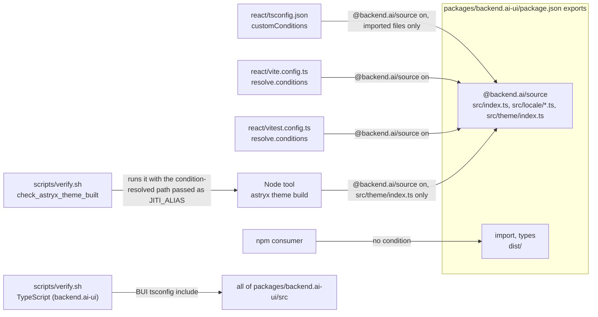

# 0013 — Source export condition for backend.ai-ui

## Summary

> Unfamiliar terms are collected in the [Glossary](#glossary) at the end.

- `react/` reads the workspace package `backend.ai-ui` (BUI) from its source in `packages/backend.ai-ui/src`, not from the built `dist/`.
- The `exports` field of BUI's `package.json` is the single source of truth. The entries `"."`, `"./locale/*"`, and `"./theme"` put the [export condition](#glossary) `@backend.ai/source` first, and that condition points at the source files. `types` and `import` still point at `dist/`, so npm consumers see no change.
- The three resolvers in `react/` (TypeScript, Vite, Vitest) only turn that condition on. They declare no `paths`, `include`, or `alias` for `backend.ai-ui`.
- `astryx theme build`, which Node runs directly, imports BUI through the subpath `backend.ai-ui/theme`, which holds only theme tokens. The tool resolves that subpath with `--conditions=@backend.ai/source` and passes the resulting source path to jiti as `JITI_ALIAS`. Node reads this source without any transform, so the tool needs no `dist/` build.

## Context

- **Three hand-kept redirects**: Two `paths` lines and one `include` line in `react/tsconfig.json`, three regex aliases in `vite.config.ts`, and three aliases in `vitest.config.ts` each recorded the same fact separately. When BUI gained a subpath export, a developer had to edit all three places, and nothing checked that the three agreed.
- **Include side effect**: The `../packages/backend.ai-ui/src` glob in `include` also put BUI's tests and stories into react's program. For that reason, three separate `exclude` lines existed (FR-1331).
- **Published package**: BUI is published to npm, so only this repository may use the path to the source.
- **Node cannot load the barrel**: The BUI source that the barrel `src/index.ts` pulls in uses `graphql` tags (babel-plugin-relay), `?react` svg imports, and CSS imports. A tool that imports BUI with Node and jiti, such as `astryx theme build`, does not run these transforms, so it fails when it reads the source.

## Diagram

## Decision

### 1. BUI's exports hold the source paths

| export           | `@backend.ai/source`   | `import` / `types`                              |
| ---------------- | ---------------------- | ----------------------------------------------- |
| `"."`            | `./src/index.ts`       | `./dist/backend.ai-ui.js` / `./dist/index.d.ts` |
| `"./locale/*"`   | `./src/locale/*.ts`    | `./dist/locale/*.js` / `./dist/locale/*.d.ts`   |
| `"./theme"`      | `./src/theme/index.ts` | `./dist/theme.js` / `./dist/theme/index.d.ts`   |
| `"./styles.css"` | none                   | `./dist/backend.ai-ui.css`                      |

- **Condition first**: A resolver picks conditions in the order the object lists them, so each entry puts `@backend.ai/source` first.
- **Namespaced name**: The condition is named `@backend.ai/source`. The name does not collide with generic names that other packages may use (`source`, `development`), so turning it on does not switch any other package in node_modules to its source.
- **No styles.css mapping**: `src/index.ts` imports its own CSS directly, so a consumer that reads the source does not import `styles.css`.
- **Side-effectful entry**: The `sideEffects` field of BUI's `package.json` lists `./src/index.ts` together with `**/*.css`. Vite applies the package's `sideEffects` to a module resolved through the condition. Without that entry, the production build skips `src/index.ts`, which only re-exports, and drops the global CSS that only `src/index.ts` imports (`styles/actionAccent.css`, `styles/backend.ai-ui.css`, `styles/dangerAction.css`). A PR that adds a source entry importing global CSS also lists that file in `sideEffects`.
- **Theme subpath**: `"./theme"` exports only the theme token values and builders in `src/theme/` (`ANTD_ALIGN_TOKENS`, `ANTD_REVERSED_BAND_OVERLAYS`, `BAI_SELF_COLOR_TOKENS`, `buildBaiCustomTokens`, `toSeedTuple`). A consumer can take only BUI's theme tokens and apply them to its own theme without the component barrel. `"."` keeps re-exporting the same values.
- **No theme side effects**: The non-test files in `src/theme/` import only each other and contain no CSS, so `sideEffects` does not list them.
- **New subpath exports**: A PR that adds a subpath export to BUI also puts `@backend.ai/source` first in that entry.

### 2. react's resolvers only turn the condition on

| File                     | Setting                                                                                        |
| ------------------------ | ---------------------------------------------------------------------------------------------- |
| `react/tsconfig.json`    | `"customConditions": ["@backend.ai/source"]` (`moduleResolution: "bundler"`)                   |
| `react/vite.config.ts`   | `resolve.conditions: ['@backend.ai/source', ...defaultClientConditions]`                       |
| `react/vitest.config.ts` | `resolve.conditions: ['@backend.ai/source']`, `ssr.resolve.conditions: ['@backend.ai/source']` |

- **Keep Vite defaults**: In Vite 6, setting `resolve.conditions` replaces the default value, so `vite.config.ts` spreads `defaultClientConditions` from `vite` after the condition. Vitest appends its own defaults (`node`, `development|production`) after the configured value, so `vitest.config.ts` lists only the condition. If `vitest.config.ts` spread `defaultClientConditions`, Vitest would add `module` and `browser`, and the tests would pick the package's browser build.
- **No redirects**: The configs in `react/` declare no `paths`, `include`, or `resolve.alias` for `backend.ai-ui`. The `paths` and alias for `backend.ai-client` are outside the scope of this decision.
- **buiSrc stays**: The resolver does not use the `buiSrc` constant in the two Vite configs. The constant remains because the `relay()` plugin in `react/vite-plugins/relay.ts` uses it to decide which files are BUI files and get BUI's Relay `artifactDirectory`.
- **SSR environment too**: In Vite 6, the top-level `resolve.conditions` applies only to the client environment. Vitest handles the test selection of `--changed` (import tracing) and the `@vitest-environment node` tests in the ssr environment, so `react/vitest.config.ts` also puts `@backend.ai/source` in `ssr.resolve.conditions`. Without it, BUI resolves to `dist/` in that step, and `vitest --changed` on a branch that changes only BUI selects none of the related react tests.
- **Import surface**: The `no-restricted-imports` rule in `react/eslint.config.js` blocks `backend.ai-ui/*` and allows only `backend.ai-ui/locale` and `backend.ai-ui/theme`.

### 3. react's tsc checks only the BUI files react imports

- **Reachable files only**: The `include` line is gone, so react's `tsc` checks only the BUI files that react imports.
- **Own lane**: The `TypeScript (backend.ai-ui)` lane in `scripts/verify.sh` and the `backend.ai-ui` lane in `.github/workflows/typecheck.yml` run BUI's `tsc --noEmit` separately.
- **Incremental locally**: The BUI lane in `verify.sh` runs with `--incremental`, as the react lane does, and reuses `.tsbuildinfo` (gitignored). The CI lane starts from a fresh checkout every time, so it does not pass the flag.

### 4. Node tools import BUI only through subpaths Node can read

- **Theme recipe import**: The theme recipe that `astryx theme build` reads with jiti (`react/src/astryx-theme/backendAiTheme.ts`) imports BUI only as `backend.ai-ui/theme`. If the recipe imported the barrel `backend.ai-ui`, Node would read source that contains `graphql` tags and JSX, and the build would fail.
- **Condition in Node**: A tool that Node runs gets the source path from `require.resolve('backend.ai-ui/theme')` under `node --conditions=@backend.ai/source`. The jiti instance through which `astryx theme build` reads the theme does not follow Node's `--conditions`; it resolves with the `node` and `import` conditions first. For that reason, the tool passes the path as `JITI_ALIAS`. `check_astryx_theme_built` in `scripts/verify.sh` and the regeneration steps written in `react/src/astryx-theme/built/index.ts` run it that way. Without the alias, jiti reads `dist/theme.js` when that file exists, so the check runs against stale values from an old `dist/`.
- **Loadable subpath only**: A PR that adds a Node tool needing other BUI code adds to BUI a subpath whose source Node can read without the Relay, JSX, CSS, or svg transforms, and the tool imports through that subpath. A Node tool does not import the barrel.
- **No dist build**: `scripts/verify.sh` and CI do not build BUI before a Node tool runs. `astryx theme build` runs only in `verify.sh`; no CI workflow runs it.

## Rejected alternatives

- **Keep the aliases**: This alternative keeps the current `paths` and `alias` entries as they are. Its advantage is that nothing changes. It is rejected because three places record the same fact separately and nothing checks that they agree.
- **Point exports at src and override on publish**: This alternative points `exports` at the source and switches them to `dist/` only at publish time through `publishConfig.exports`. Its advantage is that no condition setting is needed. It is rejected because the `exports` checked in the repository would differ from the published `exports`, and a Node tool that imports the barrel would get the source even without the condition and fail.
- **Load the barrel in Node**: This alternative passes `--conditions=@backend.ai/source` to the theme build, stubs CSS and svg, and reads the barrel `backend.ai-ui` as source. Its advantage is that BUI needs no new subpath. It is rejected because jiti compiles JSX with the classic runtime and does not run babel-plugin-relay, so it fails on BUI's `graphql` tags.
- **Rebuild dist before Node tools**: This alternative leaves the recipe importing the barrel, and `verify.sh` builds BUI before the theme build when `dist/` is missing or older than the BUI source. Its advantage is that the recipe's import does not change. It is rejected because the mtime check misses edits saved during a build, and it runs a full BUI build (about 14 seconds) even for a file whose mtime changed without any content change.

## Consequences

- **Resolution in one place**: The `exports` field of `package.json` decides where react's three resolvers resolve BUI. A PR that changes a BUI entry point or subpath also updates the lib `entries` in BUI's `vite.config.ts` (the dist build), the `server.warmup` paths in `react/vite.config.ts`, and the `!backend.ai-ui/<subpath>` allow list in `react/eslint.config.js`.
- **Dist-free paths**: react's `tsc`, vitest, `vite build`, the dev server, and `astryx theme build` work without `dist/`.
- **BUI-only type errors**: Only the BUI lane catches type errors in BUI files that react does not import.
- **Theme recipe import limit**: The theme recipe cannot use a BUI value that `backend.ai-ui/theme` does not export. When the recipe needs such a value, a developer moves the value into `src/theme/` or adds a subpath that meets the conditions in item 4.

## Sources

- Node.js [Conditional exports](https://nodejs.org/api/packages.html#conditional-exports), TypeScript [`customConditions`](https://www.typescriptlang.org/tsconfig/#customConditions), Vite [`resolve.conditions`](https://vite.dev/config/shared-options#resolve-conditions).
- FR-1331 (a1d8755c49) — the `exclude` that removed BUI tests from the react program.
- GitHub: #10409, PR #10410.
- Decided 2026-10-18.
- Related: [ADR 0009](0009-ui-common-as-the-single-entry-point-to-astryx.md) (the paths through which BUI and `react/` import Astryx).

## Glossary

| Term             | Meaning                                                                                                                                                                                                                                                                                                                                                                                                    |
| ---------------- | ---------------------------------------------------------------------------------------------------------------------------------------------------------------------------------------------------------------------------------------------------------------------------------------------------------------------------------------------------------------------------------------------------------- |
| export condition | An export condition is a key of the `exports` object in `package.json`; a resolver picks the path of the first entry whose condition matches one the resolver has turned on. The conditions that Node defines are `import`, `require`, `node`, and `default`; TypeScript reads `types`, and bundlers such as Vite read `browser`. `@backend.ai/source` is a custom condition that this repository defines. |
