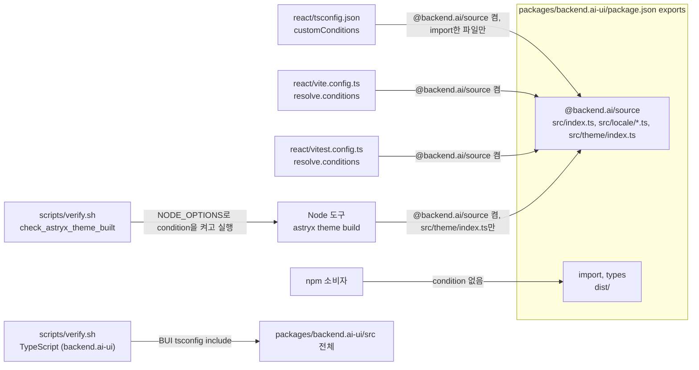

# 0013 — Source export condition for backend.ai-ui

## Summary

> 낯선 용어는 문서 맨 아래 [용어](#용어)에 모아 두었다.

- `react/`는 workspace package `backend.ai-ui`(BUI)를 build된 `dist/`가 아니라 `packages/backend.ai-ui/src`의 source로 읽는다.
- BUI `package.json`의 `exports`가 유일한 원천이다. `"."`, `"./locale/*"`, `"./theme"`는 맨 앞에 [export condition](#용어) `@backend.ai/source`를 두고 그 condition이 source 파일을 가리킨다. `types`와 `import`는 `dist/`를 그대로 가리키므로 npm 소비자는 바뀌지 않는다.
- `react/`의 세 resolver(TypeScript, Vite, Vitest)는 그 condition을 켜기만 하고, `backend.ai-ui`를 위한 `paths`·`include`·`alias`는 두지 않는다.
- Node가 직접 실행하는 `astryx theme build`는 BUI를 theme token만 담은 subpath `backend.ai-ui/theme`로 import하고, `--conditions=@backend.ai/source`로 그 source를 읽는다. 이 source는 transform 없이 Node가 읽으므로 `dist/` build가 필요 없다.

## Context

- **Three hand-kept redirects**: `react/tsconfig.json`의 `paths` 두 줄과 `include` 한 줄, `vite.config.ts`의 regex alias 세 개, `vitest.config.ts`의 alias 세 개가 같은 사실을 따로 적었다. BUI에 subpath export가 늘면 세 곳을 모두 고쳐야 했고, 셋이 같은지 아무도 검사하지 않았다.
- **Include side effect**: `include`의 `../packages/backend.ai-ui/src` glob은 BUI의 test와 story까지 react의 program에 넣었다. 그래서 `exclude` 세 줄이 따로 있었다(FR-1331).
- **Published package**: BUI는 npm에 publish되므로 source로 가는 경로는 이 저장소 안에서만 쓰여야 한다.
- **Node cannot load the barrel**: barrel `src/index.ts`가 끌어오는 BUI source는 `graphql` tag(babel-plugin-relay), `?react` svg import, CSS import를 쓴다. `astryx theme build`처럼 Node와 jiti로 BUI를 import하는 도구는 이 transform을 돌리지 않으므로 source를 읽으면 실패한다.

## 설계도

## Decision

### 1. BUI의 exports가 source 경로를 가진다

| export           | `@backend.ai/source`   | `import` / `types`                              |
| ---------------- | ---------------------- | ----------------------------------------------- |
| `"."`            | `./src/index.ts`       | `./dist/backend.ai-ui.js` / `./dist/index.d.ts` |
| `"./locale/*"`   | `./src/locale/*.ts`    | `./dist/locale/*.js` / `./dist/locale/*.d.ts`   |
| `"./theme"`      | `./src/theme/index.ts` | `./dist/theme.js` / `./dist/theme/index.d.ts`   |
| `"./styles.css"` | 없음                   | `./dist/backend.ai-ui.css`                      |

- **Condition first**: resolver는 condition을 객체에 적힌 순서로 고르므로 `@backend.ai/source`는 각 entry의 맨 앞에 둔다.
- **Namespaced name**: 이름은 `@backend.ai/source`다. 다른 package가 쓸 수 있는 일반 이름(`source`, `development`)과 겹치지 않아, 켜도 node_modules의 다른 package가 source로 바뀌지 않는다.
- **No styles.css mapping**: `src/index.ts`가 자기 CSS를 직접 import하므로 source로 읽는 소비자는 `styles.css`를 import하지 않는다.
- **Side-effectful entry**: BUI `package.json`의 `sideEffects`는 `**/*.css`와 함께 `./src/index.ts`를 적는다. condition으로 resolve된 module에는 Vite가 package의 `sideEffects`를 적용하므로, 빠지면 production build가 re-export만 하는 `src/index.ts`를 건너뛰고 거기서만 import하는 전역 CSS(`styles/actionAccent.css`, `styles/backend.ai-ui.css`, `styles/dangerAction.css`)를 버린다. 전역 CSS를 import하는 source entry를 더하는 PR은 그 파일도 `sideEffects`에 적는다.
- **Theme subpath**: `"./theme"`는 `src/theme/`의 theme token 값과 builder(`ANTD_ALIGN_TOKENS`, `ANTD_REVERSED_BAND_OVERLAYS`, `BAI_SELF_COLOR_TOKENS`, `buildBaiCustomTokens`, `toSeedTuple`)만 내보낸다. 소비자는 component barrel 없이 BUI의 theme token만 골라 자기 theme에 적용할 수 있다. `"."`도 같은 값을 계속 re-export한다.
- **No theme side effects**: `src/theme/`의 test가 아닌 파일은 서로만 import하고 CSS도 없으므로 `sideEffects`에 적지 않는다.
- **New subpath exports**: BUI에 subpath export를 더하는 PR은 그 entry에도 `@backend.ai/source`를 맨 앞에 둔다.

### 2. react의 resolver는 condition만 켠다

| 파일                     | 설정                                                                                           |
| ------------------------ | ---------------------------------------------------------------------------------------------- |
| `react/tsconfig.json`    | `"customConditions": ["@backend.ai/source"]` (`moduleResolution: "bundler"`)                   |
| `react/vite.config.ts`   | `resolve.conditions: ['@backend.ai/source', ...defaultClientConditions]`                       |
| `react/vitest.config.ts` | `resolve.conditions: ['@backend.ai/source']`, `ssr.resolve.conditions: ['@backend.ai/source']` |

- **Keep Vite defaults**: Vite 6는 `resolve.conditions`를 설정하면 기본값을 대신하므로 `vite.config.ts`는 `vite`의 `defaultClientConditions`를 뒤에 펼친다. Vitest는 설정값 뒤에 자기 기본값(`node`, `development|production`)을 붙이므로 `vitest.config.ts`는 condition만 적는다. 거기서 `defaultClientConditions`를 펼치면 `module`과 `browser`가 더해져 test가 package의 browser build를 고른다.
- **No redirects**: `react/`의 config는 `backend.ai-ui`를 위한 `paths`, `include`, `resolve.alias`를 두지 않는다. `backend.ai-client`의 `paths`와 alias는 이 결정의 범위 밖이다.
- **buiSrc stays**: 두 Vite config의 `buiSrc` 상수는 resolve에 쓰이지 않고, `@vitejs/plugin-react`의 babel 설정이 BUI 파일에 BUI의 Relay `artifactDirectory`를 주는 판정에 남는다.
- **SSR environment too**: Vite 6의 top-level `resolve.conditions`는 client environment에만 적용된다. Vitest는 `--changed`의 test 선택(import 추적)과 `@vitest-environment node` test를 ssr environment에서 처리하므로, `react/vitest.config.ts`는 `ssr.resolve.conditions`에도 `@backend.ai/source`를 둔다. 빠지면 그 단계에서 BUI가 `dist/`로 resolve되어, BUI만 바꾼 branch의 `vitest --changed`가 관련 react test를 하나도 고르지 않는다.
- **Import surface**: `react/eslint.config.js`의 `no-restricted-imports`는 `backend.ai-ui/*`를 막고 `backend.ai-ui/locale`과 `backend.ai-ui/theme`만 허용한다.

### 3. react의 tsc는 BUI를 import한 만큼만 본다

- **Reachable files only**: `include`가 빠졌으므로 react의 `tsc`는 react가 import하는 BUI 파일만 검사한다.
- **Own lane**: `scripts/verify.sh`의 `TypeScript (backend.ai-ui)` lane과 `.github/workflows/typecheck.yml`의 `backend.ai-ui` lane이 BUI의 `tsc --noEmit`을 따로 돌린다.
- **Incremental locally**: `verify.sh`의 BUI lane은 react lane과 같이 `--incremental`로 돌려 `.tsbuildinfo`(gitignore 대상)를 재사용한다. CI lane은 매번 새 checkout이므로 붙이지 않는다.

### 4. Node 도구는 Node가 읽는 subpath로만 BUI를 import한다

- **Theme recipe import**: `astryx theme build`가 jiti로 읽는 theme recipe(`react/src/astryx-theme/backendAiTheme.ts`)는 BUI를 `backend.ai-ui/theme`로만 import한다. recipe가 barrel `backend.ai-ui`를 import하면 Node가 `graphql` tag와 JSX가 든 source를 읽게 되어 build가 실패한다.
- **Condition in Node**: Node가 실행하는 도구는 `NODE_OPTIONS="--conditions=@backend.ai/source"`로 condition을 켠다. `scripts/verify.sh`의 `check_astryx_theme_built`와 `react/src/astryx-theme/built/index.ts`에 적힌 재생성 절차가 그렇게 실행한다. condition이 없으면 Node는 `dist/theme.js`를 읽으므로, `dist/`가 없으면 resolve에 실패하고 오래되었으면 낡은 값으로 검사한다.
- **Loadable subpath only**: BUI의 다른 code가 필요한 Node 도구를 더하는 PR은 Relay·JSX·CSS·svg transform 없이 Node가 읽을 수 있는 source만 담은 subpath를 BUI에 더하고, 그 subpath로 import한다. Node 도구는 barrel을 import하지 않는다.
- **No dist build**: `scripts/verify.sh`와 CI는 Node 도구 앞에서 BUI를 build하지 않는다. `astryx theme build`는 `verify.sh`에서만 돌고 CI workflow는 돌리지 않는다.

## 대안과 기각 사유

- **Keep the aliases**: 지금의 `paths`·`alias`를 그대로 둔다. 바꿀 것이 없다는 것이 장점이다. 기각한 이유는 세 곳이 같은 사실을 따로 적고 아무도 그 일치를 검사하지 않기 때문이다.
- **Point exports at src and override on publish**: `exports`를 source로 두고 `publishConfig.exports`로 publish 때만 `dist/`로 바꾼다. condition 설정이 필요 없다는 것이 장점이다. 기각한 이유는 저장소에서 검사한 `exports`와 publish된 `exports`가 달라지고, barrel을 import하는 Node 도구가 condition 없이도 source를 받아 실패하기 때문이다.
- **Load the barrel in Node**: theme build에 `--conditions=@backend.ai/source`를 주고 CSS·svg를 stub해 barrel `backend.ai-ui`를 source로 읽는다. subpath를 더하지 않아도 된다는 것이 장점이다. 기각한 이유는 jiti가 JSX를 classic runtime으로 옮기고 babel-plugin-relay를 돌리지 않아 BUI의 `graphql` tag에서 실패하기 때문이다.
- **Rebuild dist before Node tools**: recipe는 barrel을 import한 채로 두고, `verify.sh`가 theme build 앞에서 `dist/`가 없거나 BUI source보다 오래되었으면 BUI를 build한다. recipe의 import를 바꾸지 않는다는 것이 장점이다. 기각한 이유는 mtime 판정이 build 도중 저장된 수정을 놓치고, 내용 없이 mtime만 바뀐 파일에도 BUI 전체 build(약 14초)를 돌리기 때문이다.

## Consequences

- **Resolution in one place**: react의 세 resolver가 BUI를 어디로 resolve할지는 `package.json`의 `exports`가 정한다. BUI의 진입점이나 subpath를 바꾸는 PR은 그 밖에 BUI `vite.config.ts`의 lib `entries`(dist build), `react/vite.config.ts`의 `server.warmup` 경로, `react/eslint.config.js`의 `!backend.ai-ui/<subpath>` 허용 목록도 맞춘다.
- **Dist-free paths**: react의 `tsc`, vitest, `vite build`, dev server와 `astryx theme build`는 `dist/`가 없어도 동작한다.
- **BUI-only type errors**: react가 import하지 않는 BUI 파일의 type error는 BUI lane만 잡는다.
- **Theme recipe import limit**: theme recipe는 `backend.ai-ui/theme`가 내보내지 않는 BUI 값을 쓸 수 없다. 그런 값이 필요하면 그 값을 `src/theme/`로 옮기거나 4항의 조건을 지키는 subpath를 더한다.

## 출처

- Node.js [Conditional exports](https://nodejs.org/api/packages.html#conditional-exports), TypeScript [`customConditions`](https://www.typescriptlang.org/tsconfig/#customConditions), Vite [`resolve.conditions`](https://vite.dev/config/shared-options#resolve-conditions).
- FR-1331 (a1d8755c49) — BUI test를 react program에서 뺀 `exclude`.
- GitHub: #10409, PR #10410.
- 결정일: 2026-10-18.
- 관련: [ADR 0009](0009-ui-common-as-the-single-entry-point-to-astryx.md) (BUI와 `react/`가 Astryx를 import하는 경로).

## 용어

| 용어             | 뜻                                                                                                                                                                                                                                                                                                |
| ---------------- | ------------------------------------------------------------------------------------------------------------------------------------------------------------------------------------------------------------------------------------------------------------------------------------------------- |
| export condition | `package.json` `exports` 객체의 key로, resolver가 켠 condition과 맞는 첫 entry의 경로를 고른다. Node가 정한 condition은 `import`, `require`, `node`, `default`이고, `types`는 TypeScript가, `browser`는 Vite 같은 bundler가 읽는다. `@backend.ai/source`는 이 저장소가 정한 custom condition이다. |
