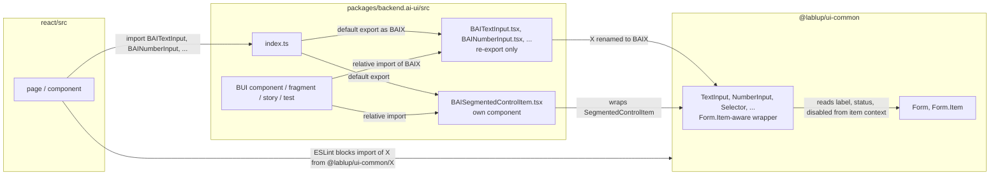

# 0014 — BAI names for ui-common form controls

> ADR 0009의 1절 "New code" 항목 중 form control에 관한 부분을 대신한다.
> `BAISelector`에 관한 부분은 ADR 0017이 대신한다.

## Summary

> 낯선 용어는 문서 맨 아래 [용어](#용어)에 모아 두었다.

- `react/`는 ui-common의 [Form.Item-aware form control](#용어)을 `@lablup/ui-common/<X>`가 아니라 `backend.ai-ui`의 `BAI<X>` 이름으로 import한다.
- BUI는 control마다 `packages/backend.ai-ui/src/components/BAI<X>.tsx` 파일을 두고, 그 파일이 ui-common component를 [re-export](#용어)한다. re-export는 wrapper가 아니므로 props와 동작은 ui-common component 그대로다.
- form control을 `Form.Item`에 맞추던 webui의 adapter(`AstryxForm*`)는 두지 않는다. value 보정, item 안의 기본 폭, label과 status와 disabled 전달은 ui-common이 한다.
- BUI 쪽 동작이 필요해진 control은 그 `BAI<X>.tsx`의 re-export를 component로 바꾼다. 지금 그런 control은 `BAISegmentedControlItem` 하나다.
- BUI의 다른 source(component, fragment, story, test)도 form control을 그 `BAI<X>.tsx`에서 상대 경로로 import한다.
- `react/eslint.config.js`의 `no-restricted-imports`가 `react/`에서 이 component 이름을 ui-common subpath로 import하는 것을 막는다. control 자신의 props type은 `BAI<X>Props`를 쓰고, 같은 subpath의 다른 type과 helper(`SelectorOptionType`, `ISODateTimeString`, `SearchSource` 등)는 그대로 import한다.

## Context

- **What ui-common provides**: ui-common 0.2.0-alpha.20부터 form control(`TextInput`, `NumberInput`, `Selector` 등)은 Astryx component를 감싼 Form.Item-aware wrapper다. `Form.Item` 안에서 value, onChange, disabled, validation status, 접근 가능한 이름을 item에서 받고, item 행 안에서 control마다 정해진 기본 폭(`IN_ITEM_WIDTH`)을 쓴다. text·select 계열은 `100%`이고, `NumberInput`은 90px, date·time input과 switch·checkbox는 `fit-content`다. `NumberInput`은 비우면 `null`을 보고하고, `Selector`는 trigger 아래로 열리고, `TagsInput`은 `tokenSeparators`로 tag를 나눈다.
- **What webui had**: webui는 이 일을 직접 하는 adapter를 두 벌 두었다. `react/src/components/astryxFormControls.tsx`·`astryxFormTextInput.tsx`와 BUI의 `astryxFormControls.tsx`다. #10553이 둘을 지우고 ui-common control을 직접 쓰게 했다.
- **Why a decision is needed**: ADR 0009는 새 webui code가 BUI에 `BAI*` adapter가 있으면 그것을, 없으면 ui-common component를 직접 쓴다고 정했다. 그 규칙대로면 form control은 BUI에 adapter가 없으므로 webui가 ui-common subpath를 직접 import한다. 그러면 webui 화면의 다른 component(`BAISelect`, `BAICheckbox`, `BAIModal` 등)는 `backend.ai-ui`에서, form control만 ui-common에서 오고, BUI 쪽 동작을 나중에 더할 자리가 없다. 팀은 form control도 `BAI*` 이름 하나로 쓰기로 했다.

## 설계도

## Decision

### 1. BUI가 form control을 `BAI<X>` 이름으로 re-export한다

| `backend.ai-ui` 이름 | ui-common subpath의 이름 |
|---|---|
| `BAICheckboxInput` | `CheckboxInput` |
| `BAICheckboxList`, `BAICheckboxListItem` | `CheckboxList`, `CheckboxListItem` |
| `BAIDateInput` | `DateInput` |
| `BAIDateRangeInput` | `DateRangeInput` |
| `BAIDateTimeInput` | `DateTimeInput` |
| `BAIFileInput` | `FileInput` |
| `BAIMultiSelector` | `MultiSelector` |
| `BAINumberInput` | `NumberInput` |
| `BAIRadioList`, `BAIRadioListItem` | `RadioList`, `RadioListItem` |
| `BAISegmentedControl` | `SegmentedControl` |
| `BAISelector` | `Selector` |
| `BAISlider` | `Slider` |
| `BAISwitch` | `Switch` |
| `BAITagsInput` | `TagsInput` |
| `BAITextArea` | `TextArea` |
| `BAITextInput` | `TextInput` |
| `BAITimeInput` | `TimeInput` |
| `BAITokenizer` | `Tokenizer` |
| `BAITypeahead` | `Typeahead` |

- **One file per control**: `BAI<X>.tsx`는 `export { X as default, type XProps as BAIXProps } from '@lablup/ui-common/X'` 한 문장이다. item component는 부모 파일에서 함께 낸다(`BAIRadioList.tsx`의 `BAIRadioListItem`, `BAICheckboxList.tsx`의 `BAICheckboxListItem`). components barrel `index.ts`는 다른 BUI component와 같이 `export { default as BAIX } from './BAIX'`로 낸다.
- **Props type**: 각 control은 `BAI<X>Props` type도 함께 낸다. 이 type은 ui-common의 `<X>Props`와 같다. `react/`와 BUI의 call site는 control 자신의 props type으로 `BAI<X>Props`를 쓰고 ui-common `<X>Props`를 import하지 않는다. 2절대로 promotion되면 두 type이 달라지기 때문이다.
- **Catalog**: 파일마다 같은 이름의 `BAI<X>.doc.ts`가 있어 `ui-common component` 목록과 `astryxIntegration.test.ts`의 catalog coverage를 채운다. doc의 공통 문장은 `formControlDoc.ts`의 `formControlDoc()`가 만든다.
- **Not a wrapper**: re-export는 ui-common component 그 자체이므로 `component-props-extension.md`가 말하는 wrapper 규칙(props extend, `...rest` 전달)의 대상이 아니다.

### 2. BUI 동작이 필요한 control은 그 파일에서 component가 된다

- **Promotion**: 어떤 control에 BUI 쪽 동작(번역, 기본값, 다른 props)이 필요해지면 그 `BAI<X>.tsx`의 re-export를 component로 바꾸고 `BAI<X>.doc.ts`에 그 props를 적는다. props interface는 ui-common `<X>Props`를 extend한다. 파일과 이름이 그대로이므로 barrel과 call site는 바뀌지 않는다.
- **SegmentedControlItem**: `BAISegmentedControlItem`은 이미 그런 component다. `label`을 `ReactNode`로 넓히고, `isLabelHidden`은 `label`이 string일 때만 받는다. 그래서 `SegmentedControlItem`의 BAI 이름은 이것이고, 같은 이름의 re-export는 두지 않는다.
- **Existing antd-shaped wrappers stay**: `BAISelect`, `BAICheckbox`, `BAIDynamicUnitInputNumber`처럼 frozen antd-v6 props를 받는 기존 BUI component는 그대로 남는다. 새 code는 Astryx 모양 props가 맞으면 이 문서의 `BAI<X>`를 쓴다.

### 3. BUI source도 `BAI<X>`를 쓴다

- **Rule**: BUI의 component, fragment, story, test는 form control을 `BAI<X>` 이름으로 쓰고, import하는 파일에서 `components/BAI<X>.tsx`까지의 상대 경로로 import한다(`components/`에서는 `./BAITextInput`, `components/fragments/`에서는 `../BAITextInput`). item component는 부모 파일의 named export다(`import BAIRadioList, { BAIRadioListItem } from './BAIRadioList'`). `backend.ai-ui`나 components barrel `index.ts`에서 import하지 않는다. barrel을 거치면 순환 import가 생긴다.
- **Antd-shaped wrappers included**: `BAISelect`, `BAICheckbox`, `BAIDynamicUnitInputNumber`처럼 2절의 기존 wrapper도 안에서 그리는 control을 `BAI<X>`로 import한다.
- **Where the subpath stays**: ui-common subpath에서 control component를 import하는 파일은 1절의 `BAI<X>.tsx`와 2절의 promotion된 component(`BAISegmentedControlItem.tsx`)뿐이다.
- **Props type**: control 자신의 props type은 1절대로 `BAI<X>.tsx`의 `BAI<X>Props`를 쓴다.
- **Types stay importable**: 그 밖의 type과 helper(`SelectorOptionData`, `ISODateTimeString`, `SearchSource` 등)는 BUI에서도 ui-common subpath에서 그대로 import한다.

### 4. ESLint가 `react/`의 직접 import를 막는다

- **Rule**: `react/eslint.config.js`의 `formControlImportBans`가 `no-restricted-imports`의 `paths`에 subpath마다 한 항목을 둔다. 항목은 그 subpath의 component 이름만 `importNames`로 막고, 메시지로 `BAI<X>`를 가리킨다. `restrictedImportPaths`와 project-agnostic page block이 이 배열을 펼친다.
- **Types stay importable**: `importNames`에 없는 이름(type, helper, `TypeaheadItem` 같은 다른 component)은 막지 않는다. control 자신의 `<X>Props`도 lint로는 막히지 않으므로 1절의 Props type 규칙은 review가 지킨다.
## 대안과 기각 사유

- **Direct ui-common imports**: ADR 0009의 규칙대로 webui가 `@lablup/ui-common/<X>`를 직접 import한다. BUI에 파일을 더하지 않는다는 것이 장점이다. 기각한 이유는 한 화면 안에서 component 출처가 `backend.ai-ui`와 ui-common으로 갈리고, 나중에 BUI 동작을 더하려면 call site를 다시 모두 고쳐야 하기 때문이다.
- **Thin BAI wrappers per control**: 각 `BAI<X>.tsx`가 ui-common component를 감싸는 function component다. 동작을 더할 자리가 처음부터 있다는 것이 장점이다. 기각한 이유는 더할 동작이 없는 wrapper가 19개 생기고, 각 wrapper가 props 전달과 `ref`를 다시 구현해 ui-common과 어긋날 수 있기 때문이다. 필요해진 control만 2절대로 component가 된다.
- **BUI imports ui-common directly**: BUI source는 re-export를 거치지 않고 ui-common subpath를 쓴다. BUI 안에 import 경로가 하나 줄어든다는 것이 장점이다. 기각한 이유는 control이 2절대로 component가 될 때 BUI 안의 화면(`BAIProjectSettingModal`, File Explorer의 modal 등)만 그 동작을 받지 못하고, 같은 control이 BUI와 `react/`에서 다른 이름으로 보이기 때문이다.
- **One re-export file**: 19개 re-export를 한 파일에 모은다. 파일 수가 적다는 것이 장점이다. 기각한 이유는 다른 BUI component와 파일 구조가 달라지고, control 하나를 component로 바꿀 때 목록에서 빼서 새 파일로 옮겨야 하기 때문이다.
- **Keep the AstryxForm adapters**: webui의 adapter를 그대로 둔다. call site를 바꾸지 않는다는 것이 장점이다. 기각한 이유는 adapter가 하던 일을 ui-common이 하게 되어 같은 일을 두 곳에서 하고, adapter가 ui-common과 다른 props 이름(`label`, `onValueChange`, `allowClear`)을 써서 ui-common 문서와 맞지 않기 때문이다.

## Consequences

- **One import source**: webui 화면의 form control은 다른 BUI component와 같이 `backend.ai-ui`에서 오고, BUI 안의 화면에서는 같은 `BAI<X>.tsx`에서 온다.
- **Upstream props**: `BAI<X>`의 props는 ui-common과 Astryx의 props다. 행을 채워야 하는 `BAINumberInput`은 call site에서 `width="100%"`를 준다. 삭제한 adapter는 이 값이 기본이었다. `label`은 `Form.Item`이 그리고 control에는 필요할 때 `aria-label`을 준다. checkbox와 switch의 보이는 글은 `children`이다.
- **New ui-common control**: ui-common이 새 Form.Item-aware control을 내면, webui에서 쓰기 전에 `BAI<X>.tsx`와 `BAI<X>.doc.ts`를 더하고 components barrel과 `formControlImportBans`에 같이 적는다.
- **Lint scope**: ban은 `react/`의 static import만 본다. BUI의 직접 import는 review에서 3절대로 고친다.

## 출처

- GitHub: #10553, PR #10554. ui-common의 Form.Item wrapper는 lablup/ui-common#72(0.2.0-alpha.20).
- 결정일: 2026-10-25.
- 관련: [ADR 0009](0009-ui-common-as-the-single-entry-point-to-astryx.md) (ui-common이 Astryx로 가는 유일한 경로, BUI의 `BAI*` adapter).

## 용어

| 용어 | 뜻 |
|---|---|
| Form.Item-aware form control | ui-common이 Astryx 입력 component를 감싸 `Form.Item` 안에서 value, onChange, disabled, validation status, 접근 가능한 이름을 item에서 받게 한 component다. Astryx의 field chrome(`label`, `description`, `isRequired`)은 받지 않는다. |
| promotion | `BAI<X>.tsx`의 re-export를 ui-common component를 감싸는 BUI component로 바꾸는 것이다(2절). 파일과 이름은 그대로다. |
| re-export | 다른 module의 export를 이름만 바꿔 다시 내는 것이다. 새 component를 만들지 않으므로 `BAITextInput === TextInput`이다. |
