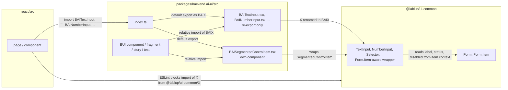

# 0014 — BAI names for ui-common form controls

> This ADR supersedes the part about form controls in the "New code" item of section 1 of ADR 0009.
> ADR 0017 supersedes the part of this ADR about `BAISelector`.

## Summary

> Unfamiliar terms are collected in the [Glossary](#glossary) at the end.

- `react/` imports ui-common's [Form.Item-aware form controls](#glossary) under their `BAI<X>` names from `backend.ai-ui`, not from `@lablup/ui-common/<X>`.
- BUI keeps one file `packages/backend.ai-ui/src/components/BAI<X>.tsx` per control, and that file is a [re-export](#glossary) of the ui-common component. A re-export is not a wrapper, so the props and the behaviour are exactly those of the ui-common component.
- Webui keeps no adapters (`AstryxForm*`) that fit form controls to `Form.Item`. ui-common does the value correction, the default width inside an item, and the passing of label, status, and disabled.
- When a control needs BUI-side behaviour, BUI replaces the re-export in its `BAI<X>.tsx` with a component. Today `BAISegmentedControlItem` is the only such control.
- The other BUI source files (components, fragments, stories, tests) also import form controls from that `BAI<X>.tsx` through a relative path.
- `no-restricted-imports` in `react/eslint.config.js` stops `react/` from importing these component names from the ui-common subpaths. For the control's own props type, code uses `BAI<X>Props`. Code still imports the other types and helpers of the same subpath (`SelectorOptionType`, `ISODateTimeString`, `SearchSource`, and so on) from there.

## Context

- **What ui-common provides**: From ui-common 0.2.0-alpha.20, the form controls (`TextInput`, `NumberInput`, `Selector`, and so on) are Form.Item-aware wrappers around Astryx components. Inside a `Form.Item`, each control receives the value, onChange, disabled, the validation status, and the accessible name from the item, and it uses a default width set per control (`IN_ITEM_WIDTH`) inside the item row. The width is `100%` for the text and select controls, 90px for `NumberInput`, and `fit-content` for the date and time inputs and for switches and checkboxes. `NumberInput` reports `null` when it is empty, `Selector` opens below its trigger, and `TagsInput` splits tags with `tokenSeparators`.
- **What webui had**: Webui had two sets of adapters that did this work themselves: `react/src/components/astryxFormControls.tsx` with `astryxFormTextInput.tsx`, and BUI's `astryxFormControls.tsx`. #10553 deleted both and made webui use the ui-common controls directly.
- **Why a decision is needed**: ADR 0009 decided that new webui code uses a `BAI*` adapter in BUI when one exists and uses the ui-common component directly when none exists. Under that rule, BUI has no adapter for form controls, so webui imports the ui-common subpaths directly. Then the other components on a webui screen (`BAISelect`, `BAICheckbox`, `BAIModal`, and so on) come from `backend.ai-ui`, only the form controls come from ui-common, and BUI has no place to add behaviour later. The team decided to use form controls under a single `BAI*` name too.

## Diagram

## Decision

### 1. BUI re-exports the form controls under `BAI<X>` names

| `backend.ai-ui` name                     | Name in the ui-common subpath      |
| ---------------------------------------- | ---------------------------------- |
| `BAICheckboxInput`                       | `CheckboxInput`                    |
| `BAICheckboxList`, `BAICheckboxListItem` | `CheckboxList`, `CheckboxListItem` |
| `BAIDateInput`                           | `DateInput`                        |
| `BAIDateRangeInput`                      | `DateRangeInput`                   |
| `BAIDateTimeInput`                       | `DateTimeInput`                    |
| `BAIFileInput`                           | `FileInput`                        |
| `BAIMultiSelector`                       | `MultiSelector`                    |
| `BAINumberInput`                         | `NumberInput`                      |
| `BAIRadioList`, `BAIRadioListItem`       | `RadioList`, `RadioListItem`       |
| `BAISegmentedControl`                    | `SegmentedControl`                 |
| `BAISelector`                            | `Selector`                         |
| `BAISlider`                              | `Slider`                           |
| `BAISwitch`                              | `Switch`                           |
| `BAITagsInput`                           | `TagsInput`                        |
| `BAITextArea`                            | `TextArea`                         |
| `BAITextInput`                           | `TextInput`                        |
| `BAITimeInput`                           | `TimeInput`                        |
| `BAITokenizer`                           | `Tokenizer`                        |
| `BAITypeahead`                           | `Typeahead`                        |

- **One file per control**: `BAI<X>.tsx` is one statement: `export { X as default, type XProps as BAIXProps } from '@lablup/ui-common/X'`. The parent file also exports the item component (`BAIRadioListItem` in `BAIRadioList.tsx`, `BAICheckboxListItem` in `BAICheckboxList.tsx`). The components barrel `index.ts` exports each control with `export { default as BAIX } from './BAIX'`, the same way it exports the other BUI components.
- **Props type**: Each control also exports a `BAI<X>Props` type. This type is the same as ui-common's `<X>Props`. Call sites in `react/` and BUI use `BAI<X>Props` as the control's own props type and do not import ui-common's `<X>Props`, because the two types become different after a promotion under section 2.
- **Catalog**: Each file has a `BAI<X>.doc.ts` with the same name, which fills the `ui-common component` list and the catalog coverage of `astryxIntegration.test.ts`. `formControlDoc()` in `formControlDoc.ts` produces the sentences that the docs share.
- **Not a wrapper**: A re-export is the ui-common component itself, so the wrapper rules in `component-props-extension.md` (extend the props, pass `...rest` through) do not apply to it.

### 2. A control that needs BUI behaviour becomes a component in its file

- **Promotion**: When a control needs BUI-side behaviour (translation, default values, different props), BUI replaces the re-export in that `BAI<X>.tsx` with a component and writes those props in `BAI<X>.doc.ts`. The props interface extends ui-common's `<X>Props`. The file and the name stay the same, so the barrel and the call sites do not change.
- **SegmentedControlItem**: `BAISegmentedControlItem` is already such a component. It widens `label` to `ReactNode` and accepts `isLabelHidden` only when `label` is a string. For this reason this component is the BAI name of `SegmentedControlItem`, and no re-export with the same name exists.
- **Existing antd-shaped wrappers stay**: Existing BUI components that take frozen antd-v6 props, such as `BAISelect`, `BAICheckbox`, and `BAIDynamicUnitInputNumber`, stay as they are. New code uses the `BAI<X>` of this document when Astryx-shaped props fit.

### 3. BUI source also uses `BAI<X>`

- **Rule**: BUI components, fragments, stories, and tests use form controls under their `BAI<X>` names, and they import them through the relative path from the importing file to `components/BAI<X>.tsx` (`./BAITextInput` in `components/`, `../BAITextInput` in `components/fragments/`). An item component is a named export of its parent file (`import BAIRadioList, { BAIRadioListItem } from './BAIRadioList'`). BUI source does not import them from `backend.ai-ui` or from the components barrel `index.ts`, because an import through the barrel creates a circular import.
- **Antd-shaped wrappers included**: The existing wrappers of section 2, such as `BAISelect`, `BAICheckbox`, and `BAIDynamicUnitInputNumber`, also import the controls they render as `BAI<X>`.
- **Where the subpath stays**: The only files that import a control component from a ui-common subpath are the `BAI<X>.tsx` files of section 1 and the promoted component of section 2 (`BAISegmentedControlItem.tsx`).
- **Props type**: For the control's own props type, code uses `BAI<X>Props` from `BAI<X>.tsx`, as section 1 says.
- **Types stay importable**: BUI also still imports the other types and helpers (`SelectorOptionData`, `ISODateTimeString`, `SearchSource`, and so on) from the ui-common subpaths.

### 4. ESLint blocks direct imports in `react/`

- **Rule**: `formControlImportBans` in `react/eslint.config.js` puts one entry per subpath into the `paths` of `no-restricted-imports`. Each entry blocks only the component names of that subpath through `importNames`, and its message points at `BAI<X>`. `restrictedImportPaths` and the project-agnostic page block spread this array.
- **Types stay importable**: The rule does not block names that are not in `importNames` (types, helpers, and other components such as `TypeaheadItem`). Lint does not block the control's own `<X>Props` either, so review enforces the Props type rule of section 1.

## Rejected alternatives

- **Direct ui-common imports**: Webui imports `@lablup/ui-common/<X>` directly, as the rule of ADR 0009 says. The advantage is that BUI gets no new files. This alternative is rejected because the components on one screen would come from two sources, `backend.ai-ui` and ui-common, and adding BUI behaviour later would require changing every call site again.
- **Thin BAI wrappers per control**: Each `BAI<X>.tsx` is a function component that wraps the ui-common component. The advantage is that a place to add behaviour exists from the start. This alternative is rejected because it creates 19 wrappers with no behaviour to add, and each wrapper reimplements the props passing and `ref`, so it can diverge from ui-common. Only a control that needs it becomes a component, as section 2 says.
- **BUI imports ui-common directly**: BUI source uses the ui-common subpaths without going through the re-exports. The advantage is one fewer import path inside BUI. This alternative is rejected because, when a control becomes a component under section 2, only the screens inside BUI (`BAIProjectSettingModal`, the File Explorer modals, and so on) would not get that behaviour, and the same control would appear under different names in BUI and in `react/`.
- **One re-export file**: All 19 re-exports go into one file. The advantage is fewer files. This alternative is rejected because the file structure would differ from the other BUI components, and turning one control into a component would mean removing it from the list and moving it into a new file.
- **Keep the AstryxForm adapters**: Webui keeps its adapters as they are. The advantage is that the call sites do not change. This alternative is rejected because ui-common now does the work the adapters did, so two places would do the same work, and the adapters use props names that differ from ui-common (`label`, `onValueChange`, `allowClear`), so they do not match the ui-common docs.

## Consequences

- **One import source**: On webui screens the form controls come from `backend.ai-ui`, like the other BUI components, and on screens inside BUI they come from the same `BAI<X>.tsx`.
- **Upstream props**: The props of `BAI<X>` are the ui-common and Astryx props. A `BAINumberInput` that must fill the row gets `width="100%"` at the call site. The deleted adapter had this value as its default. `Form.Item` draws the `label`, and a control gets an `aria-label` when it needs one. The visible text of a checkbox or a switch is its `children`.
- **New ui-common control**: When ui-common releases a new Form.Item-aware control, a developer adds `BAI<X>.tsx` and `BAI<X>.doc.ts` before webui uses it, and also adds the control to the components barrel and to `formControlImportBans`.
- **Lint scope**: The ban looks only at static imports in `react/`. Review fixes direct imports in BUI, as section 3 says.

## Sources

- GitHub: #10553, PR #10554. ui-common's Form.Item wrappers came in lablup/ui-common#72 (0.2.0-alpha.20).
- Decided 2026-10-25.
- Related: [ADR 0009](0009-ui-common-as-the-single-entry-point-to-astryx.md) (ui-common as the only path to Astryx, and BUI's `BAI*` adapters).

## Glossary

| Term                         | Meaning                                                                                                                                                                                                                                                                                                                     |
| ---------------------------- | --------------------------------------------------------------------------------------------------------------------------------------------------------------------------------------------------------------------------------------------------------------------------------------------------------------------------- |
| Form.Item-aware form control | A Form.Item-aware form control is a component in which ui-common wraps an Astryx input component so that, inside a `Form.Item`, it receives the value, onChange, disabled, the validation status, and the accessible name from the item. It does not accept the Astryx field chrome (`label`, `description`, `isRequired`). |
| promotion                    | Promotion is the change that replaces the re-export in `BAI<X>.tsx` with a BUI component that wraps the ui-common component (section 2). The file and the name stay the same.                                                                                                                                               |
| re-export                    | A re-export exports another module's export again under a new name only. It creates no new component, so `BAITextInput === TextInput`.                                                                                                                                                                                      |
