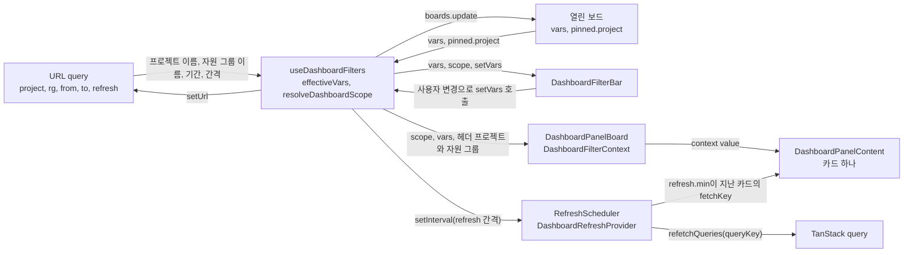
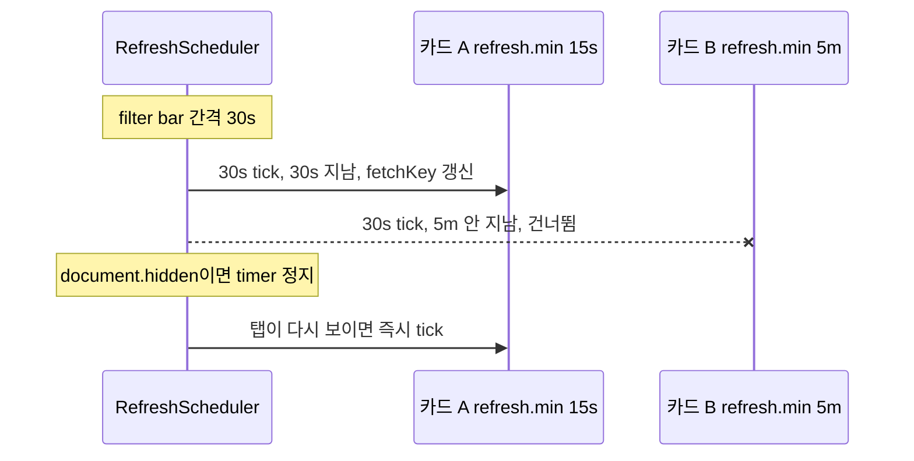

# 0015 — Dashboard filter bar

## Summary

> 낯선 용어는 문서 맨 아래 [용어](#용어)에 모아 두었다.

- 대시보드 page의 [filter bar](#용어)가 그 page의 모든 카드가 읽는 프로젝트, 자원 그룹, 기간을 정한다. 카드는 자기 범위를 따로 고르지 않고, 카드마다 범위를 덮어쓰는 설정도 없다.
- filter bar는 모든 역할에서 현재 도메인만 읽는다. superadmin도 도메인을 고르지 않고 `scoped*` field에 현재 도메인을 넘긴다([ADR 0012](0012-scoped-search-fields-in-place-of-admin-fields.md)).
- filter 값은 URL query와 열린 [보드](#용어)의 `vars`에 저장되고, 관리자 page에서는 보드의 `pinned.project`가 둘보다 우선한다. 두 곳 모두 사용자가 값을 바꿀 때만 쓴다.
- filter bar의 자동 새로고침은 page마다 timer 하나다. timer는 카드 정의의 `refresh.min`이 지난 카드만 다시 읽고, 탭이 숨겨지면 멈춘다.
- 카드가 보여 주는 합계와 시간별 개수는 매니저가 계산한 값만 쓴다. 한 프로젝트나 한 자원 그룹 단위로만 값을 주는 field는 행으로 나눠 보여 주고, 클라이언트는 값을 더하지 않는다.

## Context

- **Card scope today**: #10580 이전의 대시보드 카드는 각자 범위를 정했다. "My Sessions" 카드는 관리자에게 프로젝트 전체 세션을 세었고, 어떤 범위인지 화면에 표시되지 않았다(#9839, #7843).
- **Board model**: [ADR 0014](0014-dashboard-boards-in-manager-app-config.md)가 보드를 `DashboardModel`로 저장하고, 그 안에 filter 값 `vars`와 고정 프로젝트 `pinned.project`를 두었다.
- **Page timers**: `DashboardPage`는 15초, `AdminDashboardPage`는 30초 `useInterval`로 page query의 [fetch key](#용어)를 올렸다. 카드가 직접 읽는 REST와 TanStack query는 이 timer와 따로 움직였다.

## 설계도

### 값의 흐름

### refresh tick

## Decision

### 1. filter bar가 카드의 범위를 정한다

- **Bar controls**: `DashboardFilterBar`(`react/src/components/DashboardPanels/DashboardFilterBar.tsx`)가 page마다 아래 control을 그린다.

| control       | 일반 사용자 page `project`                                                   | 프로젝트 관리자 page `projectAdmin`                      | superadmin page `admin`                                                                   |
| ------------- | ---------------------------------------------------------------------------- | -------------------------------------------------------- | ----------------------------------------------------------------------------------------- |
| 프로젝트      | 없음. 헤더의 현재 프로젝트                                                   | 관리하는 프로젝트 중 여러 개. 기본은 URL 경로의 프로젝트 | 현재 도메인의 프로젝트 여러 개(`BAIScopedProjectSelect`, `scopedProjectsV2`). 기본은 전체 |
| 자원 그룹     | 여러 개(`BAIScopedResourceGroupSelect`, `scopedResourceGroups`). 기본은 전체 | 같음                                                     | 같음                                                                                      |
| 기간          | 최근 1시간, 24시간, 7일, 직접 지정. 기본은 24시간                            | 같음                                                     | 같음                                                                                      |
| 자동 새로고침 | 끔, 5초, 10초, 15초, 30초, 1분, 5분, 10분. 기본은 30초                       | 같음                                                     | 같음                                                                                      |

- **Resource group options**: `DashboardFilterBar`는 자원 그룹 선택지를 일반 사용자 page에서는 헤더 프로젝트(`scope: { project: [...] }`)에서, 관리자 page에서는 scope의 프로젝트들에서 읽는다. superadmin이 프로젝트를 전체로 두었을 때만 현재 도메인(`scope: { domain: [...] }`)에서 읽는다.
- **No per-card override**: 카드 정의(`PanelDefinition`)와 보드의 패널(`PersistedPanelV2`)에는 범위 field가 없다. 사용자 정의 패널의 `filter`는 행을 거르는 조건이고, 범위는 filter bar를 따른다. 이 문서의 카드는 코드의 panel과 같다.
- **No domain picker**: `DashboardFilterBar`는 도메인 control을 두지 않는다. `useDashboardFilters`가 `useCurrentDomain()`의 `{ id, name }`을 `DashboardScope`의 `domain`으로 넘긴다.
- **Copy**: 화면 문구에는 "scope"라는 단어를 쓰지 않는다. 기간 control 옆 도움말은 지금 상태를 보여 주는 카드(세션 수, 자원 할당)에 기간이 적용되지 않는다고 알린다.

### 2. filter 값의 모양

- **Vars shape**: 보드의 `vars`는 `DashboardBoardVars`(`types.ts`)이다.

| field     | type                | 뜻                                                                   |
| --------- | ------------------- | -------------------------------------------------------------------- |
| `project` | `string[] \| 'all'` | 프로젝트 UUID 목록. `'all'`은 제한 없음                              |
| `rg`      | `string[] \| 'all'` | 자원 그룹 이름 목록. `'all'`은 제한 없음                             |
| `range`   | `string`            | `now-1h` 같은 상대 기간, 또는 `YYYY-MM-DD/YYYY-MM-DD` 직접 지정 기간 |
| `refresh` | `string`            | `off`, 또는 `5s`부터 `10m`까지 `REFRESH_OPTIONS`의 값                |

- **Empty selection**: `DashboardFilterBar`는 선택을 모두 지운 control의 값을 `'all'`로 저장하고, `resolveDashboardScope`도 빈 목록을 `'all'`로 읽는다.
- **Fallback values**: `effectiveVars`는 해석되지 않는 `range`나 `refresh`를 `DEFAULT_BOARD_VARS`(`dashboardConfig.ts`)의 `now-24h`, `30s`로 바꾼다.
- **Custom range**: `rangeToDateTimeFilter(range, now)`는 직접 지정 기간을 시작일 0시부터 마지막 날 다음 날 0시까지(현지 시각)의 `{ after, before }`로 만든다. `before`는 포함하지 않는다.
- **Stable now**: 카드는 `now`로 자기 마지막 refresh 시각을 넘기므로, refresh 사이에는 query 변수가 바뀌지 않는다.

### 3. scope는 순수 함수 하나가 정한다

- **Resolver**: `resolveDashboardScope`(`dashboardScope.ts`)가 `{ page, urlProjectId, adminProjectIds, vars, pinned, currentDomain }`을 받아 `DashboardScope`(`types.ts`)를 돌려준다.

| kind       | page                    | field                                                                      |
| ---------- | ----------------------- | -------------------------------------------------------------------------- |
| `mine`     | `project`               | `projectId`(헤더 프로젝트), `rgs`. `vars.project`와 `pinned`는 읽지 않는다 |
| `projects` | `projectAdmin`, `admin` | `projectIds`(`'all'`은 superadmin만), `rgs`, `domain`                      |

- **Pinned wins**: 관리자 page에서 보드의 `pinned.project`가 비어 있지 않으면 `resolveDashboardScope`는 그 목록을 `vars.project`보다 먼저 쓰고, `DashboardFilterBar`는 프로젝트 control을 잠근다.
- **Project admin filter**: `projectAdmin` page에서 `resolveDashboardScope`는 고정 목록이나 고른 목록 중 관리하지 않는 프로젝트를 버리고, 남는 것이 없으면 URL 경로의 프로젝트 하나를 쓴다.
- **Project admin start**: `effectiveVars`는 `projectAdmin` page에서 보드에 저장된 프로젝트 목록을 쓰지 않고 URL query의 `project`만 쓴다. 그래서 고정이 없는 보드는 URL 경로의 프로젝트로 열린다.
- **Header project change**: `projectAdmin` page에서 헤더 프로젝트가 바뀌면 `useDashboardFilters`가 고정이 없는 첫 보드를 연다.
- **Single resource group cards**: 자원 그룹 하나만 받는 카드는 `resourceGroupRows(scope.rgs, currentResourceGroup)`로 행을 만든다. 자원 그룹을 여러 개 고르면 자원 그룹마다 한 행이고, 전체이면 헤더의 현재 자원 그룹 한 행이다.

### 4. 카드는 context로 값을 받는다

- **Providers**: 대시보드 page(`DashboardPage`, `AdminDashboardPage`)가 `DashboardRefreshProvider`로 page를 감싸고, `DashboardPanelBoard`가 `DashboardFilterContext`로 `BAIBoard`를 감싼다.
- **Card state**: `DashboardPanelContent`는 context와 scheduler에서 `{ scope, vars, fetchKey, isRefetching, onRefresh }`를 만들어 children render prop으로 넘기고, `useDashboardBoard`가 이 값을 `PanelComponentProps`로 카드 component에 펼친다. `vars`는 `DashboardVars`(`range`, `timeRange`, `currentProjectId`, `currentResourceGroup`)이다.

### 5. filter 값은 URL과 보드에 저장한다

- **URL params**: `useDashboardFilters`가 nuqs로 `?project=&rg=&from=&to=&refresh=`를 읽고 쓴다. `to`는 직접 지정한 기간의 마지막 날이다.
- **Project names**: URL에는 프로젝트 UUID가 아니라 이름을 쓴다. `admin` page에서는 `useDashboardFilters`가 `scopedProjectsV2`의 `name in` 조회와 picker가 넘긴 이름으로 UUID를 찾고, 다른 page에서는 `useAccessibleProjects`의 프로젝트 목록으로 찾는다.
- **Precedence**: `effectiveVars`가 보드의 `vars` 위에 URL query 값을 얹는다. 값이 없거나 해석되지 않는 param은 보드 값을 남긴다.
- **Write on user change**: `setVars`는 사용자가 control을 바꿀 때만 URL과 보드의 `vars`를 쓴다. 값을 읽거나 보드를 열 때는 아무것도 쓰지 않는다.
- **Stored projects**: `varsToStore`는 보드의 `project`를 `admin` page에서만 바꾸고, 다른 page에서는 저장된 값을 그대로 둔다.
- **Board switch**: 다른 보드를 열면 `useDashboardFilters`가 이전 보드의 URL query를 지운다.

### 6. refresh timer는 page마다 하나다

- **Scheduler**: `DashboardRefreshProvider`가 page마다 `RefreshScheduler`(`refreshScheduler.ts`)를 하나 만들고, `useDashboardFilters`가 filter bar의 자동 새로고침 값을 tick 간격으로 넘긴다.
- **Subscribers**: 카드는 `useDashboardFetchKey('panel:<id>', refresh.min)`, 카드가 아직 읽는 page query는 `useDashboardFetchKey('page-query', …)`, TanStack query는 `useDashboardRefreshQuery(queryKey, min)`으로 scheduler에 등록한다.
- **Per-card minimum**: tick마다 `RefreshScheduler`는 마지막 refresh 뒤 `minMs`가 지난 구독자만 다시 읽는다. timer 오차로 500ms까지 이르게 온 tick도 지난 것으로 친다. 새로 등록한 구독자의 첫 자동 refresh는 등록 뒤 `minMs`를 기다린다.
- **Hidden tab**: `RefreshScheduler`는 `document.hidden`이면 timer를 멈추고, 탭이 다시 보이면 간격이 켜져 있을 때 한 번 tick한 뒤 timer를 다시 시작한다.
- **Manual refresh**: filter bar의 refresh 버튼과 카드의 `onRefresh`는 `refreshAll()`을 불러 모든 구독자를 바로 다시 읽고 countdown을 처음부터 센다.
- **No suspense flash**: `useDashboardFetchKey`는 fetch key를 `startTransition` 안에서 바꾸고, 카드와 page는 `useDeferredValue`를 거친 key로 query를 다시 읽는다.

### 7. 합계와 시간별 개수는 매니저가 계산한다

- **Count aliases**: 상태별 개수 같은 값을 그리는 카드는 한 요청 안에서 filter를 달리한 connection의 `count`를 [count alias](#용어)로 읽는다.
- **Buckets**: 시간별 개수를 그리는 카드는 `bucketize(range, now)`가 만든 8개 이하의 연속 구간마다 count alias 하나를 읽는다. 1시간과 24시간은 6개, 7일은 하루씩 7개이고, 그 밖의 기간은 8개 이하의 같은 길이 구간이다.
- **Usage buckets**: 사용량 추이 카드는 매니저의 `usageBuckets`가 준 구간을 그대로 그린다.
- **Rows, not sums**: 프로젝트 하나나 자원 그룹 하나 단위로만 값을 주는 field를 읽는 카드는 고른 프로젝트나 자원 그룹마다 한 행을 그린다. 클라이언트는 여러 응답의 값을 더하지 않는다.

## 대안과 기각 사유

- **Per-card scope**: 카드마다 프로젝트와 자원 그룹을 고르게 한다. 한 보드에 여러 범위를 섞을 수 있다. 기각한다. 카드마다 범위가 다르면 사용자가 화면이 어떤 데이터를 보여 주는지 한곳에서 알 수 없고, #9839처럼 범위가 표시되지 않는 문제가 돌아온다.
- **Domain picker**: superadmin filter bar에 도메인 multi-select를 둔다. 여러 도메인을 한 보드에서 비교할 수 있다. 기각한다. [ADR 0012](0012-scoped-search-fields-in-place-of-admin-fields.md)가 모든 역할의 읽기를 현재 도메인의 `scoped*` field로 정했다.
- **Page-level timers**: page마다 `useInterval`을 두고 카드가 각자 TanStack `refetchInterval`을 쓴다. timer가 카드 가까이 있다. 기각한다. 같은 tick에 Relay 카드와 REST 카드가 어긋나고, 탭이 숨겨져도 요청이 이어지며, 정책처럼 느리게 바뀌는 카드도 15초마다 다시 읽는다.
- **Client-side sums**: 프로젝트마다 받은 값을 브라우저에서 더한다. 매니저 API가 없어도 합계를 보여 줄 수 있다. 기각한다. 권한 때문에 빠진 프로젝트를 클라이언트가 알 수 없어 합계가 틀리고, 요청 수가 고른 프로젝트 수만큼 늘어난다.

## Consequences

- **One visible scope**: 사용자는 filter bar 한 줄에서 보드가 어떤 프로젝트, 자원 그룹, 기간을 보여 주는지 안다.
- **Shareable links**: URL query가 filter 값을 담으므로 링크를 연 사용자는 같은 값으로 보드를 본다. 전체를 뜻하는 값은 param을 지우므로, 받은 사람의 보드가 다른 값을 저장했으면 그 값이 보인다.
- **Unmigrated cards**: 이 결정이 들어간 시점의 기존 카드는 `scope`와 `vars`를 읽지 않고 page query와 헤더 값을 쓴다. `resourceGroupRows`와 `bucketize`를 쓰는 카드도 아직 없다.
- **Cards blocked on aggregation**: 매니저가 group-by나 시계열 값을 주지 않는 카드는 만들지 않고 backend 요청으로 남는다.

## 출처

- #10422 (epic), #10582, #9839, #7843, 2026-10-26.
- #10422의 role-based dashboard 제안(필터 바, 기간과 갱신, 저장과 마이그레이션).

관련: [ADR 0012](0012-scoped-search-fields-in-place-of-admin-fields.md), [ADR 0014](0014-dashboard-boards-in-manager-app-config.md).

## 용어

| 용어          | 뜻                                                                                                                                                  |
| ------------- | --------------------------------------------------------------------------------------------------------------------------------------------------- |
| filter bar    | 대시보드 보드 위에서 프로젝트, 자원 그룹, 기간, 자동 새로고침을 고르는 한 줄짜리 control 묶음이다. `DashboardFilterBar`가 그린다.                   |
| 보드          | 카드 배치와 filter 값을 담아 저장한 대시보드 한 장이다. `DashboardModel`이며 [ADR 0014](0014-dashboard-boards-in-manager-app-config.md)가 정의한다. |
| fetch key     | Relay `useLazyLoadQuery`의 `fetchKey` 옵션에 넘기는 문자열이다. 값이 바뀌면 query가 서버에서 다시 읽힌다.                                           |
| count alias   | 같은 connection field를 한 GraphQL 요청 안에서 filter만 달리해 여러 번 부르고, 각 결과의 `count`만 이름을 붙여 읽는 방식이다.                       |
| `refresh.min` | `PanelDefinition`이 정하는 카드의 최소 refresh 간격이다. filter bar 간격이 이보다 짧아도 카드는 이 간격보다 자주 다시 읽지 않는다.                  |
