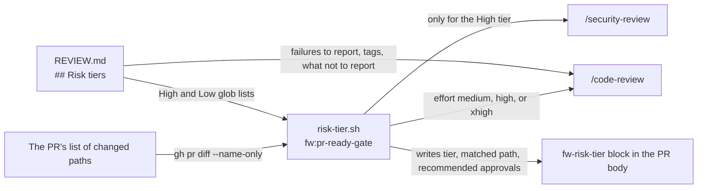

# 0015 — Risk-tiered review policy in REVIEW.md

## Summary

> Unfamiliar terms are collected in the [Glossary](#glossary) at the end.

- This repository keeps its PR review policy in one file, `REVIEW.md` at the root. Every reviewer reads this file, whether the reviewer is a person, an agent, or a bot.
- The ready gate (`fw:pr-ready-gate`) sets the [risk tier](#glossary) by matching the paths a PR changed against the `## Risk tiers` lists in `REVIEW.md`, and the tier sets the review depth and the recommended number of approvals.
- Every finding carries one tag out of Important, Nit, and Pre-existing, and the gate answers every finding.

## Context

- **Previous instructions**: The review instructions were in `.github/copilot-instructions.md`, which only Copilot read, and every PR was reviewed at the same depth.
- **Gate change**: claude-mp's `fw:pr-ready-gate` (fw 29.0.0) runs Claude Code's `/code-review` instead of Copilot, and it reads the review policy from the repository's `REVIEW.md`.
- **Source pattern**: Anthropic's [Solving code review at Anthropic](https://claude.dev/blog/solving-code-review-at-anthropic/) describes the method of setting a risk tier from the changed paths and varying the review depth per tier.

## Diagram

## Decision

### 1. The review policy lives in REVIEW.md

- **Single file**: `REVIEW.md` holds the failure types to report, the evidence rule, what not to report, the tags, and the risk tier lists. The build and component conventions stay in `AGENTS.md`.
- **Ignored paths**: The list of generated files stays identical to `.claude/rules/review-ignored-paths.md`, and a PR that changes either file changes both.

### 2. The risk tier sets the review depth

- **Classification**: If any one changed file matches a High glob, the tier is High. If every file matches a Low glob, the tier is Low. Otherwise the tier is Medium.
- **Review depth**: The table below shows the review the gate runs and the recommended number of approvals for each tier. The number of approvals is a recommendation, and branch protection sets the actual requirement.

| tier   | `/code-review` effort | `/security-review` | Recommended approvals |
| ------ | --------------------- | ------------------ | --------------------- |
| Low    | medium                | None               | 0                     |
| Medium | high                  | None               | 1                     |
| High   | xhigh                 | Runs               | 2                     |

- **Override scope**: The `### High` and `### Low` lists in `REVIEW.md` replace the gate's default lists entirely. A glob from the default lists that should stay must be written again in `REVIEW.md`.
- **Dropped defaults**: The `REVIEW.md` lists deliberately drop or narrow some of the gate's default globs. `**/auth*` was dropped because it matches unrelated files such as `AuthorIcon.tsx`. The repository-wide `*credential*`, `*purge*`, and `*delete*` were narrowed to `react/src` and the BUI `src`, because they matched manual screenshots. `**/electron*/**` was changed to the real path, `electron-app/**`. `packages/backend.ai-client/**` was narrowed to `src/**`, so the client package's docs and tests fall to Low.

### 3. Every finding carries a tag and gets an answer

- **Tags**: Important covers wrong behavior, permission leaks, contract violations, and violations of documented rules. Nit covers anything else on lines the PR changed, with at most 3 per review. Pre-existing covers defects on lines the PR did not change, and the reviewer does not ask for them to be fixed in this PR.
- **Every finding answered**: The gate takes the PR out of draft only after it has answered each finding by fixing it, handing it to a person's judgment, or giving the reason it does not apply.

## Rejected alternatives

- **Keep Copilot instructions**: This alternative keeps `.github/copilot-instructions.md`. Its advantage is that the setup already exists. It is rejected because the gate no longer calls Copilot, and other reviewers do not read that file.
- **One depth for every PR**: This alternative reviews every PR at the same effort with no tiers. Its advantage is a simple rule. It is rejected because a PR that only changes docs and a PR that changes authentication or configuration would be reviewed at the same cost and the same depth.

## Consequences

- **Steering files are High**: `REVIEW.md`, `AGENTS.md`, `.claude/**`, `.github/**`, the verification harness, the lint, build, and test configuration, and the ADRs are High even though they are Markdown. High takes precedence over Low.
- **Path-based limit**: The tier looks only at paths, so a PR that changes risky code in a path not on the High list is reviewed as Medium. The Medium tier reviewer checks the security items in `REVIEW.md` directly.
- **Plugin dependency**: The gate in fw 29.0.0 or later runs this policy. In a session with an older fw installed, the gate does not read `REVIEW.md`.

## Sources

- GitHub: #10640, #10641. Implementation: lablup/claude-mp#169 (`plugins/fw/skills/pr-ready-gate/`, `scripts/risk-tier.sh`).
- Source of the method: https://claude.dev/blog/solving-code-review-at-anthropic/
- Decision date: 2026-10-27.
- Related: `.claude/rules/review-ignored-paths.md`, `.claude/rules/adr.md`. No neighbouring ADR exists.

## Glossary

| Term      | Meaning                                                                                                                                                                                                             |
| --------- | ------------------------------------------------------------------------------------------------------------------------------------------------------------------------------------------------------------------- |
| risk tier | A risk tier is the High, Medium, or Low grade that the paths a PR changed decide. The ready gate uses this grade to set the review effort, whether a security review runs, and the recommended number of approvals. |
