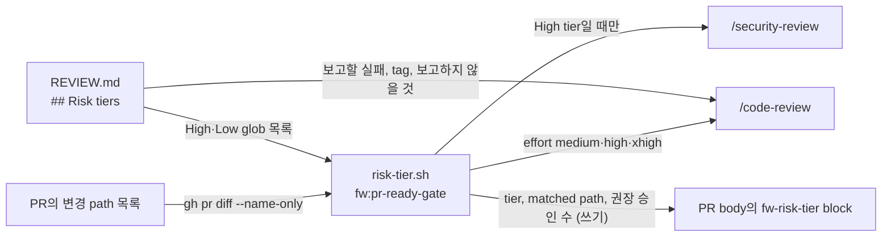

# 0015 — Risk-tiered review policy in REVIEW.md

## Summary

> 낯선 용어는 문서 맨 아래 [용어](#용어)에 모아 두었다.

- 이 저장소의 PR 리뷰 정책은 루트의 `REVIEW.md` 한 파일에 둔다. 리뷰어가 사람이든 agent든 bot이든 이 파일을 읽는다.
- ready gate(`fw:pr-ready-gate`)는 PR이 바꾼 path를 `REVIEW.md`의 `## Risk tiers` 목록과 맞춰 [risk tier](#용어)를 정하고, tier가 리뷰 깊이와 권장 승인 수를 정한다.
- 모든 finding은 Important, Nit, Pre-existing 중 하나의 tag를 달고, gate는 모든 finding에 답한다.

## Context

- **Previous instructions**: 리뷰 지침은 Copilot만 읽는 `.github/copilot-instructions.md`에 있었고, 모든 PR이 같은 깊이로 리뷰되었다.
- **Gate change**: claude-mp의 `fw:pr-ready-gate`(fw 29.0.0)는 Copilot 대신 Claude Code의 `/code-review`를 돌리고, 리뷰 정책을 저장소의 `REVIEW.md`에서 읽는다.
- **Source pattern**: 변경 path로 risk tier를 정하고 tier별로 리뷰 깊이를 다르게 하는 방식은 Anthropic의 [Solving code review at Anthropic](https://claude.dev/blog/solving-code-review-at-anthropic/)이 설명한 방식이다.

## 설계도

## Decision

### 1. 리뷰 정책은 REVIEW.md에 둔다

- **Single file**: 보고할 실패 유형, evidence 규칙, 보고하지 않을 것, tag, risk tier 목록은 `REVIEW.md`에 둔다. build와 component 규약은 `AGENTS.md`에 남는다.
- **Ignored paths**: 생성 파일 목록은 `.claude/rules/review-ignored-paths.md`와 같게 유지하고, 둘 중 하나를 바꾸는 PR은 둘 다 바꾼다.

### 2. risk tier가 리뷰 깊이를 정한다

- **Classification**: 바뀐 파일 하나라도 High glob에 맞으면 High, 모든 파일이 Low glob에 맞으면 Low, 그 밖은 Medium이다.
- **Review depth**: tier마다 gate가 하는 리뷰와 권장 승인 수는 아래와 같다. 승인 수는 권장이고 실제 요구는 branch protection이 정한다.

| tier | `/code-review` effort | `/security-review` | 권장 승인 수 |
|---|---|---|---|
| Low | medium | 없음 | 0 |
| Medium | high | 없음 | 1 |
| High | xhigh | 실행 | 2 |

- **Override scope**: `REVIEW.md`의 `### High`·`### Low` 목록은 gate의 기본 목록을 통째로 대신한다. 기본 목록에서 유지할 glob은 `REVIEW.md`에 다시 적는다.
- **Dropped defaults**: `REVIEW.md` 목록은 gate 기본 목록 중 일부를 일부러 빼거나 좁힌다. `**/auth*`는 `AuthorIcon.tsx` 같은 무관한 파일에 맞아서 뺐고, 저장소 전체의 `*credential*`·`*purge*`·`*delete*`는 매뉴얼 screenshot에 맞아서 `react/src`와 BUI `src`로 좁혔다. `**/electron*/**`는 실제 경로인 `electron-app/**`로 바꿨다. `packages/backend.ai-client/**`는 `src/**`로 좁혀, client package의 문서와 테스트는 Low로 떨어진다.

### 3. finding은 tag를 달고 모두 답을 받는다

- **Tags**: Important는 잘못된 동작, 권한 누출, 계약 위반, 문서화된 규칙 위반이다. Nit은 PR이 바꾼 줄의 그 밖의 것이고 리뷰당 3개까지다. Pre-existing은 PR이 바꾸지 않은 줄의 결함이고 이 PR에 고치라고 요구하지 않는다.
- **Every finding answered**: gate는 finding마다 고치거나, 사람의 판단으로 넘기거나, 적용하지 않는 이유를 답한 뒤에만 PR을 draft에서 꺼낸다.

## 대안과 기각 사유

- **Keep Copilot instructions**: `.github/copilot-instructions.md`를 유지한다. 설정이 이미 있다는 것이 장점이다. 기각한 이유는 gate가 더 이상 Copilot을 부르지 않고, 그 파일은 다른 리뷰어가 읽지 않기 때문이다.
- **One depth for every PR**: tier 없이 모든 PR을 같은 effort로 리뷰한다. 규칙이 단순하다는 것이 장점이다. 기각한 이유는 문서만 바꾼 PR과 인증·설정을 바꾼 PR이 같은 비용과 같은 깊이로 리뷰되기 때문이다.

## Consequences

- **Steering files are High**: `REVIEW.md`, `AGENTS.md`, `.claude/**`, `.github/**`, 검증 harness, lint·build·test 설정, ADR은 Markdown이어도 High이다. High가 Low보다 우선한다.
- **Path-based limit**: tier는 path만 보므로, High 목록에 없는 path에서 위험한 코드를 바꾼 PR은 Medium으로 리뷰된다. `REVIEW.md`의 보안 항목은 Medium tier 리뷰어가 직접 확인한다.
- **Plugin dependency**: 이 정책을 실행하는 것은 fw 29.0.0 이상의 gate다. 그보다 낮은 fw가 설치된 session의 gate는 `REVIEW.md`를 읽지 않는다.

## 출처

- GitHub: #10640, #10641. 구현: lablup/claude-mp#169 (`plugins/fw/skills/pr-ready-gate/`, `scripts/risk-tier.sh`).
- 방식의 출처: https://claude.dev/blog/solving-code-review-at-anthropic/
- 결정일: 2026-10-27.
- 관련: `.claude/rules/review-ignored-paths.md`, `.claude/rules/adr.md`. 이웃한 ADR은 없다.

## 용어

| 용어 | 뜻 |
|---|---|
| risk tier | PR이 바꾼 path로 정하는 High·Medium·Low 등급이다. ready gate가 이 등급으로 리뷰 effort, 보안 리뷰 여부, 권장 승인 수를 정한다. |
