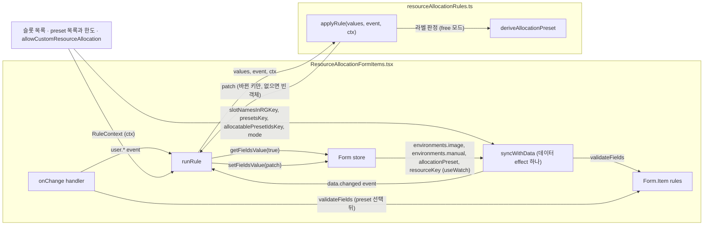

# 0016 — Rule module for the resource allocation form

## Summary

> 낯선 용어는 문서 맨 아래 [용어](#용어)에 모아 두었다.

- 세션 런처의 자원 할당 폼 fragment `ResourceAllocationFormItems`가 소유하는 필드(`allocationPreset`, `resource.*`, `enabledAutomaticShmem`)의 "한 필드가 바뀌면 다른 필드를 바꾼다"는 규칙은 전부 `react/src/components/SessionFormItems/resourceAllocationRules.ts`의 `applyRule(values, event, ctx)`에 둔다. 컴포넌트의 `onChange` 핸들러와 [데이터 effect](#용어)는 이 함수가 돌려준 [patch](#용어)를 폼에 쓰는 일만 한다.
- `applyRule`이 값을 자동으로 바꾸는 경우는 세 가지뿐이다. 다른 값의 함수인 값([derive](#용어)), 사용자가 preset이나 `minimum-required`를 골라 값 묶음을 요청한 경우([apply](#용어)), 이전 값이 문맥에서 더 이상 존재할 수 없는 경우([invalidate](#용어))다. 그 밖의 불일치는 `Form.Item`의 validator가 메시지로 보여 주고 값은 그대로 둔다. min·max·step 범위 밖의 값도 `applyRule`은 고치지 않는다.
- `free` 모드(`allowCustomResourceAllocation = true`)에서 `allocationPreset`은 값에서 파생되는 라벨이다. `deriveAllocationPreset`이 자원 값이 선택한 preset과 다르면 `custom`으로, 다시 같아지면 그 preset으로 읽는다. shared memory는 이 판정에서 제외한다.
- [preset-only 모드](#용어)에서는 `applyRule`이 preset의 값을 바꾸지 않고, 위반은 보이는 `allocationPreset` 항목의 validator가 표시한다. URL이나 템플릿에서 복원된 `custom`은 값이 일치하는 [allocatable preset](#용어)이 있으면 그 preset으로 읽고, 없으면 선택을 비워 사용자가 고르게 한다. 복원된 값을 지켜야 하는 소비자는 `keepRestoredAllocation` prop을 넘긴다.
- 같은 상태에 같은 event를 다시 넣으면 `applyRule`은 빈 patch를 돌려준다. 데이터 effect가 자기가 쓴 값 때문에 다시 실행돼도 그 한 번으로 멈춘다.

## Context

- **Form fragment**: `ResourceAllocationFormItems`는 세션 런처(`SessionLauncherPage`)와 `DeploymentAddRevisionModal`이 같은 `Form` 안에서 렌더하는 자원 할당 fragment다. 이 fragment가 소유하는 필드는 `resourceGroup`, `allocationPreset`, `resource.{cpu, mem, shmem, accelerator, acceleratorType}`, `enabledAutomaticShmem`, `agent`, `cluster_mode`, `cluster_size`다. 같은 폼의 `environments.image`와 `environments.manual`은 `ImageEnvironmentSelectFormItems`가 소유하고, 이 fragment는 `Form.useWatch`로 읽기만 한다. 폼 밖에서는 자원 그룹의 슬롯 목록(`useResourceSlotsDetails`), `resourcePreset.check`의 preset 목록과 한도(`useResourceLimitAndRemaining`), `baiClient._config.allowCustomResourceAllocation`이 들어온다.
- **Previous shape**: 2026-10-22의 `main`(`a04bf4cbdb`)에서 이 규칙은 핸들러 6곳, `Form.useWatch`를 감시하는 `useEffect` 3개, 서로의 누락을 뒤에서 메우는 `useEventNotStable` 헬퍼 4개에 흩어져 있었다. 자원 값이 preset과 달라진 같은 상태가 경로에 따라 `custom`으로 읽히기도 하고 preset 이름을 유지하기도 했다. effect가 자기가 쓴 `resource` 값에 다시 반응해 멈추지 않는 루프가 두 번 사고로 났다(FR-3523, FR-3985).
- **Decision trigger**: 규칙을 한 모듈로 옮기는 작업은 "어떤 반응이 자동이고 어떤 반응이 메시지인가"라는 경계를 먼저 요구한다. 이전 코드는 그 경계를 경로마다 다르게 두고 있었으므로, 옮기기만 하면 그 차이가 모듈 안에 그대로 들어간다.

## 설계도

`form`에서 `effect`로 가는 edge에서 FR-3523의 루프가 생겼다. `resourceKey`가 바뀌어 `effect`가 다시 실행돼도 `applyRule`이 빈 patch를 돌려주면 `runRule`은 쓰지 않으므로 두 번째 실행에서 멈춘다.

## Decision

### 1. 규칙은 `applyRule` 하나에 산다

- **Module**: `react/src/components/SessionFormItems/resourceAllocationRules.ts`는 React hook을 쓰지 않는 함수 모듈이다. 폼 값의 타입 `ResourceAllocationFormValue`, `AUTOMATIC_DEFAULT_SHMEM`, `getAutomaticShmem`, `pickChangedResourceValues`도 여기에 있고, `ResourceAllocationFormItems.tsx`가 re-export하므로 기존 importer는 바뀌지 않는다. `getUnavailableSlotNames`는 `react/src/components/ResourcePresetSelect.tsx`에서 import한다.
- **Signature**: `applyRule(values: ResourceValues, event: RuleEvent, ctx: RuleContext): RulePatch`. `values`는 핸들러가 보는 폼 전체이고, 폼 엔진은 `onChange`를 부르기 전에 편집된 필드를 이미 써 두므로 `values`에는 새 값이 들어 있다.
- **Events**: `RuleEvent`는 무슨 일이 일어났는지를 말한다.

| event                                                                 | 뜻                                                                 |
| --------------------------------------------------------------------- | ------------------------------------------------------------------ |
| `user.setResource` (`field`: `cpu` · `mem` · `shmem` · `accelerator`) | 사용자가 자원 값 하나를 편집했다                                   |
| `user.setAcceleratorType` (`next`, `prev`)                            | 사용자가 가속기 타입을 바꿨다                                      |
| `user.selectPreset` (`id`: preset id · `custom` · `minimum-required`) | 사용자가 preset 셀렉트에서 골랐다                                  |
| `user.toggleAutoShmem` (`on`)                                         | 사용자가 shared memory 자동 토글을 바꿨다                          |
| `data.changed`                                                        | 이미지, 자원 그룹, preset 목록, 슬롯 중 하나가 도착했거나 바뀌었다 |

- **Context**: `RuleContext`는 이 fragment가 소유하지 않는 입력이다. `mode`(`AllocationMode`: `free` · `preset-only`), `enableResourcePresets`, `image`, `manualImage`, `slotsInRG`(로드 전이면 `undefined`), `acceleratorSlotsInRG`, `presets`, `allocatablePresetIds`, `resourceLimits`, `imageMinMem`, `keepRestoredAllocation`이다.
- **Patch**: `RulePatch`는 바뀌어야 하는 키만 담는다. `mem`과 `shmem`은 크기로 비교하므로 `1g`와 `1024m`은 같은 값이다.
- **Caller**: 컴포넌트의 `runRule(event)`가 `applyRule`을 부르고, patch가 비어 있지 않을 때만 `form.setFieldsValue(patch)`를 한다. 자원 값과 타입의 핸들러는 `runRule`만 부른다. preset 셀렉트의 핸들러는 `custom`이 아닌 것을 고른 뒤 `resource`를 `validateFields`로 다시 검증한다.

### 2. 자동 변경은 derive, apply, invalidate 세 가지뿐이다

- **Derive**: `applyRule`은 다른 값의 함수인 값을 매 event 뒤에 다시 쓴다. `enabledAutomaticShmem`이 켜져 있을 때의 `resource.shmem`(`getAutomaticShmem(mem, imageMinMem)`)과 `allocationPreset`의 라벨(3절)이다.
- **Apply**: `user.selectPreset`은 그 순간 한 번 값 묶음을 덮어쓴다. preset id면 `getPresetResourceFields`가 preset의 슬롯 중 자원 그룹에 있는 것을 `g` 단위로 쓰고, preset에 `shared_memory`가 있으면 `enabledAutomaticShmem`을 끈다. `minimum-required`면 `getMinimumRequiredResourceFields`가 cpu와 mem을 이미지 최소값으로, 가속기를 이미지가 요구하는 타입의 최소값으로 쓰고 `enabledAutomaticShmem`을 켠다.
- **Invalidate**: `applyRule`은 문맥에서 존재할 수 없게 된 값을 정해진 폴백으로 바꾼다. `syncAcceleratorType`은 자원 그룹에 없는 `acceleratorType`을 이미지가 지원하는 그룹의 첫 슬롯으로(지원하는 슬롯이 없으면 그룹의 첫 슬롯으로) 바꾸고, 이미지가 지원하는 타입이 정확히 하나면 그 타입으로 바꾼다. 이미지가 그룹의 어떤 가속기도 지원하지 않으면 `accelerator`를 0으로, [unified 슬롯](#용어)에서는 `accelerator`를 `undefined`로 쓴다. `acceleratorType`은 `setAcceleratorType` 하나만 쓰므로, unified에서 discrete 슬롯으로 가면 새 슬롯의 최소값이 들어간다.
- **Validator cases**: min·max·step 범위 밖의 값, 자원 그룹에서 쓸 수 없는 preset, 이미지가 지원하지 않는 가속기 타입(지원 타입이 둘 이상일 때)은 `Form.Item`의 validator가 보여 준다. 가속기 타입 에러는 `free` 모드에서는 타입 항목에, preset-only 모드에서는(preset이 아닌 값일 때) 보이는 `allocationPreset` 항목에 붙는다. `applyRule`은 이 값들을 쓰지 않는다. 제출은 되지만 결과가 달라지는 경우(remaining 초과, multi-node 크기 1)는 `warningOnly` validator로 남는다.
- **Outside this module**: 선택한 버전의 `environments.image`는 `ImageEnvironmentSelectFormItems`가 쓰고, 자원 그룹에 없는 `agent`는 `AgentSelect`가 `fallbackToAuto`로 `auto`로 되돌린다. 두 규칙은 이 모듈에 없다.

### 3. `allocationPreset`은 값에서 파생되는 라벨이다

- **Free mode**: `deriveAllocationPreset`이 모든 event 뒤에 라벨을 다시 정한다. preset id인데 `matchesPreset`이 거짓이면 `custom`이 되고, `custom`인데 사용자가 값을 편집해 allocatable preset 하나와 같아지면 그 preset id가 된다. `minimum-required`는 값이 이미지 최소값과 같을 때만 유지된다.
- **Match**: `matchesPreset`은 cpu, mem(크기), `acceleratorType`(preset에 그 그룹의 가속기 슬롯이 있을 때), 가속기 수량(unified 슬롯은 제외)을 비교한다. shared memory는 비교하지 않는다. shared memory는 차지하는 자원량이 아니라 세션 내부 설정이고, preset-only 모드에서도 사용자가 바꿀 수 있는 값이기 때문이다.
- **Shared memory rule**: `deriveAllocationPreset`은 shmem 편집과 자동 토글을 값 편집으로 치지 않으므로, 사용자가 고른 `custom`도 shmem 때문에 preset으로 되돌아가지 않는다.
- **Preset-only mode**: `deriveAllocationPreset`은 `free` 모드에서만 라벨을 바꾼다. 셀렉트에 `custom`과 `minimum-required` 옵션이 없고, `resource.cpu`·`mem`·`accelerator` 항목은 `hidden`이다.

### 4. 쓸 수 없게 된 preset은 교체하지 않고 표시한다

- **Validator**: `allocationPreset` 항목의 validator가 `getPresetUnavailableReason`(`ResourcePresetSelect.tsx`)으로 사유를 정한다. 다른 자원 그룹 전용(`scoped`), 그룹에 없는 슬롯 요구(`missing-slots`), allocatable 한도 초과(`not-allocatable`) 세 가지다. 셀렉트의 비활성 옵션 툴팁과 validator는 같은 `presetUnavailableReasonText`로 문구를 만든다.
- **No re-pick**: 자원 그룹이나 이미지가 바뀌어 선택한 preset을 쓸 수 없게 되어도 `applyRule`은 다른 preset을 고르지 않는다. 초기 라벨 [`auto-select`](#용어)에서 이름순 첫 allocatable preset을 고르는 것은 apply이고 그대로다.
- **Deferred data**: 자원 그룹 셀렉트의 `onChange`는 검증하지 않는다. `resourcePreset.check`는 `useDeferredValue`로 늦게 따라오므로, 데이터 effect가 새 그룹의 데이터로 다시 검증한다. 선택한 id가 `checkPresetInfo.presets`에 아직 없으면 validator는 `scoped` 검사만 한다.

### 5. preset-only 모드에서 preset의 값은 `applyRule`이 바꾸지 않는다

- **Protected values**: `hasFreeValues`가 거짓이면(preset-only 모드이고 라벨이 `isPresetId`를 만족하면) `data.changed`는 자원 값을 쓰지 않는다. 타입 교체도, `accelerator` 0도, 이미지 최소값 재적용도 하지 않는다. 한도 위반은 숨은 항목이 아니라 보이는 `allocationPreset` 항목에 4절의 validator로 나타난다.
- **Unprotected values**: 라벨이 `custom`, `minimum-required`, `auto-select`, 비어 있음이면(`PSEUDO_PRESET_IDS`) 2절의 invalidate 규칙이 그대로 적용된다.
- **Restored labels**: URL이나 템플릿에서 `custom`이 복원되면 `relabelRestoredAllocation`이 값과 일치하는 allocatable preset을 찾아 그 id로 읽고, 없으면 라벨을 `null`로 비운다. 복원된 값 자체는 쓰지 않지만, 라벨이 비면 unprotected이므로 같은 `data.changed` 안에서 invalidate 규칙은 적용된다. `minimum-required`가 복원되면 이미지 최소값을 먼저 적용한 뒤 같은 판정을 한다.
- **Consumer switch**: 복원된 값을 지켜야 하는 소비자는 `keepRestoredAllocation` prop을 넘긴다. `DeploymentAddRevisionModal`은 deployment preset을 채울 때와 기존 리비전을 복제할 때 둘 다 `allocationPreset: 'custom'`과 함께 이 prop을 넘기므로, preset-only 모드에서도 채워진 값이 유지된다. 리비전 복제에 preset을 강제하지 않기로 한 결정이다.

### 6. 데이터 effect는 하나다

- **Dependencies**: `syncWithData`를 부르는 `useEffect`의 의존성은 데이터 키 `slotNamesInRGKey`, `presetsKey`, `allocatablePresetIdsKey`, `mode`, `enableResourcePresets`, `deferredResourceGroup`과, 폼에서 `useWatch`로 읽은 `currentImage`, `isManualImage`, `currentAllocationPreset`, `resourceKey`(`resource`의 JSON 직렬화)다.
- **Validation after the rule**: patch를 썼으면 `resource`를, 라벨이 있으면 `allocationPreset`을, `hasFreeValues`가 참인 상태면 `acceleratorType`을 `validateFields`로 다시 검증한다.
- **Closure**: `syncWithData`는 `useEventNotStable`로 감싼다. `useEffectEvent`는 effect가 새 의존성으로 다시 실행될 때 이전 렌더의 `ruleContext`를 보았으므로 쓰지 않는다. 계측 결과는 `ResourceAllocationFormItems.tsx`의 그 줄 주석에 있다.
- **Idempotence**: 같은 상태에 `data.changed`를 다시 넣으면 빈 patch가 나오는 것은 `applyRule`의 계약이고, `resourceAllocationRules.test.ts`가 `data.changed`와 "preset 선택 뒤 `data.changed`"에 대해 검사한다. 컴포넌트는 patch가 비었는지만 본다.

## 대안과 기각 사유

- **상태 기반 파생 함수 `derive(values, ctx) → values`**: event 없이 현재 값과 데이터만으로 다음 값을 계산한다. 구현이 더 작다. 기각했다. "preset을 **골랐을 때** 값을 덮어쓴다"처럼 한 번만 일어나는 동작과, 사용자가 바꿨는지 데이터가 도착했는지의 구분을 상태만으로는 표현할 수 없다.
- **범위 밖 값의 자동 clamp**: min·max·step 밖의 값을 가장 가까운 유효값으로 고친다. 사용자가 에러를 손으로 고칠 일이 줄어든다. 기각했다. 사용자가 넣은 값을 프로그램이 바꾸면 사용자는 무엇이 바뀌었는지 알 수 없고, 기존 validator 메시지가 이미 그 역할을 한다.
- **쓸 수 없게 된 preset의 자동 재선택**: 자원 그룹이 바뀌어 preset을 쓸 수 없으면 첫 allocatable preset을 적용한다(#10628의 동작). 사용자가 아무것도 안 해도 실행 가능한 상태가 된다. 기각했다. preset 하나가 아니라 cpu·mem·accelerator 전부를 조용히 바꾸고, 다른 자원 그룹 전용 preset을 에러로 표시하는 FR-4067의 결정과 어긋난다.
- **preset-only 모드에서 복원된 `custom`의 폐기**: URL의 `custom`을 `auto-select`로 바꿔 첫 preset을 적용한다. 셀렉트에 없는 값이 선택된 상태가 생기지 않는다. 기각했다. `DeploymentAddRevisionModal`은 `custom`을 "채운 값을 건드리지 말라"는 뜻으로 쓰므로, 이 대안은 복제본의 자원 값을 첫 preset으로 바꾼다.
- **URL 복원 경로에서만 거르기**: `SessionLauncherPage`가 URL을 읽을 때만 `custom`을 걸러낸다. 컴포넌트 소비자는 영향을 받지 않는다. 기각했다. 규칙이 모듈 밖에 하나 더 생기고, 같은 값이 출처에 따라 두 의미를 가진다.

## Consequences

- **Single reading surface**: 이 fragment의 필드 하나가 바뀔 때 무슨 일이 일어나는지는 `applyRule`의 `switch`와 `applyDataChanged`에 있다. `resourceAllocationRules.test.ts`의 `describe`/`it` 블록이 트리거마다 `free`와 `preset-only` 양쪽의 기대 patch를 적는다.
- **No settling loop**: 컴포넌트에 `pickChangedResourceValues`를 부르는 방어 코드가 없다. 멱등성은 모듈이 보장한다.
- **Scope**: 이 ADR은 `ResourceAllocationFormItems`가 소유하는 필드만 정한다. `ImageEnvironmentSelectFormItems`의 이미지 복원 effect와 `AgentSelect`의 폴백은 각자의 파일에 있다.

## 출처

- GitHub [#10693](https://github.com/lablup/backend.ai-webui/issues/10693) — 이 결정과 세 PR(#10696, #10697, #10698). 결정일 2026-10-29.
- #10628 — 자원 그룹에 없는 슬롯을 요구하는 preset의 비활성 표시. 그 PR의 자동 재선택은 4절로 대체됐다.
- FR-3523, FR-3985 — effect가 자기 쓴 값에 반응해 생긴 루프와 그 완화책.
- FR-4067 (#9927) — preset을 id로 식별하고 다른 자원 그룹 전용 preset을 에러로 표시한 결정.
- `react/src/components/SessionFormItems/resourceAllocationRules.ts`, `resourceAllocationRules.test.ts`, `ResourceAllocationFormItems.tsx`, `react/src/components/ResourcePresetSelect.tsx`, `react/src/components/DeploymentAddRevisionModal.tsx`.

관련: ADR 0001(이 fragment가 project를 prop으로 받는 계약), ADR 0014(폼 control의 `BAI*` 이름).

## 용어

| 용어               | 뜻                                                                                                                                                                                           |
| ------------------ | -------------------------------------------------------------------------------------------------------------------------------------------------------------------------------------------- |
| patch              | `applyRule`이 돌려주는 `RulePatch` 객체로, 폼에서 바뀌어야 하는 키와 값만 담는다. 빈 객체는 "쓸 것이 없다"는 뜻이다.                                                                         |
| 데이터 effect      | `ResourceAllocationFormItems.tsx`의 `syncWithData`를 부르는 `useEffect` 하나다. 이미지·자원 그룹·preset 데이터가 바뀌면 `data.changed` event를 `applyRule`에 넣는다.                         |
| derive             | 다른 값의 함수로 정해지는 값을 `applyRule`이 쓰는 것이다. 자동 shared memory가 그 예다.                                                                                                      |
| apply              | 사용자가 `user.selectPreset`으로 preset이나 `minimum-required`를 고른 순간, 그 값 묶음을 폼에 한 번 덮어쓰는 것이다.                                                                         |
| invalidate         | 문맥이 바뀌어 이전 값이 존재할 수 없을 때 `applyRule`이 정해진 폴백으로 바꾸는 것이다. 자원 그룹에 없는 가속기 타입이 그 예다.                                                               |
| preset-only 모드   | `config.toml`의 `allowCustomResourceAllocation = false`인 배포다. preset 셀렉트에 `custom`과 `minimum-required`가 없고 cpu·mem·accelerator 입력이 숨겨지며, shared memory만 사용자가 바꾼다. |
| allocatable preset | `ResourceAllocationFormItems.tsx`의 `getAllocatablePresetIds`가 현재 이미지와 자원 그룹의 한도 안에 든다고 판정한 preset이다.                                                                |
| `auto-select`      | `useStartSession`의 기본 폼 값이 주는 `allocationPreset`의 초기 라벨이다. `applyRule`은 이 라벨을 보면 이름순 첫 allocatable preset을 적용한다.                                              |
| unified 슬롯       | 이름이 `.unified`로 끝나는 가속기 슬롯이다(`react/src/helper/unifiedAcceleratorSlot.ts`의 `isUnifiedAcceleratorSlot`). 가속기 메모리를 호스트 메모리와 나눠 쓰므로 수량을 보내지 않는다.     |
