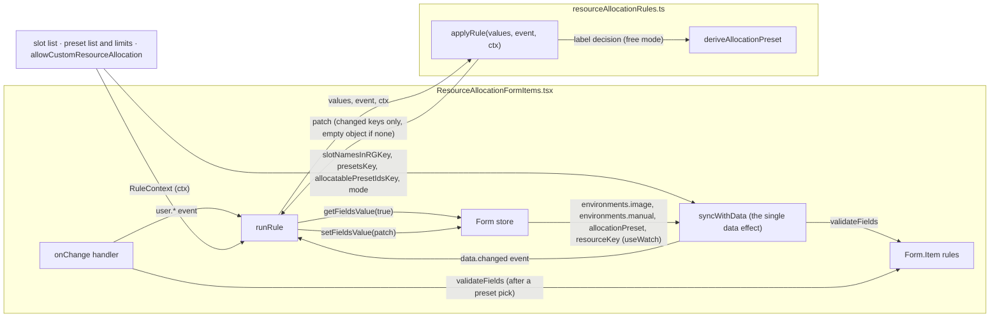

# 0016 — Rule module for the resource allocation form

## Summary

> Unfamiliar terms are collected in the [Glossary](#glossary) at the end.

- Every rule of the form "when one field changes, change another field" for the fields that the session launcher's resource allocation form fragment `ResourceAllocationFormItems` owns (`allocationPreset`, `resource.*`, `enabledAutomaticShmem`) lives in `applyRule(values, event, ctx)` in `react/src/components/SessionFormItems/resourceAllocationRules.ts`. The component's `onChange` handlers and the [data effect](#glossary) only write the [patch](#glossary) that this function returns into the form.
- `applyRule` changes a value automatically in only three cases: a value that is a function of other values ([derive](#glossary)), a user request for a bundle of values by picking a preset or `minimum-required` ([apply](#glossary)), and a previous value that can no longer exist in the context ([invalidate](#glossary)). For any other mismatch, the validator of the `Form.Item` shows a message and the value stays as it is. `applyRule` does not correct a value outside the min, max, and step range either.
- In `free` mode (`allowCustomResourceAllocation = true`), `allocationPreset` is a label derived from the values. `deriveAllocationPreset` reads it as `custom` when the resource values differ from the selected preset, and as that preset again when they match. Shared memory is excluded from this check.
- In [preset-only mode](#glossary), `applyRule` does not change a preset's values, and the validator of the visible `allocationPreset` item shows a violation. A `custom` restored from the URL or a template is read as an [allocatable preset](#glossary) whose values match, if one exists; otherwise the selection is cleared so that the user picks one. A consumer that must keep the restored values passes the `keepRestoredAllocation` prop.
- When the same event is fed again into the same state, `applyRule` returns an empty patch. When the data effect runs again because of a value it wrote itself, it stops after that one extra run.

## Context

- **Form fragment**: `ResourceAllocationFormItems` is the resource allocation fragment that the session launcher (`SessionLauncherPage`) and `DeploymentAddRevisionModal` render inside the same `Form`. The fields this fragment owns are `resourceGroup`, `allocationPreset`, `resource.{cpu, mem, shmem, accelerator, acceleratorType}`, `enabledAutomaticShmem`, `agent`, `cluster_mode`, and `cluster_size`. `ImageEnvironmentSelectFormItems` owns `environments.image` and `environments.manual` of the same form, and this fragment only reads them with `Form.useWatch`. From outside the form come the resource group's slot list (`useResourceSlotsDetails`), the preset list and limits of `resourcePreset.check` (`useResourceLimitAndRemaining`), and `baiClient._config.allowCustomResourceAllocation`.
- **Previous shape**: In `main` of 2026-10-22 (`a04bf4cbdb`), these rules were spread across 6 handlers, 3 `useEffect`s watching `Form.useWatch`, and 4 `useEventNotStable` helpers that afterwards filled in what the others missed. The same state, in which the resource values differed from the preset, was read as `custom` on some paths and kept the preset name on others. Twice, an effect reacted again to the `resource` value it had written itself and caused a loop that did not stop (FR-3523, FR-3985).
- **Decision trigger**: Moving the rules into one module first requires a boundary for "which reactions are automatic and which reactions are messages". The previous code placed that boundary differently on each path, so moving the code as it was would carry those differences into the module unchanged.

## Diagram

The FR-3523 loop came from the edge from `form` to `effect`. When `resourceKey` changes and `effect` runs again, `runRule` writes nothing if `applyRule` returns an empty patch, so the loop stops at the second run.

## Decision

### 1. The rules live in `applyRule` alone

- **Module**: `react/src/components/SessionFormItems/resourceAllocationRules.ts` is a function module that uses no React hooks. The form value type `ResourceAllocationFormValue`, `AUTOMATIC_DEFAULT_SHMEM`, `getAutomaticShmem`, and `pickChangedResourceValues` also live here, and `ResourceAllocationFormItems.tsx` re-exports them, so existing importers do not change. `getUnavailableSlotNames` is imported from `react/src/components/ResourcePresetSelect.tsx`.
- **Signature**: `applyRule(values: ResourceValues, event: RuleEvent, ctx: RuleContext): RulePatch`. `values` is the whole form as the handler sees it, and the form engine has already written the edited field before it calls `onChange`, so `values` holds the new value.
- **Events**: A `RuleEvent` says what happened.

| event                                                                 | meaning                                                                                |
| --------------------------------------------------------------------- | -------------------------------------------------------------------------------------- |
| `user.setResource` (`field`: `cpu` · `mem` · `shmem` · `accelerator`) | The user edited one resource value                                                     |
| `user.setAcceleratorType` (`next`, `prev`)                            | The user changed the accelerator type                                                  |
| `user.selectPreset` (`id`: preset id · `custom` · `minimum-required`) | The user picked an option in the preset select                                         |
| `user.toggleAutoShmem` (`on`)                                         | The user changed the automatic shared memory toggle                                    |
| `data.changed`                                                        | One of the image, the resource group, the preset list, or the slots arrived or changed |

- **Context**: `RuleContext` holds the inputs that this fragment does not own: `mode` (`AllocationMode`: `free` · `preset-only`), `enableResourcePresets`, `image`, `manualImage`, `slotsInRG` (`undefined` before it loads), `acceleratorSlotsInRG`, `presets`, `allocatablePresetIds`, `resourceLimits`, `imageMinMem`, and `keepRestoredAllocation`.
- **Patch**: A `RulePatch` holds only the keys that must change. `mem` and `shmem` are compared by size, so `1g` and `1024m` are the same value.
- **Caller**: The component's `runRule(event)` calls `applyRule` and calls `form.setFieldsValue(patch)` only when the patch is not empty. The handlers for resource values and the type call only `runRule`. After the user picks something other than `custom`, the preset select's handler validates `resource` again with `validateFields`.

### 2. Automatic changes are only derive, apply, and invalidate

- **Derive**: After every event, `applyRule` rewrites the values that are functions of other values. These are `resource.shmem` while `enabledAutomaticShmem` is on (`getAutomaticShmem(mem, imageMinMem)`) and the label of `allocationPreset` (section 3).
- **Apply**: `user.selectPreset` overwrites a bundle of values once, at that moment. For a preset id, `getPresetResourceFields` writes, in `g` units, the preset's slots that exist in the resource group, and turns `enabledAutomaticShmem` off when the preset has `shared_memory`. For `minimum-required`, `getMinimumRequiredResourceFields` writes cpu and mem as the image minimums and the accelerator as the minimum of the type the image requires, and turns `enabledAutomaticShmem` on.
- **Invalidate**: `applyRule` replaces a value that can no longer exist in the context with a fixed fallback. `syncAcceleratorType` replaces an `acceleratorType` that is not in the resource group with the group's first slot that the image supports (or the group's first slot when no slot is supported), and replaces it with the single type when the image supports exactly one type. When the image supports none of the group's accelerators, it writes `accelerator` as 0, or as `undefined` for a [unified slot](#glossary). Only `setAcceleratorType` writes `acceleratorType`, so moving from a unified slot to a discrete slot puts the new slot's minimum into the value.
- **Validator cases**: The validator of the `Form.Item` shows a value outside the min, max, and step range, a preset that the resource group cannot use, and an accelerator type that the image does not support (when the image supports two or more types). `acceleratorTypeErrorTarget` decides which item gets the accelerator type error: the type item in `free` mode (or for a consumer without a preset item); the visible `allocationPreset` item in preset-only mode when the label is not a preset; and no item when the image supports none of the group's accelerators (Invalidate above clears `accelerator` to 0 or `undefined`), when the label is empty, or when the values are a preset's. `applyRule` does not write these values. A case that can be submitted but gives a different result (exceeding remaining, multi-node size 1) stays a `warningOnly` validator.
- **Outside this module**: `ImageEnvironmentSelectFormItems` writes `environments.image` for the selected version, and `AgentSelect` returns an `agent` that is not in the resource group to `auto` through `fallbackToAuto`. Neither rule is in this module.

### 3. `allocationPreset` is a label derived from the values

- **Free mode**: `deriveAllocationPreset` decides the label again after every event. A preset id becomes `custom` when `matchesPreset` is false, and `custom` becomes a preset id when the user edits the values until they equal one allocatable preset. `minimum-required` stays only while the values equal the image minimums.
- **Match**: `matchesPreset` compares cpu, mem (by size), `acceleratorType` (when the preset has an accelerator slot of that group), and the accelerator quantity (except for unified slots). It does not compare shared memory. The reason is that shared memory is a setting inside the session, not an amount of resources it occupies, and the user can change it even in preset-only mode.
- **Shared memory rule**: `deriveAllocationPreset` does not count a shmem edit or the automatic toggle as a value edit, so a `custom` that the user picked does not revert to a preset because of shmem.
- **Preset-only mode**: `deriveAllocationPreset` changes the label only in `free` mode. The select has no `custom` or `minimum-required` options, and the `resource.cpu`, `mem`, and `accelerator` items are `hidden`.

### 4. A preset that became unusable is marked, not replaced

- **Validator**: The validator of the `allocationPreset` item decides the reason with `getPresetUnavailableReason` (`ResourcePresetSelect.tsx`). There are three reasons: dedicated to another resource group (`scoped`), requires a slot the group does not have (`missing-slots`), and exceeds the allocatable limit (`not-allocatable`). The tooltip of a disabled option in the select and the validator build their text with the same `presetUnavailableReasonText`.
- **No re-pick**: When the resource group or the image changes and the selected preset becomes unusable, `applyRule` does not pick another preset. Picking the first allocatable preset by name from the initial label [`auto-select`](#glossary) is an apply and stays as it is.
- **Deferred data**: The `onChange` of the resource group select does not validate. `resourcePreset.check` follows late through `useDeferredValue`, so the data effect validates again with the new group's data. When the selected id is not yet in `checkPresetInfo.presets`, the validator runs only the `scoped` check.

### 5. In preset-only mode, `applyRule` does not change a preset's values

- **Protected values**: When `hasFreeValues` is false (preset-only mode and a label that satisfies `isPresetId`), `data.changed` does not write resource values. It does not replace the type, set `accelerator` to 0, or apply the image minimums again. A limit violation appears through the validator of section 4 on the visible `allocationPreset` item, not on a hidden item.
- **Unprotected values**: When the label is `custom`, `minimum-required`, `auto-select`, or empty (`PSEUDO_PRESET_IDS`), the invalidate rules of section 2 apply as they are.
- **Restored labels**: When a `custom` is restored from the URL or a template, `relabelRestoredAllocation` looks for an allocatable preset whose values match and reads the label as that id; when none exists, it clears the label to `null`. It does not write the restored values themselves, but an empty label is unprotected, so the invalidate rules apply within the same `data.changed`. When a `minimum-required` is restored, the image minimums are applied first and then the same check runs.
- **Consumer switch**: A consumer that must keep the restored values passes the `keepRestoredAllocation` prop. `DeploymentAddRevisionModal` passes this prop together with `allocationPreset: 'custom'` both when it fills in a deployment preset and when it duplicates an existing revision, so the filled values stay even in preset-only mode. This is the decision not to force a preset on a duplicated revision.

### 6. There is a single data effect

- **Dependencies**: The dependencies of the `useEffect` that calls `syncWithData` are the data keys `slotNamesInRGKey`, `presetsKey`, `allocatablePresetIdsKey`, `mode`, `enableResourcePresets`, and `deferredResourceGroup`, plus `currentImage`, `isManualImage`, `currentAllocationPreset`, and `resourceKey` (the JSON serialization of `resource`), which are read from the form with `useWatch`.
- **Validation after the rule**: The effect validates again with `validateFields`: `resource` when it wrote a patch, `allocationPreset` when there is a label, and `acceleratorType` while `hasFreeValues` is true.
- **Closure**: `syncWithData` is wrapped in `useEventNotStable`. `useEffectEvent` is not used because it saw the previous render's `ruleContext` when the effect ran again with new dependencies. The measurement is in the comment on that line in `ResourceAllocationFormItems.tsx`.
- **Idempotence**: Returning an empty patch when `data.changed` is fed again into the same state is part of the contract of `applyRule`, and `resourceAllocationRules.test.ts` checks it for `data.changed` and for "`data.changed` after a preset pick". The component only checks whether the patch is empty.

## Rejected alternatives

- **State-based derive function `derive(values, ctx) → values`**: This function computes the next values from the current values and the data alone, without events. Its implementation is smaller. It is rejected. State alone cannot express an action that happens only once, such as "overwrite the values **when** a preset is picked", nor the difference between a user change and arriving data.
- **Automatic clamp of out-of-range values**: This option corrects a value outside min, max, and step to the nearest valid value. Users would fix errors by hand less often. It is rejected. When the program changes a value the user entered, the user cannot tell what changed, and the existing validator message already does that job.
- **Automatic re-pick of an unusable preset**: When a resource group change makes the preset unusable, this option applies the first allocatable preset (the behaviour of #10628). The form becomes runnable even when the user does nothing. It is rejected. It silently changes all of cpu, mem, and accelerator, not just one preset, and it conflicts with the FR-4067 decision to show a preset dedicated to another resource group as an error.
- **Discarding a restored `custom` in preset-only mode**: This option replaces a `custom` from the URL with `auto-select` and applies the first preset. The form never reaches a state where a value absent from the select is selected. It is rejected. `DeploymentAddRevisionModal` uses `custom` to mean "do not touch the filled values", so this option would change the duplicate's resource values to the first preset.
- **Filtering only on the URL restore path**: In this option, `SessionLauncherPage` filters out `custom` only when it reads the URL. Component consumers are not affected. It is rejected. It adds one more rule outside the module, and the same value would have two meanings depending on where it came from.

## Consequences

- **Single reading surface**: What happens when one field of this fragment changes is in the `switch` of `applyRule` and in `applyDataChanged`. The `describe`/`it` blocks of `resourceAllocationRules.test.ts` write the expected patch for each trigger in both `free` and `preset-only`.
- **No settling loop**: The component has no defensive code that calls `pickChangedResourceValues`. The module guarantees idempotence.
- **Scope**: This ADR decides only the fields that `ResourceAllocationFormItems` owns. The image restore effect of `ImageEnvironmentSelectFormItems` and the fallback of `AgentSelect` stay in their own files.

## Sources

- GitHub [#10693](https://github.com/lablup/backend.ai-webui/issues/10693) — this decision and its three PRs (#10696, #10697, #10698). Decided 2026-10-29.
- #10628 — the disabled display of a preset that requires a slot not in the resource group. Section 4 replaced that PR's automatic re-pick.
- FR-3523, FR-3985 — the loop caused by an effect reacting to the value it wrote itself, and its mitigation.
- FR-4067 (#9927) — the decision to identify a preset by id and to show a preset dedicated to another resource group as an error.
- `react/src/components/SessionFormItems/resourceAllocationRules.ts`, `resourceAllocationRules.test.ts`, `ResourceAllocationFormItems.tsx`, `react/src/components/ResourcePresetSelect.tsx`, `react/src/pages/DeploymentDetailPage/components/DeploymentAddRevisionModal.tsx`.

Related: ADR 0001 (the contract by which this fragment receives the project as a prop), ADR 0014 (the `BAI*` names of form controls).

## Glossary

| Term               | Meaning                                                                                                                                                                                                                                            |
| ------------------ | -------------------------------------------------------------------------------------------------------------------------------------------------------------------------------------------------------------------------------------------------- |
| patch              | A patch is the `RulePatch` object that `applyRule` returns, and it holds only the keys and values that must change in the form. An empty object means "nothing to write".                                                                          |
| data effect        | The data effect is the single `useEffect` in `ResourceAllocationFormItems.tsx` that calls `syncWithData`. When the image, resource group, or preset data changes, it feeds a `data.changed` event into `applyRule`.                                |
| derive             | Derive means that `applyRule` writes a value that is determined as a function of other values. Automatic shared memory is an example.                                                                                                              |
| apply              | Apply means that, at the moment the user picks a preset or `minimum-required` with `user.selectPreset`, the form's values are overwritten once with that bundle of values.                                                                         |
| invalidate         | Invalidate means that `applyRule` replaces a previous value with a fixed fallback when the context changed and the value can no longer exist. An accelerator type that is not in the resource group is an example.                                 |
| preset-only mode   | Preset-only mode is a deployment with `allowCustomResourceAllocation = false` in `config.toml`. The preset select has no `custom` or `minimum-required`, the cpu, mem, and accelerator inputs are hidden, and the user changes only shared memory. |
| allocatable preset | An allocatable preset is a preset that `getAllocatablePresetIds` in `ResourceAllocationFormItems.tsx` judged to fit within the limits of the current image and resource group.                                                                     |
| `auto-select`      | `auto-select` is the initial label of `allocationPreset` that the default form values of `useStartSession` provide. When `applyRule` sees this label, it applies the first allocatable preset by name.                                             |
| unified slot       | A unified slot is an accelerator slot whose name ends in `.unified` (`isUnifiedAcceleratorSlot` in `react/src/helper/unifiedAcceleratorSlot.ts`). It shares accelerator memory with host memory, so no quantity is sent.                           |
