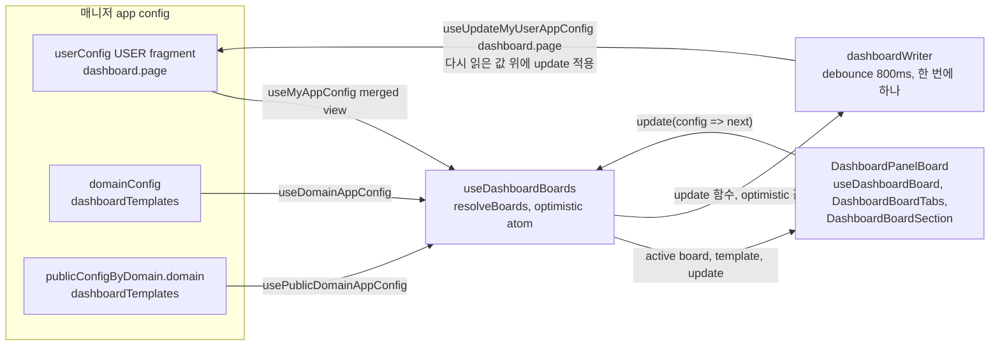
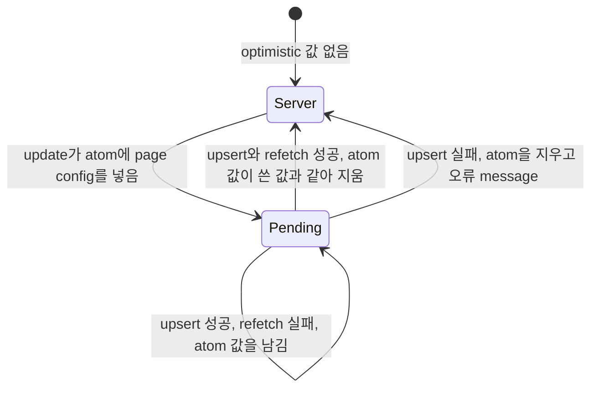

# 0017 — Dashboard boards in manager app config

## Summary

> 낯선 용어는 문서 맨 아래 [용어](#용어)에 모아 두었다.

- 대시보드 page의 보드는 [panel catalog](#용어)의 key와 배치만 담은 JSON이다. 카드 하나하나는 `panelCatalog.tsx`의 `PanelDefinition`이 정의하고, 보드는 그 key를 `PersistedPanelV2` 목록으로 가리킨다.
- 사용자의 보드는 매니저 app config `userConfig`의 `dashboard` key에 page마다 `{ boards, active }`로 저장한다. 기본 보드([role template](#용어))는 `domainConfig.dashboardTemplates`, 그다음 `publicConfigByDomain[<domain>].dashboardTemplates`, 그다음 코드의 기본값 순서로 고른다.
- `userConfig.dashboard`는 사용자 자신의 [USER fragment](#용어)에만, `useDashboardBoards` 한 곳에서만 쓴다. template은 이 key에 두지 않는다.
- 브라우저 localStorage에 있던 보드는 옮기지 않는다. 저장된 보드가 없는 page는 role template에서 시작한다.
- 쓰기는 이 탭이 캐시한 값이 아니라 서버가 지금 가진 값 위에 변경을 다시 적용한다.
- 사용자 정의 패널은 실험 기능 flag 없이 catalog의 `kind: 'preset'` 항목으로 늘 켜져 있다.

## Context

- **Panel catalog**: #10580이 대시보드의 고정 카드와 사용자 정의 패널을 `PANEL_CATALOG`(`react/src/components/DashboardPanels/panelCatalog.tsx`) 하나로 합쳤다. 순수 함수 `boardModel.ts`가 보드를 만들고(`seedBoard`), 카드를 더하고 빼고, 배치를 반영하고, 저장값을 검사한다(`sanitizeBoard`).
- **localStorage boards**: #10580까지 보드는 `useBAISettingUserState`로 localStorage의 `dashboard_board.<page>`에 있었고, 그 전에는 `dashboard_board_items`, `admin_dashboard_board_items`, `custom_dashboard_panels`에 있었다. 브라우저를 바꾸면 보드가 사라지고, 한 브라우저 안에서는 모든 프로젝트가 한 보드를 나눠 쓴다.
- **App config documents**: `react/src/hooks/useAppConfig.ts`가 매니저 app config 문서 세 개를 읽고 쓴다(FR-1964). `useMyAppConfig`는 서버가 PUBLIC, DOMAIN, USER fragment를 deep-merge한 `userConfig` view를 읽고, `useUpdateMyUserAppConfig`는 USER fragment 원본을 다시 읽어 key 하나만 바꾼 문서 전체를 upsert한다.
- **Deep merge of arrays**: 서버의 deep-merge는 배열을 scope 사이에서 섞는다. 도메인 관리자가 DOMAIN scope의 `userConfig`에 보드 목록을 두면 사용자의 보드 목록과 섞여, 사용자가 지운 보드가 다시 나타나거나 id가 겹친다.
- **Whole-document upsert**: 한 upsert가 USER fragment 문서 전체를 바꾸므로, 두 upsert가 동시에 원본을 읽으면 나중 것이 먼저 것의 변경을 지운다.
- **Layout events**: 보드를 끌거나 크기를 바꾸면 `BAIBoard`가 이벤트마다 `onItemsChange`를 낸다.

## 설계도

### 데이터 흐름

### 쓰기 상태

## Decision

### 1. 보드는 catalog key와 배치의 목록이다

- **Board shape**: 보드 하나는 `DashboardModel`(`react/src/components/DashboardPanels/types.ts`)이다.

| field       | type                                                                                    | 뜻                                                                                          |
| ----------- | --------------------------------------------------------------------------------------- | ------------------------------------------------------------------------------------------- |
| `id`        | `string`                                                                                | page 안에서 유일한 id. template에서 온 첫 보드는 `default`                                  |
| `title`     | `string`                                                                                | 탭 이름. 빈 문자열이면 탭은 `dashboard.boards.DefaultBoard`를 보여 준다                     |
| `vars`      | `{ project: string[] \| 'all'; rg: string[] \| 'all'; range: string; refresh: string }` | 보드가 열릴 때의 필터 값                                                                    |
| `panels`    | `PersistedPanelV2[]`                                                                    | catalog key, 사용자 정의 패널의 filter와 viz, 배치                                          |
| `knownKeys` | `string[]`                                                                              | 보드가 본 catalog key. 사용자가 뺀 카드는 다시 나오지 않고, 새 release가 더한 카드는 나온다 |

- **No domain fields**: 보드에는 도메인 field가 없다. superadmin도 현재 도메인을 읽는다([ADR 0012](0012-scoped-search-fields-in-place-of-admin-fields.md)).
- **Catalog owns cards**: 카드의 제목, 크기, 필요한 역할과 메뉴, 갱신 주기는 `PanelDefinition`이 정하고 보드에 복사하지 않는다. `sanitizeBoard`가 catalog에 없는 key와 page가 맞지 않는 key를 버린다.

### 2. 사용자 보드는 `userConfig.dashboard`에 둔다

- **Key shape**: `userConfig.dashboard`는 `DashboardConfig`(`Partial<Record<PanelPage, DashboardPageConfig>>`)이다. `project`, `projectAdmin`, `admin` key가 모두 아래 `DashboardPageConfig` 모양을 갖는다.

| field    | type               | 뜻                     |
| -------- | ------------------ | ---------------------- |
| `boards` | `DashboardModel[]` | page의 보드. 하나 이상 |
| `active` | `string`           | 열려 있는 보드의 id    |

- **Read path**: `useDashboardBoards(page, catalog)`(`useDashboardBoards.tsx`)가 `useMyAppConfig('dashboard')`의 page 값을 `sanitizeDashboardPageConfig`로 검사한다. 남는 보드가 없으면 저장값이 없는 것으로 본다.
- **Single writer**: `userConfig.dashboard`는 `useDashboardBoards`만 `useUpdateMyUserAppConfig(['dashboard', page], …)`로 쓴다. 다른 scope의 `userConfig`에 `dashboard` key를 쓰는 코드는 두지 않는다.
- **Board tabs and board section**: `projectAdmin`과 `admin` page는 `DashboardBoardTabs`로 보드를 고르기만 한다. 보드를 더하고(빈 보드로 시작), 이름을 바꾸고, 지우는 일은 편집 모드 사이드 패널 맨 위의 `DashboardBoardSection`이 맡는다. 이 section은 보드 selector(탭을 누른 것과 같이 active 보드를 바꾼다), 이름 입력(blur나 Enter에 저장하고 빈 이름은 저장하지 않는다), 새 보드 버튼, 보드 삭제 버튼을 둔다. 마지막 보드는 지울 수 없다. 보드 삭제는 그 보드의 패널, 배치, 사용자 정의 패널을 함께 지워 되돌릴 수 없으므로, 보드 이름을 입력해야 확인되는 `BAIDeleteConfirmModal`(`requireConfirmInput`)로 확인한다. `project` page는 보드 하나만 두고 탭도 board section도 그리지 않는다.

### 3. 기본 보드는 template key에서 고른다

- **Precedence**: `resolveTemplate`(`dashboardConfig.ts`)이 page의 template을 `domainConfig.dashboardTemplates[page]`, `publicConfigByDomain[<domain>].dashboardTemplates[page]`, `defaultBoardModel`(catalog의 `seedBoard`) 순서로 고른다. 값이 `DashboardModel`로 검사되지 않으면 다음 순서로 넘어간다.
- **Template knownKeys**: `knownKeys`가 없는 template은 지금 catalog의 page 카드를 모두 본 것으로 친다. template이 뺀 카드는 보드에 나오지 않는다.
- **Template use**: 저장된 보드가 없는 page는 template을 그대로 보여 주고, 사용자가 처음 고칠 때 쓴다. "새 보드"는 패널 없이 시작하고, 지금 catalog의 카드를 모두 본 것으로 쳐서(`createEmptyBoard`) 기본 카드가 채워지지 않는다. "기본 배치로 초기화"는 열린 보드의 패널을 template으로 되돌리고, template에 없는 사용자 정의 패널과 보드의 이름, 필터 값은 남긴다.
- **Template editing**: template을 고치는 화면은 이 결정의 범위 밖이다. superadmin은 `useUpdateDomainAppConfig`·`useUpdatePublicDomainAppConfig`로 같은 key를 쓴다.

### 4. 쓰기는 debounce하고 한 번에 하나만 보낸다

- **Optimistic state**: `update`는 다음 page config를 jotai atom `optimisticDashboardAtom`에 바로 넣어 화면에 보여 주고, update 함수를 queue에 넣는다. 쓰기와 `useRefetchMyAppConfig`가 끝나면 atom의 값이 그 쓰기가 보여 준 값과 같을 때만 지운다. 쓰기가 실패하면 atom을 지워 서버 값으로 돌아가고 오류 message를 띄운다. 쓰기는 성공하고 refetch만 실패하면 atom을 남긴다.
- **Replay on the server value**: 쓰기는 page config 값을 보내지 않는다. `useUpdateMyUserAppConfig`가 USER fragment 원본을 다시 읽으면, 그 `dashboard.<page>` 값을 `resolveBoards`로 page config로 만들고 queue에 쌓인 update 함수를 순서대로 적용한 결과를 upsert한다. 다른 탭이나 기기가 저장한 보드와 이름은 이 탭의 변경과 겹치지 않는 한 남는다. 그래서 update 함수는 config만 보고 결과를 정해야 한다. 새 보드의 id 같은 값은 함수 밖에서 정한다.
- **Write queue**: `createWriteQueue`(`writeQueue.ts`)가 800ms(`DASHBOARD_WRITE_DELAY_MS`) 안에 들어온 update를 page마다 하나로 이어 붙이고(`combinePageWrites`), 앞선 쓰기가 끝난 뒤에만 다음 쓰기를 시작한다. 앱 전체에 queue는 `useDashboardBoards.tsx`의 module 하나다. 끌기와 크기 바꾸기는 이벤트마다 쓰기를 보내지 않는다.
- **Flush**: 탭이 숨겨질 때(`visibilitychange`가 `hidden`), `pagehide`, 보드가 unmount될 때 queue를 debounce 없이 바로 보낸다.

### 5. localStorage 보드는 옮기지 않는다

- **No migration**: `dashboard_board.<page>`, `dashboard_board_items`, `admin_dashboard_board_items`, `custom_dashboard_panels`는 읽지 않는다. 저장된 보드가 없는 page는 role template을 보여 주고, 사용자가 처음 고칠 때 쓴다.
- **Why**: 이 localStorage key는 계정이 아니라 브라우저에 묶여 있다. 한 브라우저를 여러 계정이 쓰면, 업그레이드 뒤 대시보드를 먼저 연 계정이 다른 계정의 보드와 사용자 정의 패널을 자기 `userConfig`로 가져가고, 원래 주인은 그 값을 잃는다.

### 6. 사용자 정의 패널에는 실험 기능 flag가 없다

- **Flag removal**: #10580이 `experimental_custom_dashboard_panels` 설정과 그 토글을 지웠다. 사용자 정의 패널은 catalog의 `kind: 'preset'` 항목이고, 볼 수 있는지는 data source의 `minRole`(`resourceRegistry.tsx`)이 정한다.

## 대안과 기각 사유

- **Templates inside userConfig**: template을 PUBLIC·DOMAIN scope의 `userConfig.dashboard`에 두어 deep-merge로 기본값을 내려준다. 읽는 hook이 하나로 끝난다. 기각한다. deep-merge가 template의 보드 배열과 사용자의 보드 배열을 섞어, 사용자가 지우거나 고친 보드가 template 값과 합쳐진다.
- **Keep localStorage**: 보드를 localStorage에 둔다. 매니저 왕복이 없다. 기각한다. 브라우저와 기기마다 보드가 다르고, 관리자가 role template을 내려줄 길이 없다.
- **Migrate localStorage once**: page마다 한 번 localStorage 보드를 `userConfig.dashboard`로 옮긴다. 사용자가 꾸민 배치가 남는다. 기각한다. key가 브라우저 단위라 어느 계정의 보드인지 알 수 없다.
- **Write the cached value**: 이 탭이 계산한 page config를 그대로 upsert한다. 구현이 단순하다. 기각한다. 오래 열어 둔 탭에서 탭을 한 번 누르기만 해도 다른 기기가 저장한 보드가 사라진다.
- **Write per event**: 끌기와 크기 바꾸기마다 바로 upsert한다. 구현이 단순하다. 기각한다. 끌기 한 번이 수십 번의 문서 전체 upsert가 되고, 동시에 나간 upsert가 서로의 변경을 지운다.
- **Dedicated config name**: `dashboard`라는 새 app config 문서를 allow-list에 등록한다. deep-merge 규칙을 따로 정할 수 있다. 기각한다. 매니저의 allow-list 등록이 필요하고, 이미 등록된 세 문서로 충분하다.

## Consequences

- **Cross-device boards**: 같은 계정은 어느 브라우저와 기기에서나 같은 보드를 본다.
- **Admin-provided defaults**: superadmin은 template key를 써서 설치나 도메인의 기본 보드를 바꿀 수 있다. 이미 보드를 저장한 사용자는 "기본 배치로 초기화"를 누를 때 새 template을 받는다.
- **Write latency**: 보드 변경은 최대 800ms 뒤에 서버로 간다. 탭을 숨기거나 닫으면 바로 보내지만, 브라우저가 페이지를 내리기 전에 요청이 끝난다는 보장은 없다.
- **Lost local boards**: 업그레이드 전 localStorage에 보드를 꾸며 둔 사용자는 template부터 다시 시작한다.
- **Same-board edits**: 두 기기가 같은 보드의 패널을 동시에 고치면, 나중에 쓴 쪽의 패널 목록이 남는다. replay는 보드 단위까지만 변경을 나눈다.
- **Shared queue scope**: queue는 대시보드 쓰기만 줄 세운다. `useRecentSessionHistory`처럼 `userConfig`의 다른 key를 쓰는 기능과 동시에 upsert하면 USER fragment 문서를 두고 경합할 수 있다.
- **Vars without consumer**: `vars`는 저장되지만, 필터 바(#10582)가 생기기 전까지 카드의 데이터 범위를 바꾸지 않는다.
- **No pinned projects**: 보드에 프로젝트를 고정하는 field는 두지 않는다. 예전에 저장된 `pinned`는 `sanitizeDashboardModel`이 버린다.

## 출처

- #10422 (epic), #10580, #10581, 2026-10-26.
- #10422의 role-based dashboard 제안(저장과 마이그레이션, 기본 레이아웃).

관련: [ADR 0012](0012-scoped-search-fields-in-place-of-admin-fields.md).

## 용어

| 용어          | 뜻                                                                                                                                                               |
| ------------- | ---------------------------------------------------------------------------------------------------------------------------------------------------------------- |
| panel catalog | 대시보드에 놓을 수 있는 카드의 정의 목록 `PANEL_CATALOG`이다. 고정 카드는 `kind: 'custom'`, data source마다 하나인 사용자 정의 패널은 `kind: 'preset'` 항목이다. |
| role template | 저장된 보드가 없는 사용자와 "기본 배치로 초기화"가 시작점으로 쓰는 page별 기본 보드이다. `dashboardTemplates` key에 `DashboardModel`로 둔다.                     |
| USER fragment | 매니저 app config 문서 중 사용자 한 명의 scope에 저장된 원본이다. `useMyAppConfig`가 읽는 view는 이 원본과 PUBLIC, DOMAIN fragment를 합친 값이다.                |
