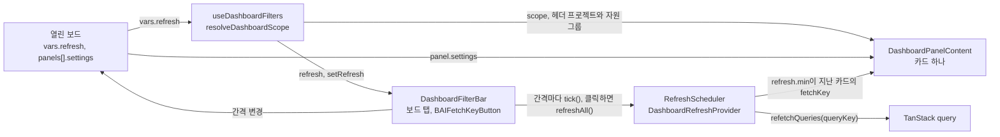
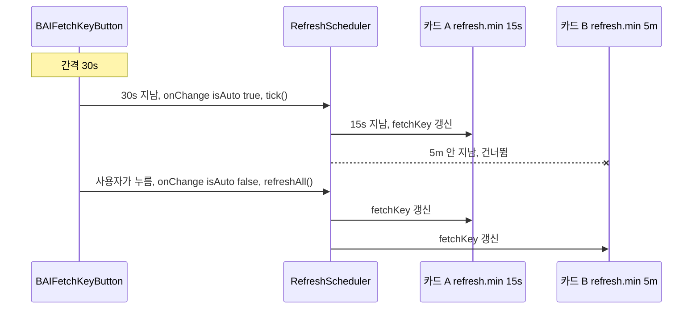

# 0017 — Dashboard refresh bar and per-card settings

## Summary

> 낯선 용어는 문서 맨 아래 [용어](#용어)에 모아 두었다.

- 대시보드 page의 [대시보드 바](#용어)는 보드 탭과 자동 새로고침 control 하나만 둔다. 바는 언제 다시 읽을지만 정하고, 무엇을 읽을지는 정하지 않는다.
- 카드가 읽는 범위는 page가 정한다. 일반 사용자 page는 헤더 프로젝트에서 자기 데이터, 프로젝트 관리자 page는 URL 경로의 프로젝트, superadmin page는 현재 도메인 전체다. superadmin도 도메인을 고르지 않는다([ADR 0012](0012-scoped-search-fields-in-place-of-admin-fields.md)).
- 자원 그룹과 기간은 [카드 설정](#용어)이다. 자원 그룹이나 기간에 따라 값이 달라지는 카드만 설정을 갖고, 편집 모드에서 그 카드에만 설정 control이 보인다. 바에는 일부 카드만 따르는 전역 filter가 없다.
- 자동 새로고침은 page마다 하나다. 바의 refresh control이 간격마다 tick을 보내고, tick은 카드 정의의 `refresh.min`이 지난 카드만 다시 읽는다. control을 누르면 모든 카드를 바로 다시 읽는다. 카드에는 자기 refresh 버튼이 없다.
- 카드가 보여 주는 합계와 시간별 개수는 매니저가 계산한 값만 쓴다. 한 프로젝트나 한 자원 그룹 단위로만 값을 주는 field는 행으로 나눠 보여 주고, 클라이언트는 값을 더하지 않는다.

## Context

- **Card scope**: #10580 이전의 대시보드 카드는 각자 범위를 정했다. "My Sessions" 카드는 관리자에게 프로젝트 전체 세션을 세었고, 어떤 범위인지 화면에 표시되지 않았다(#9839, #7843).
- **Global filters ignored**: 보드 위에 전역 자원 그룹, 기간, 프로젝트 picker를 두자 카드 대부분이 그중 일부만 따랐다. 세션 수 카드는 기간을 무시했고, 도움말이 그 차이를 설명해야 했다. 2026-10-26 회의에서 전역 picker를 없애고 카드 설정으로 옮기기로 했다.
- **Board model**: [ADR 0016](0016-dashboard-boards-in-manager-app-config.md)가 보드를 `DashboardModel`로 저장한다. 카드 하나는 보드의 `PersistedPanelV2`이다.
- **Manager bug**: 26.10.0a3 매니저는 `DateTimeFilter` 하나에 `after`와 `before`를 함께 주면 `after`를 무시한다.

## 설계도

### 값의 흐름

### refresh tick

## Decision

### 1. 바는 보드 탭과 refresh control만 둔다

- **Bar layout**: `DashboardFilterBar`(`react/src/components/DashboardPanels/DashboardFilterBar.tsx`)는 한 줄에 보드 탭(`projectAdmin`, `admin` page의 `DashboardBoardTabs`)을 왼쪽에, `BAIFetchKeyButton` 하나와 그 바로 뒤의 편집 토글(`DashboardEditToggleButton`, refresh control과 같은 크기의 secondary 버튼)을 오른쪽에 그린다. 편집 진입점은 세 page 모두 이 자리 하나이고, breadcrumb에는 두지 않는다. `project` page는 탭이 없어 refresh control과 편집 토글만 보인다.
- **Refresh control**: `BAIFetchKeyButton`에 `autoUpdateDelay`와 `onChangeAutoUpdateDelay`를 넘겨 간격 dropdown을 연다. 선택지는 끔, 5초, 10초, 15초, 30초, 1분, 5분, 10분(`REFRESH_OPTIONS`, `refreshScheduler.ts`)이고 기본은 30초다. 고른 간격은 열린 보드의 `vars.refresh`에 저장한다.
- **No pickers**: 바에는 프로젝트, 자원 그룹, 기간 control이 없다. 도메인 control도 없다.
- **No URL state**: 바의 값은 URL query에 쓰지 않는다. 남은 값이 새로고침 간격 하나뿐이라 링크로 나눌 이유가 없다.

### 2. 범위는 page가 정한다

- **Resolver**: `resolveDashboardScope`(`dashboardScope.ts`)가 `{ page, urlProjectId, currentDomain }`으로 `DashboardScope`(`types.ts`)를 정한다.

| kind       | page           | field                                            |
| ---------- | -------------- | ------------------------------------------------ |
| `mine`     | `project`      | `projectId`: page의 프로젝트(헤더 프로젝트)      |
| `projects` | `projectAdmin` | `projectIds`: URL 경로의 프로젝트 하나, `domain` |
| `projects` | `admin`        | `projectIds: 'all'`, `domain`: 현재 도메인       |

- **Page project**: page가 `DashboardPanelBoard`에 `project`(`ProjectContextOrNull`)를 넘긴다. 일반 사용자 page는 page의 현재 프로젝트, 프로젝트 관리자 page는 URL 경로의 프로젝트, superadmin page는 `null`이다. 카드와 패널 modal은 `DashboardFilterContext`에서 `useDashboardProject`로 읽고, 사용자 정의 패널 query는 `useDashboardQueryScope`가 주는 프로젝트를, 그것이 `null`이면 현재 도메인을 범위로 쓴다(ADR 0001).
- **Current domain**: `useDashboardFilters`가 `useCurrentDomain()`의 `{ id, name }`을 `domain`으로 넘긴다.
- **Board vars**: 보드의 `vars`(`DashboardBoardVars`)는 `{ refresh }` 하나다. `sanitizeBoardVars`는 예전 보드에 남은 `project`, `rg`, `range`를 버리고, `REFRESH_OPTIONS`에 없는 `refresh`를 `30s`로 바꾼다.

### 3. 자원 그룹과 기간은 카드 설정이다

- **Declared settings**: `PanelDefinition.settings`가 카드가 읽는 설정(`resourceGroup`, `range`)을 적는다. 값은 보드 패널의 `PersistedPanelV2.settings`(`{ resourceGroups?: string[]; range?: string }`)에 저장한다. `sanitizeBoard`는 카드 정의가 적지 않은 설정을 버린다.
- **Edit mode only**: 편집 모드의 사이드 패널은 보드에 있는 카드 중 설정을 적은 카드에만 설정 버튼과 지금 값을 보여 주고, 버튼은 `PanelSettingsModal`을 연다. 설정을 적지 않은 카드는 control이 없다.
- **Resource group choices**: `PanelSettingsModal`은 자원 그룹을 `BAIScopedResourceGroupSelect`로 고른다. 선택지는 page의 프로젝트(`scope: { project }`)에서, superadmin page에서는 현재 도메인(`scope: { domain }`)에서 읽는다.
- **Defaults**: 자원 그룹 설정이 비어 있으면 고정 카드는 헤더의 현재 자원 그룹을, 사용자 정의 패널은 모든 자원 그룹을 읽는다. 기간 설정의 기본은 최근 24시간(`DEFAULT_RANGE`, `panelSettings.ts`)이고, 선택지는 최근 1시간, 24시간, 7일이다.
- **Card state**: `DashboardPanelContent`가 설정을 풀어 `vars`(`DashboardVars`)로 넘긴다. `range`, 카드의 마지막 refresh 시각으로 고정한 `timeRange`, `resourceGroups`(설정 또는 헤더 자원 그룹), `currentProjectId`, `currentResourceGroup`이다.
- **Single resource group cards**: 자원 그룹 하나만 받는 field를 읽는 카드는 `resourceGroupRows(settings.resourceGroups, currentResourceGroup)`로 자원 그룹마다 한 행을 그린다.
- **Custom panels**: data source가 자원 그룹으로 좁힐 수 있으면(`ResourceConfig.supportsResourceGroup`) 사용자 정의 패널도 자원 그룹 설정을 갖는다. 세션은 minilang filter에 `scaling_group == ...`를 붙이고, 배포는 `resourceGroup: { in }`을 쓴다. 폴더 패널은 설정이 없다.

### 4. 기간은 두 bound의 AND로 거른다

- **Window**: `rangeToDateTimeFilter(range, now)`는 기간을 `{ after, before }` window로 만든다. `before`는 포함하지 않는다. 카드는 `now`로 자기 마지막 refresh 시각을 넘기므로 refresh 사이에는 query 변수가 바뀌지 않는다.
- **ANDed bounds**: window는 `DateTimeFilter` 하나로 넘기지 않고 `withinWindow(field, window)`가 만드는 `AND: [{ field: { after } }, { field: { before } }]`로 넘긴다. bucket도 같다.

### 5. refresh는 page마다 하나다

- **Scheduler**: `DashboardRefreshProvider`가 page마다 `RefreshScheduler`(`refreshScheduler.ts`)를 하나 만든다. scheduler는 timer를 갖지 않는다.
- **Ticks**: `BAIFetchKeyButton`이 간격마다 `onChange(key, { isAuto: true })`를 부르면 바가 `tick()`을, 사용자가 누르면(`isAuto: false`) `refreshAll()`을 부른다. 버튼은 숨겨진 탭에서 간격을 멈춘다.
- **Subscribers**: 카드는 `useDashboardFetchKey('panel:<id>', refresh.min)`, 카드가 아직 읽는 page query는 `useDashboardFetchKey('page-query', …)`, TanStack query는 `useDashboardRefreshQuery(queryKey, min)`으로 scheduler에 등록한다.
- **Per-card minimum**: `tick()`은 마지막 refresh 뒤 `minMs`가 지난 구독자만 다시 읽는다. 500ms까지 이른 tick도 지난 것으로 친다. `refreshAll()`은 모든 구독자를 바로 다시 읽고 각자의 minimum을 다시 센다.
- **No card buttons**: 카드와 사용자 정의 패널의 머리에는 refresh 버튼이 없다(`PanelFrame`). 대시보드 밖에서도 쓰는 카드 component는 `hideRefreshButton`으로 버튼을 숨긴다.
- **No suspense flash**: `useDashboardFetchKey`는 fetch key를 `startTransition` 안에서 바꾸고, 카드와 page는 `useDeferredValue`를 거친 key로 query를 다시 읽는다.

### 6. 합계와 시간별 개수는 매니저가 계산한다

- **Count aliases**: 상태별 개수 같은 값을 그리는 카드는 한 요청 안에서 filter를 달리한 connection의 `count`를 [count alias](#용어)로 읽는다.
- **Buckets**: 시간별 개수를 그리는 카드는 `bucketize(range, now)`가 만든 8개 이하의 연속 구간마다 count alias 하나를 읽는다. 1시간과 24시간은 6개, 7일은 하루씩 7개다.
- **Usage buckets**: 사용량 추이 카드는 매니저의 `usageBuckets`가 준 구간을 그대로 그린다.
- **Rows, not sums**: 프로젝트 하나나 자원 그룹 하나 단위로만 값을 주는 field를 읽는 카드는 프로젝트나 자원 그룹마다 한 행을 그린다. 클라이언트는 여러 응답의 값을 더하지 않는다.

### 7. 역할이 달라도 카드는 하나다

- **One UI, scope as input**: 여러 page에 있는 카드(일반 사용자, 프로젝트 관리자, superadmin)는 한 component다. 배치, 통계 표기, 차트, 표, 설정, 빈 상태가 같고, page가 정한 `DashboardScope`만 다르다. 일반 사용자는 자기 데이터를, 프로젝트 관리자는 URL 경로의 프로젝트를, superadmin은 현재 도메인과 superadmin 전용 데이터를 읽는다. 카드는 scope를 입력으로 받아 그에 맞는 field를 고르고, 역할마다 다른 component를 만들지 않는다.

## 대안과 기각 사유

- **Global filter bar**: 보드 위에 프로젝트, 자원 그룹, 기간 picker를 두고 모든 카드가 따르게 한다. 보드의 범위가 한 줄에 보인다. 기각한다. 지금 상태를 보여 주는 카드는 기간을, 자원 그룹과 무관한 카드는 자원 그룹을 따를 수 없어 바의 값 일부를 조용히 무시하고, 사용자는 어느 카드가 어느 값을 따르는지 알 수 없다.
- **Per-card refresh**: 카드마다 refresh 버튼을 둔다. 카드 하나만 다시 읽을 수 있다. 기각한다. 같은 화면에 refresh control이 여러 개면 무엇이 무엇을 다시 읽는지 모호하고, 페이지의 refresh와 겹친다.
- **Domain picker**: superadmin 바에 도메인 multi-select를 둔다. 기각한다. [ADR 0012](0012-scoped-search-fields-in-place-of-admin-fields.md)가 모든 역할의 읽기를 현재 도메인의 `scoped*` field로 정했다.
- **Scheduler timer**: scheduler가 자기 timer로 tick하고 버튼은 간격만 고른다. 기각한다. `BAIFetchKeyButton`은 간격을 고르면 자기 timer를 돌리므로 timer가 둘이 되고, 버튼의 countdown과 실제 refresh가 어긋난다.
- **Client-side sums**: 프로젝트마다 받은 값을 브라우저에서 더한다. 기각한다. 권한 때문에 빠진 프로젝트를 클라이언트가 알 수 없어 합계가 틀리고, 요청 수가 프로젝트 수만큼 늘어난다.

## Consequences

- **Per-card scope is visible where it is set**: 자원 그룹이나 기간을 고른 카드는 편집 모드의 사이드 패널에 그 값을 보여 준다. 보기 모드의 카드 머리에는 설정 값이 표시되지 않는다.
- **No shareable filter links**: 링크는 page와 프로젝트만 나른다. 카드 설정은 보드에 저장되므로 같은 계정은 어느 기기에서나 같은 값을 본다.
- **Unmigrated cards**: 이 결정이 들어간 시점의 기존 카드는 `scope`와 `vars`를 읽지 않고 page query와 헤더 값을 쓴다. 고정 카드 중 설정을 적은 카드도 아직 없다.
- **Cards blocked on aggregation**: 매니저가 group-by나 시계열 값을 주지 않는 카드는 만들지 않고 backend 요청으로 남는다.

## 출처

- #10422 (epic), #10582, #9839, #7843, 2026-10-26 회의.
- #10422의 role-based dashboard 제안(기간과 갱신, 저장과 마이그레이션).

관련: [ADR 0012](0012-scoped-search-fields-in-place-of-admin-fields.md), [ADR 0016](0016-dashboard-boards-in-manager-app-config.md).

## 용어

| 용어          | 뜻                                                                                                                                             |
| ------------- | ---------------------------------------------------------------------------------------------------------------------------------------------- |
| 대시보드 바   | 대시보드 보드 위의 한 줄이다. 보드 탭과 자동 새로고침 control을 담고 `DashboardFilterBar`가 그린다.                                            |
| 카드 설정     | 카드 하나가 보드에 저장하는 자원 그룹과 기간 값이다. `PersistedPanelV2.settings`이며, 카드 정의가 `settings`로 적은 것만 갖는다.               |
| 보드          | 카드 배치와 설정을 담아 저장한 대시보드 한 장이다. `DashboardModel`이며 [ADR 0016](0016-dashboard-boards-in-manager-app-config.md)가 정의한다. |
| fetch key     | Relay `useLazyLoadQuery`의 `fetchKey` 옵션에 넘기는 문자열이다. 값이 바뀌면 query가 서버에서 다시 읽힌다.                                      |
| count alias   | 같은 connection field를 한 GraphQL 요청 안에서 filter만 달리해 여러 번 부르고, 각 결과의 `count`만 이름을 붙여 읽는 방식이다.                  |
| `refresh.min` | `PanelDefinition`이 정하는 카드의 최소 refresh 간격이다. 바의 간격이 이보다 짧아도 카드는 이 간격보다 자주 다시 읽지 않는다.                   |
