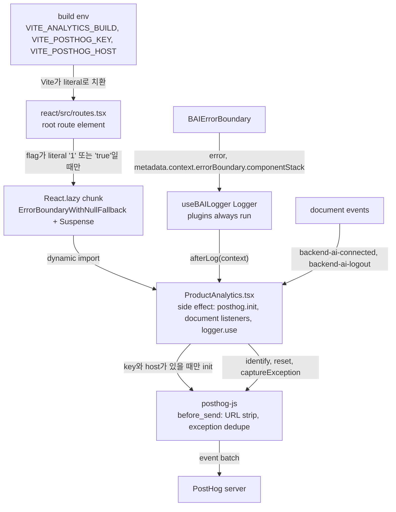

# 0017 — Build-time opt-in PostHog analytics

## Summary

> 낯선 용어는 문서 맨 아래 [용어](#용어)에 모아 두었다.

- WebUI는 사용 흐름(화면별 체류, 클릭, 이탈)과 오류를 PostHog로 보낼 수 있다. 이 코드는 build가 `VITE_ANALYTICS_BUILD=1`(또는 `true`)을 줄 때만 bundle에 들어간다.
- flag가 없는 기본 build의 output에는 analytics component도 `posthog-js`도 없고, `grep -rli posthog react/build`가 아무것도 찾지 않는다.
- [analytics build](#용어)에서도 project key `VITE_POSTHOG_KEY`와 host `VITE_POSTHOG_HOST`가 둘 다 있어야 `ProductAnalytics`가 `posthog.init`을 부른다.
- 새 runtime dependency는 `react/package.json`의 `posthog-js`이고, ESLint `no-restricted-imports`가 `react/src/components/ProductAnalytics.tsx` 밖에서의 import를 막는다.
- `useBAILogger`는 production build에서도 [logger plugin](#용어)을 부르고, `ProductAnalytics`의 plugin이 ERROR log를 PostHog error tracking으로 보낸다.
- domain마다 수집 여부를 정하는 runtime opt-in(`domainConfig.analytics`)은 후속 작업이다.

## Context

- **No usage data**: 지금 WebUI는 사용자가 session launcher에서 app 실행까지 가는지, 어느 단계에서 멈추는지 아무 데이터도 남기지 않는다. 오류도 사용자가 보고해야만 팀이 안다.
- **Self-hosted customers**: 팀은 self-hosted·air-gapped 고객에게도 같은 source로 build한 WebUI를 배포한다. 그 build에는 tracking code가 아예 없어야 한다.
- **Electron**: Electron app은 web bundle을 그대로 쓰고 page를 `file://app/index.html`에서 연다. 그 origin에서는 cookie가 동작하지 않는다.
- **Silent production logger**: `useBAILogger`의 `Logger`는 production에서 `enabled`가 `false`이고, 이전의 `logging()`은 plugin을 부르기 전에 return했다. 그래서 production에서는 `logger.use()`로 붙인 plugin이 아무 log도 받지 못했다.
- **Precedent**: `react/src/routes.tsx`의 `VITE_REVIEW_OVERLAY_BUILD`가 같은 방식의 build-time opt-in이다.

## 설계도

## Decision

### 1. Build flag

- **Literal comparison**: `react/src/routes.tsx`는 module 최상위에서 `import.meta.env.VITE_ANALYTICS_BUILD === '1' || import.meta.env.VITE_ANALYTICS_BUILD === 'true'`일 때만 `React.lazy(() => import('./components/ProductAnalytics'))`를 만들고, 아니면 `null`을 둔다. Vite가 값을 literal로 바꿔야 Rollup이 dynamic import를 지우므로, 비교는 helper 없이 inline으로 적는다.
- **Mount point**: path `/` route의 element가 `ProductAnalytics`를 `ErrorBoundaryWithNullFallback`과 `Suspense fallback={null}` 안에 mount한다. 이 element는 `LoginView`도 그리므로 일반 로그인 화면도 수집된다. sToken 로그인은 `STokenGuard`가 로그인을 끝낸 뒤에 이 element를 그린다.
- **Failure isolation**: `ProductAnalytics`는 `null`을 render한다. chunk load나 init이 실패하면 `ErrorBoundaryWithNullFallback`이 그 자리만 비운다.
- **Neutral file name**: 기본 build의 source map은 `routes.tsx`의 source를 담는다. 그래서 analytics component의 파일 이름과 symbol은 `posthog`를 포함하지 않는 `ProductAnalytics`다.

### 2. Connection settings

| env                    | 뜻                                                   |
| ---------------------- | ---------------------------------------------------- |
| `VITE_ANALYTICS_BUILD` | `1` 또는 `true`이면 analytics code를 bundle에 넣는다 |
| `VITE_POSTHOG_KEY`     | PostHog project API key                              |
| `VITE_POSTHOG_HOST`    | PostHog API host, 예: `https://posthog.example.com`  |

- **Read location**: `ProductAnalytics.tsx`만 `VITE_POSTHOG_KEY`와 `VITE_POSTHOG_HOST`를 읽는다. 저장소는 공개이므로 어떤 tracked 파일도 실제 key나 host를 기본값·예시로 담지 않는다.
- **Missing value**: 둘 중 하나라도 비어 있으면 `ProductAnalytics`는 `posthog.init`을 부르지 않고, SDK는 요청을 보내지 않는다.
- **CSP**: `posthog-js`는 event를 `VITE_POSTHOG_HOST`로 보내고, replay와 exception autocapture 확장 script를 같은 host에서 받는다. analytics build를 배포하는 server의 CSP는 `connect-src`에 그 host를 허용해야 하고, `'strict-dynamic'`을 쓰지 않으면 `script-src`에도 허용해야 한다.

### 3. Import guard

- **ESLint rule**: `react/eslint.config.js`의 `restrictedImportPatterns`가 `posthog-js`와 `posthog-js/*`를 막는다. `src/components/ProductAnalytics.tsx` 전용 block은 그 항목이 빠진 `baseRestrictedImportPatterns`와 `restrictedImportPaths`로 rule을 다시 선언한다.
- **Dependency**: `posthog-js`는 catalog가 아니라 `react/package.json`의 `dependencies`에 있고, `pnpm-workspace.yaml`의 `minimumReleaseAge`를 따른다.

### 4. SDK configuration

| option                            | 값                                              | 이유                                                |
| --------------------------------- | ----------------------------------------------- | --------------------------------------------------- |
| `persistence`                     | `'localStorage'`                                | Electron의 `file://`에서는 cookie가 동작하지 않는다 |
| `capture_pageview`                | `'history_change'`                              | SPA route 전환마다 pageview를 남긴다                |
| `capture_pageleave`               | `true`                                          | 화면별 체류 시간을 계산한다                         |
| `autocapture`                     | `true`                                          | click을 수집한다                                    |
| `disable_capture_url_hashes`      | `true`                                          | URL fragment를 보내지 않는다                        |
| `capture_exceptions`              | unhandled error와 unhandled rejection만         | console error는 수집하지 않는다                     |
| `session_recording.maskAllInputs` | `true`                                          | replay에서 모든 input 값을 가린다                   |
| `before_send`                     | URL query·fragment 제거, `$exception` 중복 제거 | 5절과 7절                                           |

- **Platform property**: `ProductAnalytics`는 `globalThis.isElectron`으로 super property `platform`(`web` 또는 `electron`)을 등록한다.
- **Session replay**: `ProductAnalytics`는 replay를 켜거나 끄지 않는다. PostHog project 설정이 replay를 켤 때만 SDK가 녹화하고, 그때도 input 값은 가려진다.
- **Single start**: module 변수 `isStarted`가 StrictMode의 effect 두 번 실행에서도 init, `document` listener 등록, `logger.use()`를 한 번만 하게 한다. 이 셋은 page가 살아 있는 동안 해제하지 않는다.

### 5. Privacy defaults

- **URL query and fragment**: `before_send`가 `properties`, `$set`, `$set_once`의 `$current_url`, `$referrer`, `$initial_current_url`, `$initial_referrer`에서 `?`나 `#`부터 뒤를 지운다. query에는 이름과 id가 실릴 수 있다.
- **Secrets**: SDK는 password input을 수집하지 않는다. autocapture는 input 값을 보내지 않고 replay는 input을 가리므로, access key·secret key·SSH key·token 입력 칸에 `ph-no-capture`를 따로 달지 않는다.
- **Identity payload**: `ProductAnalytics`는 `posthog.identify(user_uuid, { role, domain })`만 부르고 email과 이름은 보내지 않는다. 값은 `globalThis.backendaiclient`에서 읽는다. `role`은 `is_superadmin`과 `is_admin`으로 정한 `superadmin`·`admin`·`user` 중 하나이고, `domain`은 `_config.domainName`이다.
- **Identity timing**: `ProductAnalytics`는 시작할 때와 `backend-ai-connected` event마다 identify한다. `posthog._isIdentified()`가 참이고 distinct id가 다른 사용자이면 먼저 `posthog.reset()`을 부른다. `backend-ai-logout` event에서도 `posthog.reset()`을 부른다.

### 6. Logger plugin dispatch in production

- **Dispatch rule**: `packages/backend.ai-ui/src/hooks/useBAILogger.tsx`의 `logging()`은 `beforeLog`·`afterLog`·`onError`를 항상 부르고, console 호출만 `enabled`로 막는다. plugin이 없고 console이 꺼져 있으면 `logging()`은 바로 return한다. production console은 그대로 조용하다.
- **Render errors**: `react/src/components/BAIErrorBoundary.tsx`의 `onError`는 잡은 error를 `logger.withContext('errorBoundary', { componentStack }).error(error)`로 남긴다.

### 7. Error reporting

- **Allow-list**: `ProductAnalytics`의 plugin은 level이 ERROR인 log의 인자에서 첫 `Error`만 고르고, 그 `name`·`message`·`stack`만 새 `Error`로 옮겨 `posthog.captureException`에 넘긴다. `Error`가 없는 ERROR log와 나머지 인자는 보내지 않는다.
- **Logger context**: plugin은 `logger.withContext(key, value)`로 붙은 `metadata.context` 객체를 `logger_context` property로 함께 보낸다. 그래서 `withContext`의 값에는 secret을 넣지 않는다.
- **Deduplication**: `before_send`는 `$exception_list`의 type, value, stack frame 위치가 같은 `$exception` event를 page load마다 5분에 한 번만 보낸다. SDK의 exception rate limiter도 그대로 동작한다.

## 대안과 기각 사유

- **Runtime flag only**: 모든 build에 SDK를 넣고 설정으로만 켜는 방식은 build를 하나로 유지한다. self-hosted build에 tracking code가 남으므로 기각했다.
- **Domain app config now**: `domainConfig.analytics`로 domain마다 켜는 방식은 다시 build하지 않고 설정을 바꿀 수 있다. `useDomainAppConfig`는 로그인 뒤에만 읽을 수 있어 로그인 화면을 수집하지 못하므로 지금은 기각하고 후속 작업으로 남겼다.
- **Static import behind the flag**: `ProductAnalytics`를 정적으로 import하고 JSX만 flag로 감싸는 방식은 코드가 짧다. Rollup이 module을 남길 수 있고 초기 bundle이 커지므로 기각했다.
- **Bundled SDK extensions**: `posthog-js/dist/module.full.no-external`은 replay와 exception 확장을 bundle에 넣어 외부 script를 받지 않는다. 문서화된 entry가 아니고 chunk가 두 배 이상 커져 기각했다.

## Consequences

- **Zero trace by default**: 기본 build는 PostHog code와 문자열을 담지 않으므로 기존 배포는 바뀌지 않는다.
- **Rebuild to configure**: key나 host를 바꾸려면 배포하는 쪽이 다시 build해야 한다.
- **Plugin cost in production**: plugin이 하나라도 붙으면 production에서도 모든 log 호출이 `LogContext`를 만든다. plugin이 없는 기본 build에서 `logging()`의 비용은 이전과 같다.
- **Duplicate dev console line**: 개발 환경에서는 `BAIErrorBoundary`가 잡은 render error를 React와 `useBAILogger`가 한 번씩 console에 찍는다.
- **Path segments stay**: `before_send`는 URL path를 건드리지 않으므로 project 이름 같은 path segment는 event에 남는다.
- **Minified stack traces**: `ProductAnalytics`는 source map을 PostHog에 올리지 않는다. PostHog가 build의 source map을 찾지 못하면 error의 stack trace는 minify된 위치를 가리킨다.

## 출처

- GitHub: #10567.
- PostHog [JavaScript library config](https://posthog.com/docs/libraries/js/config), [self-host](https://posthog.com/docs/self-host).
- 결정일: 2026-10-27.
- 관련: `DEV_ENVIRONMENT.md`의 "Review overlay in a build (`VITE_REVIEW_OVERLAY_BUILD`)" 절(같은 방식의 build-time opt-in).

## 용어

| 용어            | 뜻                                                                                                                                              |
| --------------- | ----------------------------------------------------------------------------------------------------------------------------------------------- |
| analytics build | `VITE_ANALYTICS_BUILD`를 `1` 또는 `true`로 주고 만든 build로, `ProductAnalytics` chunk와 `posthog-js`를 담는다.                                 |
| logger plugin   | `useBAILogger`의 `LoggerPlugin` interface를 구현해 `logger.use()`로 붙이는 객체로, 모든 log 호출마다 `beforeLog`·`afterLog`·`onError`를 받는다. |
| super property  | `posthog.register()`로 등록해 이후 모든 event에 자동으로 붙는 property다.                                                                       |
| autocapture     | PostHog SDK가 click, form submit 같은 DOM event를 코드 없이 event로 남기는 기능이다.                                                            |
