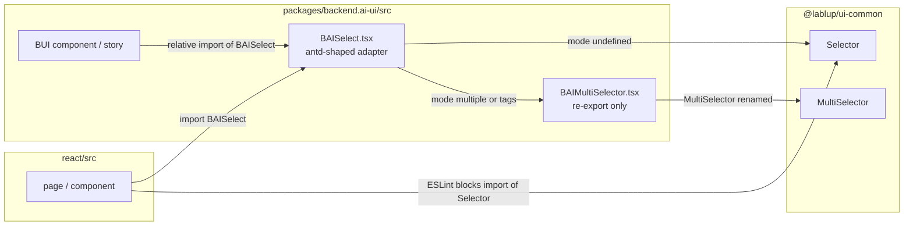

# 0017 — Single select for client-held option lists

> ADR 0014의 `BAISelector` 부분을 대신한다: 1절 표의 `BAISelector` 행, 2절 "Existing antd-shaped wrappers stay"의 `BAISelect` 부분, 3절 "Antd-shaped wrappers included"와 "Where the subpath stays"의 `BAISelect` 부분.

## Summary

> 낯선 용어는 문서 맨 아래 [용어](#용어)에 모아 두었다.

- client가 이미 가진 option 목록에서 고르는 control은 `backend.ai-ui`의 `BAISelect` 하나다. `BAISelector`는 파일, doc, story, barrel export까지 없앤다.
- `BAISelect.tsx`가 ui-common `Selector`를 직접 import한다. 이 파일이 BUI에서 `Selector` component를 import하는 유일한 파일이다.
- `BAISelector`의 49개 call site는 `BAISelect`의 frozen antd-v6 props로 옮긴다. 화면 동작은 그대로 둔다.
- `BAISelect`는 `BAISelector`가 주던 기능 중 옮겨 온 call site가 쓰는 것을 받는다: option의 `description`·`icon`·`disabled: { reason }`, `aria-label`, `id`, `disabledMessage`, 그리고 `labelRender`.
- `react/eslint.config.js`의 `formControlImportBans`는 `Selector` import를 계속 막고, 메시지로 `BAISelect`를 가리킨다.
- `BAIMultiSelector`를 포함한 나머지 18개 항목의 re-export는 ADR 0014대로 남는다.

## Context

- **Two names**: ADR 0014 이후 BUI에는 같은 일을 하는 이름이 둘 있었다. `BAISelector`는 ui-common `Selector`의 re-export이고, `BAISelect`는 같은 `Selector`를 그리는 antd 모양 adapter다.
- **Call site cost**: 두 이름은 props가 달랐다. `BAISelector`는 `hasClear`·`isLoading`·`hasSearch`를 받고 `BAISelect`는 `allowClear`·`loading`·`showSearch`를 받는다. 새 select를 쓰는 사람은 먼저 둘 중 하나를 골라야 했고, 고르는 기준은 ADR 0014와 `BAISelector.doc.ts`에서 서로 달랐다.
- **Why not the other way**: `BAISelect`는 antd 모양 props를 쓰는 call site가 62곳이고 `BAISelectProps`를 extend하는 component도 있다. 이 props는 `component-props-extension.md`의 frozen 어휘다.

## 설계도

## Decision

### 1. `BAISelect`가 유일한 이름이다

- **Removed files**: `BAISelector.tsx`, `BAISelector.doc.ts`, `BAISelector.stories.tsx`를 지우고 components barrel `index.ts`의 `BAISelector`, `BAISelectorProps` export를 지운다.
- **Selector import**: `BAISelect.tsx`는 `@lablup/ui-common/Selector`에서 `Selector` component를 import한다. ADR 0014 3절의 "ui-common subpath에서 control component를 import하는 파일"에 이 파일이 더해진다.
- **Types stay importable**: `SelectorOptionData` 같은 type은 ADR 0014 4절대로 `react/`와 BUI에서 그대로 import한다.

### 2. `BAISelect`의 props는 antd 어휘를 유지한다

- **Prop mapping**: 옮겨 온 call site는 아래 표대로 props를 바꾼다.

| `BAISelector` | `BAISelect` |
|---|---|
| `hasClear` | `allowClear` |
| `isLoading` | `loading` |
| `hasSearch` 없음 | `showSearch={false}` |
| `hasSearch` | 생략(기본값이 검색 켜짐) |
| `width` | `style.width` |
| `controlStyle` | `style` |
| `size="sm"` | `size="small"` |
| `renderOption(option)` | `optionRender({ data })` |
| `renderValue(option)` | `labelRender(option)` |
| `{ type: 'section', title, options }` | `{ label, options }` |
| 문자열 option | `{ value, label }` |

- **Option shape**: `BAISelectOption`은 `disabled`에 `{ reason }`을 받고 `description`, `icon`을 받는다. `BAISelect`는 이 값을 `Selector`로 넘긴다. `BAISelectOption`은 barrel에서 export한다.
- **Default row**: `BAISelect`는 `optionRender`가 없고 모든 label이 string이면 `renderOption`을 넘기지 않는다. Astryx의 기본 option row만 `icon`과 `description`을 그리기 때문이다.
- **Accessible name**: `BAISelect`는 `label`, `aria-label`, `placeholder`, 번역된 일반 문구 순서로 이름을 정한다.
- **New Selector props**: antd에 같은 일을 하는 이름이 있으면 그 이름을 쓴다(`labelRender`). 없으면 `Selector`의 이름을 그대로 받는다(`disabledMessage`, `id`).

### 3. ESLint는 `BAISelect`를 가리킨다

- **Rule**: `formControlImportBans`의 `Selector` 항목은 유지하고, 메시지만 `BAISelect`와 이 문서를 가리키게 바꾼다.

## 대안과 기각 사유

- **Keep both and document the criterion**: 두 이름을 두고 언제 무엇을 쓰는지 문서로 정한다. 코드를 바꾸지 않는다는 것이 장점이다. 기각한 이유는 새 select를 쓸 때마다 두 props 어휘 중 하나를 고르는 비용이 남기 때문이다.
- **Keep only BAISelector**: `BAISelect`를 없애고 Astryx 모양 props로 통일한다. ui-common 문서와 props가 같다는 것이 장점이다. 기각한 이유는 ReactNode label, `autoSelectOption`, children option 같은 `BAISelect`의 동작이 `Selector`에 없고, frozen antd 어휘를 쓰는 call site를 모두 고쳐야 하기 때문이다.
- **Rename BAISelect to BAISelector**: 이름만 ADR 0014의 `BAI<X>` 규칙에 맞춘다. 규칙이 하나로 보인다는 것이 장점이다. 기각한 이유는 `BAI<X>`가 re-export를 뜻한다는 ADR 0014의 약속이 깨지고, `BAISelectProps`를 쓰는 component까지 고쳐야 하기 때문이다.

## Consequences

- **One vocabulary**: select를 쓰는 사람은 `BAISelect` 하나의 props만 읽는다. 서버 paging이 필요한 목록은 지금처럼 `BAIComplexSelect`를 쓴다.
- **Search default**: `BAISelect`의 기본값은 검색이 켜진 상태다. 짧고 고정된 목록은 call site가 `showSearch={false}`를 적는다.
- **Clear value**: `allowClear`로 값을 지우면 `onChange`는 `null`이 아니라 `undefined`를 받는다. 옮겨 온 call site는 둘을 같게 처리한다.
- **Controlled value**: `BAISelect`는 항상 `Selector`에 `value`를 넘기므로 `defaultValue`만 주면 선택이 바뀌지 않는다. 옮겨 온 call site는 `value`를 주거나 `Form.Item` 안에 있다.
- **Upstream props**: ui-common `Selector`의 새 prop은 `BAISelect`가 받기 전까지 webui에서 쓸 수 없다. 필요해지면 `BAISelectProps`와 `BAISelect.doc.ts`에 더한다.
- **Naming exception**: `BAI<X>` 표에서 `Selector`만 빠진다. `MultiSelector`는 `BAIMultiSelector`로 남고, `BAISelect`의 `mode="multiple"`도 이것을 그린다.

## 출처

- GitHub: #10728.
- 결정일: 2026-10-30.
- 관련: [ADR 0014](0014-bai-names-for-ui-common-form-controls.md) (form control의 `BAI<X>` 이름), [ADR 0009](0009-ui-common-as-the-single-entry-point-to-astryx.md) (ui-common이 Astryx로 가는 유일한 경로).

## 용어

| 용어 | 뜻 |
|---|---|
| frozen antd-v6 props | antd 시절 call site가 그대로 컴파일되도록 BUI wrapper가 유지하는 antd v6 모양의 props 이름이다. `.claude/rules/component-props-extension.md`가 정의한다. |
| adapter | 다른 모양의 props를 받아 ui-common component의 props로 옮겨 그리는 BUI component다. re-export와 달리 자기 동작을 가진다. |
