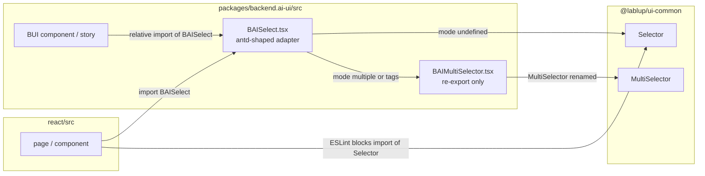

# 0017 — Single select for client-held option lists

> This ADR replaces the `BAISelector` parts of ADR 0014: the `BAISelector` row of the table in section 1, the `BAISelect` part of "Existing antd-shaped wrappers stay" in section 2, and the `BAISelect` parts of "Antd-shaped wrappers included" and "Where the subpath stays" in section 3.

## Summary

> Unfamiliar terms are collected in the [Glossary](#glossary) at the end.

- The control for picking from an option list that the client already holds is one component, `BAISelect` in `backend.ai-ui`. `BAISelector` is removed, together with its file, doc, story, and barrel export.
- `BAISelect.tsx` imports ui-common `Selector` directly. This file is the only file in BUI that imports the `Selector` component.
- The 49 call sites of `BAISelector` move to the [frozen antd-v6 props](#glossary) of `BAISelect`. The on-screen behavior stays the same.
- `BAISelect` accepts the features of `BAISelector` that the moved call sites use: the option's `description`, `icon`, and `disabled: { reason }`, plus `aria-label`, `id`, `disabledMessage`, and `labelRender`.
- `formControlImportBans` in `react/eslint.config.js` keeps blocking the `Selector` import, and its message points to `BAISelect`.
- The re-exports of the other 18 entries, including `BAIMultiSelector`, remain as ADR 0014 defines them.

## Context

- **Two names**: After ADR 0014, BUI had two names that did the same job. `BAISelector` is a re-export of ui-common `Selector`, and `BAISelect` is an antd-shaped [adapter](#glossary) that renders the same `Selector`.
- **Call site cost**: The two names took different props. `BAISelector` takes `hasClear`, `isLoading`, and `hasSearch`, and `BAISelect` takes `allowClear`, `loading`, and `showSearch`. A developer writing a new select first had to pick one of the two, and ADR 0014 and `BAISelector.doc.ts` gave different criteria for that choice.
- **Why not the other way**: `BAISelect` has 62 call sites that use antd-shaped props, and some components extend `BAISelectProps`. These props are the frozen vocabulary of `component-props-extension.md`.

## Diagram

## Decision

### 1. `BAISelect` is the only name

- **Removed files**: The change deletes `BAISelector.tsx`, `BAISelector.doc.ts`, and `BAISelector.stories.tsx`, and removes the `BAISelector` and `BAISelectorProps` exports from the components barrel `index.ts`.
- **Selector import**: `BAISelect.tsx` imports the `Selector` component from `@lablup/ui-common/Selector`. This file joins the files that ADR 0014 section 3 lists as "files that import a control component from a ui-common subpath".
- **Types stay importable**: `react/` and BUI keep importing types such as `SelectorOptionData` directly, as section 4 of ADR 0014 defines.

### 2. `BAISelect` props keep the antd vocabulary

- **Prop mapping**: A moved call site changes its props as the table below shows.

| `BAISelector`                         | `BAISelect`                       |
| ------------------------------------- | --------------------------------- |
| `hasClear`                            | `allowClear`                      |
| `isLoading`                           | `loading`                         |
| no `hasSearch`                        | `showSearch={false}`              |
| `hasSearch`                           | omitted (search is on by default) |
| `width`                               | `style.width`                     |
| `controlStyle`                        | `style`                           |
| `size="sm"`                           | `size="small"`                    |
| `renderOption(option)`                | `optionRender({ data })`          |
| `renderValue(option)`                 | `labelRender(option)`             |
| `{ type: 'section', title, options }` | `{ label, options }`              |
| string option                         | `{ value, label }`                |

- **Option shape**: `BAISelectOption` accepts `{ reason }` in `disabled`, and accepts `description` and `icon`. `BAISelect` passes these values to `Selector`. The barrel exports `BAISelectOption`.
- **Default row**: When `optionRender` is absent and every label is a string, `BAISelect` does not pass `renderOption`. The reason is that only Astryx's default option row renders `icon` and `description`.
- **Accessible name**: `BAISelect` picks the accessible name from `label`, `aria-label`, `placeholder`, and a translated generic phrase, in that order.
- **New Selector props**: When antd has a name for the same job, `BAISelect` uses that name (`labelRender`). Otherwise, `BAISelect` takes the `Selector` name as is (`disabledMessage`, `id`).

### 3. ESLint points to `BAISelect`

- **Rule**: The `Selector` entry of `formControlImportBans` stays, and only its message changes to point to `BAISelect` and this document.

## Rejected alternatives

- **Keep both and document the criterion**: This alternative keeps both names and documents when to use which. Its advantage is that the code does not change. It is rejected because every new select would still cost a choice between two props vocabularies.
- **Keep only BAISelector**: This alternative removes `BAISelect` and unifies on Astryx-shaped props. Its advantage is that the props match the ui-common documentation. It is rejected because `Selector` lacks behaviors of `BAISelect` such as a ReactNode label, `autoSelectOption`, and children options, and because every call site that uses the frozen antd vocabulary would need edits.
- **Rename BAISelect to BAISelector**: This alternative only renames the component to fit the `BAI<X>` rule of ADR 0014. Its advantage is that the naming rule looks uniform. It is rejected because it breaks the ADR 0014 promise that `BAI<X>` means a re-export, and because the components that use `BAISelectProps` would also need edits.

## Consequences

- **One vocabulary**: A developer writing a select reads the props of one component, `BAISelect`. A list that needs server paging uses `BAIComplexSelect`, as it does today.
- **Search default**: The default of `BAISelect` has search turned on. For a short, fixed list, the call site writes `showSearch={false}`.
- **Clear value**: When a user clears the value through `allowClear`, `onChange` receives `undefined`, not `null`. The moved call sites treat the two the same way.
- **Controlled value**: `BAISelect` always passes `value` to `Selector`, so a call site that gives only `defaultValue` cannot change the selection. Every moved call site either passes `value` or sits inside `Form.Item`.
- **Upstream props**: webui cannot use a new prop of ui-common `Selector` until `BAISelect` accepts it. When a call site needs such a prop, a developer adds it to `BAISelectProps` and `BAISelect.doc.ts`.
- **Naming exception**: Only `Selector` drops out of the `BAI<X>` table. `MultiSelector` remains as `BAIMultiSelector`, and the `mode="multiple"` of `BAISelect` also renders it.

## Sources

- GitHub: #10728.
- Decided 2026-10-30.
- Related: [ADR 0014](0014-bai-names-for-ui-common-form-controls.md) (the `BAI<X>` names of form controls), [ADR 0009](0009-ui-common-as-the-single-entry-point-to-astryx.md) (ui-common as the only path to Astryx).

## Glossary

| Term                 | Meaning                                                                                                                                                                                                       |
| -------------------- | ------------------------------------------------------------------------------------------------------------------------------------------------------------------------------------------------------------- |
| frozen antd-v6 props | Frozen antd-v6 props are the antd v6-shaped prop names that a BUI wrapper keeps so that call sites from the antd era compile unchanged. `.claude/rules/component-props-extension.md` defines them.            |
| adapter              | An adapter is a BUI component that accepts props of a different shape, maps them onto the props of a ui-common component, and renders that component. Unlike a re-export, an adapter has behavior of its own. |
