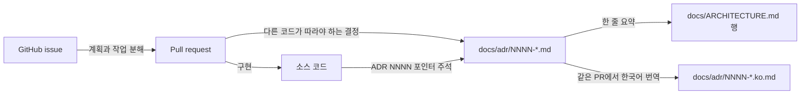

# 0018 — ADRs as the only design record

## Summary

- 저장소에서 설계 결정을 기록하는 곳은 `docs/adr/` 하나다. `.specs/`는 삭제하고, 다른 설계 문서 디렉터리를 그 대신 두지 않는다.
- 모든 ADR과 `docs/ARCHITECTURE.md`는 쌍으로 존재한다. 영어 파일(`NNNN-title.md`, `ARCHITECTURE.md`)이 기준이고, 한국어 짝 파일(`NNNN-title.ko.md`, `ARCHITECTURE.ko.md`)이 그것을 번역한다. 두 파일 모두 식별자를 코드에 나오는 그대로 적는다.
- 영어 파일을 바꾸는 PR은 같은 PR에서 그 `.ko.md`도 바꾼다. `verify.sh` gate인 `scripts/check-adr-pairs.mjs`는 짝 파일이 없을 때, 제목이나 section 구조가 다를 때, 브랜치가 영어 파일만 바꿨을 때 실패한다.
- 구현 계획, 작업 분해, 진행 기록은 저장소 파일이 아니라 GitHub issue와 PR에 둔다.
- `adr-writing` skill, `.github/instructions/adr.instructions.md`, `.claude/rules/adr.md`가 이 규칙을 적는다. `.claude/rules/adr.md`는 모든 agent 세션에서 로드되고, `adr.instructions.md`는 `docs/adr/`를 건드리는 PR에서 로드된다. 이 두 파일이 함께 새 `.specs/` 디렉터리를 지적한다. CI check는 이것을 검사하지 않는다.

## Context

- **Two homes**: 설계 기록은 `.specs/`(기능 spec, 계획, 초안을 담은 디렉터리 40개, markdown 파일 약 160개)와 `docs/adr/`(ADR 0001–0017)로 나뉘어 있었다. 코드가 왜 그런 모양인지 찾는 독자는 두 곳을 모두 뒤져야 했고, 두 곳이 서로 다를 때 어느 쪽이 현재 기준인지 알려 주는 문서가 없었다.
- **Spec drift**: `.specs/`의 spec은 기능을 계획 단계로 기술했다. 작업이 머지된 뒤에는 아무도 spec을 고치지 않았다. 그래서 spec을 링크한 source 주석과 rule은 코드와 더 이상 맞지 않는 계획을 가리켰다.
- **Body language**: `adr-writing` skill은 영어 제목 아래 한국어 본문을 요구했다. ADR의 독자는 그것을 기준으로 코드를 짜는 agent와 기여자다. agent harness의 나머지 파일(`CLAUDE.md`, `.claude/rules/`, `REVIEW.md`, skill들)은 영어로 되어 있다. 한국어 본문은 harness에서 한국어를 모르는 독자가 읽을 수 없는 유일한 부분이었다.

## 설계도

## Decision

### 1. `docs/adr/`가 유일한 기록 장소다

- **No spec directory**: 저장소에는 `.specs/` 디렉터리도, 설계 메모·계획·초안을 담은 다른 폴더도 없다. 그런 폴더를 추가하는 PR은 리뷰 지적 대상이다.
- **Absorbed content**: 아직 유효하고 다른 코드가 따라야 하는 spec의 결정은 새 ADR이나 기존 ADR로 옮긴다. `.specs/`의 나머지는 삭제하고, git history가 그 내용을 보관한다.
- **Plans**: 구현 계획, 작업 분해, 진행 기록은 GitHub issue 본문, issue 댓글, PR 설명에 적는다.
- **Inbound links**: `.specs/` 파일을 가리키던 source 주석, rule, workflow는 그 내용을 흡수한 ADR을 가리키거나, 포인터를 지운다.
- **Citations by name**: 삭제된 spec 문서를 경로 없이 이름으로 인용하는 source 주석(`MAPPING §…`, `ticket NN`)은 `.claude/rules/comment-density.md`에 따라 그 파일을 다음에 고칠 때 인용을 지운다. 이런 주석을 일괄로 찾아 고치는 사람은 없다.

### 2. 영어 ADR과 한국어 짝 파일

- **Authority**: 영어 파일이 결정의 기준 문서다. 두 파일이 다르면 영어 파일을 따르고 한국어 파일을 고친다.
- **Companion**: 각 `docs/adr/NNNN-title.md`에는 `docs/adr/NNNN-title.ko.md`가 있고, `docs/ARCHITECTURE.md`에는 `docs/ARCHITECTURE.ko.md`가 있다. 한국어 파일은 영어 H1 제목, 같은 `###` subsection, 같은 mermaid diagram을 유지하고, 본문과 section 제목을 한국어로 쓴다.
- **Same PR**: 영어 파일을 쓰거나 바꾸는 PR은 그 짝 파일도 쓰거나 바꾼다. 번역 수정처럼 한국어 파일만 바꾸는 변경에는 영어 파일 변경이 필요 없다.
- **Gate**: `scripts/check-adr-pairs.mjs`는 `scripts/verify.sh`의 `ADR pairs` lane으로 실행된다. 이 스크립트는 짝 파일이 없을 때, 제목이 다를 때, `###` subsection이나 mermaid block의 개수가 다를 때, 브랜치가 영어 파일을 바꾸면서 짝 파일을 바꾸지 않았을 때 실패한다.
- **Section headings**: `.claude/skills/adr-writing/references/document-shape.md`의 skeleton이 영어 section 제목을 나열하고, 같은 폴더의 `korean-companion.md`가 그 제목을 한국어 제목에 대응시킨다.
- **Translation**: 다른 언어로 쓰인 기존 ADR을 영어로 옮기는 작업은 결정을 하나도 바꾸지 않는 변경으로 한다.

## 대안과 기각 사유

- **Keep `.specs/` for feature specs**: spec 디렉터리는 issue가 생기기 전에 기능의 UI 스케치와 단계 목록을 둘 곳을 준다. 기각한 이유는 그 spec들이 머지 뒤에 한 번도 갱신되지 않아 디렉터리에 현재 계획보다 낡은 계획이 더 많았고, issue와 PR이 같은 내용을 날짜와 함께 이미 담고 있기 때문이다.
- **Korean body under an English title**: 현재 작성자들은 한국어 본문을 더 빨리 읽는다. 기각한 이유는 이 문서가 앞으로의 agent와 기여자를 위해 쓰이고, 그 독자가 로드하는 다른 파일이 모두 영어이기 때문이다.
- **English only**: 언어를 하나로 두면 두 사본 사이의 어긋남이 사라진다. 기각한 이유는 팀이 결정을 한국어로도 읽고, 두 사본을 위험하게 만들던 어긋남을 pair gate가 잡기 때문이다.
- **Both languages in one file**: 한 파일에 두면 두 텍스트가 나란히 놓인다. 기각한 이유는 모든 독자가 필요 없는 언어를 넘겨 가며 읽어야 하고, 영어 파일이 agent가 읽을 깨끗한 원본이 되지 못하기 때문이다.

## Consequences

- 코드가 왜 그런 모양인지 묻는 독자는 디렉터리 하나만 찾으면 되고, 찾은 결과는 모두 유효한 결정이다.
- architecture 결정이 아닌 기능 수준의 설계에는 저장소 파일이 없다. 그 설계는 issue와 PR에 있으므로, 독자는 디렉터리 목록이 아니라 `git log`와 PR로 찾는다.
- ADR 하나에 파일이 두 개 든다. 작성자는 영어 파일을 먼저 쓰고, 한국어 짝 파일은 그것의 번역이지 두 번째 초안이 아니다.
- pair gate는 의미가 아니라 구조를 검사한다. 이 gate는 한국어 문장이 영어 문장과 다른 말을 하는지 알아내지 못한다. 그래서 리뷰어가 두 파일을 나란히 놓고 읽는다.

## 출처

- GitHub issue #10802, 결정일 2026-11-03. 한국어 짝 파일 요구는 같은 날 더해졌다.
- 관련: ADR 0015 (`REVIEW.md`의 리뷰 정책으로, 리뷰어가 ADR 변경에도 적용한다).
