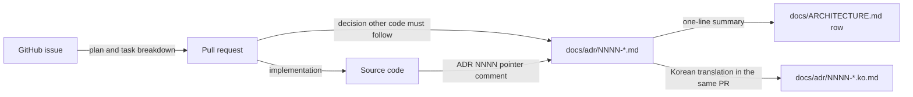

# 0018 — ADRs as the only design record

## Summary

- `docs/adr/` is the only place in the repository where a design decision is recorded. `.specs/` is removed, and no other design-document directory replaces it.
- Every ADR and `docs/ARCHITECTURE.md` is a pair: the English file (`NNNN-title.md`, `ARCHITECTURE.md`) is the authority, and a Korean companion (`NNNN-title.ko.md`, `ARCHITECTURE.ko.md`) translates it. Identifiers are written as they appear in the code in both.
- A change to an English file changes its `.ko.md` in the same PR. `scripts/check-adr-pairs.mjs`, a `verify.sh` gate, fails when a companion is missing, its title or section shape differs, or a branch changed the English file alone.
- Implementation plans, task breakdowns, and status notes live in the GitHub issue and the PR, not in a repository file.
- The `adr-writing` skill, `.github/instructions/adr.instructions.md`, and `.claude/rules/adr.md` state these rules. `.claude/rules/adr.md` loads in every agent session and `adr.instructions.md` loads for a PR that touches `docs/adr/`; together they flag a new `.specs/` directory. No CI check does.

## Context

- **Two homes**: Design records were split between `.specs/` (40 directories, about 160 markdown files of feature specs, plans, and drafts) and `docs/adr/` (ADR 0001–0017). A reader looking for why the code has a shape had to search both, and nothing said which one was current when they disagreed.
- **Spec drift**: A spec under `.specs/` described a feature as planned. Once the work landed, nobody updated it, so source comments and rules that linked to a spec pointed at plans the code no longer matched.
- **Body language**: The `adr-writing` skill required a Korean body under an English title. The readers of an ADR are agents and contributors who build against it, and the rest of the agent harness (`CLAUDE.md`, `.claude/rules/`, `REVIEW.md`, the skills) is English. A Korean body was the one part of that harness a non-Korean reader could not follow.

## Diagram

## Decision

### 1. `docs/adr/` is the single home

- **No spec directory**: The repository holds no `.specs/` directory and no other folder of design notes, plans, or drafts. A PR that adds one is a review finding.
- **Absorbed content**: A spec decision that is still in force and that other code must follow moves into an ADR, new or existing. Everything else in `.specs/` is deleted; git history keeps it.
- **Plans**: An implementation plan, a task breakdown, or a status log goes in the GitHub issue body, an issue comment, or the PR description.
- **Inbound links**: A source comment, rule, or workflow that pointed at a `.specs/` file points at the ADR that absorbed it, or loses the pointer.
- **Citations by name**: A source comment that cites a removed spec document by name without a path (`MAPPING §…`, `ticket NN`) loses the citation when its file is next edited, under `.claude/rules/comment-density.md`; nobody sweeps them.

### 2. An English ADR with a Korean companion

- **Authority**: The English file is the decision of record. When the two files disagree, the English file wins and the Korean file is fixed.
- **Companion**: Each `docs/adr/NNNN-title.md` has `docs/adr/NNNN-title.ko.md`, and `docs/ARCHITECTURE.md` has `docs/ARCHITECTURE.ko.md`. The Korean file keeps the English H1 title, the same `###` subsections, and the same mermaid diagrams, with Korean prose and Korean section headings.
- **Same PR**: A PR that writes or changes an English file writes or changes its companion. A Korean-only change, such as a translation fix, needs no English change.
- **Gate**: `scripts/check-adr-pairs.mjs` runs as the `ADR pairs` lane of `scripts/verify.sh` and fails on a missing companion, a different title, a different count of `###` subsections or mermaid blocks, or an English file changed on the branch without its companion.
- **Section headings**: The skeleton in `.claude/skills/adr-writing/references/document-shape.md` lists the English headings, and `korean-companion.md` beside it maps them to the Korean ones.
- **Translation**: A landed ADR in another language is translated in a change that alters no decision.

## Rejected alternatives

- **Keep `.specs/` for feature specs**: A spec directory gives a feature a place for UI sketches and step lists before an issue exists. It is rejected because those specs were never updated after landing, so the directory held more stale plans than current ones, and the issue and PR already hold the same material with a date attached.
- **Korean body under an English title**: A Korean body reads faster for the current authors. It is rejected because the documents are written for future agents and contributors, and every other file those readers load is English.
- **English only**: One language removes the drift between two copies. It is rejected because the team also reads the decisions in Korean, and the pair gate catches the drift that made two copies risky.
- **Both languages in one file**: One file keeps the two texts next to each other. It is rejected because every reader then scrolls past a language they do not need, and the English file stops being a clean source for agents.

## Consequences

- A reader asking why the code has a shape searches one directory, and every result is a decision in force.
- Feature-level design that is not an architecture decision has no repository file. It lives in the issue and the PR, so a reader finds it through `git log` and the PR, not through a directory listing.
- Every ADR costs two files. The English file is written first, and the Korean companion is a translation of it, not a second draft.
- The pair gate checks shape, not meaning: it cannot tell that a Korean sentence says something the English one does not. A reviewer reads the two side by side.

## Sources

- GitHub issue #10802, decided 2026-11-03; the Korean companion requirement was added on the same day.
- Related: ADR 0015 (the review policy in `REVIEW.md`, which reviewers apply to ADR changes).
