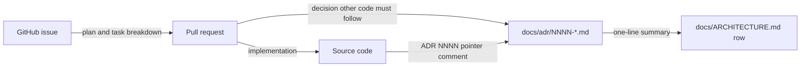

# 0018 — ADRs as the only design record

## Summary

- `docs/adr/` is the only place in the repository where a design decision is recorded. `.specs/` is removed, and no other design-document directory replaces it.
- Every ADR and `docs/ARCHITECTURE.md` is written in English: title, headings, and body. Identifiers are written as they appear in the code.
- Implementation plans, task breakdowns, and status notes live in the GitHub issue and the PR, not in a repository file.
- The `adr-writing` skill, `.github/instructions/adr.instructions.md`, and `.claude/rules/adr.md` state these rules. `.claude/rules/adr.md` loads in every agent session, so it is the rule that catches a new `.specs/` directory.

## Context

- **Two homes**: Design records were split between `.specs/` (40 directories, about 160 markdown files of feature specs, plans, and drafts) and `docs/adr/` (ADR 0001–0017). A reader looking for why the code has a shape had to search both, and nothing said which one was current when they disagreed.
- **Spec drift**: A spec under `.specs/` described a feature as planned. Once the work landed, nobody updated it, so source comments and rules that linked to a spec pointed at plans the code no longer matched.
- **Body language**: The `adr-writing` skill required a Korean body under an English title. The readers of an ADR are agents and contributors who build against it, and the rest of the agent harness (`CLAUDE.md`, `.claude/rules/`, `REVIEW.md`, the skills) is English. A Korean body was the one part of that harness a non-Korean reader could not follow.

## Diagram

## Decision

### 1. `docs/adr/` is the single home

- **No spec directory**: The repository holds no `.specs/` directory and no other folder of design notes, plans, or drafts. A PR that adds one is a review finding.
- **Absorbed content**: A spec decision that is still in force and that other code must follow moves into an ADR, new or existing. Everything else in `.specs/` is deleted; git history keeps it.
- **Plans**: An implementation plan, a task breakdown, or a status log goes in the GitHub issue body, an issue comment, or the PR description.
- **Inbound links**: A source comment, rule, or workflow that pointed at a `.specs/` file points at the ADR that absorbed it, or loses the pointer.
- **Citations by name**: A source comment that cites a removed spec document by name without a path (`MAPPING §…`, `ticket NN`) loses the citation when its file is next edited, under `.claude/rules/comment-density.md`; nobody sweeps them.

### 2. English for every ADR

- **Scope**: The title, every heading, and the body of each file under `docs/adr/`, and all of `docs/ARCHITECTURE.md`, are English.
- **Section headings**: The skeleton in `.claude/skills/adr-writing/references/document-shape.md` uses `## Summary`, `## Context`, `## Diagram`, `## Decision`, `## Rejected alternatives`, `## Consequences`, `## Sources`, and `## Glossary`.
- **Translation**: A landed ADR in another language is translated in a change that alters no decision.

## Rejected alternatives

- **Keep `.specs/` for feature specs**: A spec directory gives a feature a place for UI sketches and step lists before an issue exists. It is rejected because those specs were never updated after landing, so the directory held more stale plans than current ones, and the issue and PR already hold the same material with a date attached.
- **Korean body under an English title**: A Korean body reads faster for the current authors. It is rejected because the documents are written for future agents and contributors, and every other file those readers load is English.
- **Bilingual ADRs**: Keeping a Korean and an English body side by side serves both groups. It is rejected because two bodies drift the same way specs did, and nothing checks that they still say the same thing.

## Consequences

- A reader asking why the code has a shape searches one directory, and every result is a decision in force.
- Feature-level design that is not an architecture decision has no repository file. It lives in the issue and the PR, so a reader finds it through `git log` and the PR, not through a directory listing.
- Writing an ADR in English is slower for authors whose first language is Korean. The writing rules (L1–L5, S4, S9) keep the English plain.

## Sources

- GitHub issue #10802, decided 2026-11-03.
- Related: ADR 0015 (the review policy in `REVIEW.md`, which reviewers apply to ADR changes).
