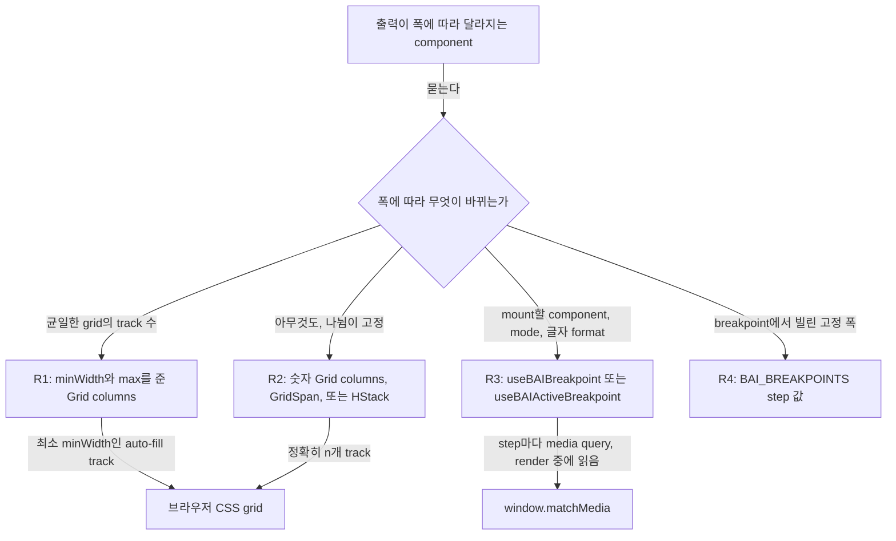

# 0020 — Container-driven grids and one breakpoint hook

## Summary

> 낯선 용어는 문서 맨 아래 [용어](#용어)에 모아 두었다.

- 쓸 수 있는 폭에 따라 column 수가 바뀌는 layout은 `columns={{ minWidth, max }}`를 준 [container-driven](#용어) Astryx `Grid`다. 이 grid는 viewport가 아니라 자기 container의 폭에 맞춰 다시 배치되고, resize 때 JavaScript를 실행하지 않는다.
- 폭이 바뀌어도 나뉨이 바뀌지 않는 layout은 `Grid columns={n}`, 또는 `GridSpan`을 둔 `Grid columns={24}`다. control 한 줄은 `HStack`이나 `BAIFlex`다.
- viewport에 따라 갈리는 [behaviour branch](#용어)는 `backend.ai-ui`의 `useBAIBreakpoint()`나 `useBAIActiveBreakpoint()`를 읽는다. 어떤 코드도 이 용도로 Astryx `useMediaQuery`를 부르지 않고, 두 branch를 모두 그린 뒤 CSS로 하나를 숨기지도 않는다.
- breakpoint 숫자를 고정 폭으로 쓰는 코드는 `BAI_BREAKPOINTS.<step>`을 읽는다. `BAI_BREAKPOINTS.xs`는 `0`이므로 폭으로 쓰지 않는다.
- 설정 화면 모양의 왼쪽 rail은 가로 `TabList`가 아니라 `Layout` + `LayoutPanel` + `List` 조합이고, `md` 미만에서는 drill-down이 된다(6절).

## Context

- **No breakpoint system upstream**: Astryx에는 이름 붙은 breakpoint도 `screen*` token도 없다. Astryx의 `useMediaQuery`는 CSS query 문자열을 그대로 받고, 첫 render에서 `false`를 돌려준 뒤 effect에서 값을 고친다. 그래서 이 hook으로 갈리는 tree는 한 frame 동안 틀린 branch를 그린다.
- **Where grids render**: 앱의 responsive grid는 대부분 modal과 card 안에 있다. `BAIModal`은 화면 폭과 관계없이 기본 폭이 520px이므로, viewport에 맞춘 column 수는 modal 안에서 틀린 값을 고른다.
- **What CSS cannot do**: 어떤 component는 좁은 화면에서 다른 tree를 mount하거나, drawer mode를 바꾸거나, 글자를 다르게 format한다. CSS는 track 크기를 바꿀 수 있지만 React가 어떤 component를 mount할지는 고를 수 없다.
- **What the hook is**: `useBAIBreakpoint`는 `packages/backend.ai-ui/src/hooks/useBAIBreakpoint.ts`에 있는 hook이다. 이 hook은 `useSyncExternalStore`로 `window.matchMedia`를 읽어 이름 붙은 step마다 boolean 하나를 돌려준다. 이 hook은 layout component가 아니고 아무것의 크기도 바꾸지 않는다.

## 설계도

## Decision

### 1. R1 — track layout은 container-driven CSS다

- **Component**: 폭에 따라 column 수가 바뀌는 균일한 grid는 `@lablup/ui-common/Grid`의 `Grid`에 `columns={{ minWidth, max }}`를 준 것이다. `minWidth`는 가장 좁은 track의 pixel 폭이고 `max`는 column 수의 상한이다. 이런 grid는 모두 두 값을 함께 준다. `minWidth`만 주면 `minWidth`보다 좁은 container에서 grid가 넘치기 때문이다.
- **Choosing `minWidth`**: layout이 처음 N개 column을 보여야 하는 폭을 N으로 나눈다. 이 계산은 576px부터 두 column이면 약 280, 768px부터 세 column이면 250, 992px부터 네 column이면 240, 1200px부터 여섯 column이면 200을 준다. 그다음 cell의 실제 내용으로 값을 확인한다. 실제 내용 때문에 값이 계산과 달라질 수 있다.
- **Choosing `max`**: `max`는 layout이 가장 넓을 때 보여 주는 column 수다.
- **Pairs in use**: 아래 표는 지금 코드가 쓰는 `minWidth`와 `max` 쌍이다.

| `minWidth` | `max` | site                                                                                               |
| ---------- | ----- | -------------------------------------------------------------------------------------------------- |
| 200        | 2     | `LogoSizeSettingItem.tsx`                                                                          |
| 200        | 6     | `ReservoirPage.tsx`                                                                                |
| 240        | 3     | `KeypairResourcePolicyV2SettingModal.tsx`                                                          |
| 280        | 2     | `AgentResources.tsx`, `AgentDetailModal.tsx`, `SessionUsageMonitor.tsx`, `SessionLauncherPage.tsx` |
| 300        | 4     | `LightDarkColorPicker.tsx`                                                                         |
| 360        | 2     | `Information.tsx`                                                                                  |
| 496        | 4     | `AIAgentPage.tsx`, `ModelStoreListPageV2.tsx` (992px부터 두 column, 상한 네 column)                |

- **Repeat mode**: `repeat`는 기본값 `'fill'`로 둔다. `'fill'`은 모든 track의 폭을 같게 유지한다. 항목이 남는 공간까지 늘어나야 할 때만 grid가 `'fit'`을 쓴다.
- **Gap**: `gap`, `rowGap`, `columnGap`은 Astryx spacing step을 받는다. step N은 N × 4px이다(`gap={4}`는 16px, `gap={6}`은 24px). 두 step 사이에 있는 gap은 더 가까운 step을 쓴다.
- **Not a hook branch**: grid에 넘기는 `md ? 3 : 1`처럼 column 수를 고르려고만 hook을 읽는 component는 R1을 따르고 hook 호출을 지운다.

### 2. R2 — 고정된 나뉨은 고정 grid다

- **Equal columns**: 폭이 바뀌어도 바뀌지 않는 나뉨은 `Grid columns={n}`이다. 숫자 `columns`는 모든 폭에서 정확히 n개 track을 만들고 다시 배치되지 않는다.
- **Unequal columns**: 폭이 섞인 나뉨은 `Grid columns={24}`에 항목마다 `GridSpan columns={k}`를 하나씩 둔 것이다.
- **One row**: control 한 줄은 grid가 아니라 `gap`을 준 `HStack`이나 기존 `BAIFlex`다.

### 3. R3 — behaviour branch는 BUI breakpoint hook을 읽는다

- **Hook**: viewport 폭에 따라 다른 tree를 mount하거나, layout mode를 바꾸거나, 글자를 format하는 component는 `backend.ai-ui`의 `useBAIBreakpoint()`를 부른다. BUI 안에서는 `hooks/useBAIBreakpoint`에서 상대 경로로 이 hook을 import한다.
- **Return shape**: `useBAIBreakpoint()`는 `BAIScreenMap`을 돌려준다. `BAIScreenMap`은 `xs`, `sm`, `md`, `lg`, `xl`, `xxl`에 대한 `Record<BAIBreakpointKey, boolean>`이다. 모든 key가 항상 들어 있다. `xs`는 `sm` 미만에서만 true다. 나머지 step은 모두 `min-width` query이므로 1280px에서는 `sm`, `md`, `lg`, `xl`이 모두 true다.
- **Single step**: `useBAIActiveBreakpoint()`는 활성인 `BAIBreakpointKey` 중 가장 큰 것을 돌려준다. map이 아니라 값 하나가 필요한 call site가 이 hook을 쓴다.
- **First render**: 이 hook은 `useSyncExternalStore`로 `matchMedia`를 동기로 읽으므로, 첫 paint부터 맞는 branch가 보인다. module 수준의 listener 집합 하나가 경계를 넘을 때마다 모든 구독자에게 알린다.
- **Forbidden alternatives**: 어떤 component도 breakpoint branch를 위해 Astryx `useMediaQuery`를 부르지 않는다. `useMediaQuery`는 첫 frame에서 틀린 branch를 그리기 때문이다. 어떤 component도 두 branch를 모두 그리고 CSS media query로 하나를 숨기지 않는다. 그러면 두 사본이 모두 DOM에 남아 e2e selector와 보조 기술에 잡히기 때문이다.
- **Canonical sites**: `BAIContentWithDrawerArea.tsx`(drawer mode), `WebUIHeaderProjectSelect.tsx`, `UserSettingsModal.tsx`와 `SettingList.tsx`(좁은 화면 drill-down), `LoginSessionExtendButton.tsx`(글자 format), `FolderExplorerModalV2.tsx`, `FolderExplorerHeaderV2.tsx`, 그리고 BUI의 `ExplorerActionControls.tsx`다.

### 4. R4 — 폭으로 쓰는 breakpoint 숫자는 `BAI_BREAKPOINTS`를 읽는다

- **Constant**: breakpoint 값을 빌린 고정 폭은 `BAI_BREAKPOINTS.<step>`을 읽는다. `KeypairResourcePolicyInfoModal.tsx`가 `width={BAI_BREAKPOINTS.sm}`으로 이렇게 한다.
- **Values**: `BAI_BREAKPOINTS`는 아래의 frozen record다. hook이 쓰는 `BAI_BREAKPOINT_QUERIES`의 media query는 이 record로 만든다.

| step  | `xs` | `sm` | `md` | `lg` | `xl` | `xxl` |
| ----- | ---- | ---- | ---- | ---- | ---- | ----- |
| width | 0    | 576  | 768  | 992  | 1200 | 1600  |

- **The `xs` trap**: `BAI_BREAKPOINTS.xs`는 antd `screenXS`의 480이 아니라 map의 바닥값 `0`이다. 480px 폭은 `ImageList.tsx`와 `CustomizedImageList.tsx`처럼 숫자 `480`으로 쓰고, `BAI_BREAKPOINTS.xs`로 쓰지 않는다.

### 5. antd 모양 wrapper의 responsive prop record

- **Collapse rule**: antd의 breakpoint별 record를 아직 받는 [frozen antd-v6 prop](0017-single-select-for-client-held-option-lists.ko.md#용어)은 viewport에 따라 값을 바꾸지 않는다. `BAIModal`은 `width`를 `BAIModalResponsiveWidth` record로 받고, 가장 넓은 항목이 아니라 마지막으로 선언된 항목(`Object.values(width).at(-1)`)을 쓴다. 새 코드는 값 하나를 넘긴다. source 주석은 이 규칙을 `ADR 0020 §5`로 가리킨다.

### 6. 설정 화면 모양의 왼쪽 rail은 `Layout` 조합이다

- **Composition**: 왼쪽 rail에서 section을 고르는 page는 `@lablup/ui-common/Layout`의 `Layout`을 그린다. `start={<LayoutPanel hasDivider>}`에는 `ListItem`들로 된 `List`를 두고, `content={<LayoutContent>}`에는 pane을 둔다. 이 page는 가로 `TabList`를 쓰지 않는다. `TabList`에는 세로 방향이 없기 때문이다. 따라 할 구현은 `SettingList.tsx`다.
- **Selection**: 선택된 section은 `ListItem isSelected`다. `isSelected`가 `aria-current`와 선택된 surface를 그린다. 어떤 코드도 highlight를 직접 만들지 않는다.
- **Narrow viewports**: `md` 미만(R3, `useBAIBreakpoint`)에서는 rail과 pane이 나란히 놓이지 않고 master-detail drill-down이 된다.
- **Template source**: 이 layout은 Astryx의 `settings-sidebar` template을 따른다. ui-common은 이 template을 제공하지 않는다. `pnpm run ui-common astryx template settings-sidebar`가 `@astryxdesign/*` import로 template을 출력하므로, 그 import는 `@lablup/ui-common` subpath로 고쳐 써야 한다(ADR 0009).

## 대안과 기각 사유

- **JavaScript grid emulation**: antd의 24-column grid와 breakpoint별 span을 breakpoint hook 위의 `BAIRow`와 `BAICol`로 다시 만든다. antd 시절 span이 그대로 옮겨 온다는 것이 장점이다. 기각한 이유는 세 가지다. 이 방식은 antd 동작의 영구 사본이 되고, modal 안에서도 여전히 viewport로 column 수를 고르며, step을 넘는 resize마다 모든 grid를 다시 render한다.
- **CSS media queries for everything**: behaviour branch도 CSS로 표현한다. resize 때 JavaScript가 돌지 않는다는 것이 장점이다. 기각한 이유는 CSS가 mount할 component를 고를 수 없어 모든 branch가 두 tree를 그리고 하나를 숨기게 되고, Astryx가 CSS에서 참조할 이름 붙은 step을 제공하지 않기 때문이다.

## Consequences

- **Width source**: modal, card, drawer 안의 grid는 실제로 가진 공간에 맞춰 다시 배치된다. 같은 grid가 넓은 화면과 좁은 modal에서 서로 다른 column 수를 보이는 것은 의도한 동작이다.
- **Converted grids differ from antd**: antd span에서 옮긴 grid는 antd와 다른 폭에서 쌓이거나 나뉠 수 있다. reviewer는 이런 grid를 viewport step에서만 보지 않고, 실제 container가 갖는 폭에서 비교한다.
- **No resize renders for layout**: R1과 R2 grid는 resize 때 JavaScript 비용이 없다. R3 component만 다시 render하고, 그것도 step 경계를 넘을 때만 한다.
- **Antd step values**: step 값은 Ant Design의 기본값이다. layout들이 이 값에 맞춰 조정되었기 때문이다. 값을 바꾸는 것은 모든 R3 branch와 모든 R4 폭을 한꺼번에 옮기는 설계 결정이다.
- **No `xxxl` step**: hook에는 `xxl`보다 큰 step이 없다. 아주 넓은 화면에서 column이 더 필요한 layout은 R1에 따라 `max`를 올린다.

## 출처

- GitHub: #10802 (`.specs/`에서 이 ADR로 옮김, 2026-11-03).
- FR-3482, PR #8626: Ant Design에서 Astryx로의 migration이다. 이 PR이 2026-08-11에 정책과 hook을 넣었다. 정책은 2026-08-07에 측정하고 결정했다.
- FR-3606, PR #8921: `useBAIBreakpoint.ts`의 공유 media-query listener.
- 이전 위치는 `.specs/FR-3482-astryx-migration/RESPONSIVE-POLICY.md`다(#10802에서 삭제, git history 참고).
- 코드: `packages/backend.ai-ui/src/hooks/useBAIBreakpoint.ts`; `@lablup/ui-common/Grid`의 `Grid`와 `GridSpan` (`pnpm run ui-common component Grid`).
- 관련: [ADR 0009](0009-ui-common-as-the-single-entry-point-to-astryx.ko.md) (Astryx는 ui-common을 통해서만 쓴다), [ADR 0017](0017-single-select-for-client-held-option-lists.ko.md) (frozen antd-v6 prop 어휘).

## 용어

| 용어             | 뜻                                                                                                                                  |
| ---------------- | ----------------------------------------------------------------------------------------------------------------------------------- |
| behaviour branch | component가 같은 요소의 크기나 배치만 바꾸지 않고, viewport 폭에 따라 다른 component tree, mode, 글자를 그리는 지점이다.            |
| container-driven | container-driven grid는 브라우저 창의 폭이 아니라 자기가 놓인 요소의 폭으로 CSS `auto-fill` track을 통해 column 수를 고르는 grid다. |
