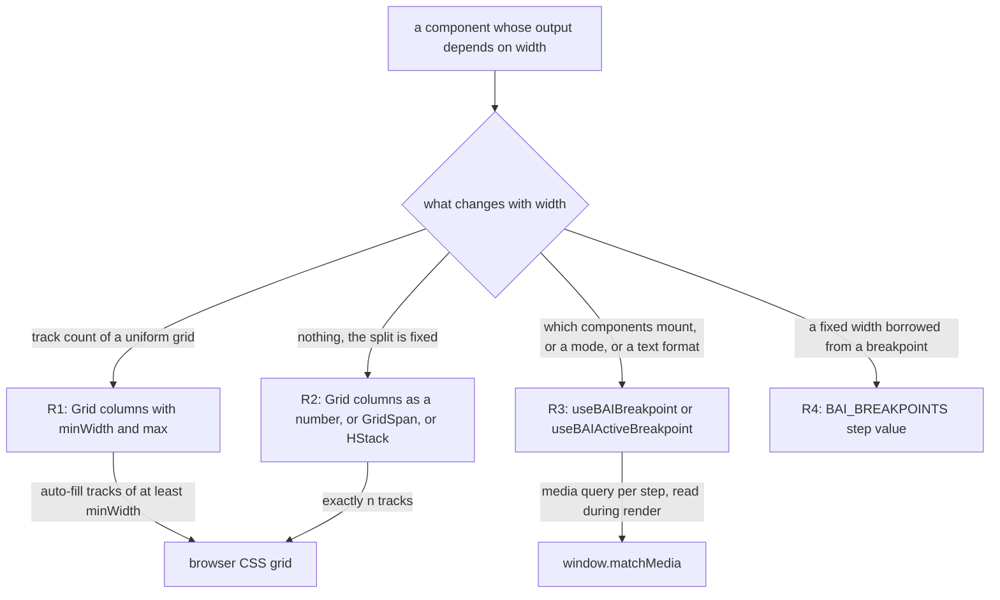

# 0020 — Container-driven grids and one breakpoint hook

## Summary

> Unfamiliar terms are collected in the [Glossary](#glossary) at the end.

- A layout whose column count changes with the available width is a [container-driven](#glossary) Astryx `Grid` with `columns={{ minWidth, max }}`. The grid reflows on the width of its container, not on the viewport, and no JavaScript runs on resize.
- A split that never changes with width is `Grid columns={n}`, or `Grid columns={24}` with `GridSpan`. A single row of controls is `HStack` or `BAIFlex`.
- A [behaviour branch](#glossary) that depends on the viewport reads `useBAIBreakpoint()` or `useBAIActiveBreakpoint()` from `backend.ai-ui`. No code calls Astryx `useMediaQuery` for this, and no code renders both branches and hides one with CSS.
- A breakpoint number used as a fixed width reads `BAI_BREAKPOINTS.<step>`. `BAI_BREAKPOINTS.xs` is `0`, so it is never a width.

## Context

- **No breakpoint system upstream**: Astryx has no named breakpoints and no `screen*` tokens. Its `useMediaQuery` takes a raw CSS query string, returns `false` on the first render, and corrects itself in an effect, so a tree that branches on it renders the wrong branch for one frame.
- **Where grids render**: Most responsive grids in the app sit inside modals and cards. `BAIModal` defaults to 520px wide whatever the screen width is, so a column count keyed to the viewport picks the wrong count there.
- **What CSS cannot do**: Some components mount a different tree, switch a drawer mode, or format text differently on a narrow screen. CSS can resize tracks, but it cannot choose which components React mounts.
- **What the hook is**: `useBAIBreakpoint` is a hook in `packages/backend.ai-ui/src/hooks/useBAIBreakpoint.ts` that returns one boolean per named step, read from `window.matchMedia` through `useSyncExternalStore`. It is not a layout component and it does not resize anything.

## Diagram

## Decision

### 1. R1 — Track layout is container-driven CSS

- **Component**: A uniform grid whose column count changes with width is `Grid` from `@lablup/ui-common/Grid` with `columns={{ minWidth, max }}`. `minWidth` is the narrowest track in pixels and `max` caps the column count. Every such grid sets both, because `minWidth` alone overflows a container narrower than `minWidth`.
- **Choosing `minWidth`**: Take the width at which the layout should first show N columns and divide it by N. The recipe gives about 280 for two columns from 576px, 250 for three from 768px, 240 for four from 992px, and 200 for six from 1200px. Then check the value against the real content of a cell, which can move it away from the recipe.
- **Choosing `max`**: `max` is the column count the layout shows at its widest.
- **Pairs in use**: The table lists the `minWidth` and `max` pairs the code uses today.

| `minWidth` | `max` | site                                                                                               |
| ---------- | ----- | -------------------------------------------------------------------------------------------------- |
| 200        | 2     | `LogoSizeSettingItem.tsx`                                                                          |
| 200        | 6     | `ReservoirPage.tsx`                                                                                |
| 240        | 3     | `KeypairResourcePolicyV2SettingModal.tsx`                                                          |
| 280        | 2     | `AgentResources.tsx`, `AgentDetailModal.tsx`, `SessionUsageMonitor.tsx`, `SessionLauncherPage.tsx` |
| 300        | 4     | `LightDarkColorPicker.tsx`                                                                         |
| 360        | 2     | `Information.tsx`                                                                                  |
| 496        | 4     | `AIAgentPage.tsx`, `ModelStoreListPageV2.tsx` (two columns from 992px, capped at four)             |

- **Repeat mode**: `repeat` stays at its default `'fill'`, which keeps every track the same width. A grid uses `'fit'` only when the items should stretch into leftover space.
- **Gap**: `gap`, `rowGap`, and `columnGap` take Astryx spacing steps, where step N is N × 4px (`gap={4}` is 16px, `gap={6}` is 24px). A gap that falls between two steps takes the nearer step.
- **Not a hook branch**: A component that reads the hook only to pick a column count, such as `md ? 3 : 1` passed into a grid, follows R1 and drops the hook call.

### 2. R2 — A fixed split is a fixed grid

- **Equal columns**: A split that does not change with width is `Grid columns={n}`. A numeric `columns` creates exactly n tracks at every width and never reflows.
- **Unequal columns**: Mixed widths are `Grid columns={24}` with one `GridSpan columns={k}` per item.
- **One row**: A single row of controls is `HStack` with `gap`, or the existing `BAIFlex`, not a grid.

### 3. R3 — Behaviour branches read the BUI breakpoint hook

- **Hook**: A component that mounts a different tree, switches a layout mode, or formats text by viewport width calls `useBAIBreakpoint()` from `backend.ai-ui`. Inside BUI the hook is imported relatively from `hooks/useBAIBreakpoint`.
- **Return shape**: `useBAIBreakpoint()` returns `BAIScreenMap`, a `Record<BAIBreakpointKey, boolean>` over `xs`, `sm`, `md`, `lg`, `xl`, and `xxl`. Every key is always present. `xs` is true only below `sm`. Every other step is a `min-width` query, so at 1280px `sm`, `md`, `lg`, and `xl` are all true.
- **Single step**: `useBAIActiveBreakpoint()` returns the largest active `BAIBreakpointKey`, for a call site that wants one value rather than the map.
- **First render**: The hook reads `matchMedia` synchronously through `useSyncExternalStore`, so the first paint already shows the right branch. One module-level listener set notifies every subscriber on each crossing.
- **Forbidden alternatives**: No component calls Astryx `useMediaQuery` for a breakpoint branch, because it renders the wrong branch on the first frame. No component renders both branches and hides one with a CSS media query, because both copies then exist in the DOM for e2e selectors and assistive technology.
- **Canonical sites**: `BAIContentWithDrawerArea.tsx` (drawer mode), `WebUIHeaderProjectSelect.tsx`, `UserSettingsModal.tsx` and `SettingList.tsx` (narrow drill-down), `LoginSessionExtendButton.tsx` (text format), `FolderExplorerModalV2.tsx`, `FolderExplorerHeaderV2.tsx`, and BUI `ExplorerActionControls.tsx`.

### 4. R4 — Breakpoint numbers used as widths read `BAI_BREAKPOINTS`

- **Constant**: A fixed width that borrows a breakpoint value reads `BAI_BREAKPOINTS.<step>`, as `KeypairResourcePolicyInfoModal.tsx` does with `width={BAI_BREAKPOINTS.sm}`.
- **Values**: `BAI_BREAKPOINTS` is the frozen record below. The hook's media queries in `BAI_BREAKPOINT_QUERIES` are built from it.

| step  | `xs` | `sm` | `md` | `lg` | `xl` | `xxl` |
| ----- | ---- | ---- | ---- | ---- | ---- | ----- |
| width | 0    | 576  | 768  | 992  | 1200 | 1600  |

- **The `xs` trap**: `BAI_BREAKPOINTS.xs` is `0`, the floor of the map, not antd's `screenXS` of 480. A 480px width is written as the number `480`, as `ImageList.tsx` and `CustomizedImageList.tsx` do, and never as `BAI_BREAKPOINTS.xs`.

### 5. Responsive prop records on antd-shaped wrappers

- **Collapse rule**: A [frozen antd-v6 prop](0017-single-select-for-client-held-option-lists.md#glossary) that still accepts antd's per-breakpoint record does not switch by viewport. `BAIModal` accepts `width` as a `BAIModalResponsiveWidth` record and uses the last declared entry (`Object.values(width).at(-1)`), not the widest one. New code passes one value. Source comments cite this rule as `ADR 0020 §5`.

## Rejected alternatives

- **JavaScript grid emulation**: This alternative rebuilds antd's 24-column grid with per-breakpoint spans as `BAIRow` and `BAICol` over the breakpoint hook. Its advantage is that the antd-era spans would carry over unchanged. It is rejected because it is a permanent copy of antd behaviour, because it still picks the column count from the viewport inside a modal, and because every resize across a step re-renders every grid.
- **CSS media queries for everything**: This alternative expresses behaviour branches as CSS too. Its advantage is that no JavaScript runs on resize. It is rejected because CSS cannot choose which components mount, so every branch would render both trees and hide one, and because Astryx exposes no named steps for CSS to reference.

## Consequences

- **Width source**: A grid inside a modal, a card, or a drawer reflows on the space it actually has. The same grid on a wide screen and in a narrow modal shows different column counts, by design.
- **Converted grids differ from antd**: A grid converted from antd spans can stack or split at a different width than antd did. A reviewer compares such a grid at the widths its real container takes, not only at the viewport steps.
- **No resize renders for layout**: R1 and R2 grids cost no JavaScript on resize. Only R3 components re-render, and only when a step boundary is crossed.
- **Antd step values**: The step values are Ant Design's defaults, because the layouts were tuned against them. Changing a value is a design decision that moves every R3 branch and every R4 width at once.
- **No `xxxl` step**: The hook has no step above `xxl`. A layout that needs more columns on a very wide screen raises `max` under R1.

## Sources

- GitHub: #10802 (absorbed from `.specs/` into this ADR, 2026-11-03).
- FR-3482, PR #8626: the Ant Design to Astryx migration, which landed the policy and the hook on 2026-08-11. The policy was measured and decided on 2026-08-07.
- FR-3606, PR #8921: the shared media-query listener in `useBAIBreakpoint.ts`.
- Formerly `.specs/FR-3482-astryx-migration/RESPONSIVE-POLICY.md` (removed in #10802; see git history).
- Code: `packages/backend.ai-ui/src/hooks/useBAIBreakpoint.ts`; `Grid` and `GridSpan` from `@lablup/ui-common/Grid` (`pnpm run ui-common component Grid`).
- Related: [ADR 0009](0009-ui-common-as-the-single-entry-point-to-astryx.md) (Astryx is reached only through ui-common), [ADR 0017](0017-single-select-for-client-held-option-lists.md) (the frozen antd-v6 prop vocabulary).

## Glossary

| Term             | Meaning                                                                                                                                                                                        |
| ---------------- | ---------------------------------------------------------------------------------------------------------------------------------------------------------------------------------------------- |
| behaviour branch | A behaviour branch is a place where a component renders a different component tree, mode, or text depending on the viewport width, as opposed to only resizing or reflowing the same elements. |
| container-driven | A container-driven grid chooses its column count from the width of the element it sits in, through CSS `auto-fill` tracks, instead of from the width of the browser window.                    |
