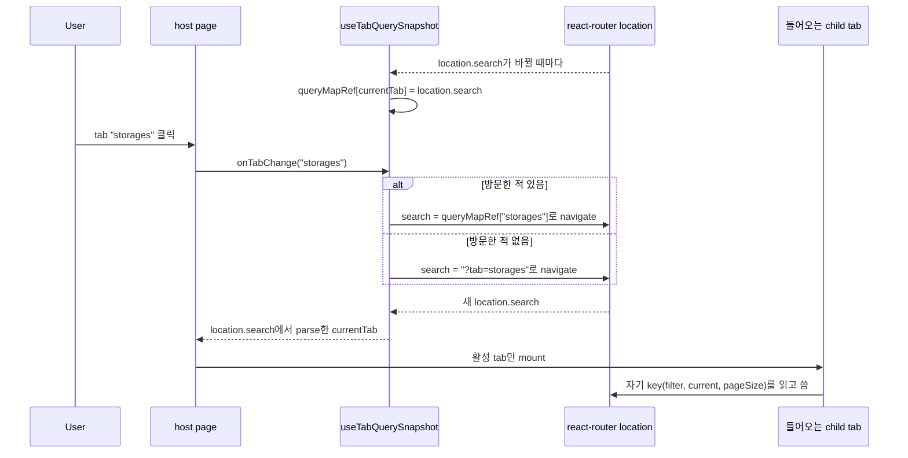
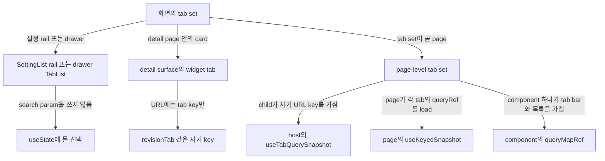

# 0021 — Per-tab URL state for multi-tab pages

## Summary

> 낯선 용어는 문서 맨 아래 [용어](#용어)에 모아 두었다.

- [page-level tab set](#용어)은 활성 tab을 search param `tab`에 둔다. nuqs `parseAsStringLiteral([...]).withDefault(...)`로 만든 module 수준의 `tabParser`가 이 값을 검증한다.
- URL에는 활성 tab의 filter, order, pagination만 있다. tab 전환은 떠나는 tab의 상태를 저장하고 들어오는 tab의 저장된 query string을 되살린다. 아직 방문하지 않은 tab은 기본 query로 시작하고, `useTabQuerySnapshot`에서 기본 query는 `?tab=<key>` 하나다. 전환은 한 tab의 key를 다음 tab에 남겨 두지 않는다.
- page는 tab body의 상태를 누가 갖는지에 따라 세 모양 중 하나를 고른다. Decision 3절부터 5절이 세 모양을 정의한다.
  - 자기 상태를 스스로 가진 child tab을 둔 host는 `useTabQuerySnapshot`을 부른다.
  - tab의 query를 직접 가진 page는 `useKeyedSnapshot`을 쓴다.
  - 자기 tab bar로 자기 목록을 바꾸는 component는 `queryMapRef`를 둔다.
- `RBACManagementPage`는 세 모양 어디에도 맞지 않고, 2절에 예외로 적었다.
- router로 tab을 바꾸는 host는 nuqs `useQueryState`가 아니라 `useWebUILocation().search`에서 tab을 읽는다.
- detail surface의 [widget tab](#용어)은 widget 이름을 딴 key 아래에 tab key만 URL에 둔다.
- `SettingList`가 그리는 설정 rail과 drawer 안의 tab은 선택을 React state에 두고 search param을 쓰지 않는다.

## Context

- **Two bugs before the rule**: 각 multi-tab page는 자기 tab handler를 따로 가졌다. `?tab=<key>`로 navigate하는 handler는 다른 tab의 `filter`, `order`, `current`, `pageSize`를 지웠다. 새 `tab`을 query string에 합치는 handler는 한 tab의 key를 형제 tab으로 넘겼다. 형제 tab들이 같은 일반 key를 읽기 때문이다.
- **nuqs and Suspense**: nuqs는 자기가 만들지 않은 URL 변경(router `navigate`, `Link`, 뒤로 가기나 앞으로 가기)을 React transition 안에서 적용한다. 들어오는 tab의 내용이 page의 공유 `Suspense` boundary 아래에서 suspend하면 이 transition이 commit되지 않은 채 남을 수 있다. 그러면 URL은 바뀌고 tab bar는 바뀌지 않는다.
- **Page-owned queries**: 어떤 page는 tab click handler에서 각 tab의 Relay query를 시작한다(render-as-you-fetch). 이런 page의 child tab은 `queryRef`를 받고 URL 상태를 갖지 않으므로, page가 모든 tab의 snapshot을 직접 들고 있어야 한다.

## 설계도

### `useTabQuerySnapshot`을 거치는 tab 전환

### page가 쓰는 모양

## Decision

### 1. 활성 tab은 search param `tab`이다

- **Parser**: 각 multi-tab page는 module 수준에 `const tabParser = parseAsStringLiteral([...]).withDefault('<default tab>')`을 선언한다. 알 수 없거나 없는 `tab` 값은 기본값이 된다.
- **Single-tab pages**: tab이 하나인 page(`SchedulerPage`, `BrandingPage`, `ConfigurationsPage`, `DiagnosticsPage`, `MyEnvironmentPage`, `AgentSummaryPage`)는 nuqs `useQueryState`와 inline parser로 `tab`을 읽고 snapshot을 두지 않는다. 이 page들의 tab은 바뀌지 않기 때문이다. `MyEnvironmentPage`와 `AgentSummaryPage`는 자기 key 하나만 받는 `onTabChange`에서 setter도 부른다.

### 2. tab별 상태는 바꿔 끼우고, 대체하거나 합치지 않는다

- **Invariant**: page-level tab set에서 URL은 활성 tab의 key만 갖고 다른 tab의 key는 갖지 않는다. tab 전환은 들어오는 tab의 저장된 상태를 쓰고, 한 번도 방문하지 않은 tab이면 그 tab의 기본값을 쓴다.
- **One mounted tab**: host는 활성 tab body만 그린다(`currentTab === '<key>' && …`). 그래서 형제 tab들은 `filter`, `order`, `current`, `pageSize` 같은 일반 key를 같이 써도 된다.
- **No shared declarations**: 동시에 mount된 별도 선언으로 두 형제 tab이 같은 URL key를 읽거나 쓰는 일은 없다.
- **Exception**: `RBACManagementPage`는 tab 전환 때 `tab` 외의 모든 key를 `history: 'push'`로 `null`로 만들고 snapshot을 두지 않는다. 사용자가 돌아온 tab은 기본값으로 열린다. 이 page는 위 invariant를 지키지 않는다.

### 3. 자기 상태를 가진 tab을 둔 host는 `useTabQuerySnapshot`을 부른다

- **Signature**: `react/src/hooks/index.tsx`의 `useTabQuerySnapshot(tabParser)`는 `{ currentTab, onTabChange }`를 돌려준다. host는 `currentTab`을 `BAICard`의 `activeTabKey`에, `onTabChange`를 `BAICard`의 `onTabChange`에 넘긴다.
- **What the hook stores**: hook은 방문한 각 tab의 `location.search` 원문을 `queryMapRef`에 둔다. `onTabChange(key)`는 `search`만 넘겨 `useWebUINavigate()`를 부르고, `search`는 저장된 문자열이나 `?tab=<key>`다. 그래서 pathname은 그대로다. 이 navigation은 history entry를 하나 쌓는다.
- **Children**: 각 child tab은 자기 URL key를 선언하고, host는 child를 바꾸지 않는다. host는 child의 key를 자기 state로 끌어올리지 않고 prop으로 내려 주지도 않는다.
- **Callers**:

| Page               | Tabs                                         |
| ------------------ | -------------------------------------------- |
| `AdminSessionPage` | `compute-sessions`, `pending-sessions`       |
| `EnvironmentPage`  | `image`, `preset`, `registry`                |
| `ResourcesPage`    | `agents`, `storages`, `resourceGroup`        |
| `StatisticsPage`   | `allocation-history`, `user-session-history` |

### 4. tab의 query를 가진 page는 `useKeyedSnapshot`을 쓴다

- **State owner**: page는 `tab`을 포함한 nuqs `useQueryStates` group 하나와 `useBAIPaginationOptionStateOnSearchParam`을 선언한다. page가 목록을 load하는 child tab은 `queryRef`와 `onReload(variables, options)` callback을 받고 URL key를 선언하지 않는다. `MaintenancePage`의 `maintenance` tab처럼 page가 load하는 목록이 없는 tab은 둘 다 받지 않는다.
- **Snapshot**: `useKeyedSnapshot<TabKey, TabSnapshot>(queryParams.tab, currentSnapshot)`은 `[currentTab, setCurrentTab, peekTabSnapshot]`을 돌려준다. 각 page는 `tab`이 빠진 `{ queryParams, tablePaginationOption }` 모양으로 자기 `TabSnapshot` type을 정의한다.
- **Tab click**: handler는 `peekTabSnapshot(tab) ?? <defaults>`를 읽고, `setCurrentTab(tab)`을 부르고, `useQueryLoader`의 load 함수로 tab의 query를 시작하고, snapshot을 `history: 'push'`로 URL에 쓴다.
- **Reload inside a tab**: child의 `onReload`는 query를 load하고 variables를 `history: 'replace'`로 URL에 다시 반영한다.
- **Mount and back/forward**: 빈 deps effect에서 부르는 `useEffectEvent`가 mount 때 URL이 가리키는 tab을 load한다. `useBrowserPopstateEffect`는 뒤로 가기나 앞으로 가기 뒤, nuqs state가 주소창과 맞춰지면 그 tab을 다시 load한다.
- **Callers**: `AdminUsersPage`, `ResourcePolicyPage`, `MaintenancePage`.

### 5. 자기 목록을 바꾸는 component는 `queryMapRef`를 둔다

- **Scope**: session `type` tab이나 folder `statusCategory` tab처럼 자기가 그리는 목록을 tab bar로 거르는 component는 그 key의 값을 key로 하는 `queryMapRef`를 둔다. 각 항목은 `{ queryParams, tablePaginationOption }`이다.
- **Switch order**: tab handler는 먼저 nuqs setter(`setQueryParams`나 `setQuery`)에 `null`을 넘긴다. 그다음 새 `type`이나 `statusCategory` 값과 함께 저장된 `queryParams`나 기본 `queryParams`를 쓴다. 마지막으로 `tablePaginationOption`을 되살린다. 처음의 reset이 떠나는 tab의 key가 URL에 남지 않게 한다.
- **Page-level keys**: `AdminComputeSessionListPage`의 `view`처럼 tab이 아니라 page에 속한 key는 snapshot에 넣지 않고 전환마다 다시 쓴다.
- **Files**: `AdminComputeSessionListPage`, `ComputeSessionListPage`, `VFolderNodeListPage`, `AdminVFolderNodeListPage`.
- **Page-level tab set with this order**: `AdminDeploymentPage`는 `queryMapRef`의 key를 `tab`으로 하고, 같은 순서로 `history: 'replace'`를 써서 전환한다. 이 page는 click handler에서 들어오는 tab의 query도 시작한다. 이 page는 mount와 tab click 때만 load하므로, 뒤로 가기나 앞으로 가기는 목록을 다시 load하지 않는다.

### 6. router가 바꾸는 tab은 router location에서 읽는다

- **Rule**: `navigate`로 tab이 바뀌는 host는 `useTabQuerySnapshot`처럼 `useWebUILocation().search`에서 `currentTab`을 얻는다. nuqs로 읽으면 nuqs가 변경을 transition 안에서 적용한다(Context 참고).
- **nuqs-driven hosts**: 4절과 5절의 host는 click handler에서 자기 nuqs setter로 `tab`을 쓰고 nuqs에서 다시 읽는다. 이 절이 피하는 멈춤은 nuqs 밖에서 만든 URL 변경(`navigate`)에서 생기고, 이 host들은 tab 전환에 `navigate`를 쓰지 않는다.

### 7. 화면에 있는 page의 다른 tab으로 가는 link는 document를 다시 load한다

- **Cause**: 현재 pathname으로 query만 바꿔 router navigation을 하면 page는 mount된 채 남고 `popstate`가 발생하지 않는다. 그래서 4절 page는 query를 시작하지 않는다.
- **Rule**: 화면에 있는 page의 다른 tab이나 filter를 향하는 앱 안의 caller는 `navigate` 대신 `location.assign(href)`를 부른다. `GlobalSearchPalette`와 walkthrough client(`react/vite-plugins/review-overlay/client/guided.ts`)가 이렇게 한다.
- **Electron exception**: `GlobalSearchPalette`는 `globalThis.isElectron`이 false일 때만 `location.assign`을 부른다. Electron에서는 `file://` 창이 깊은 경로를 load할 수 없으므로 routing을 그대로 쓴다.

### 8. widget tab은 tab key만 URL에 둔다

- **Tab key**: detail page 안의 tab 달린 card는 `tab`이 아니라 card 이름을 딴 key 아래에 `history: 'replace'`로 tab을 저장한다. `DeploymentRevisionCard`는 `revisionTab`을 쓴다.
- **Table state**: 새 widget tab은 filter, order, pagination을 React state에 두고, pagination에는 `useBAIPaginationOptionState`를 쓴다. `DeploymentAuditLogTab`과 `DeploymentAutoScalingCard`가 이렇게 한다.
- **Existing URL keys**: `DeploymentRevisionHistoryTab`(`rv*` key)과 `DeploymentReplicasCard`(`r*` key)는 아직 table 상태를 deployment detail URL에 쓴다. 두 component의 prefix가 서로를 갈라 놓으며, 2절이 이것을 요구한다.

### 9. 설정 rail과 drawer tab은 search param을 쓰지 않는다

- **Settings rail**: `SettingList`는 왼쪽 rail을 `Layout` 조합(ADR 0020 6절)으로 그리고 선택을 `useState`(`activeTabKey`)에 둔다. rail은 page 내부 state이고 page의 `?tab=`과 따로 있다. `ConfigurationsSettingList`, `MaintenanceSettingList`, `BrandingSettingList`, `UserSettingsGeneralPane`이 `SettingList`를 그린다.
- **Drawer tabs**: drawer의 `TabList`는 `RoleDetailDrawerContentV2`처럼 tab을 `useState`에 둔다. drawer는 widget surface이고, drawer의 tab은 reload 뒤에 남을 필요가 없다.

## 대안과 기각 사유

- **Replace the query string on switch**: `onTabChange`가 `?tab=<key>`로 navigate한다. 코드가 한 줄이라는 것이 장점이다. 기각한 이유는 다른 모든 tab의 filter, order, pagination을 지우기 때문이다.
- **Merge the new tab into the query string**: handler가 `tab`만 바꾸고 다른 key는 둔다. 아무것도 지워지지 않는다는 것이 장점이다. 기각한 이유는 형제 tab들이 같은 일반 key를 읽어서, 한 tab의 `current`나 `filter`가 다음 tab에 나타나기 때문이다.
- **Hoist child keys into the host**: host가 모든 child의 URL key를 선언하고 prop으로 내려 준다. component 하나가 모든 상태를 본다는 것이 장점이다. 기각한 이유는 각 child가 이미 자기 key를 갖고 있고, `useTabQuerySnapshot`의 query string 원문 snapshot은 그 key를 알 필요가 없기 때문이다.
- **Per-tab prefixed keys on a page-level tab set**: 각 tab이 자기 prefix를 붙인 key를 쓰고, 방문한 모든 tab이 한꺼번에 URL에 남는다. snapshot이 필요 없다는 것이 장점이다. 기각한 이유는 그러면 사용자가 보고 있지 않은 tab의 상태까지 URL에 실리기 때문이다. 공유 key 집합 하나를 쓰면 비활성 tab이 자기 `filter`나 `order`를 다른 tab에 흘릴 수 없다(`AdminDeploymentPage`의 `useQueryStates` 위 주석이 이것을 기록한다).
- **Read the tab with nuqs in a router-driven host**: host가 `useQueryState('tab', tabParser)`를 쓴다. parsing 어휘가 하나라는 것이 장점이다. 기각한 이유는 들어오는 tab이 suspend하면 tab bar가 전환을 멈출 수 있기 때문이다(6절).

## Consequences

- **Reload and deep links**: reload나 공유된 link는 활성 tab을 filter, order, page와 함께 그대로 재현한다.
- **Tab history**: 3절이나 4절 page의 tab 전환은 브라우저 history entry를 하나 더한다. 그래서 뒤로 가기는 이전 tab으로 상태와 함께 돌아간다. `AdminDeploymentPage`를 포함한 5절 component는 `history: 'replace'`로 쓰므로, 뒤로 가기는 page를 떠난다.
- **Snapshot lifetime**: snapshot은 page가 살아 있는 동안 메모리에 있다. reload 전에 방문한 tab은 마지막 상태가 아니라 기본값으로 돌아온다.
- **Same-path links**: page 안에서 같은 page의 다른 tab으로 가는 link는 document 전체 load를 치른다(7절).
- **Shape changes**: page를 3절에서 4절 모양으로 옮기면 child가 바뀐다. child는 URL key를 잃고 대신 `queryRef`와 `onReload`를 받는다.

## 출처

- GitHub: #8173 (FR-3267), PR #8251 (`useTabQuerySnapshot`과 page migration), 2026-07-22 결정.
- GitHub: #8418 (FR-3387), PR #8588 (`AdminUsersPage`의 `useKeyedSnapshot`과 `useBrowserPopstateEffect`), 2026-08-19; #9197 (FR-3735), PR #9198 (`ResourcePolicyPage`), 2026-08-31; FR-4136, PR #10101 (`MaintenancePage` tab).
- GitHub: #10265, PR #10336 (같은 경로 link가 document를 다시 load한다), 2026-10-20.
- GitHub: #10802 (이 ADR로 옮김, 2026-11-03). 이전 위치는 `.specs/FR-3267-tab-url-state/migration-targets.md`와 `.specs/FR-3482-astryx-migration/CONVERSION-IDIOMS.md` 1절의 규칙 5다(#10802에서 삭제, git history 참고).
- 코드: `react/src/hooks/index.tsx` (`useTabQuerySnapshot`, `useKeyedSnapshot`, `useBrowserPopstateEffect`, `useWebUILocation`), `react/src/hooks/useKeyedSnapshot.test.tsx`, `react/src/hooks/useBrowserPopstateEffect.test.tsx`.
- 관련: [ADR 0004](0004-walkthrough-stops-in-the-v3-anchor.ko.md) (walkthrough stop)와 [ADR 0008](0008-host-agnostic-review-overlay-client.ko.md) (review-overlay client). 이 client가 같은 경로의 stop을 다시 load한다. [ADR 0018](0018-adrs-as-the-only-design-record.ko.md) (ADR이 유일한 설계 기록이다).

## 용어

| 용어                | 뜻                                                                                                                                                                      |
| ------------------- | ----------------------------------------------------------------------------------------------------------------------------------------------------------------------- |
| page-level tab set  | page-level tab set은 tab이 page의 주 내용인 tab bar다. `AdminUsersPage`의 Users tab과 Credentials tab이 그 예이고, 보통 `BAICard`의 `tabList`로 그린다.                 |
| widget tab          | widget tab은 detail page의 card나 drawer 하나 안에 있는 tab bar다. `DeploymentRevisionCard`의 revision tab이 그 예다. 그것을 둘러싼 page는 자기 URL 상태를 따로 갖는다. |
| render-as-you-fetch | render-as-you-fetch는 component가 render한 뒤 effect가 query를 시작하는 대신, event handler가 re-render 전에 `useQueryLoader`로 query를 시작하는 Relay 패턴이다.        |
