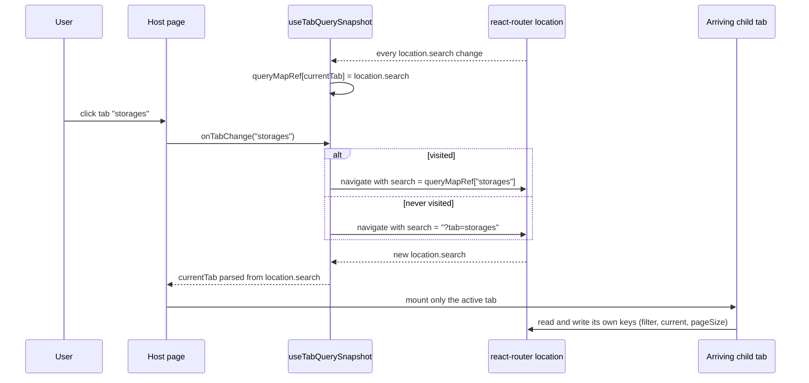
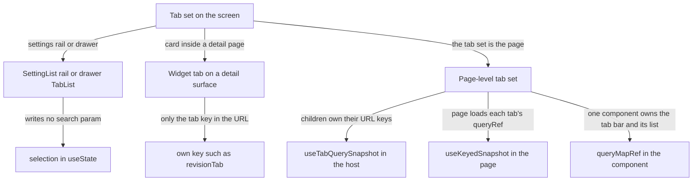

# 0021 — Per-tab URL state for multi-tab pages

## Summary

> Unfamiliar terms are collected in the [Glossary](#glossary) at the end.

- A [page-level tab set](#glossary) keeps its active tab in the search param `tab`. A module-level `tabParser`, built with nuqs `parseAsStringLiteral([...]).withDefault(...)`, validates the value.
- Only the active tab's filter, order, and pagination are in the URL. A tab switch saves the departing tab's state and restores the arriving tab's state. It never replaces the whole query string with `?tab=<key>`, and it never leaves one tab's keys in place for the next tab.
- A page picks one of three shapes, by who owns the tab bodies' state. Decision sections 3 to 5 define them.
  - A host with self-contained child tabs calls `useTabQuerySnapshot`.
  - A page that owns its tabs' queries uses `useKeyedSnapshot`.
  - A component whose own tab bar switches its own list keeps a `queryMapRef`.
- `RBACManagementPage` follows none of the three shapes and is named as an exception in section 2.
- A host that switches tabs through the router reads the tab from `useWebUILocation().search`, never from nuqs `useQueryState`.
- A [widget tab](#glossary) on a detail surface keeps only its tab key in the URL, under a key named for the widget.
- A settings rail rendered by `SettingList` and the tabs inside a drawer keep their selection in React state and write no search param.

## Context

- **Two bugs before the rule**: Each multi-tab page had its own tab handler. Handlers that navigated to `?tab=<key>` erased the other tabs' `filter`, `order`, `current`, and `pageSize`. Handlers that merged the new `tab` into the query string carried one tab's keys into its sibling, because sibling tabs read the same generic keys.
- **nuqs and Suspense**: nuqs applies URL changes it did not make itself (a router `navigate`, a `Link`, a back or forward) inside a React transition. When the arriving tab's content suspends under the page's shared `Suspense` boundary, that transition can stay uncommitted: the URL changes and the tab bar does not.
- **Page-owned queries**: Some pages start each tab's Relay query in the tab click handler (render-as-you-fetch). Their child tabs receive a `queryRef` and own no URL state, so the page itself must hold every tab's snapshot.

## Diagram

### Tab switch through `useTabQuerySnapshot`

### Which shape a page uses

## Decision

### 1. The active tab is the search param `tab`

- **Parser**: Each multi-tab page declares `const tabParser = parseAsStringLiteral([...]).withDefault('<default tab>')` at module level. An unknown or missing `tab` value resolves to the default.
- **Single-tab pages**: A page with one tab (`SchedulerPage`, `BrandingPage`, `ConfigurationsPage`, `DiagnosticsPage`, `MyEnvironmentPage`, `AgentSummaryPage`) reads `tab` with nuqs `useQueryState` and an inline parser, and keeps no snapshot, because its tab never changes. `MyEnvironmentPage` and `AgentSummaryPage` also call the setter from an `onTabChange` that accepts only their one key.

### 2. Per-tab state is swapped, never replaced or merged

- **Invariant**: On a page-level tab set, the URL holds the active tab's keys and no other tab's. A tab switch writes the arriving tab's stored state, or the arriving tab's defaults when it was never visited.
- **One mounted tab**: The host renders only the active tab body (`currentTab === '<key>' && …`). Sibling tabs may therefore use the same generic keys, such as `filter`, `order`, `current`, and `pageSize`.
- **No shared declarations**: Two sibling tabs never read or write the same URL key through separate declarations that are mounted at the same time.
- **Exception**: `RBACManagementPage` sets every key other than `tab` to `null` on a tab switch, with `history: 'push'`, and keeps no snapshot. A tab the user returns to opens with its defaults. It does not meet the invariant above.

### 3. A host with self-contained tabs calls `useTabQuerySnapshot`

- **Signature**: `useTabQuerySnapshot(tabParser)` in `react/src/hooks/index.tsx` returns `{ currentTab, onTabChange }`. The host passes `currentTab` to `BAICard`'s `activeTabKey` and `onTabChange` to its `onTabChange`.
- **What the hook stores**: The hook keeps the raw `location.search` of each visited tab in a `queryMapRef`. `onTabChange(key)` calls `useWebUINavigate()` with only `search`, set to the stored string or to `?tab=<key>`, so the pathname stays. The navigation pushes a history entry.
- **Children**: Each child tab declares its own URL keys and is not changed by the host. The host does not hoist a child's keys into its own state and does not pass them down as props.
- **Callers**:

| Page               | Tabs                                         |
| ------------------ | -------------------------------------------- |
| `AdminSessionPage` | `compute-sessions`, `pending-sessions`       |
| `EnvironmentPage`  | `image`, `preset`, `registry`                |
| `ResourcesPage`    | `agents`, `storages`, `resourceGroup`        |
| `StatisticsPage`   | `allocation-history`, `user-session-history` |

### 4. A page that owns its tabs' queries uses `useKeyedSnapshot`

- **State owner**: The page declares one nuqs `useQueryStates` group that includes `tab`, plus `useBAIPaginationOptionStateOnSearchParam`. A child tab whose list the page loads receives a `queryRef` and an `onReload(variables, options)` callback and declares no URL keys. A tab without a page-loaded list, such as the `maintenance` tab of `MaintenancePage`, receives neither.
- **Snapshot**: `useKeyedSnapshot<TabKey, TabSnapshot>(queryParams.tab, currentSnapshot)` returns `[currentTab, setCurrentTab, peekTabSnapshot]`. Each page defines its own `TabSnapshot` type, shaped `{ queryParams, tablePaginationOption }` without `tab`.
- **Tab click**: The handler reads `peekTabSnapshot(tab) ?? <defaults>`, calls `setCurrentTab(tab)`, starts the tab's query with `useQueryLoader`'s load function, and writes the snapshot to the URL with `history: 'push'`.
- **Reload inside a tab**: The child's `onReload` loads the query and mirrors the variables back to the URL with `history: 'replace'`.
- **Mount and back/forward**: A `useEffectEvent` called from an empty-deps effect loads the tab the URL describes on mount. `useBrowserPopstateEffect` loads it again after a back or forward, once nuqs state matches the address bar.
- **Callers**: `AdminUsersPage`, `ResourcePolicyPage`, and `MaintenancePage`.

### 5. A component that switches its own list keeps a `queryMapRef`

- **Scope**: A component whose tab bar filters the list it also renders, such as the session `type` tabs or the folder `statusCategory` tabs, keeps a `queryMapRef` keyed by the value of that key. Each entry is `{ queryParams, tablePaginationOption }`.
- **Switch order**: The tab handler first passes `null` to its nuqs setter (`setQueryParams` or `setQuery`), then writes the stored or default `queryParams` with the new `type` or `statusCategory` value, then restores `tablePaginationOption`. The reset keeps keys of the departing tab from staying in the URL.
- **Page-level keys**: A key that belongs to the page and not to a tab, such as `view` in `AdminComputeSessionListPage`, stays out of the snapshot and is written back on every switch.
- **Files**: `AdminComputeSessionListPage`, `ComputeSessionListPage`, `VFolderNodeListPage`, `AdminVFolderNodeListPage`.
- **Page-level tab set with this order**: `AdminDeploymentPage` keys its `queryMapRef` by `tab` and switches in the same order, with `history: 'replace'`. It also starts the arriving tab's query in the click handler. It loads only on mount and on a tab click, so a back or forward does not reload its list.

### 6. A router-driven tab is read from the router location

- **Rule**: A host whose tab changes through `navigate` derives `currentTab` from `useWebUILocation().search`, as `useTabQuerySnapshot` does. A nuqs read would apply the change in a transition (see Context).
- **nuqs-driven hosts**: The hosts in sections 4 and 5 write `tab` through their own nuqs setter in the click handler and read it back from nuqs. The hang this section avoids comes from a URL change made outside nuqs (`navigate`), which those hosts do not use to switch tabs.

### 7. A link to another tab of the page on screen reloads the document

- **Cause**: A router navigation to the current pathname with another query keeps the page mounted and fires no `popstate`, so a section 4 page starts no query.
- **Rule**: An in-app caller that targets another tab or filter of the page on screen calls `location.assign(href)` instead of `navigate`. `GlobalSearchPalette` and the walkthrough client (`react/vite-plugins/review-overlay/client/guided.ts`) do this.
- **Electron exception**: `GlobalSearchPalette` calls `location.assign` only when `globalThis.isElectron` is false. In Electron it keeps routing, because a `file://` window cannot load a deep path.

### 8. A widget tab keeps only its tab key in the URL

- **Tab key**: A tabbed card inside a detail page stores its tab under a key named for the card, not `tab`, with `history: 'replace'`. `DeploymentRevisionCard` uses `revisionTab`.
- **Table state**: A new widget tab keeps its filter, order, and pagination in React state, with `useBAIPaginationOptionState` for pagination, as `DeploymentAuditLogTab` and `DeploymentAutoScalingCard` do.
- **Existing URL keys**: `DeploymentRevisionHistoryTab` (`rv*` keys) and `DeploymentReplicasCard` (`r*` keys) still write table state to the deployment detail URL. Their prefixes keep them apart from each other, which section 2 requires.

### 9. Settings rails and drawer tabs write no search param

- **Settings rail**: `SettingList` renders its left rail as the `settings-sidebar` template composition and holds the selection in `useState` (`activeTabKey`). The rail is page-internal state, separate from the page's `?tab=`. `ConfigurationsSettingList`, `MaintenanceSettingList`, `BrandingSettingList`, and `UserSettingsGeneralPane` render it.
- **Drawer tabs**: A drawer's `TabList` holds its tab in `useState`, as `RoleDetailDrawerContentV2` does. A drawer is a widget surface and its tab does not need to survive a reload.

## Rejected alternatives

- **Replace the query string on switch**: `onTabChange` navigates to `?tab=<key>`. Its advantage is one line of code. It is rejected because it erases every other tab's filter, order, and pagination.
- **Merge the new tab into the query string**: The handler sets only `tab` and keeps the other keys. Its advantage is that nothing is erased. It is rejected because sibling tabs read the same generic keys, so one tab's `current` or `filter` appears in the next tab.
- **Hoist child keys into the host**: The host declares every child's URL keys and passes them down as props. Its advantage is that one component sees all state. It is rejected because each child already owns its keys, and the raw query-string snapshot of `useTabQuerySnapshot` needs no knowledge of them.
- **Per-tab prefixed keys on a page-level tab set**: Each tab writes its own prefixed keys, and all visited tabs stay in the URL at once. Its advantage is that no snapshot is needed. It is rejected because the URL then carries state of tabs the user is not looking at, while one shared key set means an inactive tab cannot leak its `filter` or `order` into another (the comment above `useQueryStates` in `AdminDeploymentPage` records this).
- **Read the tab with nuqs in a router-driven host**: The host uses `useQueryState('tab', tabParser)`. Its advantage is one parsing vocabulary. It is rejected because the tab bar can stop switching when the arriving tab suspends (section 6).

## Consequences

- **Reload and deep links**: A reload or a shared link reproduces the active tab with its filter, order, and page.
- **Tab history**: A tab switch on a section 3 or section 4 page adds a browser history entry, so back returns to the previous tab with its state. The section 5 components, `AdminDeploymentPage` included, write with `history: 'replace'`, so back leaves the page instead.
- **Snapshot lifetime**: The snapshots live in memory for the page's lifetime. A tab visited before a reload comes back with its defaults, not its last state.
- **Same-path links**: A link from inside a page to another tab of the same page costs a full document load (section 7).
- **Shape changes**: Moving a page from section 3 to section 4 changes its children: they lose their URL keys and take a `queryRef` and `onReload` instead.

## Sources

- GitHub: #8173 (FR-3267), PR #8251 (`useTabQuerySnapshot` and the page migrations), decided 2026-07-22.
- GitHub: #8418 (FR-3387), PR #8588 (`useKeyedSnapshot` and `useBrowserPopstateEffect` on `AdminUsersPage`), 2026-08-19; #9197 (FR-3735), PR #9198 (`ResourcePolicyPage`), 2026-08-31; FR-4136, PR #10101 (`MaintenancePage` tabs).
- GitHub: #10265, PR #10336 (same-path links reload the document), 2026-10-20.
- GitHub: #10802 (absorbed into this ADR, 2026-11-03). Formerly `.specs/FR-3267-tab-url-state/migration-targets.md` and rule 5 of section 1 in `.specs/FR-3482-astryx-migration/CONVERSION-IDIOMS.md` (removed in #10802; see git history).
- Code: `react/src/hooks/index.tsx` (`useTabQuerySnapshot`, `useKeyedSnapshot`, `useBrowserPopstateEffect`, `useWebUILocation`), `react/src/hooks/useKeyedSnapshot.test.tsx`, `react/src/hooks/useBrowserPopstateEffect.test.tsx`.
- Related: [ADR 0004](0004-walkthrough-stops-in-the-v3-anchor.md) (walkthrough stops) and [ADR 0008](0008-host-agnostic-review-overlay-client.md) (the review-overlay client), whose client reloads a same-path stop; [ADR 0018](0018-adrs-as-the-only-design-record.md) (ADRs as the only design record).

## Glossary

| Term                | Meaning                                                                                                                                                                                   |
| ------------------- | ----------------------------------------------------------------------------------------------------------------------------------------------------------------------------------------- |
| page-level tab set  | A page-level tab set is a tab bar whose tabs are the page's main content, such as the Users and Credentials tabs of `AdminUsersPage`, usually rendered through `BAICard`'s `tabList`.     |
| widget tab          | A widget tab is a tab bar inside one card or drawer of a detail page, such as the revision tabs of `DeploymentRevisionCard`. The page around it has its own URL state.                    |
| render-as-you-fetch | Render-as-you-fetch is the Relay pattern in which an event handler starts a query with `useQueryLoader` before the component re-renders, instead of an effect starting it after a render. |
