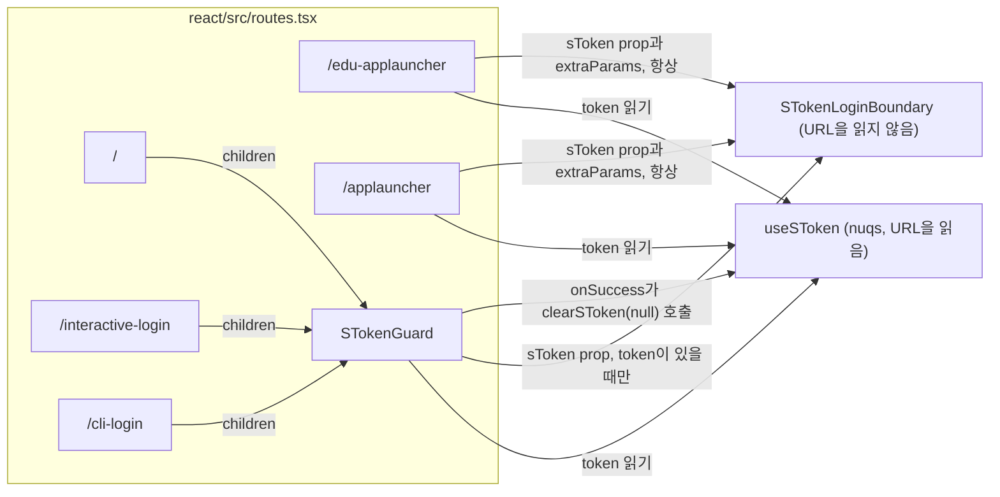
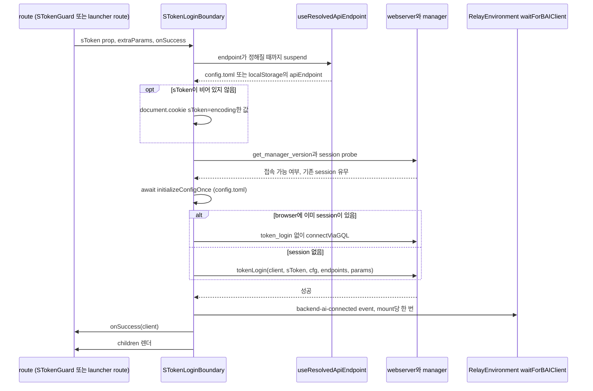

# 0022 — sToken login boundary for token URL entry points

## Summary

> 낯선 용어는 문서 맨 아래 [용어](#용어)에 모아 두었다.

- URL로 [sToken](#용어)을 받는 route는 모두 component 하나, `STokenLoginBoundary`(`react/src/components/STokenLoginBoundary.tsx`)를 거쳐 인증한다. page, route, helper 어느 것도 URL token으로 `client.token_login`을 직접 부르지 않는다.
- boundary는 login이 성공하고 `backend-ai-connected`를 dispatch한 뒤에만 `children`을 그린다. 그래서 children의 Relay query는 `globalThis.backendaiclient`가 생기기 전에 시작하지 않는다.
- boundary는 token을 `sToken` prop으로 받고 URL을 읽지도 쓰지도 않는다. caller는 `useSToken()`(`react/src/hooks/useSToken.ts`)으로 token을 읽는다. 이 hook은 nuqs를 쓰고, 소문자 `stoken` key를 deprecated alias로 받는다.
- 일반 login route는 login이 성공하면 URL에서 token을 지운다. EduApp launcher route 두 곳은 token을 남긴다. 이후 launch 단계가 token을 다시 보내기 때문이다.
- 실패는 닫힌 union `STokenLoginError`로 caller에게 전달된다. 기본 error card가 모든 kind를 처리하고, caller는 `errorFallback`으로 이 card를 바꿀 수 있다.

## Context

- **What the boundary is**: `STokenLoginBoundary`는 route의 tree를 감싸는 React component다. 이 component는 외부 platform이 URL에 넣은 token으로 browser를 login시키고, login이 끝날 때까지 tree를 그리지 않는다. 일반 login component는 아니다. ID와 password login은 `LoginView`에 남고, multi-tab 동기화, auto logout, config gating(`useLoginOrchestration`)도 그대로 남는다.
- **Two copies before it**: 이전에는 `LoginView`와 `EduAppLauncher`가 각자 token login을 가졌다. 두 구현은 cookie 값의 encoding 여부, `stoken` 허용 여부, URL에서 token을 지우는지 여부, `backend-ai-connected`를 dispatch하는 시점이 서로 달랐다.
- **Relay dependency**: `react/src/RelayEnvironment.ts`의 `waitForBAIClient()`는 `globalThis.backendaiclient`가 있으면 그것을 돌려주고, 없으면 `backend-ai-connected` event를 기다린다. event보다 먼저, client가 생기기 전에 mount된 tree의 Relay fetch는 계속 기다린다.
- **Security relevance**: token은 credential이다. 그래서 browser가 token을 어디에 저장하는지, token이 URL에 얼마나 오래 남는지, 어떤 code가 token을 읽을 수 있는지가 모든 진입점에서 중요하다.

## 설계도

### route를 감싸는 위치

### login 순서

## Decision

### 1. 모든 token URL 진입점에 boundary 하나

- **Wrapped routes**: 아래 route는 `STokenLoginBoundary`를 mount한다. URL token을 받는 새 route는 `tokenLogin`이나 `client.token_login`을 직접 부르지 않고 이 표에 더해진다.

| Route                | Wrapper                                   | Boundary mount 조건              | 성공 뒤 URL의 token |
| -------------------- | ----------------------------------------- | -------------------------------- | ------------------- |
| `/`                  | `STokenGuard`                             | `useSToken()`이 값을 돌려줄 때만 | 지움                |
| `/interactive-login` | `STokenGuard`                             | `useSToken()`이 값을 돌려줄 때만 | 지움                |
| `/cli-login`         | `STokenGuard`                             | `useSToken()`이 값을 돌려줄 때만 | 지움                |
| `/edu-applauncher`   | route의 `Component`, `extraParams`와 함께 | 항상                             | 남김                |
| `/applauncher`       | route의 `Component`, `extraParams`와 함께 | 항상                             | 남김                |

- **No-token behavior**: token이 없으면 `STokenGuard`는 children을 그대로 그린다. 그래서 `/`는 보통의 login form을 보여 준다. launcher route는 boundary를 항상 mount한다. 그래서 token 없는 launcher URL은 browser에 session이 이미 있지 않은 한 `missing-token` card를 보여 준다.
- **Children gate**: boundary는 `success` 단계에서만 `children`을 그린다. 작업하는 동안 boundary는 `fallback`(기본값은 connecting card)을 그리고, 실패하면 error card를 그린다.

### 2. boundary는 URL을 건드리지 않는다

- **Prop only**: `STokenLoginBoundaryProps.sToken`은 필수 `string`이다. boundary는 query string을 parse하지 않고 token을 지우지도 않는다. 두 일은 caller가 한다.
- **Banned APIs**: `STokenLoginBoundary.tsx`의 source는 `window.location`, `window.history`, `document.location`, `URLSearchParams`를 참조하면 안 된다. `STokenLoginBoundary.test.tsx`의 test `does not reference any URL-state APIs`는 그 파일 하나에서 주석을 지우고, 네 이름 중 하나라도 나오면 실패한다.
- **Scope of the check**: 이 test는 `STokenLoginBoundary.tsx`만 읽고 그 파일이 import하는 module은 읽지 않는다. 그래서 import된 helper에 URL 읽기를 더해도 CI를 통과한다. boundary가 import하는 `helper/loginSessionAuth.ts`는 지금 boundary가 부르지 않는 네 함수에서 `window.location`을 읽는다: `probeManager`(dev 전용 `?mockManager=` 스위치), `loadConfigFromWebServer`, `loginWithSAML`, `loginWithOpenID`.

### 3. `useSToken`이 URL key를 맡는다

- **Canonical key**: canonical key는 `?sToken=`이다. `useSToken()`은 `sToken ?? stoken`을 돌려주므로, 두 key가 함께 있으면 canonical key가 이긴다.
- **Deprecated alias**: 소문자 `?stoken=`도 여전히 받는다. `stoken`만 있으면 hook instance마다 `useBAILogger`로 deprecation 경고를 한 번 남긴다.
- **Setter**: tuple의 두 번째 원소는 canonical key를 쓰고 `stoken`은 항상 `null`로 둔다. 그래서 `clearSToken(null)`은 두 key를 모두 지우고 다른 query key는 그대로 둔다.
- **Reserved keys in `extraParams`**: `tokenLogin`은 `client.token_login`을 부르기 전에 `extraParams`에서 `sToken`과 `stoken`을 뺀다. 그래서 query key가 token 인자를 덮어쓸 수 없다. launcher route는 `routes.tsx`의 nuqs spec `eduAppExtraParamSpec`으로 `extraParams`를 모은다. 새 launcher URL key가 `token_login`에 닿으려면 그 spec에 더해져야 한다.

### 4. token이 URL을 떠나는 시점

- **Generic routes**: `STokenGuard`의 `onSuccess`는 `persistPostLoginState(client)`를 부르고, `client._config.endpoint`가 비어 있지 않은 string이면 `pluginApiEndpointState`를 설정한 뒤 `clearSToken(null)`을 부른다. token은 login이 성공한 뒤에만 지워진다. boundary가 대기 중이거나 error를 보여 주는 동안 token은 URL에 남고, Retry는 같은 token으로 다시 시도한다.
- **Launcher routes**: `/edu-applauncher`와 `/applauncher`는 `onSuccess`로 `persistPostLoginState`만 넘기고 token을 지우지 않는다. `EduAppLauncherPage`는 `sToken`을 prop으로 받아 이후 launch 단계에서 다시 보낸다. 그래서 이 route에서는 token이 browser history에 남는다.

### 5. cookie 형식

- **Cookie**: `sToken`이 비어 있지 않으면 boundary는 server에 접속하기 전에 `document.cookie`에 `sToken=<encodeURIComponent(sToken)>; path=/; Secure; SameSite=Lax`를 쓴다. 이 cookie에는 `Expires`도 `Max-Age`도 없으므로 session cookie다. script가 쓰는 cookie라서 `HttpOnly`도 아니다.
- **Purpose**: `token_login`은 token을 request body로 보낸다. cookie는 token을 cookie에서 읽는 manager 쪽 hook을 위해 있다.
- **No removal**: boundary는 성공한 뒤에도 실패한 뒤에도 cookie를 지우지 않는다.

### 6. endpoint 결정

- **Hook**: boundary는 `useResolvedApiEndpoint()`(`react/src/hooks/useResolvedApiEndpoint.ts`)로 API endpoint를 읽는다. 이 hook은 suspend한 뒤 `config.toml`의 `general.apiEndpoint`를 돌려주고, config에 값이 없으면 `localStorage('backendaiwebui.api_endpoint')`를 돌려준다.
- **No prop**: `STokenLoginBoundaryProps`에는 `apiEndpoint` prop이 없다. boundary는 `tokenLogin`과 `connectViaGQL`에 넘길 login config를 위해서만 `loginConfigState`를 읽고, endpoint는 거기서 읽지 않는다. token 진입점은 `LoginView`가 endpoint를 atom이나 `localStorage`에 쓰기 전에 실행되기 때문이다.
- **Own Suspense**: `STokenLoginBoundary`는 안쪽 component를 `<Suspense fallback={props.fallback ?? <DefaultFallback />}>`로 감싼다. 그래서 caller는 endpoint를 위해 바깥 Suspense를 둘 필요가 없다.
- **Config bootstrap**: boundary는 login하기 전에 `initializeConfigOnce(store, logger)`를 await한다. 그래야 `config.toml`의 webserver flag가 client에 닿는다. `initializeConfigOnce`가 throw하면 boundary는 경고를 남기고 `getDefaultLoginConfig()`로 login한다. boundary는 `loadConfigFromWebServer`를 부르지 않는다. API endpoint가 다른 origin에 있는 caller는 `onSuccess`에서 그 함수를 부른다.

### 7. login 순서와 기존 session 경로

- **Order**: boundary는 endpoint를 정하고, cookie를 쓰고, `createBackendAIClient('', '', apiEndpoint, 'SESSION')`로 client를 만든 뒤, `get_manager_version()`과 `helper/loginBootstrap.ts`의 `probeLoginSession(client)`를 함께 실행한다.
- **Probe failure**: `probeLoginSession`이 `LoginBootstrapIncompleteError`가 아닌 이유로 reject하면 boundary는 session이 없다고 보고 `token_login`으로 넘어간다.
- **Existing session**: `probeLoginSession`이 살아 있는 session을 찾으면 boundary는 `token_login`을 건너뛰고 그 session으로 `connectViaGQL`을 부른다. 이 경로는 `extraParams`, OTP, `force` 중 어느 것도 보내지 않는다. boundary는 token이 있든 없든 이 경로를 타고, session의 사용자와 token을 비교하지 않는다. 그래서 URL token은 browser가 이미 가진 session을 대신하지 않는다.
- **Missing token**: boundary는 session이 없고 `sToken`이 비어 있을 때만 `missing-token`을 보고한다.
- **Event once**: boundary는 성공한 시도 뒤에 client를 `detail`로 담아 `backend-ai-connected`를 mount당 최대 한 번 dispatch한다. ref 하나가 retry 사이에서 이 한 번을 지키고, 다른 ref 하나가 StrictMode의 effect 이중 실행을 막는다.

### 8. error union과 slot

- **Closed union**: `STokenLoginError`의 kind는 아래와 같다. 새 실패는 새 kind가 된다.
- **Card copy**: `kindToI18nKey`는 kind를 PascalCase 접미사로 바꾸고, 기본 card는 `sTokenLoginBoundary.Error<Suffix>Title`과 `sTokenLoginBoundary.Error<Suffix>Description`을 읽는다. `account-unavailable`만 예외다. 이 kind는 `LoginView`가 같은 실패에 보여 주는 문구인 `login.AccountInfoLoadFailed`와 `login.AccountInfoLoadFailedDesc`를 읽는다.
- **Card actions**: `totp-required`를 뺀 모든 card는 Copy error details도 제공한다. 표는 그 밖의 action을 적는다.

| `kind`                | boundary가 보고하는 경우                                                                                                                                                                                                                    | 기본 card action                                               |
| --------------------- | ------------------------------------------------------------------------------------------------------------------------------------------------------------------------------------------------------------------------------------------- | -------------------------------------------------------------- |
| `missing-token`       | 살아 있는 session이 없고 `sToken`이 비어 있음                                                                                                                                                                                               | Retry                                                          |
| `endpoint-unresolved` | `useResolvedApiEndpoint()`가 빈 string을 돌려줌                                                                                                                                                                                             | Retry                                                          |
| `server-unreachable`  | `get_manager_version()`이 throw함                                                                                                                                                                                                           | Retry                                                          |
| `token-invalid`       | `tokenLogin`이나 `connectViaGQL`이 throw했고 다른 kind에 해당하지 않음                                                                                                                                                                      | Retry                                                          |
| `totp-required`       | `failType`이 `require-totp-authentication` 또는 `require-totp-registration`, 이유에 잘못된 OTP가 적힌 `rejected-by-hook` 실패, 또는 그에 맞는 legacy 이유 문자열; 코드를 제출했거나 server가 코드를 거부했으면 `invalidOtp`는 언제나 true다 | inline OTP form; 코드는 다음 시도에 `otp`로 더해진다           |
| `concurrent-session`  | server가 `active-login-session-exists`를 보고함                                                                                                                                                                                             | Login confirm; 같은 mount의 이후 시도는 `force: true`를 보낸다 |
| `account-unavailable` | `probeLoginSession`이 찾은 session의 사용자를 manager가 돌려주지 않음                                                                                                                                                                       | Retry                                                          |
| `unknown`             | union에 선언되어 있음; 지금은 boundary의 어느 분기도 이 kind를 만들지 않음                                                                                                                                                                  | Retry                                                          |

- **Classification**: `classifyTokenLoginFailure`는 구조화된 `failType`을 먼저 읽고, type을 빼고 보내는 webserver에 대해서는 `failReason`의 부분 문자열로 판정한다.
- **Slots**: `onError(error)`는 error로 넘어갈 때마다 실행된다. `errorFallback(error, retry)`를 주면 모든 kind에서 기본 card를 대신한다. 그 `retry`는 전체 순서를 처음부터 다시 실행하고 OTP도 force 승인도 담지 않는다. `retryWithOtp`와 `retryWithForce`는 기본 card에만 닿기 때문이다. 그래서 `errorFallback`을 넘긴 caller는 `totp-required`나 `concurrent-session` login을 끝낼 수 없다.

## 대안과 기각 사유

- **A token login per route**: 진입점마다 자기 `token_login` 호출을 유지하는 안이다. route가 흐름을 자유롭게 조정할 수 있다는 장점이 있다. 이 구조가 바로 `LoginView`와 `EduAppLauncher`를 서로 어긋나게 만들었으므로 기각한다.
- **The boundary parses the URL itself**: boundary가 `window.location`에서 `sToken`을 읽고 정리하는 안이다. call site가 작아진다는 장점이 있다. 그러면 URL 처리가 boundary와 route의 nuqs state 두 곳에 놓이고, boundary의 test에 mock URL이 필요해지므로 기각한다. caller마다 정리 규칙도 다르고, 그 규칙은 caller만 안다.
- **Strip the token on every route**: boundary나 모든 caller가 성공 뒤 token을 지우는 안이다. 어느 route도 history에 credential을 남기지 않는다는 장점이 있다. EduApp launch 단계가 login 뒤 token을 다시 보내므로 launcher route에 대해서는 기각한다.

## Consequences

- **One place to change**: cookie 형식, alias 처리, error kind, connected event는 `STokenLoginBoundary.tsx`와 `useSToken.ts`에서만 바뀐다. 새 진입점은 자기 route를 감싸기만 하면 같은 동작을 얻는다.
- **Relay safety**: children은 `backend-ai-connected` 뒤에만 mount된다. 그래서 token route 아래의 page는 따로 기다리지 않고 Relay를 쓸 수 있다.
- **Credential exposure**: launcher route에서는 token이 browser history에 남고, 모든 route에서 `sToken` cookie가 browser session 동안 남는다(4절과 5절). 살아 있는 session을 가진 browser는 token URL을 따라가도 그 session의 사용자로 남는다(7절).
- **Unresolved endpoint in practice**: `useResolvedApiEndpoint()`는 빈 결과를 cache하지 않고 다음 render에서 다시 결정을 시작한다. 그래서 endpoint가 설정되지 않았으면 boundary는 `endpoint-unresolved`를 보여 주지 않고 fallback에 머문다. unit test는 hook을 mock해서 이 kind에 닿는다.
- **Other URL readers**: `useLoginOrchestration`은 `localStorage`, `sessionStorage`, `URLSearchParams(window.location.search).has('sToken')`에 `sToken`이 있는지 확인한다. 이 hook은 token이 있고, API endpoint가 비어 있고, app이 Electron이 아닐 때만 silent login을 미룬다. 이 hook은 `stoken` alias를 보지 않고, token으로 login하지도 않는다.

## 출처

- GitHub: #10802 (이 ADR로 흡수, 2026-11-03).
- Jira: FR-2616 (epic), FR-2618 (spec, PR #6828), FR-2628 (PR #6850), FR-2629 (PR #6851), FR-2630 (PR #6852), FR-2631 (PR #6853), FR-2632 (PR #6855), FR-2633 (PR #6856), FR-2626 (PR #6861), FR-2627 (PR #6864), FR-2639 (PR #6865), PR #6897 (TOTP와 concurrent-session 처리), FR-3128 (PR #7873, config bootstrap), FR-3763 (PR #9249, `/cli-login`).
- 결정일 2026-04-23.
- 설계 기록: 예전 `.specs/draft-stoken-login-boundary/` (#10802에서 삭제, git history 참고).
- Test: `react/src/components/STokenLoginBoundary.test.tsx`, `e2e/auth/stoken-login.spec.ts`, `e2e/app-launcher/edu-applauncher-stoken.spec.ts`.
- 관련: [ADR 0018](0018-adrs-as-the-only-design-record.ko.md) (유일한 설계 기록인 ADR), [ADR 0021](0021-per-tab-url-state-for-multi-tab-pages.ko.md) (nuqs를 통한 URL state).

## 용어

| 용어                   | 뜻                                                                                                                                                                  |
| ---------------------- | ------------------------------------------------------------------------------------------------------------------------------------------------------------------- |
| sToken                 | sToken은 외부 platform(LMS, 파트너 포털, SSO provider)이 WebUI URL에 넣는 login token이다. 사용자는 이 token 덕분에 이미 인증된 상태로 도착한다.                    |
| token URL entry point  | token URL entry point는 query string으로 sToken을 받아 그 token으로 browser를 login시키는 route다.                                                                  |
| `backend-ai-connected` | `backend-ai-connected`는 `document`에 dispatch되는 DOM event다. 이 event는 `waitForBAIClient()`와 plugin code에 `globalThis.backendaiclient`가 준비되었다고 알린다. |
