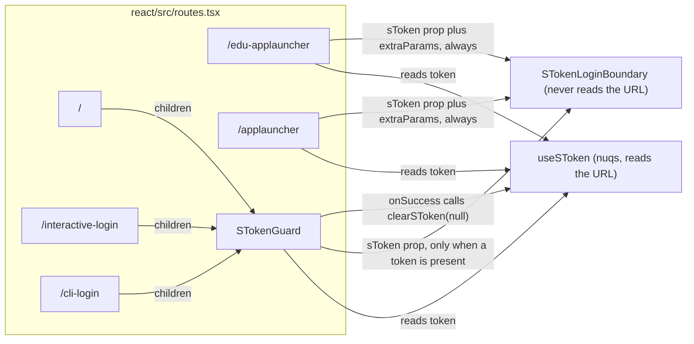
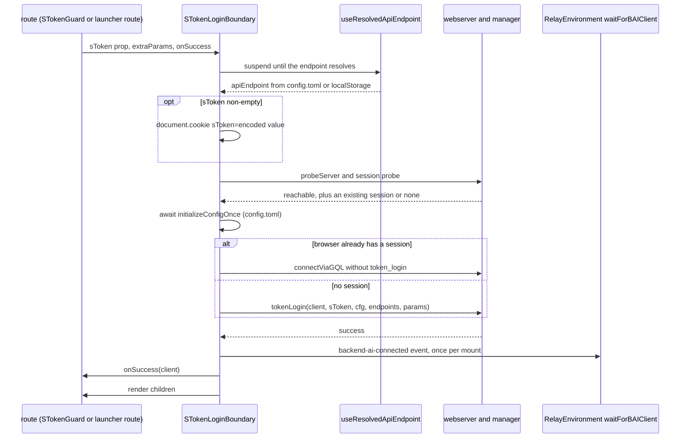

# 0022 — sToken login boundary for token URL entry points

## Summary

> Unfamiliar terms are collected in the [Glossary](#glossary) at the end.

- Every route that accepts an [sToken](#glossary) in its URL authenticates through one component, `STokenLoginBoundary` (`react/src/components/STokenLoginBoundary.tsx`). No page, route, or helper calls `client.token_login` for a URL token on its own.
- The boundary renders its `children` only after the login has succeeded and it has dispatched `backend-ai-connected`. Relay queries in the children therefore never start before `globalThis.backendaiclient` exists.
- The boundary takes the token as the `sToken` prop and never reads or writes the URL. Callers read the token with `useSToken()` (`react/src/hooks/useSToken.ts`), which uses nuqs and accepts the lowercase `stoken` key as a deprecated alias.
- The generic login routes strip the token from the URL after a successful login. The two EduApp launcher routes keep it, because a later launch step sends it again.
- Failures reach the caller as the closed union `STokenLoginError`. A default error card handles every kind, and the caller can replace it with `errorFallback`.

## Context

- **What the boundary is**: `STokenLoginBoundary` is a React component that wraps a route's tree, logs the browser in with a token an external platform put in the URL, and holds the tree back until the login is done. It is not a general login component: the ID and password login stays in `LoginView`, and so do multi-tab sync, auto logout, and config gating (`useLoginOrchestration`).
- **Two copies before it**: `LoginView` and `EduAppLauncher` each had their own token login. They differed in whether the cookie value was encoded, whether `stoken` was accepted, whether the token was removed from the URL, and when `backend-ai-connected` was dispatched.
- **Relay dependency**: `waitForBAIClient()` in `react/src/RelayEnvironment.ts` returns `globalThis.backendaiclient` when it exists and otherwise waits for the `backend-ai-connected` event. A tree that mounts before the event and before the client exists leaves its Relay fetches waiting.
- **Security relevance**: The token is a credential, so where the browser stores it, how long it stays in the URL, and which code may read it matter for every entry point.

## Diagram

### Route wrap sites

### Login sequence

## Decision

### 1. One boundary for every token URL entry point

- **Wrapped routes**: The routes below mount `STokenLoginBoundary`. A new route that accepts a URL token joins this table instead of calling `tokenLogin` or `client.token_login` itself.

| Route                | Wrapper                                     | Boundary mounted                        | Token in the URL after success |
| -------------------- | ------------------------------------------- | --------------------------------------- | ------------------------------ |
| `/`                  | `STokenGuard`                               | only when `useSToken()` returns a value | removed                        |
| `/interactive-login` | `STokenGuard`                               | only when `useSToken()` returns a value | removed                        |
| `/cli-login`         | `STokenGuard`                               | only when `useSToken()` returns a value | removed                        |
| `/edu-applauncher`   | the route's `Component`, with `extraParams` | always                                  | kept                           |
| `/applauncher`       | the route's `Component`, with `extraParams` | always                                  | kept                           |

- **No-token behavior**: `STokenGuard` renders its children unchanged when there is no token, so `/` shows the normal login form. The launcher routes always mount the boundary, so a launcher URL without a token shows the `missing-token` card unless the browser already has a session.
- **Children gate**: The boundary renders `children` only in its `success` phase. While it works it renders `fallback` (default: a connecting card), and on failure it renders the error card.

### 2. The boundary does not touch the URL

- **Prop only**: `STokenLoginBoundaryProps.sToken` is a required `string`. The boundary does not parse the query string, and it does not remove the token; the caller does both.
- **Banned APIs**: The source of `STokenLoginBoundary.tsx` must not reference `window.location`, `window.history`, `document.location`, or `URLSearchParams`. The test `does not reference any URL-state APIs` in `STokenLoginBoundary.test.tsx` strips comments from that one file and fails on any of the four names.
- **Scope of the check**: The test reads only `STokenLoginBoundary.tsx`, not the modules it imports, so a URL read added to an imported helper passes CI. `helper/loginSessionAuth.ts`, which the boundary imports, reads `window.location` today in four functions the boundary does not call: `probeManager` (the dev-only `?mockManager=` switch), `loadConfigFromWebServer`, `loginWithSAML`, and `loginWithOpenID`.

### 3. `useSToken` owns the URL keys

- **Canonical key**: `?sToken=` is the canonical key. `useSToken()` returns `sToken ?? stoken`, so the canonical key wins when both are present.
- **Deprecated alias**: The lowercase `?stoken=` is still accepted. When only `stoken` is present, each hook instance logs one deprecation warning through `useBAILogger`.
- **Setter**: The second tuple element writes the canonical key and always sets `stoken` to `null`. `clearSToken(null)` therefore removes both keys and leaves every other query key in place.
- **Reserved keys in `extraParams`**: `tokenLogin` drops `sToken` and `stoken` from `extraParams` before it calls `client.token_login`, so a query key cannot overwrite the token argument. The launcher routes collect `extraParams` with the nuqs spec `eduAppExtraParamSpec` in `routes.tsx`; a new launcher URL key must be added there to reach `token_login`.

### 4. When the token leaves the URL

- **Generic routes**: `STokenGuard`'s `onSuccess` calls `persistPostLoginState(client)`, sets `pluginApiEndpointState` when `client._config.endpoint` is a non-empty string, and then calls `clearSToken(null)`. The token is removed only after a successful login. While the boundary is pending or shows an error, the token stays in the URL, and Retry runs with the same token.
- **Launcher routes**: `/edu-applauncher` and `/applauncher` pass only `persistPostLoginState` as `onSuccess` and never clear the token. `EduAppLauncherPage` receives `sToken` as a prop and passes it again in a later launch step. The token therefore stays in the browser history on these routes.

### 5. Cookie format

- **Cookie**: When `sToken` is non-empty, the boundary writes `sToken=<encodeURIComponent(sToken)>; path=/; Secure; SameSite=Lax` to `document.cookie` before it contacts the server. The cookie has no `Expires` or `Max-Age`, so it is a session cookie, and it is not `HttpOnly` because script writes it.
- **Purpose**: `token_login` sends the token in the request body. The cookie exists for manager-side hooks that read the token from a cookie.
- **No removal**: The boundary does not delete the cookie after success or failure.

### 6. Endpoint resolution

- **Hook**: The boundary reads the API endpoint with `useResolvedApiEndpoint()` (`react/src/hooks/useResolvedApiEndpoint.ts`). The hook suspends, then returns `config.toml` `general.apiEndpoint`, or `localStorage('backendaiwebui.api_endpoint')` when the config has none.
- **No prop**: `STokenLoginBoundaryProps` has no `apiEndpoint` prop. The boundary reads `loginConfigState` only for the login config it passes to `tokenLogin` and `connectViaGQL`, never for the endpoint, because the token entry points run before `LoginView` has written the endpoint to the atom or to `localStorage`.
- **Own Suspense**: `STokenLoginBoundary` wraps its inner component in `<Suspense fallback={props.fallback ?? <DefaultFallback />}>`, so a caller does not need an outer Suspense for the endpoint.
- **Config bootstrap**: Before it logs in, the boundary awaits `initializeConfigOnce(store, logger)`, so that webserver flags from `config.toml` reach the client. When `initializeConfigOnce` throws, the boundary logs a warning and logs in with `getDefaultLoginConfig()`. It does not call `loadConfigFromWebServer`; a caller whose API endpoint lives on another origin calls it from `onSuccess`.

### 7. Login order and the existing-session path

- **Order**: The boundary resolves the endpoint, writes the cookie, creates the client with `createBackendAIClient('', '', apiEndpoint, 'SESSION')`, and runs `probeServer()` (an anonymous reachability check) together with `probeLoginSession(client)` from `helper/loginBootstrap.ts`. The manager version is read only once signed in, by `connectViaGQL`.
- **Probe failure**: A `probeLoginSession` rejection other than `LoginBootstrapIncompleteError` counts as no session, and the boundary continues to `token_login`.
- **Existing session**: When `probeLoginSession` finds a live session, the boundary skips `token_login` and calls `connectViaGQL` with that session. This path sends none of `extraParams`, the OTP, or `force`. The boundary takes it whether or not a token is present, and it does not compare the session's user with the token. A URL token therefore does not replace a session the browser already holds.
- **Missing token**: The boundary reports `missing-token` only when there is no session and `sToken` is empty.
- **Event once**: The boundary dispatches `backend-ai-connected` with the client as `detail` at most once per mount, after the successful attempt. A ref guards it across retries, and another ref guards the StrictMode double effect.

### 8. Error union and slots

- **Closed union**: `STokenLoginError` has the kinds below. A new failure becomes a new kind.
- **Card copy**: `kindToI18nKey` turns a kind into a PascalCase suffix, and the default card reads `sTokenLoginBoundary.Error<Suffix>Title` and `sTokenLoginBoundary.Error<Suffix>Description`. `account-unavailable` is the exception: it reads `login.AccountInfoLoadFailed` and `login.AccountInfoLoadFailedDesc`, the copy `LoginView` shows for the same failure.
- **Card actions**: Every card also offers Copy error details, except `totp-required`. The table lists the other action.

| `kind`                | When the boundary reports it                                                                                                                                                                                                                                  | Default card action                                             |
| --------------------- | ------------------------------------------------------------------------------------------------------------------------------------------------------------------------------------------------------------------------------------------------------------- | --------------------------------------------------------------- |
| `missing-token`       | no live session and an empty `sToken`                                                                                                                                                                                                                         | Retry                                                           |
| `endpoint-unresolved` | `useResolvedApiEndpoint()` returned an empty string                                                                                                                                                                                                           | Retry                                                           |
| `server-unreachable`  | `probeServer()` threw                                                                                                                                                                                                                                         | Retry                                                           |
| `token-invalid`       | `tokenLogin` or `connectViaGQL` threw and no other kind matched                                                                                                                                                                                               | Retry                                                           |
| `totp-required`       | `failType` `require-totp-authentication` or `require-totp-registration`, a `rejected-by-hook` failure whose reason names an invalid OTP, or the matching legacy reason strings; `invalidOtp` is true whenever a code was submitted or the server rejected one | inline OTP form; the code is added to the next attempt as `otp` |
| `concurrent-session`  | the server reported `active-login-session-exists`                                                                                                                                                                                                             | Login confirm; later attempts in the mount send `force: true`   |
| `account-unavailable` | `probeLoginSession` found a session whose user the manager did not return, or `tokenLogin` / `connectViaGQL` threw `LoginBootstrapIncompleteError` (the manager failed after sign-in)                                                                         | Retry                                                           |
| `unknown`             | declared in the union; no branch of the boundary produces it today                                                                                                                                                                                            | Retry                                                           |

- **Classification**: `classifyTokenLoginFailure` reads the structured `failType` first and falls back to substrings of `failReason` for webservers that omit the type.
- **Slots**: `onError(error)` runs on every transition to an error. `errorFallback(error, retry)`, when given, replaces the default card for every kind. Its `retry` restarts the whole sequence and carries no OTP and no force approval, because `retryWithOtp` and `retryWithForce` reach only the default card. A caller that passes `errorFallback` therefore cannot complete a `totp-required` or `concurrent-session` login.

## Rejected alternatives

- **A token login per route**: Each entry point keeps its own `token_login` call. Its advantage is that a route can tune its flow freely. It is rejected because this is the arrangement that let `LoginView` and `EduAppLauncher` drift apart.
- **The boundary parses the URL itself**: The boundary reads `sToken` from `window.location` and cleans it up. Its advantage is a smaller call site. It is rejected because URL handling then lives in two places, the boundary and the route's nuqs state, and the boundary's tests would need a mocked URL. The callers also need different cleanup rules, which only they know.
- **Strip the token on every route**: The boundary or every caller removes the token after success. Its advantage is that no route leaves the credential in the history. It is rejected for the launcher routes because the EduApp launch step sends the token again after login.

## Consequences

- **One place to change**: Cookie format, alias handling, error kinds, and the connected event change in `STokenLoginBoundary.tsx` and `useSToken.ts` only. A new entry point gets the same behavior by wrapping its route.
- **Relay safety**: The children mount only after `backend-ai-connected`, so a page under a token route can use Relay without its own wait.
- **Credential exposure**: The token stays in the browser history on the launcher routes, and the `sToken` cookie stays for the browser session on every route (sections 4 and 5). A browser with a live session follows a token URL as that session's user (section 7).
- **Unresolved endpoint in practice**: `useResolvedApiEndpoint()` does not cache an empty result and starts a new resolution on the next render, so with no endpoint configured the boundary stays on its fallback instead of showing `endpoint-unresolved`. The unit test reaches that kind by mocking the hook.
- **Other URL readers**: `useLoginOrchestration` checks for an `sToken` in `localStorage`, `sessionStorage`, or `URLSearchParams(window.location.search).has('sToken')`, and defers its silent login only when one is found, the API endpoint is empty, and the app is not Electron. It ignores the `stoken` alias and does not log in with the token.

## Sources

- GitHub: #10802 (absorbed into this ADR, 2026-11-03).
- Jira: FR-2616 (epic), FR-2618 (spec, PR #6828), FR-2628 (PR #6850), FR-2629 (PR #6851), FR-2630 (PR #6852), FR-2631 (PR #6853), FR-2632 (PR #6855), FR-2633 (PR #6856), FR-2626 (PR #6861), FR-2627 (PR #6864), FR-2639 (PR #6865), PR #6897 (TOTP and concurrent-session handling), FR-3128 (PR #7873, config bootstrap), FR-3763 (PR #9249, `/cli-login`).
- Decided 2026-04-23.
- Design record: formerly `.specs/draft-stoken-login-boundary/` (removed in #10802; see git history).
- Tests: `react/src/components/STokenLoginBoundary.test.tsx`, `e2e/auth/stoken-login.spec.ts`, `e2e/app-launcher/edu-applauncher-stoken.spec.ts`.
- Related: [ADR 0018](0018-adrs-as-the-only-design-record.md) (ADRs as the only design record), [ADR 0021](0021-per-tab-url-state-for-multi-tab-pages.md) (URL state through nuqs).

## Glossary

| Term                   | Meaning                                                                                                                                                         |
| ---------------------- | --------------------------------------------------------------------------------------------------------------------------------------------------------------- |
| sToken                 | An sToken is a login token that an external platform (an LMS, a partner portal, an SSO provider) puts in a WebUI URL so the user arrives already authenticated. |
| token URL entry point  | A token URL entry point is a route that accepts an sToken in its query string and logs the browser in with it.                                                  |
| `backend-ai-connected` | `backend-ai-connected` is the DOM event, dispatched on `document`, that tells `waitForBAIClient()` and plugin code that `globalThis.backendaiclient` is ready.  |
