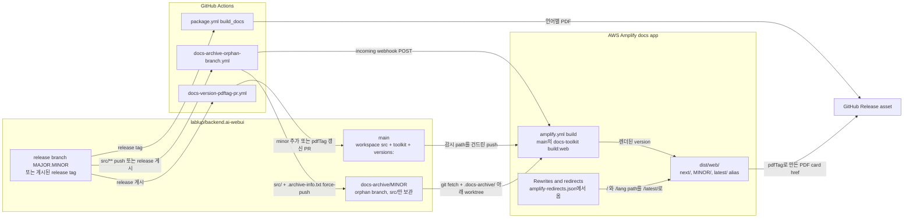

# 0023 — Multi-version docs site from source archive branches

> Decision 2절의 **Branch content** 항목은 [ADR 0029](0029-user-manual-images-in-git-lfs.ko.md)가 넓힌다. archive는 각 이미지 blob을 source ref가 저장한 그대로 두며, 그것이 Git LFS pointer이면 archive 루트에 그 경로들을 `filter=lfs`로 표시하는 `.gitattributes`도 둔다. 나머지 결정은 그대로 발효 중이다.

## Summary

> 낯선 용어는 문서 맨 아래 [용어](#용어)에 모아 두었다.

- `packages/backend.ai-webui-docs/`의 사용자 매뉴얼은 AWS Amplify app 하나로 `https://webui.docs.backend.ai`에 게시되고, 모든 version은 자기 path `/<minor>/<lang>/…` 아래에 놓인다.
- 게시된 [minor](#용어)마다 docs **source**를 [orphan branch](#용어) `docs-archive/<minor>`에 둔다. Amplify build마다 `main`의 toolkit이 모든 archive와 workspace([`next`](#용어))를 `dist/web/` tree 하나로 렌더한다. 그래서 모든 version이 현재 toolkit의 기능을 갖는다.
- `docs-toolkit.config.yaml`의 `versions:`는 minor와 literal `next`만 나열한다. 정확히 한 entry가 `latest: true`를 갖고, `pdfTag`는 그 version이 링크하는 release PDF의 patch tag를 가리킨다.
- `amplify-redirects.json`의 Amplify redirect 규칙은 build가 만드는 version 무관 [`/latest/` alias](#용어)만 대상으로 한다. 그래서 release가 규칙을 바꾸는 일은 없다.
- 범위 밖: version을 가로지르는 검색, 그리고 처음 archive된 minor보다 오래된 version. 오래된 version은 selector가 `legacyDocsUrl`로 연결한다.

## Context

- **Toolkit and layout**: `backend.ai-docs-toolkit`이 매뉴얼을 build한다. `versions:`가 선언되어 있으면 `docs-toolkit build:web`은 version마다 `dist/web/<outDir>/<lang>/…`를 쓴다. 여기서 `outDir`은 version label이다. 각 version directory는 자기 sidebar, 검색 index, version selector를 가진 독립 site다.
- **Release PDFs**: `.github/workflows/package.yml`의 `build_docs` job은 GitHub Release마다 언어별(en, ko, ja, th) PDF를 하나씩 붙인다. `generate-pdf.ts`는 렌더에 실패한 언어를 건너뛰고, 모든 언어가 실패할 때만 job을 실패시킨다. 그래서 release에 붙은 PDF가 네 개보다 적을 수 있다. site는 PDF를 build하지 않고 이 asset에 링크한다.
- **Need**: 설치된 release의 독자는 그 release의 매뉴얼이 필요하고, `main`의 독자는 아직 release되지 않은 매뉴얼이 필요하다. release 담당자가 release마다 hosting 설정을 고치지 않고도 두 매뉴얼을 hostname 하나에서 제공해야 한다.

## 설계도

## Decision

### 1. path로 version을 나누는 Amplify app 하나

- **Hostname**: Amplify app 하나가 site 전체를 `https://webui.docs.backend.ai`에서 제공한다. version은 path `/<label>/<lang>/…`로만 구분된다.
- **Monorepo manifest**: build spec은 저장소 루트의 `amplify.yml`에 있고, 이 파일은 `applications:` schema를 쓴다. docs app은 `appRoot: packages/backend.ai-webui-docs` entry이고, Amplify console도 같은 App root를 설정한다. 자기 Amplify app이 필요한 다른 package는 이 파일에 `applications[]` entry를 하나 더 받는다. `react`와 `packages/backend.ai-ui`가 이미 그렇게 되어 있다.
- **Build trigger**: trigger 설정은 `amplify.yml`이 아니라 Amplify console이 가진다. console은 `main`에서만 build하고, 감시 path로 rebuild를 `packages/backend.ai-webui-docs/**`와 `packages/backend.ai-docs-toolkit/**`로 제한하며, 예약 rebuild는 없다. `amplify.yml`의 머리말은 이 감시 path를 console이 가져야 할 값으로 적어 둔다. build가 실패하면 Amplify는 마지막으로 성공한 배포를 계속 제공한다.

### 2. archive branch는 source를 담고, `main`의 toolkit이 렌더한다

- **Branch content**: `docs-archive/<minor>`는 `src/`(markdown, 이미지, `src/book.config.yaml`)와 출처 파일 `.archive-info.txt`만 담는 orphan branch다. 렌더된 HTML은 담지 않는다.
- **Writer**: archive branch는 `.github/workflows/docs-archive-orphan-branch.yml`만 쓴다. 이 workflow는 force-push하므로 최신 snapshot이 이전 snapshot을 대신한다. workflow는 `packages/backend.ai-webui-docs/src/**`를 건드린 bare `<MAJOR>.<MINOR>` branch push, 게시된 non-prerelease GitHub Release, `workflow_dispatch`에서 실행된다. archive branch를 손으로 고치는 사람은 없다.
- **Fixing an archive**: docs 수정이 archive된 minor에 닿는 길은 그 minor의 release branch에 수정이 들어가는 것 하나다. 그러면 workflow가 다시 실행된다.
- **Rendering**: Amplify build는 `docs-toolkit.config.yaml`의 `ref:` 줄 중 값 전체가 `docs-archive/<digits>.<digits>`에 맞는 줄을 모두 fetch하고, 각각을 `.docs-archive/<ref의 /를 __로 바꾼 이름>` 아래 worktree로 check out한 뒤, `docs-toolkit build:web --lang all --no-strict`를 한 번 실행한다. `packages/backend.ai-docs-toolkit/src/versions.ts`의 `resolveVersionSource`가 `archive-branch` entry를 그 worktree에 연결하고, `website-generator.ts`의 `generateWebsite`가 `main`에서 build한 toolkit으로 그것을 렌더한다.
- **Missing archive**: Amplify build는 `origin`에 없거나 `docs-archive/<digits>.<digits>`에 맞지 않는 ref를 fetch하지 않는다. 그런 entry에는 worktree가 없으므로 `resolveVersionSource`가 경고를 돌려주고, build는 실패하지 않고 그 version을 건너뛴다.
- **Live refresh**: dry run이 아닌 실행이 끝나면, push든 release든 `workflow_dispatch`든 시작 경로와 상관없이 workflow는 저장소 secret `AMPLIFY_DOCS_WEBHOOK_URL`에 저장된 Amplify incoming webhook에 POST한다. 그래서 갱신된 archive는 다음 `main` merge를 기다리지 않고 다시 렌더된다. secret이 없거나 POST가 실패하면 workflow는 경고를 남기고 그대로 성공한다.

### 3. `versions:`는 minor만 나열한다

`packages/backend.ai-webui-docs/docs-toolkit.config.yaml`의 `versions:` 목록이 site가 build할 대상을 선언한다.

- **Checked rules**: `versions.ts`의 `loadVersions`는 이 표의 규칙을 어긴 config를 거부한다.

| field    | 검사하는 규칙                                                                                                                                                                |
| -------- | ---------------------------------------------------------------------------------------------------------------------------------------------------------------------------- |
| `label`  | `^[0-9]+\.[0-9]+$`에 맞거나 literal `next`다. `26.4.7` 같은 patch label은 오류다. 두 entry가 같은 label을 가질 수 없다.                                                      |
| `source` | `{ kind: workspace }`, 또는 비어 있지 않은 `ref`를 가진 `{ kind: archive-branch, ref }`다. `next`는 `workspace`를 써야 한다.                                                 |
| `latest` | 정확히 한 entry가 `latest: true`를 가진다.                                                                                                                                   |
| `pdfTag` | 선택 항목이다. `^v[0-9]+\.[0-9]+\.[0-9]+$`에 맞으며, 그 version의 landing page가 링크하는 GitHub Release PDF의 patch tag다. 이 값이 없는 entry는 PDF card를 렌더하지 않는다. |

- **Unchecked conventions**: toolkit의 어느 code도 아래 규칙을 강제하지 않는다. 그래서 `versions:` 변경의 reviewer가 이 규칙을 확인한다.

| field     | 관례                                                                                                                                                                       |
| --------- | -------------------------------------------------------------------------------------------------------------------------------------------------------------------------- |
| `ref`     | `docs-archive/<label>`이다. `resolveVersionSource`는 `..`, 앞의 `/`, 앞의 `.`가 없는 ref를 모두 받지만, Amplify build는 `docs-archive/<digits>.<digits>` 모양만 fetch한다. |
| `latest`  | `next`는 `latest: true`를 갖지 않는다.                                                                                                                                     |
| 목록 순서 | `next`가 맨 앞이고, 그 뒤로 minor가 최신부터 오래된 순으로 온다. version selector는 entry를 이 순서대로 보여 준다.                                                         |

- **Release automation**: 안정 release가 게시되면 `.github/workflows/docs-version-pdftag-pr.yml`이 `main`을 향한 PR을 연다. 새 minor라면 PR은 `next` 바로 아래에 `archive-branch` entry를 더하고, 그 minor가 현재 latest보다 새것일 때만 `latest: true`를 그쪽으로 옮긴다. 그래서 오래된 minor의 backfill도 `next` 바로 아래, 더 새 minor들 위에 들어가고, PR reviewer가 그 entry를 제자리로 옮긴다. 이미 나열된 minor라면 PR은 그 entry의 `pdfTag`를 올린다. 이 편집은 `packages/backend.ai-webui-docs/scripts/set-version-pdftag.mjs`에 있고, PR을 merge하면 Amplify rebuild가 시작된다.
- **PDF filename**: `pdfFilenameTemplate`은 literal `v` 없이 `Backend.AI_WebUI_User_Guide_{version}_{lang}.pdf`로 둔다. `getDocVersion()`이 이미 `{version}`을 `v`가 붙은 값으로 바꾸기 때문이다.
- **PDF card URL**: `website-builder.ts`의 `buildPdfReleaseUrl`은 하드코딩된 `PDF_RELEASE_BASE_URL`과 하드코딩된 이름 `Backend.AI_WebUI_User_Guide_<pdfTag>_<lang>.pdf`로 card의 href를 만든다. 이 함수는 `pdfFilenameTemplate`을 읽지 않는다. 그래서 template을 바꾸면 모든 PDF card가 깨지고, 그것을 보고하는 검사는 없다.

### 4. redirect는 `/latest/` alias를 대상으로 한다

- **Alias**: build는 언어를 고르는 `dist/web/latest/index.html`과, `latest: true` minor로 redirect하는 `dist/web/latest/<lang>/index.html`을 쓴다. alias는 배포마다 `latest: true`를 따라간다.
- **Rules file**: `packages/backend.ai-webui-docs/amplify-redirects.json`은 Amplify "Rewrites and redirects" 규칙을 `customRules` 아래에 담는다. 모든 대상은 `/latest/…` path다. `/`와 bare `/<lang>` path는 301로 redirect하고, `/<lang>/<*>`는 302로 그 언어의 index에 redirect한다.
- **No version in a target**: 규칙 대상에는 version 번호가 들어가지 않는다. Amplify는 이 파일을 읽지 않는다. 그래서 DevOps가 `customRules` 배열을 console이나 `aws amplify update-app --custom-rules`로 적용하고, 규칙 집합 자체가 바뀔 때만 적용한다.
- **`next` is opt-in**: 어떤 redirect도, 어떤 `/latest/` path도 `next`로 가지 않는다. 각 page의 canonical link는 `latest: true` version의 같은 slug를 가리킨다(`versions.ts`의 `canonicalPathFor`). 그래서 `next`나 오래된 minor의 page는 canonical이 되지 않는다.

### 5. 오래된 매뉴얼은 외부 링크다

- **Selector tail**: `docs-toolkit.config.yaml`의 `legacyDocsUrl`은 version selector 맨 아래에 현지화된 "Previous versions" option을 더한다. 이 option은 URL을 새 tab에서 연다. URL 하나가 모든 언어에 쓰인다.
- **Hidden when unset**: `legacyDocsUrl`이 없거나 비어 있으면 selector는 그 option을 보여 주지 않는다. `config.ts`의 `resolveLegacyDocsUrl`은 절대 `http(s)://` URL이 아닌 값을 거부한다.

## 대안과 기각 사유

- **Rendered archives built by the toolkit of their day**: 이 모델에서는 archive workflow가 release tag 시점에 `build:web`을 실행하고 렌더된 `dist/web/`을 orphan branch에 commit했으며, 배포는 그 tree들을 합치기만 했다. 각 minor가 release 당시 모습 그대로 보이고, 오래된 minor의 markdown이 새 toolkit을 통과할 필요가 없다는 장점이 있다. 그러면 archive된 minor마다 PDF card, version selector, 오래된 version 배너, `/latest/` alias 같은 이후 toolkit 기능이 빠지고, 한 site 안의 version들이 서로 다르게 보이고 동작하므로 기각한다.
- **Patch-level entries in the selector**: `26.4.7`, `26.4.10` 같은 patch마다 별도 version으로 나열하는 안이다. 독자가 매뉴얼을 정확한 설치 version에 맞출 수 있다는 장점이 있다. patch release마다 selector가 길어지는데 한 minor 안의 docs 차이는 작으므로 기각한다. patch는 `pdfTag`와 PDF 파일 이름에만 나온다.
- **A hostname or Amplify app per version**: minor마다 자기 host에서 제공하는 안이다. version을 따로 배포할 수 있다는 장점이 있다. release마다 DNS, TLS, redirect 설정이 늘어나는 반면 path routing을 쓰는 app 하나는 그런 설정이 필요 없으므로 기각한다.
- **Version numbers in redirect targets**: `/`를 `/<latest minor>/`로 보내는 안이다. redirect 단계가 하나 줄어든다는 장점이 있다. release마다 Amplify console에서 규칙을 다시 적용해야 하고, browser가 오래된 minor로 가는 301을 무기한 cache하므로 기각한다.

## Consequences

- **One look across versions**: `main`의 toolkit이 모든 version을 렌더하므로, site의 모든 version이 현재 toolkit의 navigation, 배너, selector를 갖는다.
- **Toolkit compatibility**: `main`의 toolkit 변경은 archive된 모든 minor의 렌더도 바꾼다. 오래된 minor의 markdown을 깨는 변경은 다음 배포에서 그 version을 깬다.
- **Relaxed strictness**: archive된 `src/`에는 `main`의 toolkit이 거부하는 link 진단이 있을 수 있으므로 Amplify build는 `--no-strict`를 넘긴다. PR docs preview(`.github/scripts/pr-preview/build-docs-preview.sh`)도 `--no-strict`를 넘긴다. 그래야 배포가 통과하는 곳에서 preview가 실패하지 않는다. 다른 `build:web` 실행은 CLI 기본값인 strict mode를 유지한다.
- **Build time**: Amplify build는 매번 나열된 모든 minor를 렌더하므로, archive 수가 늘수록 build 시간이 길어진다.
- **Release steps**: release는 docs 쪽에서 손으로 고칠 것이 없다. 사람은 `docs-version-pdftag-pr.yml`이 연 PR을 review하고 merge하며, redirect 규칙은 바뀌지 않는다.
- **Mutable archives**: archive branch는 그 minor의 release branch가 docs 수정을 받을 때마다 바뀐다. 그래서 archive는 고정된 release가 아니라 release branch를 반영한다.

## 출처

- GitHub: #10802 (삭제된 spec에서 흡수, 2026-11-03).
- Jira: FR-2729 (multi-version 배포 epic), FR-2710 (docs site 개선, F6절: version별 layout과 minor 전용 label).
- PR: #7011 (FR-2718, version별 출력과 minor 전용 selector, 2026-04-26), #7057 (FR-2731, `pdfTag`), #7059 (FR-2733, `legacyDocsUrl`), #7058과 #7089 (FR-2735, monorepo `amplify.yml`), #7093 (FR-2738, source archive가 렌더된 archive를 대신함, 2026-04-27), #8110 (FR-3242, release branch push 시 갱신), #8121 (FR-3246, release 자동화), #8144 (FR-3247, `/latest/` alias), #8158 (FR-3255, config에서 읽는 archive ref), #8200 (FR-3275, Amplify webhook).
- 결정일 2026-04-26. archive 모델은 2026-04-27에 source로 바뀌었다.
- 예전 `.specs/FR-2729-webui-docs-multi-version-deployment/spec.md`와 `.specs/FR-2710-docs-site-production-uplift/spec.md` (#10802에서 삭제, git history 참고).
- 운영 checklist: `packages/backend.ai-webui-docs/RELEASE-RUNBOOK.md`.
- 관련: [ADR 0018](0018-adrs-as-the-only-design-record.ko.md) (유일한 설계 기록인 ADR).

## 용어

| 용어             | 뜻                                                                                                                                                    |
| ---------------- | ----------------------------------------------------------------------------------------------------------------------------------------------------- |
| orphan branch    | orphan branch는 `main`과 history를 공유하지 않는 git branch다. 그래서 이 branch의 파일은 `main` history의 크기를 늘리지 않는다.                       |
| minor            | minor는 `26.9` 같은 `MAJOR.MINOR` release 계열이다. `v26.9.0`, `v26.9.1` 같은 patch들은 docs site에서 entry 하나를 함께 쓴다.                         |
| `next`           | `next`는 `main`의 현재 checkout으로 build하는 version entry다. 이 entry는 release되지 않은 docs를 보여 주고, `/next/`가 들어간 path로만 닿을 수 있다. |
| `/latest/` alias | `/latest/` alias는 build가 `dist/web/latest/` 아래에 쓰는 redirect page 묶음이다. 이 page들은 독자를 `latest: true`로 표시된 version으로 보낸다.      |
