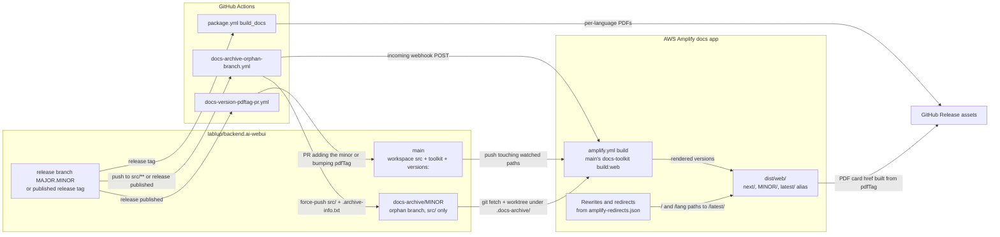

# 0023 — Multi-version docs site from source archive branches

## Summary

> Unfamiliar terms are collected in the [Glossary](#glossary) at the end.

- The user manual in `packages/backend.ai-webui-docs/` is published as one AWS Amplify app at `https://webui.docs.backend.ai`, with every version under its own path, `/<minor>/<lang>/…`.
- Each published [minor](#glossary) keeps its docs **source** on an [orphan branch](#glossary) `docs-archive/<minor>`. At every Amplify build, the toolkit on `main` renders all archives and the workspace ([`next`](#glossary)) into one `dist/web/` tree, so every version has the current toolkit's features.
- `versions:` in `docs-toolkit.config.yaml` lists minors only, plus the literal `next`. Exactly one entry carries `latest: true`, and `pdfTag` names the patch tag whose release PDFs the version links to.
- The Amplify redirect rules in `amplify-redirects.json` target only the version-agnostic [`/latest/` alias](#glossary) that the build emits, so a release never changes the rules.
- Out of scope: search across versions, and any version older than the first archived minor, which the selector reaches through `legacyDocsUrl`.

## Context

- **Toolkit and layout**: `backend.ai-docs-toolkit` builds the manual. When `versions:` is declared, `docs-toolkit build:web` writes `dist/web/<outDir>/<lang>/…` per version, where `outDir` is the version label, and each version directory is a self-contained site with its own sidebar, search index, and version selector.
- **Release PDFs**: The `build_docs` job in `.github/workflows/package.yml` attaches one PDF per language (en, ko, ja, th) to every GitHub Release. `generate-pdf.ts` skips a language whose render fails and fails the job only when every language fails, so a release can carry fewer than four PDFs. The site does not build PDFs; it links to these assets.
- **Need**: Readers of an installed release need that release's manual, and readers of `main` need the unreleased one. Both have to be served from one hostname without a release manager editing hosting settings for each release.

## Diagram

## Decision

### 1. One Amplify app with path-based versions

- **Hostname**: A single Amplify app serves the whole site at `https://webui.docs.backend.ai`. Versions differ only by path, `/<label>/<lang>/…`.
- **Monorepo manifest**: The build spec lives in the repository-root `amplify.yml`, which uses the `applications:` schema. The docs app is the entry with `appRoot: packages/backend.ai-webui-docs`, and the Amplify console sets the same App root. Another package that needs its own Amplify app gets another `applications[]` entry in this file, as `react` and `packages/backend.ai-ui` already have.
- **Build trigger**: The Amplify console, not `amplify.yml`, holds the trigger settings. The console builds only from `main`, its watched paths limit rebuilds to `packages/backend.ai-webui-docs/**` and `packages/backend.ai-docs-toolkit/**`, and it has no scheduled rebuild; the header of `amplify.yml` lists these watched paths as the desired console values. When a build fails, Amplify keeps serving the last successful deployment.

### 2. Archive branches hold source, rendered by `main`'s toolkit

- **Branch content**: `docs-archive/<minor>` is an orphan branch that holds only `src/` (the markdown, images, and `src/book.config.yaml`) and the provenance file `.archive-info.txt`. It holds no rendered HTML.
- **Writer**: Only `.github/workflows/docs-archive-orphan-branch.yml` writes an archive branch, and it force-pushes, so the newest snapshot replaces the old one. It runs on a push to a bare `<MAJOR>.<MINOR>` branch that touches `packages/backend.ai-webui-docs/src/**`, on a published non-prerelease GitHub Release, and on `workflow_dispatch`. Nobody edits an archive branch by hand.
- **Fixing an archive**: A docs fix reaches an archived minor only by landing on that minor's release branch, which re-runs the workflow.
- **Rendering**: The Amplify build fetches every `ref:` line in `docs-toolkit.config.yaml` whose whole value matches `docs-archive/<digits>.<digits>`, checks each one out as a worktree under `.docs-archive/<ref with / replaced by __>`, and runs `docs-toolkit build:web --lang all --no-strict` once. `resolveVersionSource` in `packages/backend.ai-docs-toolkit/src/versions.ts` maps an `archive-branch` entry to that worktree, and `generateWebsite` in `website-generator.ts` renders it with the toolkit built from `main`.
- **Missing archive**: The Amplify build does not fetch a ref that is missing on `origin` or that does not match `docs-archive/<digits>.<digits>`. For such an entry no worktree exists, so `resolveVersionSource` returns a warning and the build skips that version instead of failing.
- **Live refresh**: After every run that is not a dry run, whether started by a push, a release, or `workflow_dispatch`, the workflow POSTs the Amplify incoming webhook stored in the repository secret `AMPLIFY_DOCS_WEBHOOK_URL`, so the refreshed archive is re-rendered without waiting for the next `main` merge. When the secret is unset or the POST fails, the workflow logs a warning and still succeeds.

### 3. `versions:` lists minors only

The `versions:` list in `packages/backend.ai-webui-docs/docs-toolkit.config.yaml` declares what the site builds.

- **Checked rules**: `loadVersions` in `versions.ts` rejects a config that breaks a rule in this table.

| field    | checked rule                                                                                                                                                         |
| -------- | -------------------------------------------------------------------------------------------------------------------------------------------------------------------- |
| `label`  | Matches `^[0-9]+\.[0-9]+$`, or is the literal `next`. A patch label such as `26.4.7` is an error. No two entries share a label.                                      |
| `source` | `{ kind: workspace }`, or `{ kind: archive-branch, ref }` with a non-empty `ref`. `next` must use `workspace`.                                                       |
| `latest` | Exactly one entry carries `latest: true`.                                                                                                                            |
| `pdfTag` | Optional. Matches `^v[0-9]+\.[0-9]+\.[0-9]+$`, the patch tag whose GitHub Release PDFs the version's landing page links to. An entry without it renders no PDF card. |

- **Unchecked conventions**: Nothing in the toolkit enforces the rules below, so the reviewer of a `versions:` change checks them.

| field      | convention                                                                                                                                                                                      |
| ---------- | ----------------------------------------------------------------------------------------------------------------------------------------------------------------------------------------------- |
| `ref`      | Is `docs-archive/<label>`. `resolveVersionSource` accepts any ref without `..`, a leading `/`, or a leading `.`, but the Amplify build fetches only the `docs-archive/<digits>.<digits>` shape. |
| `latest`   | `next` never carries `latest: true`.                                                                                                                                                            |
| list order | `next` is first, then the minors from newest to oldest. The version selector shows the entries in this order.                                                                                   |

- **Release automation**: On a published stable release, `.github/workflows/docs-version-pdftag-pr.yml` opens a PR against `main`. For a new minor, the PR adds an `archive-branch` entry directly below `next` and moves `latest: true` to it only when it is newer than the current latest. An older-minor backfill therefore also lands directly below `next`, above newer minors, and the PR reviewer moves it into place. For an already listed minor, the PR bumps that entry's `pdfTag`. The edit lives in `packages/backend.ai-webui-docs/scripts/set-version-pdftag.mjs`, and merging the PR triggers the Amplify rebuild.
- **PDF filename**: `pdfFilenameTemplate` stays `Backend.AI_WebUI_User_Guide_{version}_{lang}.pdf` with no literal `v`, because `getDocVersion()` already substitutes `{version}` with a `v`-prefixed value.
- **PDF card URL**: `buildPdfReleaseUrl` in `website-builder.ts` builds the card's href from the hardcoded `PDF_RELEASE_BASE_URL` and the hardcoded name `Backend.AI_WebUI_User_Guide_<pdfTag>_<lang>.pdf`. It does not read `pdfFilenameTemplate`, so a change to the template breaks every PDF card, and no check reports it.

### 4. Redirects target the `/latest/` alias

- **Alias**: The build writes `dist/web/latest/index.html`, which picks a language, and `dist/web/latest/<lang>/index.html`, which redirects into the `latest: true` minor. The alias follows `latest: true` on every deploy.
- **Rules file**: `packages/backend.ai-webui-docs/amplify-redirects.json` holds the Amplify "Rewrites and redirects" rules under `customRules`. Every target is a `/latest/…` path: `/` and the bare `/<lang>` paths redirect with 301, and `/<lang>/<*>` redirects to that language's index with 302.
- **No version in a target**: A rule target never contains a version number. Amplify does not read this file, so DevOps applies the `customRules` array in the console or with `aws amplify update-app --custom-rules`, and only when the rule set itself changes.
- **`next` is opt-in**: No redirect and no `/latest/` path resolves to `next`. Each page's canonical link points at the same slug in the `latest: true` version (`canonicalPathFor` in `versions.ts`), so a `next` or older-minor page is never canonical.

### 5. Older manuals are a link out

- **Selector tail**: `legacyDocsUrl` in `docs-toolkit.config.yaml` adds a localized "Previous versions" option at the bottom of the version selector, which opens the URL in a new tab. One URL serves all languages.
- **Hidden when unset**: When `legacyDocsUrl` is absent or empty, the selector shows no such option. `resolveLegacyDocsUrl` in `config.ts` rejects a value that is not an absolute `http(s)://` URL.

## Rejected alternatives

- **Rendered archives built by the toolkit of their day**: In this model, the archive workflow ran `build:web` at the release tag and committed the rendered `dist/web/` to the orphan branch, and the deploy only merged those trees. Its advantage is that each minor looks exactly as it did at release, and an old minor's markdown never has to pass a newer toolkit. It is rejected because every archived minor would then miss later toolkit features, such as the PDF card, the version selector, the outdated-version banner, and the `/latest/` alias, so versions on one site would look and behave differently.
- **Patch-level entries in the selector**: This alternative lists every patch, such as `26.4.7` and `26.4.10`, as its own version. Its advantage is that a reader can match the manual to an exact install. It is rejected because the selector grows with every patch release, while docs within a minor differ little. The patch appears only in `pdfTag` and the PDF filename.
- **A hostname or Amplify app per version**: This alternative serves each minor from its own host. Its advantage is that a version deploys on its own. It is rejected because every release would add DNS, TLS, and redirect setup, while one app with path routing needs none.
- **Version numbers in redirect targets**: This alternative points `/` at `/<latest minor>/`. Its advantage is one redirect hop fewer. It is rejected because each release would require re-applying the rules in the Amplify console, and a browser caches a 301 to an old minor indefinitely.

## Consequences

- **One look across versions**: Every version on the site has the current toolkit's navigation, banner, and selector, because `main`'s toolkit renders them all.
- **Toolkit compatibility**: A toolkit change on `main` also changes how every archived minor renders. A change that breaks an older minor's markdown breaks that version on the next deploy.
- **Relaxed strictness**: The Amplify build passes `--no-strict` because an archived `src/` can carry link diagnostics that `main`'s toolkit rejects. The PR docs preview (`.github/scripts/pr-preview/build-docs-preview.sh`) passes `--no-strict` too, so that a preview never fails where the deploy passes. Other `build:web` runs keep the CLI default, which is strict mode.
- **Build time**: Each Amplify build renders every listed minor, so build time grows with the number of archives.
- **Release steps**: A release needs no hand edits on the docs side. A human reviews and merges the PR from `docs-version-pdftag-pr.yml`, and the redirect rules stay unchanged.
- **Mutable archives**: An archive branch changes whenever its minor's release branch receives a docs fix, so the archive reflects the release branch, not a frozen release.

## Sources

- GitHub: #10802 (absorbed from the removed spec, 2026-11-03).
- Jira: FR-2729 (multi-version deployment epic), FR-2710 (docs site uplift, section F6: versioned layout and minor-only labels).
- PRs: #7011 (FR-2718, versioned output and minor-only selector, 2026-04-26), #7057 (FR-2731, `pdfTag`), #7059 (FR-2733, `legacyDocsUrl`), #7058 and #7089 (FR-2735, monorepo `amplify.yml`), #7093 (FR-2738, source archives replace rendered archives, 2026-04-27), #8110 (FR-3242, refresh on release-branch pushes), #8121 (FR-3246, release automation), #8144 (FR-3247, `/latest/` alias), #8158 (FR-3255, archive refs read from the config), #8200 (FR-3275, Amplify webhook).
- Decided 2026-04-26, with the archive model changed to source on 2026-04-27.
- Formerly `.specs/FR-2729-webui-docs-multi-version-deployment/spec.md` and `.specs/FR-2710-docs-site-production-uplift/spec.md` (removed in #10802; see git history).
- Operational checklist: `packages/backend.ai-webui-docs/RELEASE-RUNBOOK.md`.
- Related: [ADR 0018](0018-adrs-as-the-only-design-record.md) (ADRs as the only design record).

## Glossary

| Term             | Meaning                                                                                                                                                     |
| ---------------- | ----------------------------------------------------------------------------------------------------------------------------------------------------------- |
| orphan branch    | An orphan branch is a git branch that shares no history with `main`, so its files do not add to the size of `main`'s history.                               |
| minor            | A minor is a `MAJOR.MINOR` release line such as `26.9`. Its patches, such as `v26.9.0` and `v26.9.1`, share one entry on the docs site.                     |
| `next`           | `next` is the version entry built from the current checkout of `main`. It shows unreleased docs and is reachable only by a path that contains `/next/`.     |
| `/latest/` alias | The `/latest/` alias is a set of redirect pages that the build writes under `dist/web/latest/`, which send the reader to the version marked `latest: true`. |
