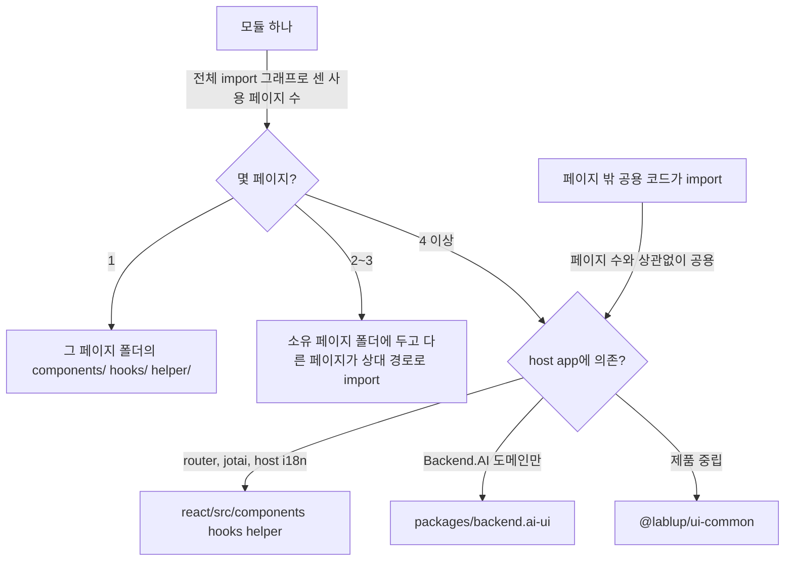

# 0024 — Per-page placement by usage count

## Summary

> 낯선 용어는 문서 맨 아래 [용어](#용어)에 모아 두었다.

- route component는 `react/src/pages/<Name>Page/<Name>Page.tsx`에 둔다. 폴더와 파일 이름은 route component 이름과 같다(`SchedulerPage`, `Page404`, `ModelStoreListPageV2`). `index.tsx` barrel은 두지 않고, importer는 파일 경로를 명시한다.
- 한 페이지만 쓰는 component·hook·helper는 그 페이지 폴더의 `components/`·`hooks/`·`helper/`에 둔다.
- 어떤 모듈을 몇 페이지가 쓰는지는 전체 import 그래프로 센다. 페이지 파일만이 아니라 hook·helper·다른 component의 import도 센다.
- 3곳 이하의 페이지가 쓰는 모듈은 페이지 밖 공용 코드가 import하지 않는 한 페이지 폴더에 둔다. 4곳 이상이 쓰거나 공용 코드가 import하는 모듈은 host app에 의존하면 `react/src/components`·`hooks`·`helper`에, 아니면 `.claude/rules/bui-component-home.md`대로 `backend.ai-ui`나 `@lablup/ui-common`에 둔다.
- 페이지 폴더마다 `CLAUDE.md`를 두어 그 페이지의 성격(route, 사용자, 다루는 데이터, 지켜야 할 제약)을 적는다.
- 이 결정이 착지한 PR은 모든 페이지를 폴더로 나누고 페이지 전용 component를 그 폴더로 옮겼다. 무엇을 옮기고 무엇을 남겼는지는 4절에 있다.

## Context

`react/src/pages`에는 `*Page.tsx` 파일이 평평하게 놓여 있었고, 페이지가 쓰는 component는 모두
`react/src/components`(400개 이상), hook은 `react/src/hooks`, helper는 `react/src/helper`에 있었다.
어느 component가 한 페이지 전용이고 어느 것이 공용인지는 import를 따라가 봐야만 알 수 있었다.
예를 들어 `FairShareItems`는 `SchedulerPage`만 쓰지만 공용 폴더에 있었다.

반대로 페이지 import만 세면 잘못 분류되는 모듈이 있다. `DashboardPanels`는 `DashboardPage`만
페이지로서 import하지만 `hooks/useBAISetting.tsx`가 그 type을,
`components/SessionMonitor/SessionMonitorSettingsPane.tsx`가 `DashboardPanels/sessionFilterProperties`를 import한다. 이런 모듈을 페이지 폴더로 옮기면 공용 hook이 특정 페이지 폴더 안을
가리키게 된다.

`.claude/rules/bui-component-home.md`는 재사용 component의 집을 정한다(제품 중립이면 ui-common,
Backend.AI에 의존하면 `backend.ai-ui`(BUI), host app에 의존하면 `react/src`). 그 규칙은 "어느 라이브러리에 두는가"를
정하고, "언제 페이지를 떠나 공용이 되는가"는 정하지 않았다.

## 설계도

## Decision

### 1. 페이지 폴더

| 경로                                             | 내용                                           |
| ------------------------------------------------ | ---------------------------------------------- |
| `react/src/pages/<Name>Page/<Name>Page.tsx`      | route component이며 default export는 그대로다  |
| `react/src/pages/<Name>Page/<Name>Page.test.tsx` | 페이지 test                                    |
| `react/src/pages/<Name>Page/<Name>Page.css`      | 페이지 stylesheet이며, 페이지에 있을 때만 둔다 |
| `react/src/pages/<Name>Page/components/`         | 3절이 이 페이지에 둔 component와 그 test·CSS   |
| `react/src/pages/<Name>Page/hooks/`              | 3절이 이 페이지에 둔 hook                      |
| `react/src/pages/<Name>Page/helper/`             | 3절이 이 페이지에 둔 helper                    |
| `react/src/pages/<Name>Page/CLAUDE.md`           | 페이지 설명 (5절)                              |

Relay compiler는 module 이름을 파일 이름에서 읽으므로 `DeploymentListPage.tsx`의 `DeploymentListPageQuery` 같은
operation 이름과 생성 파일 이름이 바뀌지 않는다. 폴더에 `index.tsx` barrel을 두지 않으므로 `routes.tsx`는
`import('./pages/SchedulerPage/SchedulerPage')`, 다른 모듈은 `../pages/SessionLauncherPage/SessionLauncherPage`처럼
파일을 명시해 import한다. 페이지 폴더는 그런 모듈이 있을 때만 `components/`·`hooks/`·`helper/`를 가진다.

### 2. 사용 페이지 수를 세는 법

모듈 하나의 사용 페이지 수는 그 모듈을 import 그래프에서 (직접이든 다른 모듈을 거쳐서든) 닿는
페이지 폴더의 수다. 셀 때 다음을 지킨다.

- `routes.tsx`, `App.tsx`, `react/src/components`·`hooks`·`helper`의 공용 모듈이 import하면 그 모듈은
  페이지 수와 상관없이 공용이다.
- 페이지 진입 파일(`<Name>Page/<Name>Page.tsx`)은 경계다. 진입 파일을 import하는 것은 그 페이지를 쓰는 것이고,
  폴더 안 `components/`·`hooks/`·`helper/`의 모듈을 쓰는 것으로 세지 않는다.
- type-only import, `React.lazy(() => import(...))`, `vi.mock(...)` 경로도 import로 센다.
- 모듈 자신의 test(`X.test.tsx`)와 story는 세지 않는다. 그 파일은 모듈과 함께 옮긴다.

### 3. 배치 규칙

| 사용 페이지 수 | 둘 곳                                                                                                                                                                                                                                                                            |
| -------------- | -------------------------------------------------------------------------------------------------------------------------------------------------------------------------------------------------------------------------------------------------------------------------------- |
| 1              | 그 페이지 폴더의 `components/`·`hooks/`·`helper/`                                                                                                                                                                                                                                |
| 2~3            | 그 모듈을 처음 만든 페이지(소유 페이지)의 폴더. 다른 페이지는 `../<Owner>Page/components/X`로 import하고, 소유 페이지의 `CLAUDE.md`에 함께 쓰는 페이지를 적는다                                                                                                                  |
| 4 이상         | `.claude/rules/bui-component-home.md`를 따른다. host app(router·navigation, host jotai, host `resources/i18n`)에 의존하면 `react/src/components`·`hooks`·`helper`, Backend.AI 의존(`BAIClient`, Relay fragment 포함)은 `packages/backend.ai-ui`, 제품 중립은 `@lablup/ui-common` |

1~3 페이지가 쓰는 모듈의 자리는 이 표가 정한다. Backend.AI에 의존하더라도 BUI로 올리지 않고 페이지 폴더에 둔다.
`bui-component-home.md`는 4곳 이상이 쓰거나 페이지 밖 공용 코드가 import하는 모듈에 대해서만 라이브러리를 정한다.

component·hook·helper 모두 같은 규칙을 따른다. 페이지 폴더 안의 모듈도 `bui-component-home.md` 5항을
따른다. BUI나 ui-common component와 같은 이름·같은 목적의 twin을 페이지 폴더에 만들지 않는다.

### 4. 옮기는 시점

새 코드는 처음부터 이 규칙대로 둔다. 이 결정이 착지한 PR은 다음만 했다.

- 모든 페이지를 1절의 폴더로 나눴다.
- 2절 기준(전체 import 그래프)으로 사용 페이지가 1곳인 손으로 쓴 component를 그 페이지의 `components/`로 옮겼다. 폴더 일부만 페이지 전용인 `DashboardPanels/`는 나누지 않았다. `StartPage`만 닿는 `HuggingFaceModelPreview`는 `react/src/components`에 남았다.
- `react/src/components`에 있던 route component `Information.tsx`를 `InformationPage/InformationPage.tsx`로 옮겼다.
- route가 없는 `AdminComputeSessionListPage`는 `AdminSessionPage/components/AdminComputeSessionList.tsx`로, 공용 `RouteErrorBoundary`만 쓰는 `ForbiddenPage`는 `react/src/components`로 옮겼다.

사용 페이지가 2곳 이상인 기존 모듈(예: `DashboardPage`와 `AdminDashboardPage`가 쓰는 `ActiveAgents`)과
페이지 전용인 기존 hook·helper는 그 코드를 고치는 PR에서 3절대로 옮긴다.

### 5. 페이지 `CLAUDE.md`

Claude Code는 작업하는 파일의 상위 폴더에 있는 `CLAUDE.md`를 읽으므로,
페이지 폴더의 파일을 고칠 때 이 설명이 자동으로 들어온다. 내용은 짧은 bullet로 다음을 적는다.

- route와 메뉴 label, 그 route에 들어오는 사용자
- 페이지가 다루는 데이터와 하는 일
- 그 페이지에 걸린 제약(관련 ADR, ESLint 규칙, 같은 component를 쓰는 다른 route)
- 3절의 2~3 페이지 모듈을 소유하면 함께 쓰는 페이지

파일 목록은 적지 않는다. 폴더가 그 목록이다. `react/src/pages/CLAUDE.md`가 모든 페이지에 같은 내용(폴더 구조와 배치 규칙)을 담고, 페이지 노트는 그 내용을 반복하지 않는다.

### 6. Import 경계

`react/eslint.config.js`의 `no-restricted-imports`는 페이지 밖 코드가 `**/pages/**/components/**`, `**/pages/**/hooks/**`, `**/pages/**/helper/**`를 import하지 못하게 막는다. 공용 코드가 필요로 하는 모듈은 3절대로 페이지 폴더 밖으로 옮긴다.

## 대안과 기각 사유

- **Index entry files**: 진입 파일을 `pages/SchedulerPage/index.tsx`로 두면 importer가 폴더 경로만 쓰면 되어
  짧다. 기각한다. 도구와 사람이 파일을 basename으로 찾는다. `scripts/release-risk-report.mjs`의 `areaOf()`는
  파일 basename에서 기능 영역을 뽑고, `.claude/agents/docs-update-writer.md`는 `find -name 'FeatureName*'`로
  파일을 찾는다. 편집기 탭·검색·stack trace·diff에서도 40개가 넘는 페이지가 모두 `index.tsx`로 보인다.
- **Kebab-case folders**: `pages/scheduler/scheduler.tsx`는 URL과 가까워 보이는 장점이 있다. 기각한다.
  Relay가 module 이름을 파일 이름으로 읽어 모든 페이지 operation과 생성 파일 이름이 바뀌고,
  `routes.tsx`와 페이지를 import하는 모든 모듈도 바뀐다.
- **Sibling page folders**: 페이지 파일은 그대로 두고 옆에 같은 이름의 폴더만 두면(`pages/X.tsx` + `pages/X/`) 옮기는 파일이
  적다. 기각한다. 페이지와 페이지 전용 코드가 한 폴더에 모이지 않는다.
- **Page-only counting**: 페이지 파일의 import만 세면 세기 쉽다. 기각한다. `DashboardPanels`처럼 공용 hook·component가 쓰는
  모듈을 페이지 전용으로 잘못 분류한다.
- **README page notes**: 페이지 설명을 `README.md`로 두면 사람에게 익숙하다. 기각한다. Claude Code가 자동으로 읽지 않는다.
- **Shared code move**: 공용 코드까지 한 번에 옮기면 구조가 바로 끝난다. 기각한다. 수백 개 파일이 움직여 진행 중인 PR과
  충돌하고, 2~3 페이지 모듈의 소유 페이지를 한 번에 판정해야 한다.

## Consequences

- **Code locality**: 페이지를 고칠 때 볼 코드가 한 폴더에 모이고, `react/src/components`에는 여러 곳이 쓰는 코드만 남는 쪽으로 간다.
- **Page notes**: 페이지 폴더의 `CLAUDE.md`가 페이지의 성격을 agent에게 자동으로 알린다. 페이지 변경이 노트에 적힌 내용을 바꾸면 노트도 함께 고쳐야 한다.
- **Review tier**: 페이지 `CLAUDE.md`는 agent의 행동을 바꾸는 파일이라 `REVIEW.md`의 `**/CLAUDE.md` High 목록에 그대로 둔다. 노트를 고친 PR은
  코드 변경과 상관없이 High 등급이 되고, 이 비용을 받아들인다.
- **Cross-page imports**: 2~3 페이지 모듈은 다른 페이지 폴더 안을 상대 경로로 가리키는 import를 만든다.
- **File history**: `git blame`은 파일 이동을 따라가지만, `git log`는 `--follow`를 붙여야 이동 전 이력을 보여 준다.
- **Manual counting**: 사용 페이지 수는 사람이 import 그래프를 따라가 센다. 이를 검사하는 도구는 없다.
- **Lint boundary**: 페이지 밖 코드가 `pages/*/components`·`hooks`·`helper`를 import하면 ESLint(`no-restricted-imports`)가 막는다.
  다른 페이지 폴더의 상대 경로 import와 동적 `import()`는 검사하지 않는다.

## 출처

- GitHub issue [#10806](https://github.com/lablup/backend.ai-webui/issues/10806), 2026-11-03 결정.
- 관련: [ADR 0001](0001-explicit-project-prop-contract.ko.md)(페이지만 ambient project를 읽는다), [ADR 0009](0009-ui-common-as-the-single-entry-point-to-astryx.ko.md), `.claude/rules/bui-component-home.md`.

## 용어

| 용어           | 뜻                                                                                                                                     |
| -------------- | -------------------------------------------------------------------------------------------------------------------------------------- |
| barrel         | importer가 파일 대신 폴더를 이름으로 쓰도록 폴더의 모듈을 다시 export하는 `index.tsx`다.                                               |
| 페이지 폴더    | `react/src/pages/<Component>/`이다. 폴더 이름은 route component 이름이고, 폴더는 route component 하나와 3절이 그곳에 둔 코드를 담는다. |
| 사용 페이지 수 | 모듈에 import 그래프로 닿는 페이지 폴더의 수다(2절).                                                                                   |
| 소유 페이지    | 2~3 페이지가 쓰는 모듈을 처음 만든 페이지다. 모듈은 그 페이지의 폴더에 있다.                                                           |
