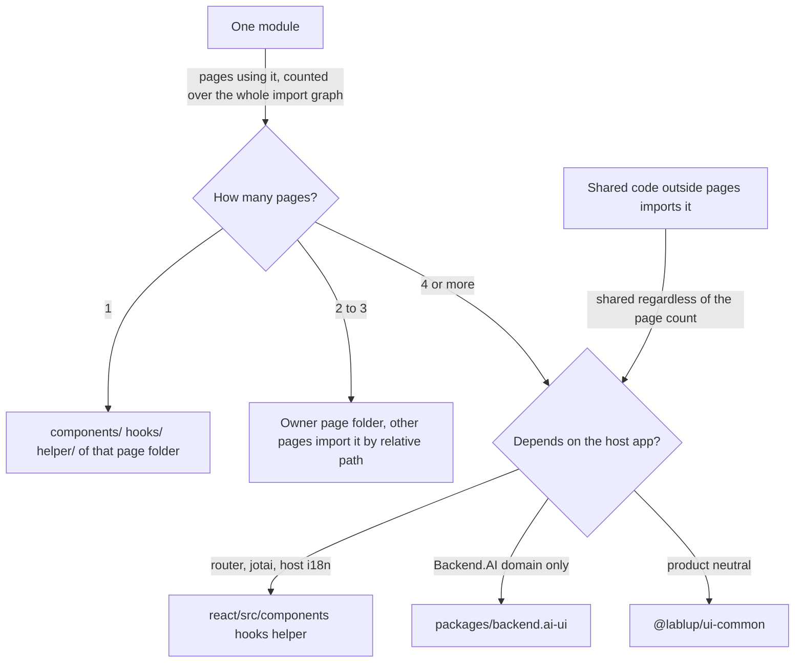

# 0024 — Per-page placement by usage count

## Summary

> Unfamiliar terms are collected in the [Glossary](#glossary) at the end.

- A route component lives in `react/src/pages/<Name>Page/<Name>Page.tsx`. The folder and the file take the route component's name (`SchedulerPage`, `Page404`, `ModelStoreListPageV2`). No `index.tsx` barrel exists, and importers name the file.
- A component, hook, or helper that one page uses lives in that page folder's `components/`, `hooks/`, or `helper/`.
- The number of pages that use a module is counted over the whole import graph. The count includes imports from hooks, helpers, and other components, not only page files.
- A module that three or fewer pages use lives in a page folder, unless shared code outside pages imports it. A module that four or more pages use, or that shared code imports, lives in `react/src/components`, `hooks`, or `helper` when it depends on the host app, and otherwise in `backend.ai-ui` or `@lablup/ui-common` as `.claude/rules/bui-component-home.md` says.
- Every page folder has a `CLAUDE.md` that states the page's character: its route, its users, the data it handles, and the constraints it must keep.
- The PR that landed this decision split every page into a folder and moved page-specific components into those folders. Section 4 lists what it moved and what it left in place.

## Context

`react/src/pages` held `*Page.tsx` files in one flat level, and every component the pages used sat in
`react/src/components` (more than 400), every hook in `react/src/hooks`, and every helper in `react/src/helper`.
A reader could tell which component belonged to one page and which was shared only by following the imports.
For example, only `SchedulerPage` uses `FairShareItems`, but it sat in the shared folder.

Counting only page imports misclassifies some modules in the other direction. Among pages, only `DashboardPage`
imports `DashboardPanels`, but `hooks/useBAISetting.tsx` imports its type and
`components/SessionMonitor/SessionMonitorSettingsPane.tsx` imports `DashboardPanels/sessionFilterProperties`. Moving such a module into a page folder makes a shared hook point inside a specific
page folder.

`.claude/rules/bui-component-home.md` decides the home of a reusable component: ui-common when it is product
neutral, `backend.ai-ui` (BUI) when it depends on Backend.AI, and `react/src` when it depends on the host app. That rule decides
which library a component belongs to. It did not decide when a module leaves a page and becomes shared.

## Diagram

## Decision

### 1. Page folder

| Path                                             | Content                                                                 |
| ------------------------------------------------ | ----------------------------------------------------------------------- |
| `react/src/pages/<Name>Page/<Name>Page.tsx`      | The route component, with its default export unchanged                  |
| `react/src/pages/<Name>Page/<Name>Page.test.tsx` | The page test                                                           |
| `react/src/pages/<Name>Page/<Name>Page.css`      | The page stylesheet, when the page has one                              |
| `react/src/pages/<Name>Page/components/`         | Components that section 3 places in this page, with their tests and CSS |
| `react/src/pages/<Name>Page/hooks/`              | Hooks that section 3 places in this page                                |
| `react/src/pages/<Name>Page/helper/`             | Helpers that section 3 places in this page                              |
| `react/src/pages/<Name>Page/CLAUDE.md`           | The page note (section 5)                                               |

The Relay compiler reads the module name from the file name, so operation names such as `DeploymentListPageQuery` in
`DeploymentListPage.tsx` and the generated file names do not change. A folder has no `index.tsx` barrel, so `routes.tsx`
imports `import('./pages/SchedulerPage/SchedulerPage')` and other modules import the file by name, as in
`../pages/SessionLauncherPage/SessionLauncherPage`. A page folder has `components/`, `hooks/`, or `helper/` only when it holds such a module.

### 2. Counting the pages that use a module

The number of pages that use a module is the number of page folders that reach the module in the import graph,
directly or through other modules. The count follows these rules.

- If `routes.tsx`, `App.tsx`, or a shared module in `react/src/components`, `hooks`, or `helper` imports a module,
  that module is shared regardless of the page count.
- A page entry file (`<Name>Page/<Name>Page.tsx`) is a boundary. Importing an entry file uses that page, and it does
  not count as using the modules in the folder's `components/`, `hooks/`, or `helper/`.
- Type-only imports, `React.lazy(() => import(...))`, and `vi.mock(...)` paths count as imports.
- A module's own test (`X.test.tsx`) and story do not count. Those files move with the module.

### 3. Placement rule

| Pages using the module | Location                                                                                                                                                                                                                                                                                                                                      |
| ---------------------- | --------------------------------------------------------------------------------------------------------------------------------------------------------------------------------------------------------------------------------------------------------------------------------------------------------------------------------------------- |
| 1                      | That page folder's `components/`, `hooks/`, or `helper/`                                                                                                                                                                                                                                                                                      |
| 2 to 3                 | The folder of the page that first created the module (the owner page). Other pages import `../<Owner>Page/components/X`, and the owner page's `CLAUDE.md` names the pages that share it                                                                                                                                                       |
| 4 or more              | Follow `.claude/rules/bui-component-home.md`: `react/src/components`, `hooks`, or `helper` when it depends on the host app (router and navigation, host jotai, host `resources/i18n`), `packages/backend.ai-ui` when it depends on Backend.AI (including `BAIClient` and Relay fragments), and `@lablup/ui-common` when it is product neutral |

This table decides the location of a module that one to three pages use. Such a module stays in a page folder and
does not move up to BUI, even when it depends on Backend.AI. `bui-component-home.md` picks the library only for a
module that four or more pages use or that shared code outside pages imports.

Components, hooks, and helpers all follow the same rule. A module in a page folder also follows item 5 of
`bui-component-home.md`: a page folder does not hold a twin with the same name or purpose as a BUI or ui-common
component.

### 4. Timing of moves

New code follows this rule from the start. The PR that landed this decision did only the following.

- It split every page into the folder of section 1.
- It moved hand-written components that one page uses, by the section 2 count over the whole import graph, into that page's `components/`. It did not split `DashboardPanels/`, of which only part is page-specific. `HuggingFaceModelPreview`, which only `StartPage` reaches, stayed in `react/src/components`.
- It moved the route component `Information.tsx` in `react/src/components` to `InformationPage/InformationPage.tsx`.
- It moved `AdminComputeSessionListPage`, which has no route, to `AdminSessionPage/components/AdminComputeSessionList.tsx`, and `ForbiddenPage`, which only the shared `RouteErrorBoundary` uses, to `react/src/components`.

An existing module that two or more pages use (for example `ActiveAgents`, which `DashboardPage` and
`AdminDashboardPage` use) and an existing page-specific hook or helper move per section 3 in the PR that next edits
that code.

### 5. Page `CLAUDE.md`

Claude Code reads the `CLAUDE.md` in the parent folders of a file it works on, so this
note loads automatically when a file in the page folder changes. The note states the following in short bullets.

- The route, the menu label, and the users who enter that route
- The data the page handles and what the page does
- The constraints on the page: the related ADRs, ESLint rules, and other routes that use the same component
- The pages that share a two-to-three-page module of section 3, when this page owns one

The note does not list files, because the folder is that list. `react/src/pages/CLAUDE.md` holds the content that is the
same for every page (the folder structure and the placement rule), and page notes do not repeat it.

### 6. Import boundary

`no-restricted-imports` in `react/eslint.config.js` blocks code outside pages from importing `**/pages/**/components/**`, `**/pages/**/hooks/**`, and `**/pages/**/helper/**`. A module that shared code needs moves out of the page folder per section 3.

## Rejected alternatives

- **Index entry files**: An entry file at `pages/SchedulerPage/index.tsx` lets an importer write only the folder path, which is shorter. This is rejected because tools and people find files by basename. `areaOf()` in `scripts/release-risk-report.mjs` derives the feature area from the file basename, and `.claude/agents/docs-update-writer.md` finds files with `find -name 'FeatureName*'`. In editor tabs, search, stack traces, and diffs, more than 40 pages would all appear as `index.tsx`.
- **Kebab-case folders**: `pages/scheduler/scheduler.tsx` looks closer to the URL. This is rejected because Relay reads the module name from the file name, so every page operation and generated file name would change, along with `routes.tsx` and every module that imports a page.
- **Sibling page folders**: Keeping the page file in place with a same-named folder beside it (`pages/X.tsx` plus `pages/X/`) moves fewer files. This is rejected because the page and its page-specific code do not sit in one folder.
- **Page-only counting**: Counting only the imports in page files is easy. This is rejected because it classifies a module such as `DashboardPanels`, which shared hooks and components use, as page-specific.
- **README page notes**: A page note in `README.md` is familiar to people. This is rejected because Claude Code does not read it automatically.
- **Shared code move**: Moving shared code at the same time finishes the structure at once. This is rejected because hundreds of files would move and conflict with PRs in progress, and the owner page of every two-to-three-page module would have to be decided at once.

## Consequences

- **Code locality**: The code to read when changing a page sits in one folder, and `react/src/components` moves toward holding only code that several places use.
- **Page notes**: A page folder's `CLAUDE.md` tells an agent the page's character automatically. A page change that alters what the note states must also change the note.
- **Review tier**: A page `CLAUDE.md` changes agent behavior, so it stays in the `**/CLAUDE.md` High list of `REVIEW.md`. A PR that edits a note is High tier regardless of its code changes, and this decision accepts that cost.
- **Cross-page imports**: A two-to-three-page module creates imports that point into another page's folder by relative path.
- **File history**: `git blame` follows file moves, but `git log` shows the history before a move only with `--follow`.
- **Manual counting**: A person counts the pages using a module by following the import graph. No tool checks this count.
- **Lint boundary**: ESLint (`no-restricted-imports`) blocks code outside pages from importing `pages/*/components`, `hooks`, or `helper`. It does not check relative imports of another page's folder or dynamic `import()`.

## Sources

- GitHub issue [#10806](https://github.com/lablup/backend.ai-webui/issues/10806), decided 2026-11-03.
- Related: [ADR 0001](0001-explicit-project-prop-contract.md) (only the page reads the ambient project), [ADR 0009](0009-ui-common-as-the-single-entry-point-to-astryx.md), `.claude/rules/bui-component-home.md`.

## Glossary

| Term                 | Meaning                                                                                                                                                       |
| -------------------- | ------------------------------------------------------------------------------------------------------------------------------------------------------------- |
| barrel               | An `index.tsx` that re-exports a folder's modules so importers can name the folder instead of a file.                                                         |
| page folder          | `react/src/pages/<Component>/`. The folder name is the route component's name. The folder holds one route component and the code that section 3 places there. |
| pages using a module | The number of page folders that reach the module in the import graph (section 2).                                                                             |
| owner page           | The page that first created a module that two to three pages use. The module lives in that page's folder.                                                     |
