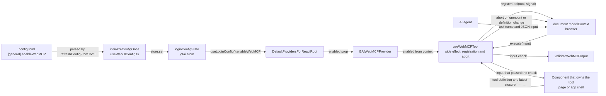

# 0025 — WebMCP tool surface

## Summary

> Unfamiliar terms are collected in the [Glossary](#glossary) at the end.

- WebUI registers [WebMCP](#glossary) [tools](#glossary) so that an AI agent can read and operate an open tab. The one registration path is `document.modelContext.registerTool`, which the browser implements. WebUI uses no [polyfill](#glossary), no [relay](#glossary), no `@mcp-b/*` package, and no new runtime npm dependency.
- The tools ship in the production build. `[general] enableWebMCP` in `config.toml` is on by default, and a tool is registered only when the browser has `document.modelContext`. When the setting is off, WebUI code does not even read `document.modelContext`.
- A tool does one of three things: read, navigate, or fill a form. WebUI does not build a tool that submits a create or confirm action, nor a tool that opens a destructive action such as delete or terminate.
- Tool names start with `bai_`. A tool that belongs to a page uses one of four shapes: `bai_list_visible_<noun>`, `bai_get_current_<noun>`, `bai_get_<noun>_filter`, or `bai_prepare_<noun>`.
- The browser does not enforce `inputSchema`. BUI's `useWebMCPTool` therefore checks every input with `validateWebMCPInput`, and returns `{ error: { code, message, issues } }` instead of throwing on an invalid input.
- The component that already holds a tool's data registers the tool with `useWebMCPTool`, and an [`AbortSignal`](#glossary) removes the registration when that component unmounts.
- **Out of scope**: each page's Jira issue decides the page's tool list and the concrete inputs of its `bai_prepare_<noun>` tool.

## Context

- **What WebMCP is**: WebMCP is a W3C community group proposal in which a web page announces JavaScript functions to the browser as tools, and an AI agent connected to the browser calls a tool by name with a JSON input (webmachinelearning/webmcp). Chrome exposes `document.modelContext` when an [origin trial](#glossary) or the `--enable-features=WebMCPTesting` flag is on. In Chrome 153, `navigator.modelContext` is `undefined`.
- **What the spec gives**: The `tool` of `registerTool(tool, { signal })` consists of `name`, `description`, `inputSchema` (a JSON Schema object), `execute`, and optional `annotations` (`readOnlyHint`, `untrustedContentHint`, `consequentialHint`). The browser converts the return value of `execute` to a JSON string. The spec has no `outputSchema`.
- **Earlier attempt**: FR-3764 exposed tools only on the dev server, through the `@mcp-b` polyfill, a local relay, a Vite plugin, and a dev CSP exception. Now that the browser implements the API directly, WebUI can do the same in production without a dependency.
- **Why the surface needs a rule**: A page cannot tell a button an agent pressed from a button a person pressed. When the same agent can both call tools and operate the page's UI, the agent can also press the approve button of a confirmation dialog placed in front of a tool (webmcp issue #288).
- **New pieces**: This decision adds two things to BUI (`packages/backend.ai-ui`). `BAIWebMCPProvider` is a provider that carries the setting value `enabled`, passed by the host, through React context. `useWebMCPTool` is a hook with which one component registers one tool for as long as it is mounted.

## Diagram

## Decision

### 1. Only the browser's native API

- **Entry point**: `useWebMCPTool` registers a tool only through `document.modelContext.registerTool(tool, { signal })`. BUI's `getWebMCPModelContext()` checks that `document.modelContext` and its `registerTool` function exist.
- **No dependency**: WebUI brings in no polyfill, no relay, no `@mcp-b/*` package, and no new runtime npm dependency. The API types are a minimal hand-written declaration in `packages/backend.ai-ui/src/components/provider/BAIWebMCPProvider/types.ts`.
- **No outputSchema**: A tool author does not put `outputSchema`, which the spec lacks, in a tool definition. The tool's `description` describes the shape of the return value.

### 2. Registration only when both the setting and feature detection are on

- **Config key**: The setting is `[general] enableWebMCP` in `config.toml`, and its default is `true`. The Backend.AI webserver builds `/config.toml` from a fixed template and cannot pass this key, so the default must be on for tools to work in a webserver deployment as well. `refreshConfigFromToml` in `react/src/helper/loginConfig.ts` reads the value into `LoginConfigState.enableWebMCP`. A missing key or the boolean `true` turns it on; `false` and a quoted string turn it off. `applyConfigToClient` copies it to `baiClient._config.enableWebMCP` at login. `config.toml.sample` describes it.
- **Provider**: `DefaultProvidersForReactRoot` passes `useLoginConfig()?.enableWebMCP` to the `enabled` prop of `BAIWebMCPProvider`. In a tree without the provider, `enabled` is `false`.
- **Check order**: When `enabled` is `false`, `useWebMCPTool` does not read `document.modelContext`. When `enabled` is `true`, `useWebMCPTool` reads `document.modelContext` to check that the API exists, and registers nothing when it does not.
- **Active check**: A component that must run a query or a computation to get the data a tool uses does not call that hook when `useBAIWebMCPActive()` is `false`. `useBAIWebMCPActive()` checks the two conditions above in the same order.

### 3. Names follow the `bai_` prefix and fixed shapes

| Shape | What it does | Example |
|---|---|---|
| `bai_list_visible_<noun>` | Returns the page rows drawn on screen now, in the current sort order | `bai_list_visible_session` |
| `bai_get_current_<noun>` | Returns the one open or selected item, or `null` when there is none | `bai_get_current_vfolder` |
| `bai_get_<noun>_filter` | Returns the filter, sort, and page state the page keeps in the URL | `bai_get_session_filter` |
| `bai_prepare_<noun>` | Opens a create or edit form and fills in values. It does not submit | `bai_prepare_session` |

- **Noun**: `<noun>` is a singular snake_case word, and uses the resource name of the schema (`session`, `vfolder`, `deployment`, `model_card`).
- **App shell tools**: A tool that belongs to no specific page is named with a short verb phrase. FR-4073 puts `bai_whoami`, `bai_get_current_page`, and `bai_navigate` in the app shell.
- **Unique names**: A tool author chooses where to register a tool so that two components never mount tools with the same name at the same time. When the browser rejects a duplicate name, `useWebMCPTool` only logs a warning with `useBAILogger`. A tool name does not include a project or a tab to avoid duplicates.

### 4. Tools only read, navigate, and fill forms

| Allowed | Forbidden |
|---|---|
| Read the data and URL state the component has already drawn on screen | Submit a create, edit, or confirm action |
| Navigate to another page or item in the app | Call a destructive action such as delete, purge, terminate, or revoke |
| Open a form or modal and fill in values | Allow either of the above on the condition of a confirmation dialog inside the page |

- **Enforced by the tool list**: WebUI keeps this rule by not building any `execute` that calls a submit or a delete. Even if an agent can press an approve button in the UI, calling a tool does not cause that action.
- **Prepare description**: The `description` of a `bai_prepare_<noun>` tool states that the tool does not submit the form and that a person submits it.
- **No extra data**: A tool returns only the data that the component that registered it draws on screen. A tool does not fetch fields that permissions keep off the screen.
- **No login by URL**: `bai_navigate` refuses a path that carries an `sToken` or `stoken` parameter (`path_not_allowed`), because arriving with that parameter starts a login.

### 5. Tools check their own input

`validateWebMCPInput(schema, input)` handles only flat object schemas. The `WebMCPInputSchema` type allows only this subset, so nested objects, arrays, and `oneOf` do not compile.

| Keyword | Check |
|---|---|
| `type` | `string`, `integer`, `number` (a finite number), `boolean` |
| `enum` | For `string` and number properties, whether the value is in the list |
| `required` | Whether each listed key is not `undefined` |
| `minimum`, `maximum` | The range of a number |
| `minLength`, `maxLength` | The length of a string |
| `additionalProperties: false` | Whether no undeclared key is present |

- **Input forms**: A string input is parsed as JSON first. `undefined`, `null`, and an input whose parse result is `null` are treated as `{}`.
- **Always on**: `useWebMCPTool` always runs the check before calling `execute`. A rule across several properties (for example, only one of two) is checked by the tool's `execute` itself.
- **Closed schemas**: The `WebMCPInputSchema` type requires `additionalProperties: false`. A key the agent misspells then comes back as an error instead of being silently ignored.

### 6. Failures return a structured error

| `code` | Who returns it | When |
|---|---|---|
| `invalid_input` | `useWebMCPTool` | `validateWebMCPInput` rejected the input. `issues: [{ path, message }]` is attached |
| `execution_failed` | `useWebMCPTool` | The input check or `execute` threw, the return value cannot be converted to JSON, or the conversion result is `undefined`. `message` holds the first string among `message`, `msg`, and `title` of the exception or of the plain object the client and Relay throw, and holds a fixed text when none of the three exists |
| `tool_unavailable` | `useWebMCPTool` | A call arrived after registration ended: the component switched to passing a `null` tool, unmounted, or the gate turned off |
| Any other snake_case string | The tool's `execute` | The tool rejected the call by its own rule. The tool builds it with `webMCPError(code, message)` |

- **Shape**: Every error is `{ error: { code, message, issues? } }` (`WebMCPErrorResult`).
- **Success shape**: A successful call returns one JSON object with camelCase keys.

### 7. Annotations only under fixed conditions

| Annotation | Tools that carry it |
|---|---|
| `readOnlyHint: true` | Tools that only read. Navigation and form-filling tools do not carry it |
| `untrustedContentHint: true` | Tools whose return value contains text a user wrote, such as a name, an email, a description, or a project name |
| `consequentialHint` | Not used. Because of section 4 no tool produces an irreversible result, and the `WebMCPToolAnnotations` type does not include it |

- **Description is page content**: An agent also receives a tool's `description` as untrusted content sent by the page. A tool author does not put user-written data in a `description`.

### 8. The component that owns the data registers, and unmount unregisters

- **Owner**: The component that already holds a tool's data, or the open state of its form, registers the tool with `useWebMCPTool(tool)`. The page component that holds the state that opens the form registers `bai_prepare_<noun>`. A component does not send a new query for a tool.
- **Lifetime**: `useWebMCPTool` aborts, on unmount, the `AbortController` it created at registration. When the route changes, the previous page's tools disappear and the new page's tools are registered.
- **Re-registration**: When any of `name`, `description`, `inputSchema`, or `annotations` changes, `useWebMCPTool` aborts the previous registration and registers again.
- **Latest closure**: The browser calls `execute` long after the effect has finished, so `useWebMCPTool` builds a stable `execute` with BUI's `useEventNotStable` (`useEffectEvent` is safe only inside an effect). `useEventNotStable` swaps in the latest closure in a layout effect, so `execute` always reads the values of the latest render, and a change of values alone does not cause re-registration.
- **Not ready**: A component passes `null` for a tool that is not ready yet, and `useWebMCPTool` does not register it.

## Rejected alternatives

- **Polyfill and local relay**: The `@mcp-b/global` polyfill and `@mcp-b/webmcp-local-relay` expose tools even in browsers without the API; FR-3764 used this on the dev server. Its advantage is that it works in any browser. It is rejected because it puts a runtime dependency and a CSP exception for the relay (`frame-src blob:`) into the production bundle and CSP.
- **Approval dialog for destructive tools**: A delete tool exists, and the page shows a confirmation dialog before it runs. Its advantage is a wider range of what an agent can do. It is rejected because, as the last item of Context says, that dialog cannot guarantee a person's approval.
- **Schema validation library**: ajv or zod checks the input. Its advantage is that it handles all of JSON Schema. It is rejected because flat objects are enough for tool inputs, and that subset gives no reason to bring in a runtime dependency.
- **Build-time flag**: A build variable such as `VITE_WEBMCP` turns the tools on. Its advantage is that a build with the flag off drops the code. It is rejected because one deployed bundle cannot be turned on and off per site. Every WebUI feature an operator turns on and off (`enableModelFolders`, `enableReservoir`, and others) is in `[general]` of `config.toml`.

## Consequences

- **On by default**: A deployment without the key also registers tools, but they are visible only in browsers that implement WebMCP. To turn them off, an operator writes `enableWebMCP = false` in a static `config.toml`. The `/config.toml` the webserver builds has no such key, so a webserver deployment cannot turn the tools off today; when a way to turn them off is needed, the key is added to the webserver template. In a deployment with the setting off, `useWebMCPTool` reads the context, returns immediately in its effect, and does not touch the browser API.
- **Browser support**: Tools are visible only in browsers that implement WebMCP. Today that is Chrome with the origin trial or the feature flag on.
- **Writes stay manual**: Even when an agent fills a form, a person presses submit. These tools cannot build write automation that completes without a person.
- **Plugin risk**: Third-party JavaScript that `[plugin]` in `config.toml` loads can also call `document.modelContext.registerTool` on the same page. The rules of this ADR apply only to code in the WebUI repository. The operator checks the tools a plugin registers.
- **Flat inputs only**: A tool that needs a complex input splits the input into several flat properties, or splits the tool.

## Sources

- Jira: FR-4071 (epic), FR-4072 (this decision and the BUI and config code), FR-4073 (app shell tools).
- `index.bs` of webmachinelearning/webmcp (checked on 2026-09-18) and webmcp issue #288.
- Earlier attempt: FR-3764, commit `c82dc64f6`.
- Decided: 2026-09-25.
- Related: [ADR 0001](0001-explicit-project-prop-contract.md) decides how a globally mounted component reads the current project. `.claude/rules/destructive-confirmation.md` decides how a person confirms a destructive action, and `.claude/rules/use-effect-event.md` decides the rules for `useEffectEvent`.

## Glossary

| Term | Meaning |
|---|---|
| WebMCP | WebMCP is a W3C community group proposal in which a web page registers tools in JavaScript and an AI agent connected to the browser calls them. Its entry point is `document.modelContext`. |
| tool | A tool is a registration unit made of `name`, `description`, `inputSchema`, and `execute`. An agent calls a tool by name with a JSON input and receives the return value of `execute` as JSON. |
| polyfill | A polyfill is a library that imitates an API the browser lacks with the page's JavaScript and fills it in. FR-3764 filled in `document.modelContext` with `@mcp-b/global`. |
| relay | A relay is a separate process plus an embed inside the page that connects an MCP client outside the page to the page's tools. FR-3764 used `@mcp-b/webmcp-local-relay`. |
| origin trial | An origin trial is a Chrome program that opens an experimental feature to a specific site in advance through a token. |
| AbortSignal | `AbortSignal` is a web-standard object that an `AbortController` creates. When the signal passed to `registerTool` is aborted, the browser removes that tool's registration. |
