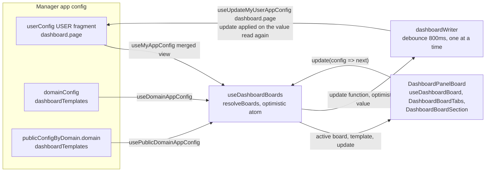
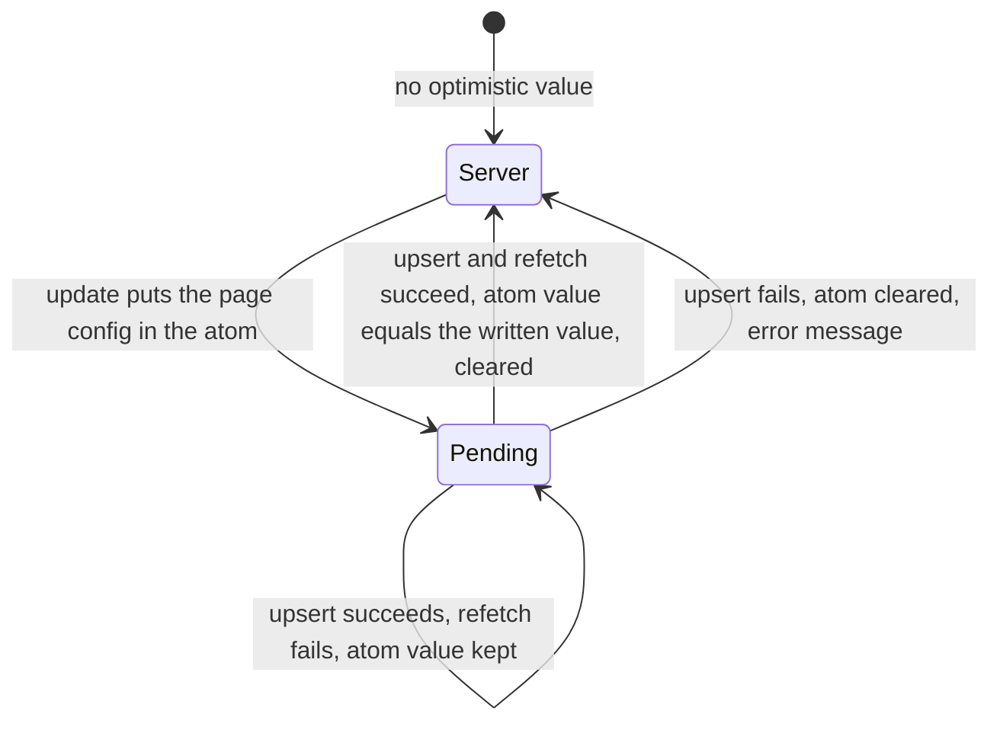

# 0026 — Dashboard boards in manager app config

> The app config hooks this ADR names, and its write base (**Optimistic state**, **Replay on the server value**, **Same-panel edits**, **Shared queue scope**), are replaced by [ADR 0033](0033-scoped-and-merged-app-config-hooks.md): a write now builds on the USER document this tab read at sign-in, kept current by its own upserts.

## Summary

> Unfamiliar terms are collected in the [Glossary](#glossary) at the end.

- A dashboard page's board is JSON that holds only [panel catalog](#glossary) keys and their layout. Each card is defined by a `PanelDefinition` in `panelCatalog.tsx`, and the board points at those keys through a list of `PersistedPanelV2`.
- A user's boards are stored in the `dashboard` key of the manager app config `userConfig`, as `{ boards, active }` per page. The default board (the [role template](#glossary)) is picked from `domainConfig.dashboardTemplates`, then `publicConfigByDomain[<domain>].dashboardTemplates`, then the default in code, in that order.
- Only `useDashboardBoards` writes `userConfig.dashboard`, and it writes only the user's own [USER fragment](#glossary). Templates are not stored in this key.
- Boards in browser localStorage are not migrated. A page with no saved board starts from the role template.
- A write applies the change again on top of the value the server holds now, not on the value this tab cached.
- Custom panels are always on, as `kind: 'preset'` entries of the catalog, with no experimental feature flag.

## Context

- **Panel catalog**: #10580 merged the dashboard's fixed cards and custom panels into one `PANEL_CATALOG` (`react/src/components/DashboardPanels/panelCatalog.tsx`). The pure functions in `boardModel.ts` create a board (`seedBoard`), add and remove cards, apply a layout, and validate a stored value (`sanitizeBoard`).
- **localStorage boards**: Up to #10580, boards lived in localStorage under `dashboard_board.<page>` through `useBAISettingUserState`, and before that under `dashboard_board_items`, `admin_dashboard_board_items`, and `custom_dashboard_panels`. A user who switches browsers loses the boards, and within one browser every project shares one board.
- **App config documents**: `react/src/hooks/useAppConfig.ts` reads and writes three manager app config documents (FR-1964). `useMyAppConfig` reads the `userConfig` view, which the server builds by deep-merging the PUBLIC, DOMAIN, and USER fragments. `useUpdateMyUserAppConfig` reads the USER fragment source again and upserts the whole document with one key changed.
- **Deep merge of arrays**: The server's deep merge mixes arrays across scopes. If a domain admin puts a board list in the DOMAIN scope `userConfig`, it mixes with the user's board list, so a board the user deleted comes back or ids collide.
- **Whole-document upsert**: One upsert replaces the whole USER fragment document. When two upserts read the source at the same time, the later one erases the earlier one's change.
- **Layout events**: When a user drags or resizes a card, `BAIBoard` fires `onItemsChange` on every event.

## Diagram

### Data flow

### Write states

## Decision

### 1. A board is a list of catalog keys and layout

- **Board shape**: One board is a `DashboardModel` (`react/src/components/DashboardPanels/types.ts`).

| field       | type                                                                                    | meaning                                                                                                                   |
| ----------- | --------------------------------------------------------------------------------------- | ------------------------------------------------------------------------------------------------------------------------- |
| `id`        | `string`                                                                                | An id unique within the page. The first board that comes from a template is `default`                                     |
| `title`     | `string`                                                                                | The tab name. When it is an empty string, the tab shows `dashboard.boards.DefaultBoard`                                   |
| `vars`      | `{ project: string[] \| 'all'; rg: string[] \| 'all'; range: string; refresh: string }` | The filter values when the board opens                                                                                    |
| `panels`    | `PersistedPanelV2[]`                                                                    | Catalog keys, the filter and viz of custom panels, and the layout                                                         |
| `knownKeys` | `string[]`                                                                              | The catalog keys the board has seen. A card the user removed does not come back, and a card a new release added does show |

- **No domain fields**: A board has no domain field. A superadmin also reads the current domain ([ADR 0012](0012-scoped-search-fields-in-place-of-admin-fields.md)).
- **Catalog owns cards**: The `PanelDefinition` sets a card's title, size, required role and menu, and refresh interval, and the board does not copy them. `sanitizeBoard` drops keys that are not in the catalog and keys whose page does not match.

### 2. User boards live in `userConfig.dashboard`

- **Key shape**: `userConfig.dashboard` is a `DashboardConfig` (`Partial<Record<PanelPage, DashboardPageConfig>>`). The `project`, `projectAdmin`, and `admin` keys all have the `DashboardPageConfig` shape below.

| field    | type               | meaning                          |
| -------- | ------------------ | -------------------------------- |
| `boards` | `DashboardModel[]` | The page's boards. At least one  |
| `active` | `string`           | The id of the board that is open |

- **Read path**: `useDashboardBoards(page, catalog)` (`useDashboardBoards.tsx`) validates the page value of `useMyAppConfig('dashboard')` with `sanitizeDashboardPageConfig`. When no board is left, it treats the page as having no saved value.
- **Single writer**: Only `useDashboardBoards` writes `userConfig.dashboard`, through `useUpdateMyUserAppConfig(['dashboard', page], …)`. No code writes a `dashboard` key into the `userConfig` of another scope.
- **Board tabs and board section**: The `projectAdmin` and `admin` pages only select a board with `DashboardBoardTabs`. Adding a board (it starts empty), renaming it, and deleting it belong to `DashboardBoardSection` at the top of the edit-mode side panel. The section holds a board selector (it changes the active board the same way a tab click does), a name input (it saves on blur or Enter and does not save an empty name), a new board button, and a delete board button. The last board cannot be deleted. Deleting a board also deletes its panels, layout, and custom panels and cannot be undone, so `BAIDeleteConfirmModal` (`requireConfirmInput`) confirms it only after the user types the board name. The `project` page keeps one board and draws neither tabs nor the board section.

### 3. The default board comes from a template key

- **Precedence**: `resolveTemplate` (`dashboardConfig.ts`) picks the page's template from `domainConfig.dashboardTemplates[page]`, `publicConfigByDomain[<domain>].dashboardTemplates[page]`, and `defaultBoardModel` (the catalog's `seedBoard`), in that order. When a value does not validate as a `DashboardModel`, it moves to the next one.
- **Template knownKeys**: A template without `knownKeys` counts as having seen every page card in the current catalog. A card the template left out does not appear on the board.
- **Template use**: A page with no saved board shows the template as it is and writes it when the user first edits. "New board" starts with no panels and counts every card in the current catalog as seen (`createEmptyBoard`), so the default cards are not filled in. "Reset to default layout" returns the open board's panels to the template and keeps the custom panels that are not in the template, the board's name, and its filter values.
- **Template editing**: A screen for editing templates is out of scope. A superadmin writes the same keys with `useUpdateDomainAppConfig` and `useUpdatePublicDomainAppConfig`.

### 4. Writes are debounced and sent one at a time

- **Optimistic state**: `update` puts the next page config into the jotai atom `optimisticDashboardAtom` at once, so the screen shows it, and puts the update function in the queue. After the write and `useRefetchMyAppConfig` finish, the hook clears the atom only when its value equals the value that write showed. When the write fails, the hook clears the atom so the screen returns to the server value, and shows an error message. When the write succeeds and only the refetch fails, the hook keeps the atom.
- **Replay on the server value**: A write does not send the page config value. When `useUpdateMyUserAppConfig` reads the USER fragment source again, the writer turns its `dashboard.<page>` value into a page config with `resolveBoards`, applies the queued update functions in order, and upserts the result. Boards and names that another tab or device saved survive unless they overlap this tab's change. An update function must therefore decide its result from the config alone. A value such as a new board's id is decided outside the function.
- **Write queue**: `createWriteQueue` (`writeQueue.ts`) joins the updates that arrive within 800ms (`DASHBOARD_WRITE_DELAY_MS`) into one per page (`combinePageWrites`), and starts the next write only after the previous one finishes. The app has one queue, the module in `useDashboardBoards.tsx`. Dragging and resizing do not send a write per event.
- **Flush**: The queue sends at once, without the debounce, when the tab is hidden (`visibilitychange` is `hidden`), on `pagehide`, and when the board unmounts.

### 5. localStorage boards are not migrated

- **No migration**: Nothing reads `dashboard_board.<page>`, `dashboard_board_items`, `admin_dashboard_board_items`, or `custom_dashboard_panels`. A page with no saved board shows the role template and writes it when the user first edits.
- **Browser-bound keys**: These localStorage keys belong to a browser, not to an account. When several accounts share one browser, the account that opens the dashboard first after the upgrade would take the other accounts' boards and custom panels into its own `userConfig`, and the original owners would lose them.

### 6. Custom panels have no experimental feature flag

- **Flag removal**: #10580 removed the `experimental_custom_dashboard_panels` setting and its toggle. A custom panel is a `kind: 'preset'` entry of the catalog, and the data source's `minRole` (`resourceRegistry.tsx`) decides who can see it.

## Rejected alternatives

- **Templates inside userConfig**: Templates sit in the PUBLIC and DOMAIN scope `userConfig.dashboard` and reach users as defaults through the deep merge. One hook reads everything. This is rejected because the deep merge mixes the template's board array with the user's board array, so a board the user deleted or edited merges with the template value.
- **Keep localStorage**: Boards stay in localStorage. No manager round trip is needed. This is rejected because boards differ per browser and device, and an admin has no way to provide role templates.
- **Migrate localStorage once**: Each page moves its localStorage boards into `userConfig.dashboard` once. The layout a user arranged survives. This is rejected because the keys belong to a browser, so nothing tells whose boards they are.
- **Write the cached value**: The writer upserts the page config this tab computed as it is. The implementation is simple. This is rejected because a single tab click in a tab left open for a long time erases boards that another device saved.
- **Write per event**: Every drag and resize upserts at once. The implementation is simple. This is rejected because one drag becomes dozens of whole-document upserts, and upserts sent at the same time erase each other's changes.
- **Dedicated config name**: A new app config document named `dashboard` is registered in the allow-list. Its deep merge rule could be set separately. This is rejected because it needs a manager allow-list registration, and the three registered documents are enough.

## Consequences

- **Cross-device boards**: The same account sees the same boards in any browser and on any device.
- **Admin-provided defaults**: A superadmin can change the default board of an installation or a domain by writing a template key. A user who already saved boards gets the new template when they press "Reset to default layout".
- **Write latency**: A board change reaches the server up to 800ms later. Hiding or closing the tab sends it at once, but nothing guarantees the request finishes before the browser unloads the page.
- **Lost local boards**: A user who arranged boards in localStorage before the upgrade starts again from the template.
- **Same-panel edits**: A save applies only the panels this tab added, removed, or changed onto the panels the server holds, so a panel added or changed on another device survives. When two devices change the same panel, the later write wins.
- **Older clients**: A save puts back the stored cards that this client's catalog does not have and the settings its card definitions do not declare, so a save from an older WebUI on the same manager keeps what a newer one added.
- **Shared queue scope**: The queue orders only dashboard writes. An upsert from a feature that writes another `userConfig` key, such as `useRecentSessionHistory`, can race with it over the USER fragment document.
- **Vars without consumer**: `vars` is saved, but it does not change a card's data range until the filter bar (#10582) exists.
- **No pinned projects**: A board has no field that pins a project. `sanitizeDashboardModel` drops a `pinned` value saved earlier.

## Sources

- #10422 (epic), #10580, #10581, decided 2026-10-26.
- The role-based dashboard proposal in #10422 (storage and migration, default layout).
- Related: [ADR 0012](0012-scoped-search-fields-in-place-of-admin-fields.md).

## Glossary

| Term          | Meaning                                                                                                                                                                                     |
| ------------- | ------------------------------------------------------------------------------------------------------------------------------------------------------------------------------------------- |
| panel catalog | `PANEL_CATALOG`, the list of definitions of the cards a dashboard can hold. A fixed card is a `kind: 'custom'` entry, and a custom panel, one per data source, is a `kind: 'preset'` entry. |
| role template | The per-page default board that a user with no saved board and "Reset to default layout" start from. It is stored as a `DashboardModel` in a `dashboardTemplates` key.                      |
| USER fragment | The manager app config source stored in one user's scope. The view `useMyAppConfig` reads merges this source with the PUBLIC and DOMAIN fragments.                                          |
