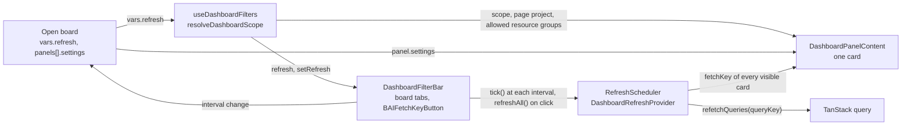
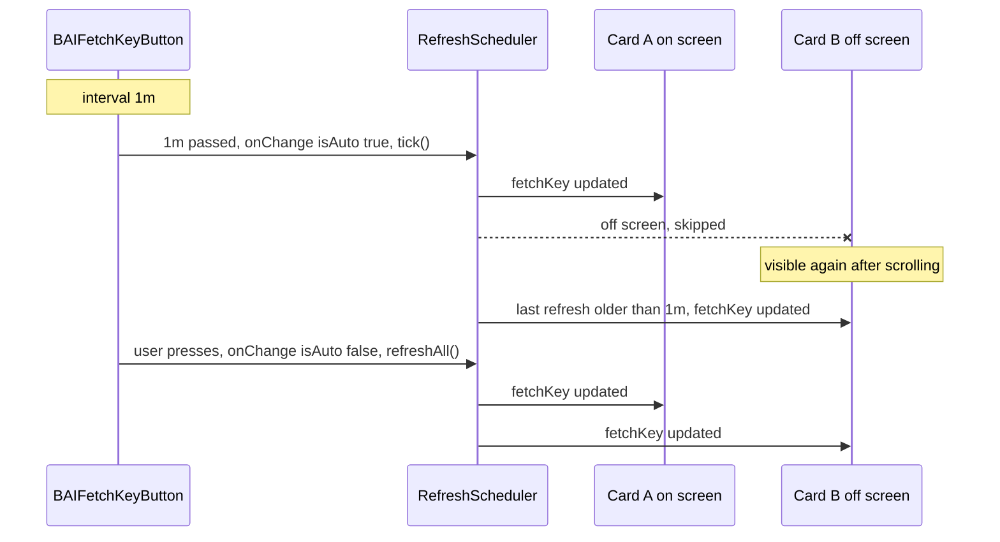

# 0027 — Dashboard refresh bar and per-card settings

## Summary

> Unfamiliar terms are collected in the [Glossary](#glossary) at the end.

- The [dashboard bar](#glossary) of a dashboard page holds only the board tabs and one auto-refresh control. The bar decides only when the cards read again, not what they read.
- The page decides the range a card reads. The regular user page reads the user's own data in the header project, the project admin page reads the project in the URL path, and the superadmin page reads the whole current domain. A superadmin does not pick a domain either ([ADR 0012](0012-scoped-search-fields-in-place-of-admin-fields.md)). The audit log cards build their domain scope as described under "Domain audit scope".
- The dashboard does not read the header's current resource group. A card's resource group choices are the resource groups the page's URL project (the current domain on the superadmin page) can use. A card with no setting, or whose saved group can no longer be used, reads the first resource group of that list by name.
- Resource group and period are [card settings](#glossary). Only a card whose values depend on the resource group or the period has settings. The user edits the saved default in edit mode, and in view mode can change a card's value for a while with the picker in the card header. The bar has no global filter that only some cards follow.
- A page has one auto-refresh. The bar's refresh control sends a tick at each interval (1 minute by default), and a tick makes every card on screen read again together. No card has its own minimum interval. Pressing the control makes every card read again at once. A card has no refresh button of its own.
- A card shows counts over time only as counts the manager computed. A total for the whole period is the sum of the bucket counts the card read. A card that reads a field giving values only per project or per resource group shows them as separate rows, and the client does not add values across projects or resource groups.
- A card the viewer has no permission to read is hidden. When data the client already has tells, the catalog leaves the card out; otherwise the error code in the response tells. No separate request checks permissions. A card whose range a card setting narrowed, and a custom panel, are not hidden and show a notice inside the card.

## Context

- **Card scope**: Before #10580, each dashboard card decided its own range. The "My Sessions" card counted every session in the project for an admin, and the screen did not show which range it used (#9839, #7843).
- **Global filters ignored**: When global resource group, period, and project pickers sat above the board, most cards followed only some of them. The session count card ignored the period, and the help text had to explain the difference. The 2026-10-26 meeting decided to remove the global pickers and move them into card settings.
- **Board model**: [ADR 0026](0026-dashboard-boards-in-manager-app-config.md) stores a board as a `DashboardModel`. One card is a `PersistedPanelV2` of the board.
- **Denied fields**: For a V2 field the viewer cannot read, the manager answers HTTP 200 with only that field set to `null`, and puts `path: [<field>]` and `extensions.code` in `errors[]` (`user_auth_forbidden` for an admin-only field, `permission_access_forbidden` outside the RBAC scope). The other fields of the same request are read (checked on staging with a project admin account, 2026-11-03). Without `@catch`, Relay reads that field as a plain `null`, and the card shows 0 or an empty list.
- **Manager bug**: The 26.10.0a3 manager ignores `after` when one `DateTimeFilter` carries both `after` and `before`.

## Diagram

### Flow of values

### Refresh tick

## Decision

### 1. The bar holds only the board tabs and the refresh control

- **Bar layout**: `DashboardFilterBar` (`react/src/components/DashboardPanels/DashboardFilterBar.tsx`) draws one row with the board tabs (`DashboardBoardTabs` on the `projectAdmin` and `admin` pages) on the left, and one `BAIFetchKeyButton` followed by the edit toggle (`DashboardEditToggleButton`, a secondary button the same size as the refresh control) on the right. This is the only edit entry point on all three pages, and the breadcrumb has none. The `project` page has no tabs, so it shows only the refresh control and the edit toggle.
- **Refresh control**: The bar passes `autoUpdateDelay` and `onChangeAutoUpdateDelay` to `BAIFetchKeyButton`, which opens the interval dropdown. The choices are off, 5 seconds, 10 seconds, 15 seconds, 30 seconds, 1 minute, 5 minutes, and 10 minutes (`REFRESH_OPTIONS`, `refreshScheduler.ts`), and the default is 1 minute. The chosen interval is saved in the open board's `vars.refresh`.
- **No pickers**: The bar has no project, resource group, or period control. It has no domain control either.
- **No URL state**: The bar does not write its value to the URL query. The only value left is the refresh interval, so there is no reason to share it in a link.

### 2. The page decides the range

- **Resolver**: `resolveDashboardScope` (`dashboardScope.ts`) decides the `DashboardScope` (`types.ts`) from `{ page, urlProjectId, currentDomain }`.

| kind       | page           | field                                                   |
| ---------- | -------------- | ------------------------------------------------------- |
| `mine`     | `project`      | `projectId`: the project in the URL path                |
| `projects` | `projectAdmin` | `projectIds`: the one project in the URL path, `domain` |
| `projects` | `admin`        | `projectIds: 'all'`, `domain`: the current domain       |

- **Page project**: The page passes `project` (`ProjectContextOrNull`) to `DashboardPanelBoard`. It is the project in the URL path on the regular user page and the project admin page (`useUrlProjectValidity`), and `null` on the superadmin page. The page does not read the header's current project, because that project follows the URL through an effect. Cards and panel modals read it from `DashboardFilterContext` with `useDashboardProject`, and a custom panel query uses the project `useDashboardQueryScope` gives, or the current domain when that is `null` (ADR 0001).
- **Current domain**: `useDashboardFilters` passes the `{ id, name }` of `useCurrentDomain()` as `domain`.
- **Domain audit scope**: On the superadmin page, a card that reads audit logs reads `scopedAuditLogsV2` with one scope made of the current domain, every project of the domain, and every user of the domain as `triggeredUser`. A domain entity scope alone misses the session, folder, and deployment records inside that domain, and the user items bring them back: on a 26.10 manager with one domain, 30 days of records read 91 entries with the domain alone and 3012 with this scope, against 5157 cluster-wide, where the rest were system records no user triggered. WebUI serves one domain, so records of other domains never show. The card reads the domain's projects and users first, in one page each, since a scope has no other way to name them.
- **Board vars**: A board's `vars` (`DashboardBoardVars`) is `{ refresh }` only. `sanitizeBoardVars` drops the `project`, `rg`, and `range` left in older boards, and changes a `refresh` that is not in `REFRESH_OPTIONS` to `1m`. A board that already chose an interval keeps it.

### 3. Resource group and period are card settings

- **Declared settings**: `PanelDefinition.settings` lists the settings a card reads (`resourceGroup`, `range`). The values are saved in the board panel's `PersistedPanelV2.settings` (`{ resourceGroups?: string[]; range?: string }`). A card has only one resource group, saved as a one-item `resourceGroups` array. `sanitizeBoard` drops settings the card definition does not list, and keeps only the first of several resource groups left in an older board.
- **Saved default in edit mode**: The edit-mode side panel shows a settings button and the current value only for the cards on the board that list settings, and the button opens `PanelSettingsModal`. The value chosen there is the card's default saved in the board. A card that lists no settings has no control.
- **Header pickers in view mode**: A card that lists settings also draws a resource group picker and a period picker next to the title in its header in view mode (`PanelSettingsHeaderControls`). On hover, each picker shows a tooltip naming what it picks (resource group, period). A value chosen in the header is not saved and lives only in memory (`panelSettingOverridesAtom`). It survives auto-refresh, and it returns to the saved default when the user leaves the page or reloads it. When it differs from the saved value, the resource group picker is highlighted, and a revert button appears beside the pickers and restores the saved value; the period picker (ui-common's `DateTimeRangeInput`, which has no highlighted style) is marked by that button alone.
- **Resource group choices**: `PanelSettingsModal` and the header picker pick one resource group with `BAIScopedResourceGroupSelect`. The choices come from the page's URL project (`scope: { project }`), or on the superadmin page from the current domain (`scope: { domain }`) (`resourceGroupScopeOf`, `dashboardScope.ts`). SFTP-only resource groups are left out. That list is the `sftp_scaling_groups` of the same project's storage hosts (`vfolder.list_hosts(projectId)`, without a project on the superadmin page).
- **Allowed groups**: `DashboardResourceGroupsProvider` (`DashboardResourceGroups.tsx`) reads that scope's `scopedResourceGroups` once per page (on a project page, the project scope alone, `resourceGroupScopeOf`; scopes are combined with OR, so adding the domain scope would offer groups the project may not use), without SFTP-only groups, sorted by `NAME` ascending, up to 100, and shares them through `useDashboardResourceGroups()`. Cards, header pickers, and the settings modal all use this value, and the page draws a skeleton instead of the board until the list arrives.
- **Defaults**: When the resource group setting is empty, a fixed card reads the first resource group of that list (`defaultResourceGroupOf`), and a custom panel reads every resource group. When a saved value or a value chosen in the header is not in the list (the project can no longer use it), the card returns to the same default. When the list was cut at 100 or failed to load, the card uses the saved value as it is. The page does not read the header's current resource group, so changing the resource group in the header does not change the cards. The period setting defaults to the last 24 hours (`DEFAULT_RANGE`, `panelSettings.ts`), and the choices are the last 1 hour, 24 hours, and 7 days, or a custom start and end.
- **Fixed window**: A period is a preset (`now-1h`, `now-24h`, `now-7d`) or a fixed window stored as `<ISO date-time>/<ISO date-time>` (`windowRange`, `timeRange.ts`). The pickers (`PanelRangeSelect`, ui-common's `DateTimeRangeInput`) offer the presets and a custom start and end to the minute. A preset is stored as its rolling range, and a custom pick as a fixed window; the picker's `max` is now and its `maxDuration` the cap below, so it cannot commit a longer window. The end must be later than the start, an end later than now is set to now, and the length is at most 7 days (`MAX_WINDOW_DAYS`) (`checkWindow`). `sanitizePanelSettings` keeps only presets and windows that meet these conditions, and drops the rest so the card returns to the default period. The value saved in the board and the value chosen in the header (in memory) follow the same rules as presets.
- **One cap for every card**: Every card, including Long-running Sessions and My Activity, limits a fixed window to 7 days (`MAX_WINDOW_DAYS`). Cards that count within a period themselves, with a count alias per interval, would otherwise send long queries, and one cap keeps every picker the same. `checkWindow`, `sanitizePanelSettings`, and `PanelRangeSelect` use it, and a longer saved value, including one saved under the earlier 90-day cap, returns to the default period. A catalog entry's `maxRangeDays` can still lower the cap for one card. Long-running Sessions sets it to `0`: the card reads only the period's start, so its picker offers the presets alone and stores no fixed window.
- **Period in the header**: A card's period shows only in its header picker: a preset's name, or a fixed window's start and end. The body repeats no period line. A chart's tooltip names the span of each bucket and of the window a delta compares (`formatBucketSpan`).
- **Superadmin resource group**: The `/admin/dashboard` route draws no header project selector. The superadmin page's list is the current domain's resource groups, and a card with an empty setting reads the first of them by name.
- **Card state**: `DashboardPanelContent` resolves the value chosen in the header, or else the saved setting, and passes it as `vars` (`DashboardVars`): `range`, `timeRange` fixed at the card's last refresh time, `resourceGroup` (the setting when it is in the list, or else the default resource group), and `currentProjectId` (the page's project).
- **Single resource group cards**: A card that reads a field taking only one resource group reads only the one resource group that `cardResourceGroup(settings.resourceGroups, allowed)` decides. It does not split requests per resource group.
- **Group slots**: The "My Total Resource Usage" card on the regular user page draws bars only for cpu, mem, and the slots greater than 0 in the card resource group's `ResourceGroup.resourceInfo.capacity` (`offeredSlotsOf`, `memberCardData.ts`). The card filters because `myUserResourceAllocationV2` returns every slot the manager knows, regardless of the resource group. When `resourceInfo` is `null`, the card does not filter. The session page's resource card (`ConfigurableResourceCard.tsx`) offers the same two views as the dashboard (My Total Resource Usage and Total Resources in Resource Group) with the same header and body (`MyResourcesInResourceGroup`), and only its resource group picker differs. That picker reads and changes the header's current resource group. The card filters slots the same way as the dashboard card, with `offeredSlotsOf` over the group's `resourceInfo.capacity`.
- **Member allocation**: This card reads only fields a regular project member can read. The usage is `myUserResourceAllocationV2.user.used`, and the limit is the usage plus the smallest of `myUserResourceAllocationV2.user.assignable`, `projectResourceAllocationV2(projectId).project.assignable`, and the card resource group's `resourceInfo.free`. The card does not use `effectiveResourceAllocationV2`, because a regular member gets `permission_access_forbidden` for it (no session READ on the project) (checked on staging with the `frontend-session-guest` account, 2026-11-03). The domain limit is left out because a member has no field to read it from. When the project limit or the resource group's free amount is denied, the card leaves out only that limit, and only a denial of the primary field `myUserResourceAllocationV2` hides the card.
- **Custom panels**: When the data source can narrow by resource group (`ResourceConfig.supportsResourceGroup`), a custom panel also has a resource group setting. Sessions add `scaling_group == ...` to the minilang filter, and deployments use `resourceGroup: { in }`. Folder panels have no setting. A custom chart panel that counts within a period also has a period setting: a time chart (line, area, column) always, and a group chart (donut, pie, bar, radar) when "Count within a period" is on. The setting kinds of a board panel come from `panelDefinitionOf(definition, panel)` (`panelSettings.ts`), which adds `range` to the preset's `settings` for such a chart, and every place that reads `settings` for a board panel reads them through it. The period follows the card rules above: the saved default, the header picker, the 7-day cap, and the period line. The table listed under such a chart narrows to the same period.

### 4. The period filter is an AND of two bounds

- **Window**: `rangeToDateTimeFilter(range, now)` turns a period into an `{ after, before }` window. `before` is exclusive. A card passes its last refresh time as `now`, so the query variables do not change between refreshes.
- **ANDed bounds**: The window is not passed as one `DateTimeFilter`. `withinWindow(field, window)` passes it as `AND: [{ field: { after } }, { field: { before } }]`. Buckets do the same.

### 5. A page has one refresh

- **Scheduler**: `DashboardRefreshProvider` creates one `RefreshScheduler` (`refreshScheduler.ts`) per page. The scheduler has no timer.
- **Ticks**: When `BAIFetchKeyButton` calls `onChange(key, { isAuto: true })` at an interval, the bar calls `tick()`. When the user presses the button (`isAuto: false`), the bar calls `refreshAll()`. The button pauses the interval in a hidden tab.
- **Subscribers**: A card registers with the scheduler through `useDashboardFetchKey('panel:<id>')`, a page query that cards still read through `useDashboardFetchKey('page-query')`, and a TanStack query through `useDashboardRefreshQuery(queryKey)`.
- **One cadence**: `tick()` makes every subscriber on screen read again. A card definition has no refresh interval, so the whole dashboard reads again together. `refreshAll()` makes every subscriber read again at once, including those off screen.
- **Off-screen cards**: When `useBoardItemVisibility` tells the scheduler a card is off screen, `tick()` skips it. When the card is visible again, the scheduler makes it read again at once if its last refresh is older than the current interval (`setIntervalMs`, passed by the bar). A value up to 500ms early also counts as past. When the interval is off, the card does not read again.
- **No card buttons**: The headers of cards and custom panels have no refresh button (`PanelFrame`). A card component also used outside the dashboard hides its button with `hideRefreshButton`.
- **No suspense flash**: `useDashboardFetchKey` changes the fetch key inside a `useTransition` transition, and the cards and the page read their queries again with that key. While the new query suspends, the screen keeps showing the previous value.
- **In-flight refresh**: A subscriber whose transition has not finished is `isPending` and tells the scheduler through `setPending`. While any subscriber is in flight, the bar's refresh button shows loading and does not start the next interval, and `tick()` skips the subscribers in flight.
- **Observed as mounted**: `useBoardItemVisibility` uses a `MutationObserver` to observe each `[data-board-item-id]` element as the board attaches it. The board draws its items only after it measures its width, so one lookup at the first render is not enough.

### 6. The manager counts over time, and totals add those counts

- **Count aliases**: A card that draws values such as counts per status reads the `count` of connections with different filters in one request, as [count aliases](#glossary).
- **Buckets**: A card that draws counts over time reads one count alias per consecutive interval among the eight or fewer that `planBuckets(range, now)` (`timeRange.ts`) makes. A relative period gets intervals aligned to unit boundaries (10 minutes for 1 hour, 4 hours for 24 hours, a day for 7 days), plus one first interval cut to fit `now`. So 1 hour and 24 hours get 7 intervals, and 7 days gets 8 intervals of one day each, with one fewer only when `now` falls exactly on a boundary. A custom period is split into equal lengths.
- **Totals from buckets**: A total for the whole period (such as the success and failure counts of audit logs) adds the bucket counts the same card read. The buckets split the window with no gap and no overlap, so the sum equals the window's count, and the card reads no separate alias for the total.
- **Usage buckets**: The usage trend card draws the intervals the manager's `usageBuckets` returns as they are.
- **Rows, not sums**: A card that reads a field giving values only per project or per resource group draws one row per project or resource group. The client does not add the values of the responses it received per project or resource group.

### 7. One card across roles

- **One UI, scope as input**: A card that appears on several pages (regular user, project admin, superadmin) is one component. Its layout, statistic format, charts, tables, settings, and empty state are the same, and only the `DashboardScope` the page decides differs. A regular user reads their own data, a project admin reads the project in the URL path, and a superadmin reads the current domain and superadmin-only data. The card takes the scope as input and picks the matching fields, and no role gets a separate component.

### 8. Cards the viewer cannot read are hidden

- **Catalog first**: The catalog leaves out the cards that the role decides (`catalogFor`). `requires.role: 'projectAdmin'` accepts a superadmin, a domain admin, and an RBAC admin of the page project (`useIsCurrentProjectAdmin`, the same value the route guard uses). It is passed as `PanelCatalogContext.isProjectAdmin`.
- **Runtime detection**: Every root field of a card query carries `@catch(to: RESULT)`. `isPermissionDenied(errors)` in `panelPermission.tsx` checks whether `extensions.code` is `permission_access_forbidden` or `user_auth_forbidden`. For an object `RelayEnvironment` threw because the whole request failed, it counts a denial when `error_code` is one of the same codes or `statusCode` is 403. A 401 means the session ended, so it does not count as a denial.
- **Primary and secondary**: A card reads its primary data field with `readPrimary`. On a denial it throws `PermissionDeniedError`, and other errors are `null` as before. It reads secondary fields (extra counts, previous-period counts, buckets) with `readSecondary`, and draws a denied value, and the totals, deltas, and donut totals built from it, as "-" instead of 0.
- **Hide through the board**: `PanelPermissionBoundary` inside the card catches the denial and reports it to `DeniedPanelsContext` in an effect. `useDeniedPanels` (`DashboardPanelBoard`) holds the denied panel ids per page scope key (`dashboardScopeKey`: the page and the project, or the domain on the superadmin page), and `useDashboardBoard` removes those panels from the board items so the board flows again with no empty slot. The panels stay in the saved board and in `activeKeys`, and `applyLayout` keeps the places of panels it does not draw. The edit-mode side panel marks such a card with "You do not have permission to view this".
- **Reset**: The denied list empties when the scope changes, and when the user presses the refresh control (`refreshAll`). A permission granted in between shows at the next manual refresh. An auto tick does not empty the list. `useBAILogger` logs the same panel of the same scope only once.
- **Notice instead of hiding**: A card whose range a card setting or header picker narrowed (resource group, period, and so on) is not hidden and draws a notice such as "You do not have permission for this resource group" in its body. The header pickers and the revert button stay, so the user can undo the chosen value. A custom panel (`kind: 'preset'`) is not hidden either and draws a notice.

## Rejected alternatives

- **Global filter bar**: Project, resource group, and period pickers sit above the board, and every card follows them. The board's range shows in one row. This is rejected because a card showing the current state cannot follow the period, and a card unrelated to resource groups cannot follow the resource group, so cards silently ignore some of the bar's values, and the user cannot tell which card follows which value.
- **Per-card refresh**: Each card has a refresh button. A user can make one card read again. This is rejected because several refresh controls on one screen make it unclear what reads what again, and they overlap the page's refresh.
- **Per-card minimum**: Each card definition has a minimum refresh interval (`refresh.min`), and a tick makes only the cards whose interval passed read again. Slow-changing data is requested less. This is rejected (2026-10-29) because cards on the same screen show values from different times, and the user cannot tell which cards the bar's interval makes read again.
- **Header resource group default**: A card with an empty setting reads the header's current resource group. It shows the same group as other pages. This is rejected because the header's resource group follows the header's current project, which can differ from the URL project of the project admin page, so the card would read a group that project cannot use, and the card would change silently whenever the header changes.
- **Effective allocation for members**: "My Total Resource Usage" reads the minimum of every limit from `effectiveResourceAllocationV2` alone. The domain limit is included. This is rejected because a regular member cannot read this field even in their own project, so the card would be hidden or empty, and the card would disappear for the dashboard's main users.
- **Edit-mode-only settings**: Card setting controls exist only in edit mode. Cards in view mode get simpler. This is rejected because a user who wants a quick look at another resource group or period has to enter edit mode and change the board's saved value, and in view mode nothing shows which resource group and period a card reads.
- **Cluster-wide audit log**: The audit log cards on the superadmin page read `adminAuditLogsV2`, which holds every record. This is rejected (2026-11-06) because WebUI serves one domain, and on a multi-domain cluster the cards would show other domains' records while the neighbouring cards count only the current domain.
- **Domain entity scope alone**: The audit log cards read with only the current domain as the scope. This is rejected because that scope misses the domain's session, folder, and deployment records, so the card cannot show most of the real activity.
- **Domain picker**: The superadmin bar has a domain multi-select. This is rejected because [ADR 0012](0012-scoped-search-fields-in-place-of-admin-fields.md) set every role's reads to the current domain's `scoped*` fields.
- **Scheduler timer**: The scheduler ticks with its own timer, and the button only picks the interval. This is rejected because `BAIFetchKeyButton` runs its own timer once an interval is chosen, so there would be two timers, and the button's countdown would drift from the actual refresh.
- **Permission pre-check**: Before drawing cards, a request such as `myAtomicBulkScopePermissions` asks for each card's permission. A denied card is never drawn, even briefly. This is rejected because it adds requests per card, and the client would have to maintain a separate table pairing the fields a card reads with permission entities. The error code in the response tells the same fact with no extra request.
- **Show zero or an error state**: A denied card stays and shows 0 or "unexpected error". This is rejected because 0 is a false value, and an error state makes something the user cannot fix look broken.
- **Client-side sums**: The browser adds the values received per project. This is rejected because the client cannot know which projects were left out for lack of permission, so the total is wrong, and the number of requests grows with the number of projects.

## Consequences

- **Visible card scope**: A card that lists settings shows, even in view mode, the resource group and period it reads in its header pickers. The edit-mode side panel shows the saved default.
- **Superadmin audit log range**: System records that no user triggered and that name no project of the domain, such as scheduler and global configuration records, do not show on the superadmin audit log cards. A domain with many users or projects sends a long scope with every audit read.
- **No shareable filter links**: A link carries only the page and the project. Card settings are saved in the board, so the same account sees the same values on any device.
- **Unmigrated cards**: The existing cards at the time this decision landed do not read `scope` and `vars`; they use the page query and the header values. No fixed card lists settings yet.
- **No domain limit for members**: The limit of "My Total Resource Usage" leaves out the domain limit. When the domain limit is smaller than the user limit, the project limit, or the resource group's free amount, the card shows a limit larger than what can actually be allocated.
- **Hidden card flash**: A denial is known only after the response arrives, so a card to be hidden shows as a skeleton during the first load and then disappears. The same happens after a manual refresh.
- **Cards blocked on aggregation**: A card for which the manager gives no group-by or time series values is not built and stays a backend request.

## Sources

- #10422 (epic), #10582, #9839, #7843, the 2026-10-26 meeting, the 2026-10-29 decision (one refresh cadence for every card, 1 minute by default, one resource group per card), the 2026-10-30 decision (card header pickers in view mode), and the 2026-11-03 decision (hide cards the viewer cannot read, show a notice on cards narrowed by settings and on custom panels, dashboard resource groups independent of the header with the URL project's first resource group as the default, and only the slots a resource group offers in "My Total Resource Usage"), and the 2026-11-06 decision (the superadmin audit log reads the current domain only).
- The role-based dashboard proposal in #10422 (period and refresh, storage and migration).
- Related: [ADR 0012](0012-scoped-search-fields-in-place-of-admin-fields.md), [ADR 0026](0026-dashboard-boards-in-manager-app-config.md).

## Glossary

| Term          | Meaning                                                                                                                                                                   |
| ------------- | ------------------------------------------------------------------------------------------------------------------------------------------------------------------------- |
| dashboard bar | The row above the dashboard board. It holds the board tabs and the auto-refresh control, and `DashboardFilterBar` draws it.                                               |
| card setting  | The resource group and period values one card saves in the board. It is `PersistedPanelV2.settings`, and a card has only the settings its definition lists in `settings`. |
| board         | One saved dashboard sheet that holds the card layout and settings. It is a `DashboardModel`, defined by [ADR 0026](0026-dashboard-boards-in-manager-app-config.md).       |
| fetch key     | The string passed to the `fetchKey` option of Relay `useLazyLoadQuery`. When the value changes, the query reads from the server again.                                    |
| count alias   | Calling the same connection field several times in one GraphQL request with different filters, and reading only each result's `count` under its own name.                 |
