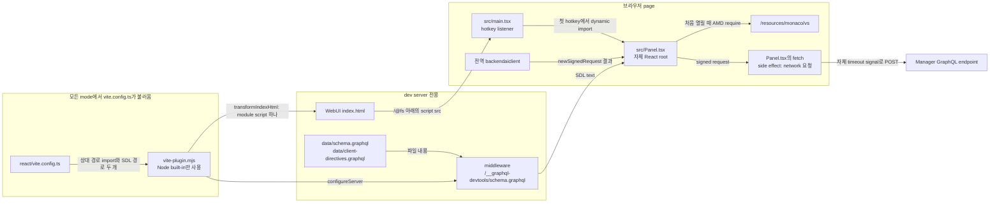

# 0028 — Dev-only tools as Vite plugin packages

## Summary

> 낯선 용어는 문서 맨 아래 [용어](#용어)에 모아 두었다.

- 개발자만 쓰는 tool은 `packages/` 아래의 독립된 private workspace package에 둔다. 이 package는 `react/`의 dependency가 아니고, `react/src`는 이 package를 import하지 않는다. tool의 import는 자기 package 안에 머물고, app과 공유하는 logic은 package 안에 복사한다.
- [`apply: 'serve'`](#용어)를 쓰는 [Vite plugin](#용어)이 tool을 dev server에 붙인다. plugin은 WebUI `index.html`에 module script 하나를 넣고, tool 전용 dev asset을 dev-server middleware로 제공한다. production build에는 tool 코드로 가는 경로가 없다.
- `react/vite.config.ts`가 production build에서도 plugin 파일을 불러오므로, plugin 파일은 Node built-in만 쓴다.
- tool은 page load 때 hotkey listener만 불러오고, 나머지는 처음 열릴 때 불러온다.
- `packages/backend.ai-graphql-devtools`가 이 규칙을 따르는 첫 tool이다. 이 tool은 app의 전역 `backendaiclient`로 [signed request](#용어)를 만들고 자기 `fetch`로 보낸다. panel은 React이고 `/resources/monaco/vs`의 app Monaco runtime을 쓴다.
- Decision의 1~4항은 모든 dev 전용 tool에 적용된다. 5항과 6항은 GraphQL devtools panel이 app을 쓰는 방식을 기록한다.
- **Out of scope**: `react/vite-plugins/review-overlay/`의 review overlay는 build-time 주입과 `react/src`의 host component도 가지고 있으므로 그 위치에 그대로 둔다.

## Context

- **What the tool is**: GraphQL devtools panel은 WebUI dev server 안에서 로그인된 session으로 query를 실행한다(#10963).
- **Why the placement needs a rule**: `react/src` 아래의 모든 줄은 production bundle에 들어갈 후보이고, dev 코드에 guard를 둘러도 그 코드는 reviewer와 bundler가 읽는 source tree에 남는다. tree 밖에 둔 tool은 WebUI source를 바꾸지 않는다.
- **Client request path**: `packages/backend.ai-client/src/client.ts`의 `Client._wrapWithPromise`는 요청을 보내는 일 외의 일도 한다. 이 함수는 `NetworkStatusBanner`가 듣는 event를 보내고, local storage의 `backendaiwebui.logs` 항목에 기록을 더한다.

## 설계도

## Decision

### 1. 개발자 전용 tool은 별도 private package다

- **Location**: tool은 `"private": true`인 `packages/<name>/`에 둔다. `pnpm-workspace.yaml`은 이미 `packages/*`를 포함한다.
- **No link from the app**: 이 package는 `react/package.json`에 나타나지 않고, `react/src` 아래의 어떤 파일도 이 package를 import하지 않는다.
- **Own dependencies**: package는 자기가 쓰는 것을 직접 선언한다. `backend.ai-graphql-devtools`는 `react`, `react-dom`, `graphql`, `graphql-language-service`를 선언하고, `monaco-editor`는 타입 용도의 dev dependency로만 둔다.
- **Imports stay inside the package**: tool은 자기 파일과 자기가 선언한 dependency만 import하고, `react/src`나 다른 package의 source는 import하지 않는다. app과 공유하는 logic은 package 안에 복사한다. 이 tool에서는 `src/graphql-transformer.ts`가 client-directive 변환인 `react/src/helper/graphql-transformer.ts`의 복사본이다.
- **Own styling**: panel은 일반 element를 `src/Panel.css`로 꾸며 그리고, `@lablup/ui-common`은 이 package의 dependency가 아니다. 이 stylesheet는 page 전체에 적용되므로 selector에 `bai-gql-devtools` prefix를 붙인다.

### 2. `apply: 'serve'` Vite plugin이 tool을 붙인다

- **Call site**: `react/vite.config.ts`가 plugin을 상대 경로로 import해 호출한다. 이 tool의 호출은 `projectRoot`에서 `data/schema.graphql`과 `data/client-directives.graphql`을 resolve한 `schemaPath`와 `clientDirectivesPath`를 넘긴다.
- **Injection**: `transformIndexHtml`이 body에 `<script type="module">` 하나를 더한다. 그 `src`는 `/@fs` 아래에서 `src/main.tsx`를 가리킨다. `react/vite.config.ts`의 `server.fs.allow`에 저장소 root가 들어 있어 dev server가 그 파일을 제공할 수 있다.
- **Dev assets**: `configureServer`가 tool에만 필요한 asset용 middleware를 더한다. 이 tool에는 두 SDL 파일을 이어 붙여 제공하는 `/__graphql-devtools/schema.graphql` 하나가 있다. 파일이 없으면 error다.
- **Hook order**: `transformIndexHtml`은 일반 함수로 둔다. 그래야 Vite가 HTML을 project root의 template으로 바꾸는 `projectRootStaticPlugin`의 `order: 'pre'` handler 뒤에 이 함수를 실행한다.
- **Prebundling**: plugin의 `config` hook이 panel을 `optimizeDeps.entries`에 더하므로, Vite는 dev server 시작 때 panel의 dependency를 prebundle한다.

### 3. plugin 파일은 Node built-in만 쓴다

- **Rule**: `vite-plugin.mjs`는 `node:*` module만 import한다.
- **Reason**: `react/vite.config.ts`의 정적 import가 `vite build` 중에 이 파일을 평가한다. `apply: 'serve'`는 거기서 plugin의 hook이 실행되는 것은 막지만 파일을 불러오는 것은 막지 않는다.
- **Referencing source**: plugin은 `src/` 파일을 `new URL(..., import.meta.url)`로만 가리키므로, plugin을 불러와도 tool은 불러오지 않는다.

### 4. page load 때는 hotkey listener만 불러온다

- **Page load cost**: `src/main.tsx`는 capture 단계 `keydown` listener 하나를 등록하고 다른 것은 정적으로 import하지 않는다.
- **First open**: hotkey(macOS는 Cmd+Shift+G, 그 밖은 Ctrl+Shift+G)가 `src/Panel.tsx`를 dynamic import하고, 그 다음 panel이 Monaco와 schema를 불러온다.
- **Own root**: `togglePanel`은 `document.body`에 container 하나를 붙이고 거기에 별도 React root를 mount한다. panel은 app의 React tree에 들어가지 않는다.

### 5. client로 서명하고 자기 `fetch`로 보낸다

- **Signing**: `Panel.tsx`는 전역 client의 `backendaiclient.newSignedRequest('POST', '/admin/gql', ...)`를 부른다. 그래서 요청은 로그인된 session의 credential을 지니고, token을 복사하지 않는다.
- **Client directives**: 서명 전에 `Panel.tsx`는 client-directive 변환의 복사본을 적용하고, version 확인은 `react/src/RelayEnvironment.ts`처럼 `client.isManagerVersionCompatibleWith`로 한다. 요청에는 변환된 query가 실리고, operation guard와 history 항목은 입력한 query를 쓴다.
- **Sending**: `Panel.tsx`는 `AbortSignal.timeout(client.requestTimeout)`으로 직접 `fetch`를 부른다. `SESSION` mode에서는 `_wrapWithPromise`와 같이 `credentials: 'include'`와 `mode: 'cors'`를 넣는다.
- **Reason**: `_wrapWithPromise`는 app의 soft-timeout banner를 띄우고, 성공하면 그 banner를 닫을 수 있고, app log를 쓴다. 개발자의 시험 query는 이 중 어느 것도 바꾸면 안 된다.

### 6. panel은 app의 Monaco runtime을 다시 쓴다

- **Runtime**: `Panel.tsx`의 `loadMonaco`는 `react/vite.config.ts`의 `monacoStaticPlugin`이 개발 중 제공하는 `/resources/monaco/vs`의 AMD loader를 쓴다. app이 Monaco를 이미 불러왔으면 `loadMonaco`는 `globalThis.monaco`를 쓴다.
- **GraphQL support**: panel은 자기 editor model에 marker를 넣는다. `graphql` language에 completion provider도 등록하는데, 이 provider는 panel의 model이 아니면 아무것도 돌려주지 않는다. 결과는 `graphql-language-service`가 계산한다.

## 대안과 기각 사유

- **GraphiQL**: GraphiQL은 완성된 GraphQL IDE다. 기각한 이유는 app과 다른 version의 Monaco를 하나 더 가져오고 worker 설정이 필요하기 때문이다.
- **Altair**: Altair는 기능이 많은 GraphQL client다. 기각한 이유는 HTML로 넣는 Angular app이라 app의 client 함수를 넘길 수 없기 때문이다.
- **Apollo Sandbox**: Apollo Sandbox는 local editor 코드가 필요 없다. 기각한 이유는 외부 Apollo host의 iframe을 불러오기 때문이다.
- **CodeMirror with `cm6-graphql`**: 이 조합은 바로 쓸 수 있는 GraphQL 편집 기능을 준다. 기각한 이유는 app이 이미 Monaco를 싣고 있는데 editor를 하나 더 들이기 때문이다.
- **`import.meta.env.DEV` gate inside `react/src`**: 이 gate는 별도 package가 필요 없다. 기각한 이유는 WebUI source를 고치고, tool을 bundle에서 빼는 일을 dead-code 제거에 맡기기 때문이다.
- **No-framework iframe app**: 이 형태는 구현까지 했고 tool을 page에서 완전히 격리한다. 기각한 이유는 `postMessage`, token 복사, Monaco 두 번째 load가 필요하고, owner가 격리의 이득이 그 비용만 못하다고 판단했기 때문이다.

## Consequences

- **Production output**: plugin을 넣은 production build의 파일 1,648개는 `sw.js.map`만 빼고 동일하다. 이 파일은 plugin 없는 두 build 사이에서도 다르다.
- **Page state after opening**: panel을 열면 `body`에 Monaco의 class가 남고 전역 `monaco`가 남는다. users page의 element 2,947개를 비교한 결과 panel을 열고 닫은 뒤 computed style 변화는 없었다.
- **Word suggestions in app editors**: Schema tab이 열린 뒤에는 language가 `graphql`인 app editor에 열린 schema 문서에서 뽑은 Monaco word-based suggestion이 나타난다. 그 tab을 열기 전에는 없고, panel의 provider와 marker는 app editor에 닿지 않는다.
- **App modals**: panel은 `body`의 일반 element이므로, app modal이 열려 있으면 modal이 닫힐 때까지 panel은 inert 상태다.
- **Copied transform**: `src/graphql-transformer.ts`는 `react/src/helper/graphql-transformer.ts`와 달라질 수 있고, 이를 검사하는 것은 없다.
- **Undocumented client fields**: tool은 `ready`, `newSignedRequest`와 그 결과의 `uri`, `requestTimeout`, `_config.connectionMode`, `isManagerVersionCompatibleWith`에 의존한다. `Panel.tsx`가 이 타입을 손으로 선언하므로, `backend.ai-client`가 바뀌어도 type-checking은 잡지 못한다.
- **Verification gap**: `scripts/verify.sh`는 이 package를 검사하지 않고, 1항과 3항을 강제하는 lint 규칙도 없다. tool 작성자가 `packages/backend.ai-graphql-devtools/TEST-PLAN.md`의 검사를 손으로 실행한다.

## 출처

- GitHub issue: #10963.
- `packages/backend.ai-graphql-devtools/vite-plugin.mjs`, `src/main.tsx`, `src/Panel.tsx`, `src/graphql-transformer.ts`, `TEST-PLAN.md`.
- `react/src/helper/graphql-transformer.ts`와 `react/src/RelayEnvironment.ts`.
- `packages/backend.ai-client/src/client.ts`의 `Client._wrapWithPromise`와 `react/src/components/NetworkStatusBanner.tsx`.
- 결정일: 2026-11-09.
- 관련: [ADR 0008](0008-host-agnostic-review-overlay-client.ko.md)은 dev server에 붙는 다른 tool인 review overlay client를 정한다.

## 용어

| 용어 | 뜻 |
|---|---|
| Vite plugin | Vite dev server와 `vite build`가 하는 일을 hook으로 넓히는 object다. |
| `apply: 'serve'` | Vite가 plugin의 hook을 dev server에서만 실행하게 하는 plugin option이다. |
| signed request | `newSignedRequest`가 돌려주는 object로, 현재 client로 인증된 Backend.AI API 호출의 URI, method, header, body를 담는다. |
| AMD runtime | `min/vs` 아래의 Monaco build로, page가 bundler 없이 `require` loader로 불러온다. |
| inert | element가 사용자의 click, focus, keyboard 입력을 받지 않는 상태다. |
