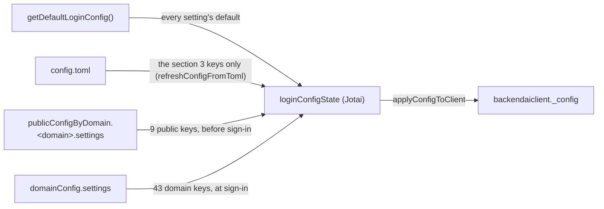
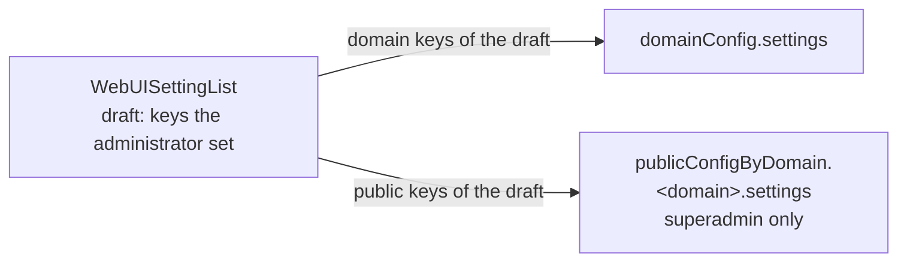

# 0028 — WebUI settings in the app config settings key

## Summary

> 낯선 용어는 문서 맨 아래 [용어](#용어)에 모아 두었다.

- `config.toml`에만 있던 WebUI 설정 52개를 관리자가 시스템 설정 페이지(`/admin/system-settings`)에서 바꾼다. 값은 manager의 [app config](#용어) 문서에 저장된다.
- 각 [스코프](#용어) 문서에는 평탄한 키 `settings` 하나만 둔다. 로그인 전에 필요한 9개는 `publicConfigByDomain.<domain>.settings`, 로그인 뒤에 쓰는 43개는 `domainConfig.settings`에 둔다.
- 두 문서는 서로 다른 키를 가진다. 문서에 있고 타입이 맞는 키만 설정의 코드 기본값(`getDefaultLoginConfig`)을 덮고, 문서가 없거나 읽지 못하면 코드 기본값을 쓴다.
- `config.toml`은 이 설정들을 더 이상 담지 않는다(#10664). 문서를 읽기 전에 필요한 값과 webserver가 함께 강제하는 값만 파일에 남는다(3절).
- 키마다 스코프와 타입은 `react/src/helper/webuiSettings.ts`의 [정의표](#용어) `WEBUI_SETTING_DEFINITIONS`가 정한다. 화면, 병합, 저장이 모두 이 표를 읽는다.

## Context

- **What existed**: 메뉴 숨김, 세션 자원 상한, 로그인 화면 옵션 같은 WebUI 설정은 `config.toml`에만 있었다. 값을 바꾸려면 배포 파일을 고쳐 다시 배포해야 했고, 한 webserver가 서빙하는 모든 도메인이 같은 값을 썼다.
- **What app config is**: manager가 스코프별 JSON 문서를 저장하는 곳이다. webui는 이미 테마(`publicConfigByDomain.<domain>.appearance`)와 공지(`domainConfig.announcement`)를 여기에 둔다. PUBLIC 문서는 로그인 전에 REST(`POST /func/v2/app-config/public/get`)로 익명으로 읽힌다.
- **Why a decision is needed**: 설정이 사는 곳이 배포 파일에서 manager 문서로 옮겨 가고, 값을 바꾸는 사람이 배포 담당자에서 관리자로 바뀐다. 문서 구조, 키 이름, 파일과의 관계, 파일에 남길 키를 정해 두지 않으면 기능마다 다른 서브키가 생긴다.

## 설계도

### 값이 정해지는 순서

### 저장

## Decision

### 1. 스코프별 평탄 `settings` 키

| 스코프 | 문서 경로                                | 읽는 시점   | 키                                                                                                                                                                                                                 |
| ------ | ---------------------------------------- | ----------- | ------------------------------------------------------------------------------------------------------------------------------------------------------------------------------------------------------------------ |
| PUBLIC | `publicConfigByDomain.<domain>.settings` | 로그인 전   | `autoLogout`, `allowChangeSigninMode`, `allowAnonymousChangePassword`, `allowSignupWithoutConfirmation`, `enableInteractiveLoginAccountSwitch`, `singleSignOnVendors`, `ssoRealmName`, `pluginLogin`, `pluginPage` |
| DOMAIN | `domainConfig.settings`                  | 로그인할 때 | 정의표의 나머지 43개                                                                                                                                                                                               |

- **Document shape**: `settings`의 값은 `WebUISettingsDocument`(`Record<string, unknown>`)다. 안에 섹션이나 그룹 단계를 두지 않는다. 화면의 그룹은 정의표의 `group` 필드로만 표현한다.
- **Key names**: 키 이름은 `config.toml`에서 쓰던 이름을 그대로 쓴다. 예외는 `menuBlocklist`/`menuInactivelist`(파일의 `menu.blocklist`/`inactivelist`), `fasttrackEndpoint`(파일의 `pipeline.frontendEndpoint`), `pluginLogin`/`pluginPage`(파일의 `plugin.login`/`page`)다. 파일에서 쉼표로 이은 문자열은 문자열 배열이다.
- **Public scope criterion**: 로그인 화면이 쓰는 키와, 로그인 전에 한 번 적용되는 키(부트 때 한 번 로드되는 `pluginPage`)만 PUBLIC이다.
- **Domain lookup**: PUBLIC 문서의 `<domain>`은 `config.toml`의 `general.apiDomainName`이다(`resolvePublicConfigTarget`).
- **Write scope**: 쓰기는 문서 전체가 아니라 `settings` 서브키만 바꾼다. 쓰기 hook(`useUpdateDomainAppConfig`, `useUpdatePublicDomainAppConfig`)은 [read-modify-write](#용어)로 manager의 원본 문서를 다시 읽고 `settings`만 바꾼다.

### 2. 병합 규칙

- **Defaults first, then each document**: 상태는 코드 기본값에 3절의 파일 키를 적용한 값(`refreshConfigFromToml`)으로 시작하고, `applyWebUISettings(state, doc, scope)`가 그 스코프의 키만 덮는다. 다른 스코프의 키, 정의표에 없는 키, `isValidWebUISettingValue`를 통과하지 못한 값은 무시한다. 그래서 PUBLIC과 DOMAIN 문서는 겹치지 않는다. `config.toml`에 남은 설정 키는 무시한다.
- **Option-limited lists**: `options`가 있는 `stringList` 정의는 목록 밖의 값을 병합과 저장 모두에서 버린다(`restrictToOptions`).
- **No seeding**: 저장은 관리자가 설정한 키를 문서에 쓰며, 코드 기본값과 같은 값도 쓴다(`buildWebUISettingsDocument`). 입력을 비우거나 행을 초기화하면 키가 지워지고, 그 키는 계속 기본값을 따른다. 남은 키가 없으면 `settings` 서브키를 지운다.
- **Read failures**: 문서를 읽지 못하면 경고만 남기고 코드 기본값으로 진행한다. DOMAIN 문서는 로그인 query(`loginSessionAuthMyUserQuery`의 `myAppConfigs … @catch(to: NULL)`, `readDomainWebUISettings`)에 실려 오고, PUBLIC 문서는 `fetchPublicDomainConfigOnce`가 읽는다.
- **Merge points**: PUBLIC 문서는 부트(`initializeConfigOnce`)와 다른 webserver의 설정을 받을 때(`loadConfigFromWebServer`) 병합한다. 후자는 그 webserver의 `apiEndpoint`로 문서를 찾고, 그 서버의 파일 키를 내장 `config.toml` 위에 병합한다. DOMAIN 문서는 로그인(`connectViaGQL`) 때 병합한다.
- **One store**: 병합을 마친 값은 `loginConfigState`에만 있다. React 밖에서 읽는 값도 `jotaiStore.get(loginConfigState)`로 읽고, `globalThis` 사본을 두지 않는다. 파일을 해석하는 `refreshConfigFromToml`은 부작용이 없다.

### 3. `config.toml`에만 남는 키

| 키                                                                                                             | 이유                                                                                                         |
| -------------------------------------------------------------------------------------------------------------- | ------------------------------------------------------------------------------------------------------------ |
| `general.apiEndpoint`, `general.apiDomainName`                                                                 | 문서를 찾는 주소와 도메인이다.                                                                               |
| `general.connectionMode`                                                                                       | webserver 배포는 SESSION으로 고정되고, Electron은 PUBLIC 문서를 찾을 도메인이 없다.                          |
| `general.signupSupport`                                                                                        | webserver의 `service.enable-signup`이 가입 요청을 따로 막는다. webui만 바꾸면 버튼은 보이고 요청은 거부된다. |
| `general.enableWebMCP`                                                                                         | ADR 0025가 정한 WebMCP tool의 배포 스위치이고, 배포를 운영하는 쪽이 정한다.                                  |
| `wsproxy.proxyURL`, `wsproxy.disableCertCheck`, `server.webServerURL`, `license.edition`, `license.validUntil` | Electron 로컬 proxy와 창, 부트, About 모달용 값이다.                                                         |

- **Removed keys**: 아무 코드도 읽지 않던 파일 키 10개(`apiEndpointText`, `allowProjectResourceMonitor`, `alwaysEnqueueComputeSession`, `force2FA`, `directoryBasedUsage`, `enableImportFromHuggingFace`, `environments.allowlist`, `wsproxy.proxyBaseURL`, `wsproxy.proxyListenIP`, `pipeline.endpoint`)와, 이 값을 쓰던 브라우저 측 로그인 시도 제한과 함께 `loginAttemptLimit`/`loginBlockTime`을 없앴다(#10664). 로그인 시도 제한은 webserver의 제한(`session.login-allowed-fail-count`, `session.login-block-time`)만 남는다.

### 4. 정의표

- **Entry shape**: 정의표의 항목(`WebUISettingDefinition`)은 `key`, `scope`, `type`(`boolean`, `number`, `string`, `stringList`), `group`, `field`(`keyof LoginConfigState`), 그리고 선택 필드 `options`, `unit`, `min` / `max`(`number`의 포함 범위. 범위 밖 값은 읽을 때 무시하고 저장하지 않는다)를 가진다.
- **Single source**: 화면(`WebUISettingList`), 병합(`applyWebUISettings`), 저장(`buildWebUISettingsDocument`)은 이 표만 읽는다.
- **Keys outside the table**: `settings`에는 정의표에 없는 키도 산다. 지금은 시스템 공지(`settings.announcement`, #10713) 하나다. 화면은 이 키로 변경 여부를 판정하지 않는다(`ownedWebUISettings`). Apply와 Reset은 저장 시점의 원본에서 이 키를 그대로 옮겨 쓴다(`withForeignWebUISettings`). 쓰기 hook은 `(current) => next` 함수를 받아 원본 값에 적용한다.
- **Adding a setting**: 새 설정은 `getDefaultLoginConfig`에 기본값을 둔 `LoginConfigState` 필드, `applyConfigToClient`의 `_config` 복사, 정의표 한 줄, `WebUISettingLabels.ts`의 문구를 함께 더한다. `config.toml`에서는 읽지 않는다.

### 5. 편집 권한과 안전장치

- **Who sees what**: 페이지와 메뉴는 superadmin 전용이다(`access: 'superadmin'`). superadmin은 두 스코프를 모두 보고 저장한다. 도메인 관리자 화면은 이 결정의 범위 밖이다.
- **Who may write**: 저장 가능 여부는 manager의 RBAC가 정한다. PUBLIC 문서는 superadmin만 쓸 수 있다. 저장이 거부되면 저장되지 않은 설정을 목록으로 알린다.
- **Reset**: 툴바의 Reset은 보이는 스코프의 `settings`에서 정의표의 키를 지운다. 되돌릴 수 없으므로 `BAIDeleteConfirmModal`에 버튼 이름(`button.Reset`)을 입력해야 실행된다.
- **Self-hiding**: `menuBlocklist`/`menuInactivelist`의 `system-settings`는 무시한다(`useWebUIMenuItems`). 이 페이지를 숨기면 같은 화면에서 되돌릴 수 없다.

### 6. 디버그 모드는 설정이 아니다

- **Where it lives**: 디버그 모드(i18n 키 마커, 원본 오류 메시지, 앱 런처 프록시 옵션, 오류 상세)는 정의표에 없고 어떤 문서에도 저장하지 않는다. 저장된 `debug` 키는 무시한다. superadmin이 "이 사용자로 이용하기" 모달의 "디버그 모드" 체크박스로 켜며, 그 act-as 탭에서만 적용된다(`ActAsTarget.debug`, `isActAsDebugMode`가 읽음).
- **Why**: PUBLIC 키는 로그인 화면을 포함해 도메인의 모든 사용자에게 이 정보를 보여 줬고(#10952), 대상 사용자의 USER 문서에 쓰면 그 사용자에게도 켜진다. act-as 탭의 `sessionStorage`에만 두므로 act-as 탭을 종료하거나 닫으면 꺼진다.

## 대안과 기각 사유

- **기능별 서브키**(`session`, `appLauncher` 등 8개): 문서가 화면 그룹과 같은 모양이 된다. 기각했다. 그룹을 다시 나누면 저장된 문서를 옮겨야 하고, 키 하나를 찾으려면 그룹을 알아야 한다.
- **`config.toml` 섹션 구조 그대로**: 파일과 문서가 기계적으로 대응한다. 기각했다. 섹션은 파일을 손으로 고칠 때의 구분이고, 한 섹션 안에서도 스코프가 갈린다.
- **`siteConfig` 같은 새 단일 문서**: 스코프 구분 없이 문서 하나로 끝난다. 기각했다. 로그인 전 값은 익명으로 읽히는 PUBLIC 문서에, 도메인별 값은 DOMAIN 문서에 있어야 한다.
- **`config.toml`을 아예 없앤다**: 설정이 한 곳에만 있다. 기각했다. 3절의 키는 문서를 읽기 전에 필요하거나 webserver가 같은 값을 강제한다.
- **모든 설정의 기본값을 파일로**: 손대지 않은 배포는 옮기는 작업 없이 `config.toml` 값을 그대로 쓴다. 기각했다. 같은 키가 배포 파일과 시스템 설정 두 곳에 있어 어디를 봐야 하는지 갈리고, 파일은 설정의 출처에서 물러나고 있다.
- **처음 로그인할 때 파일 값으로 문서를 채운다**: 화면이 처음부터 모든 값을 문서에서 보여 준다. 기각했다. 파일을 두 번째 출처로 계속 끌고 가게 된다.

## Consequences

- **Per-domain values**: 관리자가 재배포 없이 도메인별로 설정을 바꾸고, 같은 webserver의 도메인마다 다른 값을 가질 수 있다.
- **Public means readable**: PUBLIC 키는 익명으로 읽히므로 비밀 값을 두지 않는다.
- **Reload to apply**: 값은 페이지를 다시 불러와야 반영된다. Apply와 Reset은 저장 뒤 페이지를 다시 불러온다.
- **File values move by hand**: `config.toml`(또는 webserver가 그 안에 렌더하는 `webserver.conf`)에서 설정하던 배포는 그 값을 시스템 설정으로 옮긴다. #10664부터 파일의 키는 무시된다.
- **Checked table**: 정의표의 `field`는 `keyof LoginConfigState`로 타입이 붙지만, 기본값이 `key`를 그대로 캐스팅하므로 오타는 `tsc`가 잡지 못한다. 모든 `field`가 상태에 있는지는 `webuiSettings.test.ts`가 검사한다.

## 출처

- #10436 — config.toml을 app config로 옮기는 이슈. 배치 결정은 이슈 댓글 6278871655(2026-10-20)와 6280664195(2026-10-28).
- #10438 — 구현 PR.
- #10664 — 읽지 않는 키, 로그인 제한 키, 설정 키를 `config.toml`에서 지우고 코드 기본값을 기준으로 삼는다. BA-8735 — webserver 템플릿의 같은 키 삭제.

## 용어

| 용어              | 뜻                                                                                                                                      |
| ----------------- | --------------------------------------------------------------------------------------------------------------------------------------- |
| app config        | manager가 스코프(PUBLIC, DOMAIN, USER)별로 저장하는 JSON 설정 문서. 로그인 뒤에는 GraphQL로, PUBLIC 문서는 로그인 전에도 REST로 읽는다. |
| 스코프            | 문서가 속한 범위. PUBLIC 문서는 로그인 전에 익명으로 읽히고, DOMAIN 문서는 그 도메인 사용자가 로그인한 뒤 읽힌다.                       |
| 정의표            | `WEBUI_SETTING_DEFINITIONS`. 설정 키마다 스코프, 타입, 화면 그룹, `LoginConfigState` 필드를 적은 배열.                                  |
| read-modify-write | 원본 문서를 다시 읽어 한 부분만 바꾼 뒤 문서 전체를 저장하는 방식. 같은 문서의 다른 서브키가 보존된다.                                  |
