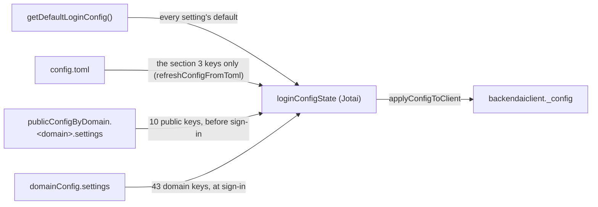
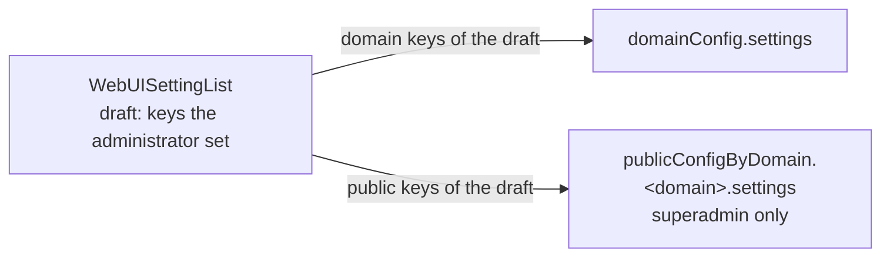

# 0028 — WebUI settings in the app config settings key

## Summary

> Unfamiliar terms are collected in the [Glossary](#glossary) at the end.

- Administrators change the 53 WebUI settings that lived only in `config.toml` on the System Settings page (`/admin/system-settings`). The values are stored in the manager's [app config](#glossary) documents.
- Each [scope](#glossary) document carries one flat key, `settings`. The 10 keys needed before sign-in live in `publicConfigByDomain.<domain>.settings`; the 43 used after sign-in live in `domainConfig.settings`.
- The two documents hold different keys. Only a key the document carries, with the right type, overrides the setting's code default (`getDefaultLoginConfig`); with no document, or a document that cannot be read, the code default is used.
- `config.toml` no longer carries these settings (#10664). It keeps only the values needed before the documents can be read and the values the webserver enforces as well (section 3).
- The scope and type of each key are set by the [definition table](#glossary) `WEBUI_SETTING_DEFINITIONS` in `react/src/helper/webuiSettings.ts`. The page, the merge and the save all read that table.

## Context

- **What existed**: WebUI settings such as hidden menus, session resource caps and login page options lived only in `config.toml`. Changing one meant editing the deployment file and redeploying, and every domain a webserver served used the same values.
- **What app config is**: the manager's store of per-scope JSON documents. The webui already keeps the theme (`publicConfigByDomain.<domain>.appearance`) and the announcement (`domainConfig.announcement`) there. The PUBLIC document is read anonymously before sign-in over REST (`POST /func/v2/app-config/public/get`).
- **Why a decision is needed**: the settings move from a deployment file to manager documents, and the person who changes them moves from whoever deploys to an administrator. Without a fixed document shape, key names, relation to the file and list of file-only keys, every feature would add its own sub-key.

## Diagram

### Order in which a value is decided

### Saving

## Decision

### 1. One flat `settings` key per scope

| Scope  | Document path                            | Read         | Keys                                                                                                                                                                                                                        |
| ------ | ---------------------------------------- | ------------ | --------------------------------------------------------------------------------------------------------------------------------------------------------------------------------------------------------------------------- |
| PUBLIC | `publicConfigByDomain.<domain>.settings` | before login | `autoLogout`, `allowChangeSigninMode`, `allowAnonymousChangePassword`, `allowSignupWithoutConfirmation`, `enableInteractiveLoginAccountSwitch`, `singleSignOnVendors`, `ssoRealmName`, `debug`, `pluginLogin`, `pluginPage` |
| DOMAIN | `domainConfig.settings`                  | at sign-in   | the other 43 keys of the definition table                                                                                                                                                                                   |

- **Document shape**: the value of `settings` is a `WebUISettingsDocument` (`Record<string, unknown>`), with no section or group level inside it. The page groups come only from the definition table's `group` field.
- **Key names**: a key keeps the name it had in `config.toml`. The exceptions are `menuBlocklist`/`menuInactivelist` (the file's `menu.blocklist`/`inactivelist`), `fasttrackEndpoint` (the file's `pipeline.frontendEndpoint`) and `pluginLogin`/`pluginPage` (the file's `plugin.login`/`page`). A comma-joined string in the file is an array of strings.
- **Public scope criterion**: only the keys the login page uses, and keys applied once before sign-in (`debug`, and `pluginPage`, loaded once at boot), are PUBLIC.
- **Domain lookup**: the `<domain>` of the PUBLIC document is `general.apiDomainName` in `config.toml` (`resolvePublicConfigTarget`).
- **Write scope**: a save changes the `settings` sub-key only, never the whole document. The write hooks (`useUpdateDomainAppConfig`, `useUpdatePublicDomainAppConfig`) re-read the manager's raw document and change `settings` alone ([read-modify-write](#glossary)).

### 2. Merge rules

- **Defaults first, then each document**: the state starts from the code defaults with the section 3 file keys applied (`refreshConfigFromToml`), and `applyWebUISettings(state, doc, scope)` overrides only that scope's keys. A settings key left in `config.toml` is ignored. Keys of another scope, keys missing from the definition table, and values that fail `isValidWebUISettingValue` are ignored, so the PUBLIC and DOMAIN documents never overlap.
- **Option-limited lists**: a `stringList` definition with `options` drops values outside the list, both when merging and when saving (`restrictToOptions`).
- **No seeding**: a save writes the keys the administrator set, a value equal to the code default included (`buildWebUISettingsDocument`). Clearing a field or resetting its row removes the key, which then keeps following the default. When no key is left, the `settings` sub-key is removed.
- **Read failures**: a document that cannot be read leaves a warning and the code defaults. The DOMAIN document rides in the sign-in query (`loginSessionAuthMyUserQuery`, `myAppConfigs … @catch(to: NULL)`, read by `readDomainWebUISettings`); the PUBLIC one comes from `fetchPublicDomainConfigOnce`.
- **Merge points**: the PUBLIC document is merged at boot (`initializeConfigOnce`) and when another webserver's config is taken in (`loadConfigFromWebServer`), which looks the document up under that webserver's `apiEndpoint` and merges that server's file keys onto the bundled `config.toml`. The DOMAIN document is merged at sign-in (`connectViaGQL`).
- **One store**: the merged values live only in `loginConfigState`. A value read outside React, such as `debug`, is read with `jotaiStore.get(loginConfigState)`; there is no `globalThis` copy. `refreshConfigFromToml`, which parses the file, has no side effects.

### 3. Keys that stay in `config.toml` only

| Key                                                                                                            | Why                                                                                                                                               |
| -------------------------------------------------------------------------------------------------------------- | ------------------------------------------------------------------------------------------------------------------------------------------------- |
| `general.apiEndpoint`, `general.apiDomainName`                                                                 | They are the address and domain the documents are looked up with.                                                                                 |
| `general.connectionMode`                                                                                       | A webserver deployment is fixed to SESSION, and Electron has no domain to look the PUBLIC document up with.                                       |
| `general.signupSupport`                                                                                        | The webserver's `service.enable-signup` blocks sign-up requests on its own; changing the webui alone shows the button and the request is refused. |
| `wsproxy.proxyURL`, `wsproxy.disableCertCheck`, `server.webServerURL`, `license.edition`, `license.validUntil` | Values for the Electron local proxy and window, the boot, and the About modal.                                                                    |

- **Removed keys**: the 10 file keys no code read (`apiEndpointText`, `allowProjectResourceMonitor`, `alwaysEnqueueComputeSession`, `force2FA`, `directoryBasedUsage`, `enableImportFromHuggingFace`, `environments.allowlist`, `wsproxy.proxyBaseURL`, `wsproxy.proxyListenIP`, `pipeline.endpoint`) and `loginAttemptLimit`/`loginBlockTime`, with the browser-side login limiter they fed, are gone (#10664). The webserver's own limiter (`session.login-allowed-fail-count`, `session.login-block-time`) is the only one.

### 4. Definition table

- **Entry shape**: an entry (`WebUISettingDefinition`) has `key`, `scope`, `type` (`boolean`, `number`, `string`, `stringList`), `group`, `field` (`keyof LoginConfigState`), and the optional `options`, `unit` and `min` / `max` (the inclusive range of a `number`; a value outside it is ignored when read and not saved).
- **Single source**: the page (`WebUISettingList`), the merge (`applyWebUISettings`) and the save (`buildWebUISettingsDocument`) read only this table.
- **Keys outside the table**: `settings` also holds keys the table does not define; today that is the system announcement alone (`settings.announcement`, #10713). The page does not count such a key when deciding whether anything changed (`ownedWebUISettings`). Apply and Reset carry it over unchanged from the raw document at save time (`withForeignWebUISettings`), and the write hooks take a `(current) => next` function applied to that raw value.
- **Adding a setting**: a new setting adds a `LoginConfigState` field with its default in `getDefaultLoginConfig`, its `_config` copy in `applyConfigToClient`, one table entry, and its copy in `WebUISettingLabels.ts`, together. It is not read from `config.toml`.

### 5. Who may edit, and safeguards

- **Who sees what**: the page and its menu item are superadmin-only (`access: 'superadmin'`). A superadmin sees and saves both scopes. A domain admin page is outside this decision.
- **Who may write**: whether a save succeeds is the manager's RBAC call; only a superadmin may write the PUBLIC document. A refused save lists the settings that were not saved.
- **Reset**: the toolbar's Reset removes the table's keys from `settings` in the scopes on screen. It cannot be undone, so it runs only after the button's name (`button.Reset`) is typed into a `BAIDeleteConfirmModal`.
- **Self-hiding**: `system-settings` in `menuBlocklist`/`menuInactivelist` is ignored (`useWebUIMenuItems`); hiding this page would leave no screen to undo it from.

## Rejected alternatives

- **One sub-key per feature** (`session`, `appLauncher` and six more): the document would mirror the page groups. Rejected: regrouping the page would mean migrating saved documents, and finding one key would require knowing its group.
- **The `config.toml` section layout as is**: file and document would map mechanically. Rejected: sections organise hand edits of the file, and one section can span both scopes.
- **A new single document such as `siteConfig`**: one document with no scope split. Rejected: values needed before sign-in must sit in the anonymously readable PUBLIC document, per-domain values in the DOMAIN document.
- **No `config.toml` at all**: settings in one place. Rejected: the keys in section 3 are needed before the documents can be read, or the webserver enforces the same value.
- **The file as the default for every setting**: an untouched deployment would keep its `config.toml` values with no migration. Rejected: the same key would live in the deployment file and in System Settings, leaving two places to look, and the file is being retired as a settings source.
- **Seed the documents from the file at first sign-in**: the page would show every value from the documents from the start. Rejected: it would carry the file forward as a second source.

## Consequences

- **Per-domain values**: administrators change settings per domain without a redeploy, and domains served by the same webserver can differ.
- **Public means readable**: PUBLIC keys are read anonymously, so no secret goes there.
- **Reload to apply**: a value takes effect on the next page load; Apply and Reset reload the page after saving.
- **File values move by hand**: a deployment that set a setting in `config.toml` (or in `webserver.conf`, which the webserver renders into it) moves the value into System Settings; the file's key is ignored from #10664 on.
- **Checked table**: a definition's `field` is typed `keyof LoginConfigState`, but its default casts the `key`, so `tsc` does not catch a typo. `webuiSettings.test.ts` checks that every `field` exists on the state.

## Sources

- #10436 — the issue that moves `config.toml` into app config. The layout was decided in issue comments 6278871655 (2026-10-20) and 6280664195 (2026-10-28).
- #10438 — the implementation PR.
- #10664 — removes the unread keys, the login limiter keys and the settings keys from `config.toml`, and makes the code defaults the base. BA-8735 — removes the same keys from the webserver template.

## Glossary

| Term              | Meaning                                                                                                                                                               |
| ----------------- | --------------------------------------------------------------------------------------------------------------------------------------------------------------------- |
| app config        | JSON configuration documents the manager stores per scope (PUBLIC, DOMAIN, USER). Read over GraphQL after sign-in; the PUBLIC document also over REST before sign-in. |
| scope             | The range a document belongs to. The PUBLIC document is read anonymously before sign-in; the DOMAIN document is read after a user of that domain signs in.            |
| definition table  | `WEBUI_SETTING_DEFINITIONS`: an array that gives each setting key its scope, type, page group and `LoginConfigState` field.                                           |
| read-modify-write | Re-reading the raw document, changing one part, and saving the whole document, so the document's other sub-keys are kept.                                             |
