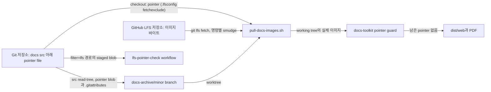

# 0029 — User manual images in Git LFS

> Decision 1절과 Summary는 [ADR 0031](0031-visual-regression-tests-for-backend-ai-ui-stories.ko.md)이 넓힌다. backend.ai-ui visual test baseline(`packages/backend.ai-ui/test/visual/__screenshots__/**/*.png`)도 LFS로 추적하며, `.lfsconfig`는 매뉴얼 이미지 옆에서 이 파일들도 기본적으로 pointer file로 둔다. 나머지 결정은 그대로 발효 중이다.

## Summary

> 낯선 용어는 문서 맨 아래 [용어](#용어)에 모아 두었다.

- 사용자 매뉴얼의 이미지(`packages/backend.ai-webui-docs/src/` 아래 모든 깊이의 `png`, `jpg`, `jpeg`, `gif`, `webp`)는 Git LFS에 저장한다. `packages/backend.ai-webui-docs/assets/`와 그 밖의 파일은 일반 Git 파일로 남는다.
- clone은 git-lfs가 설치되어 있어도 기본적으로 이 이미지들을 pointer file로 받는다. 루트 `.lfsconfig`가 `lfs.fetchexclude = packages/backend.ai-webui-docs/src/**`를 설정한다.
- 이미지 바이트가 필요한 소비처는 모두 먼저 자기 checkout에서 `.github/scripts/lfs/pull-docs-images.sh`를 실행한다. pointer file이 하나도 없으면 이 script는 아무것도 하지 않고 git-lfs도 필요로 하지 않는다.
- docs toolkit은 pointer file로 빌드하지 않는다. `build:web`, `pdf`, document mode preview, `diff:web`은 해당 경로와 pull 명령을 보여 주고 멈춘다.
- `docs-archive/<minor>` branch는 각 이미지 blob을 source ref가 저장한 그대로 둔다. source가 pointer를 저장하고 있으면 archive 루트에 그 경로들을 `filter=lfs`로 표시하는 `.gitattributes`도 둔다. 이는 ADR 0023 §2가 나열한 branch 내용을 넓힌다.

## Context

- **저장소 크기**: 매뉴얼 스크린샷은 PNG 약 1,600개로, HEAD 기준 187 MiB, `main` 히스토리 전체로는 546 MiB이며 자동 문서 업데이트로 매달 50–160 MiB씩 늘어난다. 기본 clone은 약 1.26 GiB이고, 이미지 바이트가 필요한 것은 docs 빌드뿐이다.
- **조용한 실패**: toolkit은 이미지의 존재 여부만 확인하며(`getImageDimensions`, `image-meta.ts`), `copyImagesDir`는 파일을 그대로 복사한다. 약 130바이트짜리 pointer file은 둘 다 통과하므로, LFS object 없이 checkout한 트리는 오류 없이 깨진 이미지로 가득한 사이트와 PDF를 배포한다.
- **git-lfs 없는 빌더**: AWS Amplify 빌드 이미지와 `package.yml` `build_docs`의 Playwright 컨테이너에는 git-lfs가 없다. Amplify 빌드는 `main`과 모든 archive worktree를 렌더한다(ADR 0023 §2).

## 설계도

## Decision

### 1. Git LFS에 들어가는 파일

- **규칙**: 루트 `.gitattributes`는 `<ext>`가 `png`, `jpg`, `jpeg`, `gif`, `webp`인 `packages/backend.ai-webui-docs/src/**/*.<ext> filter=lfs diff=lfs merge=lfs -text`를 가진다. `packages/backend.ai-webui-docs/src/` 밖의 파일은 LFS로 추적하지 않는다.
- **Landing**: 이 규칙은 기존 이미지를 변환하는 커밋과 함께 들어간다(#11040). 그 전에는 LFS로 추적하는 파일이 없으므로, 검사와 pull script와 아래 guard는 할 일이 없다.
- **기본 checkout**: `.lfsconfig`가 `lfs.fetchexclude = packages/backend.ai-webui-docs/src/**`를 설정하므로 `git clone`, `git checkout`, 일반 `git lfs pull`은 그곳에 pointer file을 남긴다.
- **커밋 검사**: workflow `.github/workflows/lfs-pointer-check.yml`이 pull request마다 `.github/scripts/lfs/check-lfs-pointers.sh`를 실행하고, `main`에 push될 때도 실행해(#11065) `main`에 들어온 원본 파일을 그 push에서 바로 보고한다. `filter` attribute가 `lfs`인 tracked file은 모두 올바른 pointer로 stage되어 있어야 하고, `filter=lfs` 경로의 원본 파일은 검사를 실패시킨다.

### 2. 소비처는 하나의 script로 이미지를 받는다

- **Script**: `.github/scripts/lfs/pull-docs-images.sh [--ref <rev>] [--remote <name|url>]... [--fallback-remote <url>]... [<worktree>...]`는 두 layout, 즉 `packages/backend.ai-webui-docs/src/`와 archive worktree의 `src/`를 모두 다룬다.
- **No-op**: 그 루트 아래에서 내용이 pointer text인 tracked working-tree file을 찾는다. 없으면 0으로 끝나고 git-lfs가 필요 없다.
- **그 밖의 경우**: git-lfs가 없으면 `.github/scripts/lfs/install-git-lfs.sh`로 설치하고(Linux x86_64용 release 3.8.1, 그 script에 sha256과 함께 고정), staged pointer가 가리키는 object 중 로컬 LFS 저장소에 이미 있는 것을 sha256으로 검사해 손상된 것은 지우고, 모두 로컬에 있지 않으면 `.lfsconfig`의 제외를 덮어써서 `--ref`(기본 `HEAD`)의 object를 fetch한 뒤, LFS filter로 index에서 pointer file을 복원한다. filter와 그 경로를 나열한 임시 attributes 파일은 명령마다 넘기므로, `.gitattributes`가 그 경로를 표시하든 아니든 복원되고 어떤 git config 파일도 쓰지 않는다. pointer가 남거나 쓴 파일의 sha256이 pointer의 oid와 다르면 실패하고, 필요한 object 수, 이미 로컬에 있던 수, 내려받은 수를 한 줄로 출력한다.
- **호출처**: `amplify.yml`(docs app, `main`과 각 archive worktree), `package.yml` `build_docs`, `.github/scripts/pr-preview/build-docs-preview.sh`(head에 대해 한 번, merge base의 `src`를 checkout한 뒤 `--ref`로 그 커밋의 object를 받아 다시 한 번). fork PR이면 `pr-preview.yml`이 head 저장소의 clone URL을 `--head-lfs-remote`로 넘기고, head pull은 이를 `--fallback-remote`로 쓴다. 이 URL은 base 저장소의 인증 정보 없이, `origin`에 없는 object에 대해서만 받는다. fork에만 있는 이미지도 빌드하지만, `main`의 빌드는 `origin`에서만 받으므로 job은 merge 전에 maintainer가 실행할 `git lfs push origin` 명령을 출력하고 실패한다. 기여자는 `pnpm --filter backend.ai-webui-docs run images:pull`을 실행한다.

### 3. toolkit은 pointer file을 거부한다

- **Guard**: `packages/backend.ai-docs-toolkit/src/lfs-pointer.ts`는 `assertNoLfsPointers`, `findLfsPointerFiles`, `isLfsPointerFile`, `LfsPointerError`를 export한다. 1024바이트 이하이고 첫 줄이 `version https://git-lfs.github.com/spec/v1`인 파일이 pointer다.
- **실행 위치**: `generateWebsite`(`website-generator.ts`)는 렌더하는 모든 source 루트(workspace `src/`와 각 archive worktree의 `src/`)를, `generatePdf`(`generate-pdf.ts`)는 자기 `src/`를, `preview-server.ts`와 `preview-server-web.ts`의 document mode는 자기 `src/`를, `generateWebDiff`(`web-diff.ts`)는 두 build tree를 검사한다. 각각 출력을 쓰기 전에 `LfsPointerError`를 던지고, `cli.ts`가 그 메시지를 출력하고 1로 끝난다.
- **`--no-strict`**: 이 flag는 link 진단만 완화하며, 이 guard는 완화하지 않는다.

### 4. archive branch는 source의 blob을 그대로 둔다

- **내용**: `docs-archive-orphan-branch.yml`은 source commit의 `packages/backend.ai-webui-docs/src` tree에서 `git read-tree --prefix=src/`로 archive commit을 만든다. 따라서 모든 blob이 source의 것 그대로다. pointer는 pointer로, 원본 이미지는 원본으로 남는다.
- **Attributes**: 그 tree에 pointer blob이 있으면 archive 루트에 정확히 그 경로들을 `filter=lfs diff=lfs merge=lfs -text`로 나열한 `.gitattributes`를 둔다. 원본 이미지를 가진 source에는 `.gitattributes`가 생기지 않고, `src/` tree는 이 결정 이전과 같다. 공백이 든 pointer 경로는 `.gitattributes`로 표현할 수 없으므로 workflow를 실패시킨다.
- **범위**: ADR 0023 §2 "Branch content"가 나열한 파일에 `.gitattributes`를 더한다. ADR 0023의 나머지는 바뀌지 않는다.

## 대안과 기각 사유

- **별도 저장소나 bucket에 이미지 보관**: 스크린샷을 저장소 밖으로 옮기면 모든 clone에서 빠진다. 매뉴얼의 Markdown과 이미지는 한 PR에서 함께 바뀌고 docs-update automation이 둘 다 쓰므로 기각한다.
- **기본으로 모든 LFS object 받기**: `.lfsconfig`를 두지 않으면 git-lfs를 설치한 clone이 이미지를 모두 받는다. 대부분의 기여자는 매뉴얼을 빌드하지 않으므로 기각한다.
- **`actions/checkout`의 `lfs: true`**: GitHub-hosted job만 다룬다. Amplify와 archive worktree는 일반 `git`으로 checkout하고 Playwright 컨테이너에는 git-lfs가 없으므로 기각한다.
- **working-tree 복사본으로 archive를 다시 stage**: 이전 workflow는 checkout을 복사해 `git add`했다. runner의 git-lfs smudge·clean filter가 pointer를 바이너리로, 바이너리를 새 pointer로 바꿀 수 있으므로 기각한다.

## Consequences

- 기본 clone과 docs가 아닌 모든 CI job은 이미지 바이트를 받지 않는다. docs 빌드와 스크린샷 작업만 받는다.
- 스크린샷을 바꾸는 기여자는 git-lfs가 필요하고 `git lfs install --skip-repo`로 설정한다(hook은 Husky가 관리하므로 `.husky/pre-push`가 `git lfs pre-push`를 실행한다). git-lfs 없이 커밋한 이미지는 raw 바이트가 되며, pre-push hook이 그 push를 거부하고 pointer 검사도 실패시킨다.
- 이미지를 받지 않은 docs 빌드는 깨진 이미지를 게시하는 대신 분명히 실패한다.
- PR preview는 LFS object 저장소를 캐시한다(#11070). `docs-lfs-cache.yml`이 `main`의 캐시를 최신으로 유지하고, `pr-preview.yml`은 그 캐시(또는 PR 자신의 캐시)를 복원한 뒤 빌드에 쓴 object만 남겨(`prune-lfs-store.sh`) PR 범위 캐시로 저장한다. 키는 `.github/scripts/lfs/docs-lfs-cache-key.sh`가 만들므로, 빌드는 복원한 캐시에 없는 이미지만 내려받는다. GitHub는 캐시를 ref 단위로 격리하므로 PR의 캐시를 `main`이 읽는 일은 없다. fork PR 실행은 캐시를 저장하지 않는다. fork에만 있는 object는 merge 전에 `origin`으로 옮겨야 하는데, 캐시된 사본이 있으면 그 검사를 건너뛰기 때문이다. 쓰기 token을 가진 `package.yml` `build_docs`는 캐시를 복원하지 않는다. git-lfs는 로컬 저장소의 object를 검증하지 않으므로 `pull-docs-images.sh`가 쓰는 object마다 sha256을 확인한다. 릴리스 빌드와 Amplify 빌드는 여전히 실행마다 모든 이미지를 내려받는다.
- `main` 히스토리는 별도의 히스토리 재작성 전까지 원본 PNG를 그대로 가지므로, 전체 clone은 그 이후에야 줄어든다.

## 출처

- GitHub issue #11040, 2026-11-10 결정. 고정 버전 git-lfs 다운로드와 `git lfs pull`은 기본 AWS Amplify 빌드 이미지에서 메인 checkout과 archive worktree 모두에 대해 확인했다.
- 관련: ADR 0023 (multi-version docs site와 그 archive branch).

## 용어

| 용어                  | 뜻                                                                                                                          |
| --------------------- | --------------------------------------------------------------------------------------------------------------------------- |
| Git LFS               | Git Large File Storage. 파일 바이트를 별도 서버에 저장하고 그 자리에 작은 pointer file을 커밋하는 확장                      |
| pointer file          | Git LFS가 파일 대신 커밋하는 텍스트. `version https://git-lfs.github.com/spec/v1`, `oid sha256:` 줄, `size` 줄로 이루어진다 |
| smudge / clean filter | checkout 시 pointer를 실제 파일로, stage 시 실제 파일을 pointer로 바꾸는 Git filter                                         |
| `fetchexclude`        | 기본으로 object를 내려받지 않을 경로를 지정하는 git-lfs 설정                                                                |
